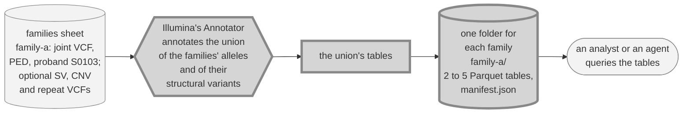
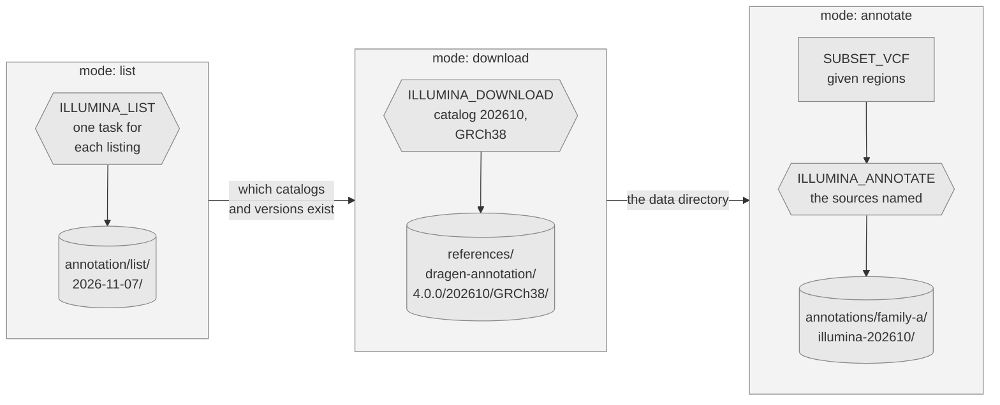
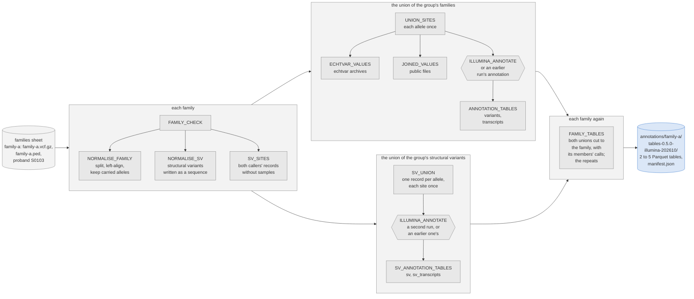

# Annotation

The pipeline annotates the variant calls of the families it is given and writes each family's annotation as tables. This
document explains it for the person who runs the pipeline: how `annotator.nf` runs Illumina's Annotator, and how
`family_tables.nf` turns its output into the family tables that an analyst or an agent queries.



The marked steps are the pipeline: it reads the families of a sheet, annotates them together and writes one folder of
tables for each. [Reading the family tables](family-tables.md) shows how a reader queries the tables in the last step,
and [The Annotator's image](annotator-image.md) says what the image that runs the Annotator has to hold. The
[glossary](glossary.md) defines each word used here.

Every id and value in the examples is invented, except Illumina's catalog ids, source names and versions, which are
Illumina's own.

## Background

> [!NOTE]
>
> Skip this section if you know what annotation adds to a VCF.

### What annotation adds to a VCF

A variant caller writes every difference between a person's reads and the reference genome into a VCF file. The file
says where each variant is and who carries it, and nothing about what the variant does. A whole genome has several
million variants, so a diagnostic laboratory rarely reads a raw VCF. Its pipeline first annotates the file: it adds to
each variant the facts that an analyst filters and ranks on.

| Annotation           | What it says about a variant                                                     | Example sources                |
| -------------------- | -------------------------------------------------------------------------------- | ------------------------------ |
| consequence          | its effect on each transcript it overlaps, such as a changed amino acid          | Ensembl, RefSeq                |
| population frequency | how common it is in large reference populations                                  | gnomAD                         |
| prediction scores    | how damaging a model expects it to be                                            | AlphaMissense, SpliceAI, REVEL |
| clinical assertions  | what laboratories have reported about it, such as a classification as pathogenic | ClinVar                        |

A transcript is one of the RNA molecules that a gene is copied into before a protein is made. A gene usually has
several, and one variant can change each of them differently, which is why a consequence is given for each transcript.

### Illumina's Annotator

`annotator.nf` runs Illumina's standalone annotator, DRAGEN Annotation 4.0 (Illumina Connected Annotations), which this
document calls the Annotator. It ships inside DRAGEN Software Mode at `/opt/dragen/share/nirvana/Annotator` and runs on
CPUs alone.

The Annotator's data and its output are Illumina's and licensed to the organisation that runs it, so neither is in this
repository, and the repository builds no image of the Annotator. The workflows take the image as a param
([The Annotator's image](annotator-image.md)), and they publish the data and the output to the storage that a run names
as `output_dir`.

## The two workflows

Annotation takes two workflows. `annotator.nf` deals with Illumina: it lists what Illumina hosts, downloads the data,
and can annotate one VCF. `family_tables.nf` produces what a reader queries: it annotates the alleles of a group of
families once, and their structural variants in a second run, and writes Parquet tables for each family.

| Workflow           | Mode       | What a run does                                                              | When                                   |
| ------------------ | ---------- | ---------------------------------------------------------------------------- | -------------------------------------- |
| `annotator.nf`     | `list`     | asks Illumina which catalogs and which versions of each source it hosts      | to choose a catalog                    |
| `annotator.nf`     | `download` | fetches one catalog's data for one assembly                                  | once for each catalog                  |
| `annotator.nf`     | `annotate` | annotates one VCF and publishes Illumina's JSON                              | for one VCF, such as a small trial run |
| `family_tables.nf` |            | annotates the alleles of a group of families and writes each family's tables | once for each group of families        |

`family_tables.nf` does not go through the `annotate` mode. It runs the same process, `ILLUMINA_ANNOTATE`, over the
alleles of its families and again over their structural variants, so an operator who wants family tables runs `list`,
`download` and then `family_tables.nf`.

The rest of the document has two halves, and each reads on its own.

- [Annotating with Illumina's Annotator](#annotating-with-illuminas-annotator) is for the operator who downloads
  Illumina's data and runs the Annotator. It covers catalogs and sources, which of the sources are dated, the three
  modes, the licence and the machines.
- [Family tables](#family-tables) is for the operator who runs `family_tables.nf`. It covers what the workflow takes,
  its steps, what it publishes and how another pipeline includes it. [Reading the family tables](family-tables.md) is
  for the reader who writes the queries, and the notes on the tables, [`tables.md`](../src/case_annotation/tables.md),
  hold what a table does not show.

## Annotating with Illumina's Annotator

### Catalogs and sources

Illumina publishes its data as catalogs. A [catalog](glossary.md#catalog) is a dated set of data source versions, with
an id such as `202610` and an alias, `LATEST`, that moves to each new one. A source is one database, such as ClinVar or
gnomAD, and a source can have several annotation types, such as one for small variants and one for structural variants.

A run config tells the Annotator what to read. It pins one version of each source by source and annotation type
(`data.versionSelector`, for example `clinvar` → `SmallVariant` → `20260928`), and the Annotator reads only the sources
its run config names. Sources fall into categories (basic, premium, germline-tagging, methylation and tmb), and
Illumina's `setup` writes one run config per category.

The data that one download fetches is called the bundle here. It is a data directory that holds the sources of one
catalog together with one run config, `runConfigs/bundle.json`, which lists exactly those sources.

### Dated sources

An annotation's sources fall into two groups. A [dated source](glossary.md#dated-source) carries clinical assertions or
literature: it asserts a link between a variant or a gene and a disease, or records that a variant was reported. What it
says depends on the date of its version, so an analysis that has to leave out what was reported after some date needs to
know which version of each such source its tables hold. Every other source is a current source.

The table places the sources that Illumina hosts for GRCh38, with the reason that a family's manifest records where a
run leaves a source of its bundle out.

| Group                                       | Sources                                                                                                                        | Reason recorded where a run leaves it out                                                        |
| ------------------------------------------- | ------------------------------------------------------------------------------------------------------------------------------ | ------------------------------------------------------------------------------------------------ |
| dated                                       | `clinvar`, `clinvar-preview`, `omim`, `clingen`, `clingen (legacy)`, `mitomap`, `dbSNP`                                        | `dated`                                                                                          |
| current: gene models                        | `Ensembl`, `RefSeq`, `HGNC`, `GenomeAssembly`                                                                                  | `current`                                                                                        |
| current: population frequencies             | `gnomad`, `gnomad-exome`, `TOPMed`, `oneKg`, `ABRaOM`, `GME`, `globalAllele`, `DECIPHER`'s common copy-number variants         | `current`                                                                                        |
| current: prediction and conservation scores | `alphaMissense`, `spliceAI`, `primateAI-3D`, `PrimateAI`, `PromoterAI`, `REVEL`, `DANN`, `Gerp`, `phylopScore`, `MultiZ100Way` | `current`                                                                                        |
| not for germline small variants             | `FusionCatcher` (known gene fusions), `UcscCpgIsland` (methylation regions)                                                    | `not_applicable`                                                                                 |
| somatic                                     | `cosmic`                                                                                                                       | none where the download left it out with `exclude_sources`; `unplaced` in a bundle that holds it |
| not yet placed                              | a source Illumina adds later                                                                                                   | `unplaced`, which counts as dated until someone has placed it                                    |

The placement of `dbSNP` and of REVEL needs a reason. `dbSNP` is dated because a newly minted rsID says that someone
reported the variant. REVEL is current although it was trained on disease variants: they come from HGMD's 2015.2
release, so the score holds nothing that was reported since.

Two predictors among the [joined files](#joined-files) are current in the same way, each with a later date. gnomAD's MPC
score, v4.1.1, comes from an XGBoost model. Its authors fitted the model with ClinVar's pathogenic and benign
classifications of the release of 4 May 2025, and chose the genes of the pathogenic ones in part by a panel of genes of
developmental disorders of 27 November 2025. The score has therefore seen disease assertions up to those dates.
MitoTIP's scores have MITOMAP's annotations of pathogenicity among their sources, as they stood when its file was
written, so they have seen disease assertions up to 27 April 2020.

A run names the sources it annotates with in `sources`, and it includes a dated source only by naming it. It names
sources, not annotation types, so a source is included or left out whole. The workflow uses the groups in three ways.

- A family's tables leave out the columns of a dated source that the run did not name, so that a missing source reads as
  missing rather than as an empty result: `rsids` for `dbSNP`, and the `clinvar_` columns of `variants` and of `sv` for
  `clinvar`. The manifest lists them as `omitted_columns` and `sv_omitted_columns`. The same holds for the columns of an
  echtvar archive that a run can leave out ([AlphaGenome's scores](#alphagenomes-scores)), which is no dated source:
  `omitted_columns` lists them after those of the dated sources, and then the columns of a public file that a run can
  leave out ([Joined files](#joined-files)). `transcripts_omitted_columns` lists the columns of `transcripts` that such
  a file gives.
- The conversion refuses an annotation that holds a dated source's data which the run did not name ([Steps](#steps)).
- A family's manifest records each source the run named with the version it pinned (`annotation.source_versions`), and
  each source of the bundle that the run left out with its reason (`annotation.omitted`).

The refusal is there because leaving a source out of `sources` keeps it out of the tables only if the Annotator then
skips it, and Illumina does not document that a source missing from the run config is skipped rather than taken at
another version. `family_tables.nf` therefore checks in every run that the JSON of the alleles holds no ClinVar or dbSNP
record, that the JSON of the structural variants holds no ClinVar, ClinGen, MITOMAP or dbSNP record, and that neither
has a header entry of a dated source, where the run did not name the source.

A consumer that needs a family's tables as of a date compares the pinned versions with that date. The catalog's id does
not serve for that: a catalog's sources are dated independently of the catalog and of each other.

### Modes

`annotator.nf` takes a `mode`, and a run does one thing. The figure shows the three modes with the folder each
publishes, for catalog `202610` and the family `family-a`. A hexagon is a task that runs the Annotator.



`list` asks Illumina which catalogs it hosts and which versions of each data source it hosts for an assembly, all
catalogs together and then each catalog named in `catalogs` on its own. Each listing is a task of its own on a small VM,
writing a text file under `annotation/list/<date>/`.

`download` fetches one catalog's data for one assembly:

1. `setup` writes the categories' run configs.
1. The sources of the categories named in `categories`, less those in `exclude_sources`, go into one run config,
   `runConfigs/bundle.json`, which pins the catalog's version of each.
1. `download` fetches the data of that run config, and `version-validate` checks it.
1. The data directory is published under `references/dragen-annotation/<annotator version>/<catalog>/<assembly>/`, with
   setup's own run configs moved to `runConfigs.setup/` and without `license/`, where setup saves the credentials.

A catalog is given by id, never as `LATEST`, so that the folder names the versions it holds.

> [!WARNING]
>
> A second download of a catalog, for instance with other categories, removes the data directory that the first one
> published and writes its own, so the folder holds the sources that its `runConfigs/bundle.json` lists and no others.
> An annotation that reads the folder meanwhile finds it incomplete.

`annotate` annotates one VCF with a downloaded bundle.

- `sources` names the sources it annotates with. The run config is the bundle's, cut down to them, and a source the
  bundle lacks fails the run.
- The Annotator writes its JSON (and, where it writes one, a `.jsi` index beside it), reporting each sample's de novo
  quality (`--annotationOptions.enableDq`).
- An invalid licence for any source fails the run (`--license.throwInvalidLicenseError`) rather than leaving the source
  out.
- `regions`, a BED file, cuts the VCF down first for a small run.
- The outputs land in `annotations/<name>/illumina-<catalog>/`, or `illumina-<catalog>-<label>/` given a `label`, with
  the run config used and the Annotator's log.

The reference lists the params of each mode ([Params of `annotator.nf`](#params-of-annotatornf)).

### The licence

The Annotator needs Illumina's licence key in every mode. Each task fetches the key when it starts: `gcp-secret` in the
image reads the Secret Manager version that `license_secret` names into `/tmp` on the VM, readable by its owner only
([The Annotator's image](annotator-image.md#the-licence-key)). The Annotator takes it as an API key file
(`--license.apiKeyFile`), which a DRAGEN API key works with.

The key must not leave the VM, and the tasks guard it in these ways:

- The Annotator runs in a scratch folder under `/tmp` with `HOME` pointing there, so nothing it caches reaches the work
  directory, and the task deletes the key and the folder when it ends.
- Its output passes through a filter that replaces each line of the key file with `[redacted]` before it is written or
  shown.
- A download writes its data in the scratch folder and copies it out without `license/`, and fails if any other file in
  it is named like a credentials file or any file under 10 MB holds a line of the key.
- An annotation's output gets the same check for the key.

The Annotator also takes a credentials JSON (`--license.credentialsFile`) or a LIC credentials file
(`--license.licCredentialsFile`). The workflow passes neither: the filter and the check look for whole lines of the key
file, and would miss a secret value inside a line of JSON. Supporting one means taking the filter's needles from its
secret values, with a test.

> [!WARNING]
>
> The Annotator has no metering preview, so whether a run consumes licence shows only in Illumina's usage export
> afterwards.

### Machines

| Task          | Machine                                                                | Note                                                                                                                                                  |
| ------------- | ---------------------------------------------------------------------- | ----------------------------------------------------------------------------------------------------------------------------------------------------- |
| a listing     | the default small VM                                                   | one task for each listing                                                                                                                             |
| a download    | 8 vCPUs and a 500 GB boot disk                                         | a download is bound by Illumina's servers rather than the CPUs; the disk holds the data and stages each file as it is written to the work directory   |
| an annotation | a 16-vCPU highmem VM with 128 GB and local SSDs, 8 workers (`workers`) | an annotation copies the bundle to the local SSDs first, rather than reading it through the bucket's mount (about 6 minutes for October 2026's 71 GB) |

Below 500,000 positions the Annotator uses one worker whatever `workers` says. The structural variants of a group are
usually fewer: one whole-genome trio has about 65,000, which one worker annotates in under two minutes once the bundle
is copied, at a peak of about 8 GB of memory.

## Family tables

Illumina's JSON of one whole-genome trio is about 6 GB compressed and 49 GB inflated. Reading it once takes minutes on
one core, too slow for a reader such as an AI agent, whose commands are bounded in time. `family_tables.nf` turns the
annotation into tables for each family in Parquet, a columnar file format, which the database engine DuckDB or any
Parquet reader queries by region, gene or variant in well under a second.

The [family tables](glossary.md#family-tables) of one family are a folder of three files, and of up to three more for a
family that also brings the calls of its [larger variants](glossary.md#larger-variants).

| File                     | Holds                                                                                                                                                                                                                      |
| ------------------------ | -------------------------------------------------------------------------------------------------------------------------------------------------------------------------------------------------------------------------- |
| `variants.parquet`       | one row per allele: its consequence, frequencies, scores and ClinVar records, and one column per sequenced member that holds the member's call of the allele                                                               |
| `transcripts.parquet`    | one row per allele and transcript it overlaps                                                                                                                                                                              |
| `sv.parquet`             | optional: the structural variants and the copy-number variants, one row per record of the two callers, told apart by `caller`, with its annotation, and one column per sequenced member that holds the member's call of it |
| `sv_transcripts.parquet` | optional: one row per structural variant or copy number segment and transcript that the Annotator lists for it                                                                                                             |
| `repeats.parquet`        | optional: one row per tandem repeat that a repeat genotyper sized, and one column per sequenced member that holds the sizes of the member's alleles                                                                        |
| `tables.md`              | the notes on the tables: what a table does not show and a query gets wrong without an error                                                                                                                                |
| `manifest.json`          | the tables the folder holds with their sizes and checksums, the pedigree with each member's role, and what annotated the tables                                                                                            |

The optional tables come from the family's own VCFs of those variants. The Annotator annotates the structural variants
and copy number segments in a run of their own, and nothing annotates the repeats
([Structural variants, copy number and repeats](#structural-variants-copy-number-and-repeats)).

A copy-number row of `sv` is a segment whose copy number differs from the expected one in some member, and the segments
at the expected copy number are left out. A member carries it by copy number, a gain with no zygosity, and one event can
have a row from each caller ([Who carries a record](family-tables.md#who-carries-a-record)).

This half explains how the workflow makes them. [Reading the family tables](family-tables.md) follows one VCF record
into its rows, shows the queries and defines the manifest. [The contract](../contract/tables.json) has every column with
its type.

The same workflow serves a laboratory's real families and synthetic ones: it reads a VCF and a PED file per family,
takes each family's proband from the sheet of families that the run is given, and knows nothing about where they came
from.

### The input contract

A run takes its families as a sheet, and each family brings two files: a VCF with genotypes, and a PED file, which is
the usual text format for a pedigree.

The sheet is a CSV with the columns `family`, `vcf`, `ped` and `proband`. For the family `family-a`, whose proband has
the sample name `S0103`, it reads:

```csv
family,vcf,ped,proband
family-a,families/family-a/family-a.vcf.gz,families/family-a/family-a.ped,S0103
```

`proband` holds the sample id of the family's proband, as the VCF names it, and stays empty for a family in which no
proband is designated. The column is required and a value in it is optional. The tables' proband is the one the run's
sheet names. Nothing derives a proband from the pedigree, so a sheet without the column stops the run, and so does a row
that ends before it.

A family without a proband gets the same two tables, with a column for every sequenced member. Only its manifest
differs: no member has a role, and each member's `affected` still says who is affected, which is what a search over
every affected member reads
([Rare variants in every affected member](family-tables.md#rare-variants-in-every-affected-member)).

The VCF has to meet these conditions:

- It is called against GRCh38 with contigs named `chr1`, `chr2`, ..., `chrX`, `chrY` and `chrM`.
- Each sequenced member has a column named as its individual in the PED file.
- GT is required. AD, DP, GQ, PL, PS and FT are read where the header defines them, and so are DRAGEN's DN, DQ and MSC.
- Multi-allelic records are allowed and are split here.
- Homozygous reference calls stay in, so that a parent's call of an allele can be read beside the child's.
- QUAL and FILTER are kept and reach the family's variants table. INFO is not read.

The PED file has six columns (family, individual, father, mother, sex, phenotype), and its family column is the family's
id. Its individuals include every sample of the VCF; an individual the VCF lacks is a relative who was not sequenced.

A named proband must be an individual of the family's PED file and a sample of its VCF, because the proband's role names
a column of `variants`; a family whose proband was not sequenced leaves the field empty. The proband's phenotype is not
checked. The sheet says who the proband is and the PED file says who is affected, so a proband whom the PED file has as
unaffected, or with an unknown phenotype, is accepted, and the manifest shows both.

The sheet can have three more columns, which name the VCFs of a family's larger variants. Each is optional: a sheet may
lack the column, and a row may leave it empty. A family gets the tables of what its row names.

| Column        | Names                                                                                   | The family gets           |
| ------------- | --------------------------------------------------------------------------------------- | ------------------------- |
| `sv_vcf`      | the family's VCF from a structural-variant caller, jointly called                       | `sv` and `sv_transcripts` |
| `cnv_vcf`     | the family's VCF from a copy-number caller, jointly called                              | `sv` and `sv_transcripts` |
| `repeat_vcfs` | the members' repeat VCFs, one single-sample VCF of each sequenced member, joined by `;` | `repeats`                 |

A family with either of the first two has an `sv` table, which holds the records of the callers it brings, and an
`sv_transcripts` table of the transcripts that the Annotator lists for those records.

With all three, the row of `family-a` reads:

```csv
family,vcf,ped,proband,sv_vcf,cnv_vcf,repeat_vcfs
family-a,families/family-a/family-a.vcf.gz,families/family-a/family-a.ped,S0103,families/family-a/family-a.sv.vcf.gz,families/family-a/family-a.cnv.vcf.gz,families/family-a/S0101.repeats.vcf.gz;families/family-a/S0102.repeats.vcf.gz;families/family-a/S0103.repeats.vcf.gz
```

These VCFs have to meet conditions of their own:

- Each is bgzipped and has its `.tbi` index beside it.
- The structural-variant VCF and the copy-number VCF hold exactly the samples of the family's VCF, because every
  sequenced member has a column in `sv`.
- Every record of those two VCFs that is not a breakend has INFO `END`, as DRAGEN writes it, also a deletion or an
  insertion written as a sequence. The Annotator takes how far a record reaches from it, so a record without one stops
  the run ([Annotating the structural variants](#annotating-the-structural-variants)).
- The repeat VCFs stand in one field in any order. The workflow reads the member from the one sample in each file's
  header, so the sheet does not pair files with members and a row stays one line. A family brings a repeat VCF of every
  sequenced member or of none.
- The layouts read are DRAGEN's: its structural-variant caller's, its copy-number caller's, and its repeat genotyper's,
  which runs ExpansionHunter. A VCF from another caller is read where it has the same fields, and the run stops where
  its records break a check, such as a copy-number caller that writes its genotypes by another convention.

> [!WARNING]
>
> A sheet with a column other than these seven stops the run. A misspelt optional column would otherwise be read as
> absent, and its families would get no table of it while the run ended well.

Where the inputs come from depends on who runs the pipeline. For a laboratory's real families:

| Input                   | Where it comes from                                        |
| ----------------------- | ---------------------------------------------------------- |
| VCF                     | one VCF per family, exported from the cohort's store       |
| PED                     | the family's pedigree, with the family's id                |
| proband                 | from wherever the laboratory records its probands          |
| VCFs of larger variants | the family's own, where its callers write DRAGEN's layouts |

A laboratory with a cohort of real families exports each family's VCF with the family's samples and their homozygous
reference calls, without the rows where every member is homozygous reference, and without the cohort-level INFO fields
(AC, AN, AF, ExcessHet, InbreedingCoeff, the AS\_ VQSR fields, MLEAC and so on), which describe other families. That
export belongs to the laboratory, not to this repository. A synthetic family brings the same files from whatever built
it.

### Steps

One Annotator run serves all the families of a run. The workflow collects their alleles into a
[union](glossary.md#union-and-group), annotates the union once, and cuts each family's tables out of the result. A
variant id, `<chrom>-<pos>-<ref>-<alt>`, names one allele in every step, which is what lets the pieces be joined again.
The structural variants and copy number segments of the families go the same way through a union of their own and a
second Annotator run, which the figure shows below the first.



1. `FAMILY_CHECK` checks each family's PED file against its id and its VCF's samples, that each sample can name a column
   of the variants table, and that the proband the sheet names, if any, is an individual of the PED file and a sample of
   the VCF, so that a mistake fails before anything is annotated. Where the sheet names VCFs of the family's larger
   variants, it checks from their headers that their samples are the family's.
1. `NORMALISE_FAMILY` rewrites each family's VCF as one record per allele, and keeps only the alleles that some member
   carries. It also writes the family's sites, which are the same records without the samples, ID, QUAL, FILTER and
   INFO. The family's calls and its sites both come from these records, so their variant ids match.
1. `NORMALISE_SV` runs for a family with a structural-variant VCF. It normalises the structural variants that the caller
   wrote as a sequence in the same way, each under its record's ID, so that `FAMILY_TABLES` can tell which of them is an
   allele of the family's `variants`.
1. `SV_SITES` runs for a family with a structural-variant or a copy-number VCF. It writes the records of each as sites:
   without samples, QUAL and FILTER, under the caller's IDs, and with INFO cut down to six fields.
1. `UNION_SITES` takes the union of the families' sites, each allele once.
1. `SV_UNION` takes the union of the families' sites of structural variants: one record per allele, each site once under
   an id of its content, and a map from each family's records to the sites.
1. `ECHTVAR_VALUES` reads the values of the union's alleles that come from echtvar archives. gnomAD's joint values,
   which are its counts and frequencies over exomes and genomes together, come from the archive that `gnomad_joint`
   names ([gnomAD's joint values](#gnomads-joint-values)). AlphaGenome's scores come from up to three archives that a
   run can leave out ([AlphaGenome's scores](#alphagenomes-scores)). It runs in every run, also in one that reuses an
   annotation.
1. `JOINED_VALUES` reads the values of the union's alleles that come from public files, each of which a run can leave
   out: gnomAD's frequencies of the alleles on chrM, MitoTIP's scores, GENCODE's polyadenylation signals, APARENT2's
   effects on polyadenylation, and gnomAD's genomic constraint, regions of missense constraint and MPC scores
   ([Joined files](#joined-files)). It runs in every run too, and writes a table of the alleles alone in a run without a
   file.
1. `ILLUMINA_ANNOTATE`, the process of the `annotate` mode above, annotates the union with the sources named. A run
   given `annotated`, the folder an earlier run published the union's annotation in, reuses that annotation instead.
1. `ANNOTATION_TABLES` reads the Annotator's JSON line by line and writes the union's `variants` and `transcripts`
   tables, with each gene's HGNC id.
1. `ILLUMINA_ANNOTATE` runs a second time, over the union of the structural variants, with the same catalog and sources.
   A run given `annotated` reuses that folder's annotation of this union too.
1. `SV_ANNOTATION_TABLES` reads the second JSON and writes that union's `sv` and `sv_transcripts` tables, with each
   gene's HGNC id as well.
1. `FAMILY_TABLES` reads each family's calls, cuts the union's tables, archive values and joined values down to the
   family's alleles, and writes the family's folder, in which each member's calls are a column of `variants`. A joined
   value of an allele and a transcript goes on that transcript's row of `transcripts`. For a family that brings them, it
   also reads the VCFs of the larger variants into `sv` and `repeats`, gives each record of `sv` the annotation of its
   site, and writes `sv_transcripts`.

The four steps of the structural variants run only in a group with a family that names `sv_vcf` or `cnv_vcf`. The
repeats take no part in either union: nothing annotates them, so they go from the members' VCFs straight into the
family's folder.

Some of the steps have details that matter when a run fails or an input is unusual.

`NORMALISE_FAMILY` runs `bcftools norm -m -any -f <reference> --check-ref e` between two filters:

- It keeps the primary chromosomes, splits multi-allelic records and left-aligns indels against the reference.
- An allele counts as carried when a genotype holds a copy of it, also beside a missing allele, as in `./1`.
- Spanning deletions (`*`) and symbolic alleles are left out.
- It fails on an allele that two records hold after normalising, since each record would give its members a call and
  keeping one would drop the other's.

> [!WARNING]
>
> `--check-ref e` stops the run at a record whose REF is not the reference's sequence. bcftools reads an IUPAC ambiguity
> code in the reference as `N`, so the run stops at a REF of `N` where the reference has a base, and at a base as REF
> where the reference has `N` or such a code; a REF of `N` passes where the reference has either.

`ECHTVAR_VALUES` runs `echtvar anno` once, with every archive of the run, and echtvar matches each allele by position,
REF and ALT. That is why it gets the split and left-aligned union. `case-annotation echtvar-values` then writes the
values as a table keyed by variant id, and fails unless the table's alleles are exactly the union's. It also fails where
two archives add a field of the same name: echtvar does not check that, and would keep the later archive's values.

`JOINED_VALUES` normalises gnomAD's VCF with bcftools, and `case-annotation joined-values` then joins every file of the
run to the union's alleles and writes the values as a table keyed by variant id, in the union's order. The values that a
file gives for an allele and one transcript go into a second table, keyed by variant id and transcript id. The step
fails unless the first table's alleles are exactly the union's, and for a file that is not what its source publishes
([Joined files](#joined-files)).

`ILLUMINA_ANNOTATE` and a reused annotation give the same thing: the group's annotation is the JSON named after the
group, and a run without one stops with the group's name.

`ANNOTATION_TABLES` is careful about what it reads:

- It does not use the `.jsi` index, whose offsets are wrong after a non-ASCII character such as one in a ClinVar
  condition's name.
- It fails unless the JSON's alleles are exactly the union's, so that a reused annotation must be this union's.
- It fails if the JSON holds ClinVar or dbSNP records, or the entry of a dated source ([Dated sources](#dated-sources))
  in its header, that the run did not name.
- It fails for an entry that lacks what a column reads: a SpliceAI score without its distance or a distance without its
  score, a PromoterAI entry without `score` or `distanceFromTss`, and a regulatory feature without `id` or `type`.
- It fails for a SpliceAI entry with a key other than `geneId` and the four scores with their distances. Illumina's
  SpliceAI file holds a second set of scores, and an entry that held it would otherwise be read as if it held the first
  alone.
- It fails for a gnomAD entry without `coverage`, and for one with some of a group's four values and not the others. It
  also fails for a gnomAD entry with a key other than `coverage`, `failedFilter` and the four values of all samples and
  of each group that the columns have. The columns would otherwise lack a group that Illumina adds or renames, and
  nothing would show it.
- It fails for an `aminoAcidConservation` entry without `scores`, for a ClinVar record of the allele without
  `dateLastUpdated`, and for a ClinVar record of another allele without `accession`, `refAllele` or `altAllele`.
- It fails for a transcript whose `hgvsc` it cannot read both intron offsets from. It reads a name of the form
  `<reference>:c.` or `<reference>:n.` with one position or two and then the change. A position is a number, after `-`
  before the start codon and after `*` after the stop codon, and in an intron its offset follows with a sign, as in
  `c.-12+5` and `c.*34-5`. Any other name fails with the name in the message, such as one with an unknown offset
  (`c.123+?`) or with an uncertain position in parentheses. An empty offset for such a name would hide its allele from a
  query on `intron_offset_start` and `intron_offset_end`.
- It inflates the JSON twice. The genes section, which holds each gene's HGNC id, ends the document, and the rows made
  from the positions before it hold those ids.

The genes section has one record per gene, with the gene's symbol as `name`, its Ensembl and NCBI gene ids, its HGNC id
as `hgncId` where it has one, and gene-level knowledge such as OMIM's. The tables take the HGNC id and nothing else from
it. A transcript names its gene by a symbol and by the gene id of its own gene model, and `ANNOTATION_TABLES` matches
the transcript to the section by the symbol:

| What the genes section holds for a transcript's symbol                                                                      | The transcript's `hgnc_id`  |
| --------------------------------------------------------------------------------------------------------------------------- | --------------------------- |
| one record with an HGNC id                                                                                                  | that id                     |
| several records, such as one of Ensembl's gene and one of NCBI's that the Annotator did not join, of which some lack the id | the id that the others give |
| records without an HGNC id, as for a gene that Ensembl has not named                                                        | none                        |
| records that give two different HGNC ids                                                                                    | the run stops               |
| no record, also in a document without a genes section                                                                       | the run stops               |

A transcript that the Annotator gives no symbol has no `hgnc_id` either, and does not stop the run.

The match is by symbol because the gene ids do not settle it. In the genes sections of two annotations of whole-genome
unions, two Ensembl gene ids each had two records, with different symbols and HGNC ids, and about 120 symbols had an
HGNC id on the record of one gene model and none on the record of the other. No symbol had two HGNC ids there. Each
section also listed every symbol that the transcripts checked against it named, about 78,000 of them, which is why a
transcript without a record stops the run instead of getting no id. A record without a symbol and an HGNC id that is not
a positive integer stop the run as well.

Each of its tables is a folder of parts in the union's order, and a part stores `pos` as the differences between
neighbouring positions, as a family's tables do ([Column encodings](family-tables.md#column-encodings)).

`NORMALISE_SV` runs the command of `NORMALISE_FAMILY` on the records of the structural-variant VCF that hold a sequence
and lie on the primary chromosomes. It leaves out symbolic alleles and breakends, which have no sequence to compare, and
it also stops at a REF that is not the reference's sequence.

`SV_SITES` cuts with bcftools alone (`bcftools view -G` and `bcftools annotate -x`), which leave INFO `END` as the
caller wrote it; the workflow's test compares the `END` of each record of the union with its caller's. It keeps the
fields `END`, `SVTYPE`, `SVLEN`, `CIPOS`, `CIEND` and `IMPRECISE`.

`SV_UNION` runs `case-annotation sv-union`, which writes the union's records as text, and compresses them with bcftools.
It is careful in these ways:

- It fails for a record without an ID, for an ID that two records of a family's callers share, and for a record that is
  not a breakend and has no `END`.
- It fails if the families' callers give no record on the primary chromosomes, since there is nothing to annotate.

`SV_ANNOTATION_TABLES` holds the JSON to this union and to what the Annotator is known to write
([Annotating the structural variants](#annotating-the-structural-variants)):

- It fails for a record of the union whose ID is not the id of its content, `END` among it, so a union that was changed
  after `SV_UNION` wrote it stops the run.
- It finds a position's site by the position's `id`, which echoes the record's ID, and fails unless the positions are
  exactly the union's sites, each once, with the site's chromosome, position and alleles.
- It fails for a key of a position or of a variant that it does not know, which can be a source nobody has placed.
- It fails if the JSON holds ClinVar, ClinGen, MITOMAP or dbSNP records, or the entry of a dated source in its header,
  that the run did not name.
- It fails for an entry that the Annotator did not match as it is known to: below a reciprocal overlap of 0.5, without
  an overlap on a record with an extent, or a loss matched to a gain.
- It reads the genes section of its JSON as `ANNOTATION_TABLES` reads that of the alleles' JSON, gives each transcript
  the HGNC id of its gene by the same rule, and stops for the same faults of the section.

`FAMILY_TABLES` reads the larger variants as their callers wrote them:

- It keeps the records on the primary chromosomes, as the other tables do, and fails for a VCF that has records and none
  on those, which is what contigs named `1`, `2`, ... give. A VCF without any record gives an empty table.
- It leaves out the copy number segments at the reference's copy number, which DRAGEN writes too.
- It fails for a record without an ID, and for an ID that two records of the family's callers share, because the ID is
  the key of `sv`.
- It fails for a copy-number genotype that contradicts its copy number
  ([Who carries a record](family-tables.md#who-carries-a-record)), and unless every member's repeat VCF holds the same
  repeats, described alike.
- It fails unless the map of the union names exactly the alleles of the family's records and the union's tables hold
  each of their sites, and unless the structural variants were annotated with the catalog and sources of the alleles.

### What a run publishes

The workflow publishes the union and the families' folders apart, and the tables' version and the catalog name the
folder of each. For the tables' version `0.5.0` and catalog `202610` the folder is `tables-0.5.0-illumina-202610`. The
Annotator's output has a folder of its own, which the catalog names without the tables' version.

| What                                                                        | Folder                                                           |
| --------------------------------------------------------------------------- | ---------------------------------------------------------------- |
| the union, its tables and its values from the archives and the joined files | `annotation-unions/<group>/tables-<version>-illumina-<catalog>/` |
| the union of the structural variants, its map and its tables                | the same folder                                                  |
| the Annotator's output for both unions                                      | `annotation-unions/<group>/illumina-<catalog>/`                  |
| each family's folder                                                        | `annotations/<family>/tables-<version>-illumina-<catalog>/`      |

> [!IMPORTANT]
>
> The two unions and the Annotator's output hold every family's alleles and records, so publishing any of them beside a
> family's tables would show that family what the others carry. Only a family's own folder may reach whoever analyses
> that family.

`group` names the run's families together ([Groups](#groups)).

A family's folder also holds `sv.parquet` and `sv_transcripts.parquet`, `repeats.parquet`, or all three, where its row
names their VCFs. Nothing of the repeats goes into the union's folder.

The two Annotator runs publish into one folder: the JSON of the alleles as `out/<group>.json.gz`, that of the structural
variants as `out/<group>.sv.json.gz`, a log each, and one `run.json`, since both runs have the same catalog and sources.
That folder is what `annotated` takes ([Reusing an annotation](#reusing-an-annotation)).

A run into folders that an earlier run wrote replaces what that run published. The unions' tables, archive values and
joined values are removed whole and written again, so the union's folder holds the tables that the families' newest
tables were cut from. A run that annotates replaces the files that an earlier run of the group with the same catalog
published for the Annotator, whatever version of the tables that run wrote. It replaces only the files that it writes
itself ([Reusing an annotation](#reusing-an-annotation)). A run that reuses an annotation publishes no Annotator JSON,
and leaves one that an earlier run published there. A family's folder keeps an `sv.parquet`, an `sv_transcripts.parquet`
or a `repeats.parquet` of an earlier run as well, where the family's row no longer names the VCFs: the new manifest's
`tables` lists the tables that belong to it.

### Reusing an annotation

The Annotator is licensed and billed, so a run that can read an earlier run's annotation should not annotate again. A
run given the folder of that annotation as `annotated`, in place of `sources`, starts no Annotator.

The Annotator's output depends on the group's two unions, on the catalog, on the sources that the run named and on the
Annotator. It does not depend on the tables' version, so a run of another version of the tables can convert the JSON
that an earlier run published. The folder is named by the group and the catalog for that reason: a launcher fills in
those two values and finds the annotation, whichever version of the tables the run that made it wrote.

A run that reuses a folder does not go by its name, and checks what it holds:

| What the output depends on | What a reusing run does                                                                                                                                                                      |
| -------------------------- | -------------------------------------------------------------------------------------------------------------------------------------------------------------------------------------------- |
| the group's unions         | It stops unless the JSON of the alleles holds exactly the union's alleles, and the JSON of the structural variants exactly the sites of their union.                                         |
| the catalog                | It stops unless `run.json` is of the run's `catalog` and pins each of its sources at the version that the data directory in `annotation_data` holds.                                         |
| the sources                | It takes the sources from `run.json`, so the run itself gives no `sources`. It stops if a JSON holds data of a dated source that `run.json` does not list ([Dated sources](#dated-sources)). |
| the Annotator              | It takes the Annotator's name from the JSON's header. Nothing compares that name with `annotator_version`, which a reusing run does not need.                                                |

The run also stops if the folder holds no `out/<group>.json.gz` or no `run.json`, or no `out/<group>.sv.json.gz` for a
group with structural variants.

A reusing run does not say which sources or which Annotator it expects, so it accepts an annotation that was made with
other sources or another Annotator. Each family's manifest then records what annotated its tables (`annotation` and
`sv_annotation`), and the tables leave out the columns of a dated source that `run.json` does not list. Tables with
other sources need a run with `sources`: the Annotator runs again, and each file that it writes replaces the folder's.

> [!WARNING]
>
> The folder has one `run.json` for both JSONs, and an annotating run leaves a file that it does not write. A run with
> other sources can publish the JSON of the alleles with its `run.json` and no JSON of the structural variants, because
> its sheet names no such VCF or because it stopped before the second Annotator run ended. The earlier
> `out/<group>.sv.json.gz` then stays beside the new `run.json`, and a reusing run reads it as made with the new
> sources. If the union of the structural variants is still the same, the checks above stop that run only where the
> earlier JSON holds data of a dated source that the new `run.json` does not list. After such a run, remove
> `out/<group>.sv.json.gz` from the folder before reusing it.

### Groups

A group is the set of families that one run annotates together. The families of one run share one catalog and one set of
sources, so one Annotator run serves all their alleles, and a second one all their structural variants.

Families that need another catalog or other sources form a group of their own. A large set of families with the same
catalog and sources can still be split into groups, which only keeps each run to a manageable size.

### Including the workflow in another pipeline

The steps of `family_tables.nf` are a workflow of their own, `ANNOTATE_FAMILIES`, which another pipeline can include.
Such a pipeline makes the families' files itself and gives each family to the workflow as a channel value, so that one
run makes the files and annotates them, and nothing writes a families sheet. A run of `family_tables.nf` goes through
the same workflow: its entry workflow reads the sheet and the params, and publishes what `ANNOTATE_FAMILIES` emits. In a
run's log each process therefore has the workflow's name before its own, as `ANNOTATE_FAMILIES:FAMILY_CHECK`.

```groovy
include { ANNOTATE_FAMILIES ; unionFolder ; annotatorFolder ; familyFolder } from './case-annotation-pipeline/family_tables.nf'

workflow {
    main:
    annotated = ANNOTATE_FAMILIES(families, annotates_sv, settings)

    publish:
    union = annotated.union
    annotator = annotated.annotator
    family_tables = annotated.family_tables
}

output {
    union {
        path unionFolder(params.group, params.catalog)
        overwrite true
    }
    annotator {
        path annotatorFolder(params.group, params.catalog)
    }
    family_tables {
        path { r -> familyFolder(r.family, params.catalog) }
    }
}
```

The workflow takes three values.

| Value          | What it holds                                                                                                                                                                                                                                                                                                                                                                                                                                                                                                                                                                                                                                    |
| -------------- | ------------------------------------------------------------------------------------------------------------------------------------------------------------------------------------------------------------------------------------------------------------------------------------------------------------------------------------------------------------------------------------------------------------------------------------------------------------------------------------------------------------------------------------------------------------------------------------------------------------------------------------------------ |
| `families`     | a channel with one value for each family, `tuple(family, vcf, ped, proband, sv, cnv, repeats)`. The first four are the family's id, its VCF, its PED file and its proband's sample id, as in [the sheet's columns](#the-input-contract) of those names. The last three are the VCFs of its structural-variant caller, of its copy-number caller and of its members' repeats, each as a list of the VCFs and their `.tbi` indexes, which is empty for what the family does not have.                                                                                                                                                              |
| `annotates_sv` | `true` where any family has a structural-variant or a copy-number VCF                                                                                                                                                                                                                                                                                                                                                                                                                                                                                                                                                                            |
| `settings`     | a map with the keys `group`, `reference`, `catalog`, `annotation_data`, `sources`, `workers`, `annotator`, `annotator_version`, `license_secret`, `annotated`, `gnomad_joint`, `alphagenome_avi`, `alphagenome_avi_breakdown`, `alphagenome_splicing`, `gnomad_mito`, `mitotip`, `gencode_polya`, `aparent2`, `genomic_constraint`, `mcr` and `mpc`. Each holds the value of [the param of that name](#params-of-family_tablesnf), with the param's type. Only `annotated`, `annotator`, `annotator_version`, `license_secret`, the three `alphagenome_` archives and the seven joined files can be `null`, each in a run that does not need it. |

A family's files can be written during the run. `annotates_sv` and the settings are read while Nextflow builds the
workflow, before any task runs. `annotates_sv` decides whether the run has the steps of the structural variants' union
at all, so the including pipeline has to know at its launch whether a family will have such a VCF. The reference's
`.fai` and the files of a reused annotation are looked for at the same point, so they exist when the run starts.

The proband's sample id is an empty string for a family in which none is designated, as in the sheet, and a family
without the value stops the run. The workflow checks a family's id and its proband's sample id when the family arrives.
It stops the run for a family with a structural-variant or a copy-number VCF where `annotates_sv` is `false`. Where it
is `true` and no family has one, `SV_UNION` fails for want of sites. The sheet's other checks are the entry workflow's,
so an including pipeline gives each family once, and each VCF of the larger variants with its index.

The workflow emits the three values that `family_tables.nf` publishes, and a function gives the folder of each under the
output directory ([What a run publishes](#what-a-run-publishes)).

| Emitted         | What it holds                                                                           | Folder                            |
| --------------- | --------------------------------------------------------------------------------------- | --------------------------------- |
| `union`         | each file and folder of the two unions                                                  | `unionFolder(group, catalog)`     |
| `annotator`     | each file of the Annotator's output, and nothing in a run that reuses an annotation     | `annotatorFolder(group, catalog)` |
| `family_tables` | a record of each family, with its id as `family` and the files of its folder as `files` | `familyFolder(family, catalog)`   |

The output of `union` needs `overwrite true`, which removes the tables of an earlier run into the same folder before the
new ones are written.

The workflow gives its steps the version in `pipeline-version.txt` of its own repository, whatever the manifest of the
launched pipeline says, and the tools image has to be of that release
([Checks that stop a run](#checks-that-stop-a-run)).

An included workflow comes without this repository's `nextflow.config`. Its processes keep the directives that are
written in them, which are the machine type, the CPUs, the memory and the disk of the larger steps. The config of the
including pipeline provides the rest:

- the image of each process: the Annotator's image for `ILLUMINA_ANNOTATE` and `ILLUMINA_ANNOTATE_SV`, and
  `case-annotation-tools` of the workflow's release for every other process
- a machine for the steps that name none, which are `FAMILY_CHECK`, the normalisations and the steps of the unions'
  sites (`e2-standard-2` in this repository's config)
- outbound access for the VMs of the Annotator's steps
  ([The Annotator's image](annotator-image.md#the-helper-that-fetches-the-key))
- anything else that it wants of this repository's config, such as `errorStrategy = 'finish'` and the Google Batch
  settings

The processes carry the labels `tools` and `illumina`, and this repository's config selects the two images by them. An
including pipeline whose own processes carry one of these labels for another image selects by the process's name
instead, since a `withName` selector applies over a `withLabel` selector:

```groovy
process {
    withName: 'ANNOTATE_FAMILIES:.*' {
        container = params.annotation_tools_container
    }
    withName: 'ANNOTATE_FAMILIES:ILLUMINA_ANNOTATE.*' {
        container = params.annotator_container
    }
}
```

The Annotator's selector comes second, because the later of two `withName` selectors that match a process applies. A
pattern matches a process's whole name, which also has the name of every workflow that the call of `ANNOTATE_FAMILIES`
lies in.

### gnomAD's joint values

Illumina's bundle, the data that a download fetches, carries gnomAD's genomes and exomes separately and has no values
over both together. The four `gnomad_joint_` columns of `variants` therefore come from another place: a public echtvar
archive of gnomAD v4.1's joint release, published for the Talos pipeline. echtvar is a tool that packs the values of a
VCF into a compact archive and looks alleles up in it.

| The archive  |                                                                   |
| ------------ | ----------------------------------------------------------------- |
| file         | `gnomad_4.1_whole_genome.zip`                                     |
| published as | Zenodo record [22297079](https://doi.org/10.5281/zenodo.22297079) |
| size         | 4,031,792,972 bytes                                               |
| licence      | CC BY 4.0                                                         |

A run gives the workflow a copy as `gnomad_joint`, and each family's manifest records the file's name, size and SHA-256
as the run read it. The archive holds four of gnomAD's fields for each allele of gnomAD's joint sites VCFs, and the
columns hold them as the archive stores them.

echtvar matches an allele by position, REF and ALT exactly. The union's alleles are split and left-aligned, so an indel
that gnomAD's VCF writes at another position reads as one gnomAD does not hold. gnomAD is a current source
([Dated sources](#dated-sources)), like the frequencies Illumina carries.

The archive stores a frequency in steps of 5e-7: the largest multiple that is not above gnomAD's value or, for about
0.9% of values, the one below that, because its encoder multiplies in 32-bit arithmetic. Its counts are exact. It marks
an allele that it lacks with a missing allele count, and all four columns are then empty. An allele that gnomAD lists
with an allele count of 0 has 0 in all four, and a filtering allele frequency that gnomAD did not compute reads 0 as
well. The archive has no allele number, no hemizygote count, no values per ancestry group and no filter status, and
gnomAD's joint release has no chrM. The Annotator's gnomAD columns of `variants` have the allele number, the values per
ancestry group and per sex and the filter status, for the genomes and for the exomes apart. The notes on the tables,
[`tables.md`](../src/case_annotation/tables.md), have the part of this that a query has to know.

### AlphaGenome's scores

A run can add AlphaGenome's scores of the single-base changes to `variants`, from up to three echtvar archives. Each
archive is a param that a run can leave out, and the tables of a run without an archive lack its columns. DeepMind
publishes the scores as tables and no archive, so an archive is built first
([AlphaGenome's archives](#alphagenomes-archives)).

| Param                       | Adds to `variants`                                                    | DeepMind offers the scores for                                           |
| --------------------------- | --------------------------------------------------------------------- | ------------------------------------------------------------------------ |
| `alphagenome_avi`           | `avi_phred` and `avi_raw`, the AlphaGenome Variant Impact (AVI) score | commercial and non-commercial use                                        |
| `alphagenome_avi_breakdown` | the 16 `avi_shap_` columns, each input's share of the raw score       | non-commercial use only, with a notice wherever the values are passed on |
| `alphagenome_splicing`      | `alphagenome_splicing`, a splicing score                              | non-commercial use only, with a notice wherever the values are passed on |

> [!IMPORTANT]
>
> The breakdown and the splicing scores are not for a commercial organisation, not for a clinical purpose and not for
> training a model like AlphaGenome, and tables that hold them may not be shared with a commercial organisation.
> [The terms of AlphaGenome's files](#the-terms-of-alphagenomes-files) quotes the passages. A run that names either
> archive writes tables that are under those terms. No file of the three is validated for clinical use.

A run names any of the three, in any combination, and the columns of an archive that it does not name are left out as
those of a dated source are: the manifest lists them in `omitted_columns`, and a query that reads one fails
([Dated sources](#dated-sources)).

`ECHTVAR_VALUES` reads the archives in the one `echtvar anno` call that reads gnomAD's joint values ([Steps](#steps)).
The columns are 32-bit floats, as the `gnomad_joint_` columns are.

- The archives hold the single-base changes of chr1 to chr22, chrX and chrY. Every insertion, every deletion and every
  allele on chrM therefore has no value in any of the 19 columns, and so has an allele outside the stretches that the
  splicing scores cover.
- An allele has all the columns of an archive or none of them, and the step stops at an allele with some.
- echtvar stores a value cut down to a step one decimal finer than the columns keep. The step rounds `avi_phred` and
  `avi_raw` to five decimals, which is what DeepMind's table writes, and the other 17 columns to six.

The rounding gave the table's value back for every one of 223,664 rows of DeepMind's score table that were compared,
whose largest PHRED was 50.68. Above a PHRED of about 67, a 32-bit float is coarser than the archive's steps, and a
value there can differ from DeepMind's by 0.00001. A contribution is within about a millionth of DeepMind's, which
writes four significant digits.

A family's manifest has a key for each archive, named as the param: null in a run without the archive, and otherwise the
archive's file name, size and SHA-256 as the run read it, echtvar's version and the archive's fields, as `gnomad_joint`
has them. The records of the breakdown and of the splicing scores also hold the notice, as `terms`. The step reads it
from the descriptions that the archive embeds, and stops at an archive of either kind without it.

The step's disk grows with the archives, which Nextflow copies to it: 50 GB for the image, the union and its annotated
copy, plus the size of every archive that the run names, rounded up to whole GB. The archive of gnomAD's joint release
makes that 55 GB. Archives of the estimated sizes, about 49 GB, 190 GB and 10 GB, make it about 305 GB.

### AlphaGenome's archives

AlphaGenome is Google DeepMind's model of DNA sequence. DeepMind publishes three tables of scores that it computed with
the model for the single-base changes of GRCh38: the AlphaGenome Variant Impact (AVI) score, the breakdown of that score
by input, and a splicing score. The tables hold no insertion, no deletion and no change on chrM. This section says how
to build an echtvar archive of each table, which a run takes as the param of the archive's name
([AlphaGenome's scores](#alphagenomes-scores)). DeepMind publishes no archive, so whoever wants one builds it from the
download, and the tools image holds what that takes.

| Archive                     | DeepMind's download                                                                   | The table in it                                                                           | Value columns                                           | Offered for                       |
| --------------------------- | ------------------------------------------------------------------------------------- | ----------------------------------------------------------------------------------------- | ------------------------------------------------------- | --------------------------------- |
| `alphagenome_avi`           | AVI SNV scores, `avi_scores_snvs_tabix.zip`, 88.5 GB                                  | `alphagenome_variant_impact_score_snvs.tsv.gz`                                            | `raw_score` and `PHRED`                                 | commercial and non-commercial use |
| `alphagenome_avi_breakdown` | AVI SNV feature importance scores, `avi_feature_importances_snvs_tabix.zip`, 283.9 GB | `combined_ag_cond_linear_ensemble_20260417_feature_importance_indels_with_am_snvs.tsv.gz` | 16 contributions, then `IS_INSERTION` and `IS_DELETION` | non-commercial use only           |
| `alphagenome_splicing`      | AlphaGenome 1 SNV merged splicing scores, `combined_splicing_snvs_tabix.zip`, 20.6 GB | `combined_alphagenome_splicing_snvs.tsv.gz`                                               | `alphagenome_splicing`                                  | non-commercial use only           |

The files are on DeepMind's [downloads page](https://deepmind.google.com/science/alphagenome/downloads), which gave
these names and sizes on 20 November 2026. Each download is a zip that holds one table, bgzipped and sorted by position,
with its tabix index. A table has the columns `#CHROM`, `POS`, `REF` and `ALT`, then its value columns, and one row for
each single-base change. The score table and the breakdown have three rows at every position of chr1 to chr22, chrX and
chrY that they cover, which is about 8.7 billion rows each. The splicing table covers stretches of the genome and has
about 3.9 billion rows. Both counts are estimates.

### The terms of AlphaGenome's files

The downloads page lists the score file under "Permissive Use Downloadable artifacts for commercial and non-commercial
use", and the breakdown and the splicing file under "Downloadable artifacts for non-commercial use only". DeepMind's
[terms](https://deepmind.google.com/science/alphagenome/terms), last modified on 6 November 2026, bind whoever downloads
a file, builds an archive of it or passes on tables that hold its values. Read them in full before using a file. The
passages below are quoted as DeepMind writes them, and they decide whether an organisation can use the two files that
are not for permissive use.

- The breakdown does not share the terms of the score: "For clarity, the AVI Score Feature Breakdown (defined below)
  does not form part of AVI Score."
- Who may use the two files: "only individuals and non-commercial organizations (universities, non-profit organizations
  and research institutes, educational and government bodies) may use the AlphaGenome Assets and only for non-commercial
  purposes (except for the Permissive Use Downloadable Artifacts for Commercial and Non-Commercial Use, which may be
  used for commercial purposes)."
- Sharing: "You must not share Output or Derivatives with any commercial organization or use any AlphaGenome Services in
  a manner that will grant a commercial organization any rights in Output or Derivatives, in each case aside from
  indirectly via a scientific publication, open source release or to support journalism."
- Training: the two files may not be used "to train machine learning models or related technology for predicting the
  effects of genetic variants similar to AlphaGenome".
- The notice: the two files may not be used "without providing conspicuous notice that any Output or Derivatives you
  publish or distribute are provided under and subject to AlphaGenome Output Terms of Use and of any modifications you
  make to Output". The terms give this notice as an example: "By using this information, you agree to AlphaGenome Output
  Terms of Use found at https://deepmind.google.com/science/alphagenome/output-terms".
- Clinical use, of all three files: "AlphaGenome Assets are for theoretical modelling only. They are not intended,
  validated, or approved for clinical use. You should not use AlphaGenome Assets for clinical purposes or rely on them
  for medical or other professional advice."

The terms count "computational predictions, descriptions, modifications, copies, or adaptations that are substantially
derived from Output" as Derivatives, so an archive of a table is under the table's terms, and so is a file that holds
values read from the archive. The encode configurations of the breakdown and of the splicing table therefore put the
example notice into the description of every field. echtvar embeds the descriptions in the archive and writes them into
the header of each VCF that it annotates with the archive.

### Building an AlphaGenome archive

`echtvar encode` reads a VCF and a configuration that says which INFO fields to store. `case-annotation` has a command
for each: `alphagenome-vcf` writes a table's rows as that VCF, with one INFO field per value column under the column's
name, and `alphagenome-config` writes the table's configuration, which is one of three files in
[`src/case_annotation/echtvar/`](../src/case_annotation/echtvar). All the commands below run in the tools image, which
holds `case-annotation`, bcftools and echtvar 0.2.4.

```sh
set -euo pipefail
table=alphagenome_avi
tsv=alphagenome_variant_impact_score_snvs.tsv.gz
# The zip holds the table and its index.
python3 -m zipfile -e avi_scores_snvs_tabix.zip .
case-annotation alphagenome-config --table "${table}" > "${table}.json"
for chromosome in chr{1..22} chrX chrY; do
  case-annotation alphagenome-vcf --table "${table}" --reference-index GRCh38.fa.fai \
    --tsv "${tsv}" --chromosome "${chromosome}" |
    bcftools view --no-version -Ob -o "${table}.${chromosome}.bcf"
done
echtvar encode "${table}.zip" "${table}.json" "${table}".chr{1..22}.bcf "${table}".chr{X,Y}.bcf
```

The conversion goes chromosome by chromosome because it is the slow part and the chromosomes do not depend on each
other, so the turns of the loop can run side by side, each on a core of its own. `--chromosome` reads one chromosome's
rows through the table's index, and stops for a chromosome that the table has no row of. Without `--tsv` the command
reads a table's text from standard input, header first.

`--reference-index` is the `.fai` of the reference that the families' VCFs are called against. The VCF's header declares
that reference's primary chromosomes, and every file of one archive has to declare the same ones, because echtvar takes
them from the first file.

The conversion writes a value as the table writes it and stops at anything that it does not expect:

- a header other than the table's
- a row with another number of cells, a position that is no number, or an allele that is not one base
- a value that is no number, or one too large for echtvar to store with the field's multiplier
- a row on a chromosome that the reference's index lacks
- a value other than 0 in `IS_INSERTION` or `IS_DELETION`

The breakdown's last two columns are the contributions of two inputs that mark an insertion and a deletion. They were 0
in every row of the table that was read, about 115,000, so the archive leaves them out, and the conversion stops at a
row where one of them is not.

On one core of a laptop (Apple M4 Max) the conversion wrote 1.6 million rows a second of the score table, 320,000 of the
breakdown and 2.1 million of the splicing table, measured on 1.4 to 4.3 million rows of each. At that rate the breakdown
takes about eight hours as one stream. The speed on a cloud VM is not measured. From the size of archives of a sample,
the three archives should come to about 49 GB, 190 GB and 10 GB, which is an estimate too.

The configurations store each value as echtvar stores a float: as a whole number of steps, cut down and not rounded, in
32-bit arithmetic.

| Setting         | Value                                                                                 | Why                                                                                                                                                          |
| --------------- | ------------------------------------------------------------------------------------- | ------------------------------------------------------------------------------------------------------------------------------------------------------------ |
| `multiplier`    | 1,000,000 for the two scores; 10,000,000 for the contributions and the splicing score | the steps are millionths and ten-millionths, one decimal finer than the score table writes, so that a value cut down by one step still rounds to the table's |
| `zigzag`        | `true`                                                                                | a raw score and a contribution can be negative, and echtvar stores a negative number only with it                                                            |
| `missing_value` | 2139095041                                                                            | with it echtvar writes a missing value (`.`) for an allele that the archive lacks; any other stand-in is a number, which a score could be                    |

The score table writes up to five decimals. The breakdown writes four significant digits, so a contribution below 0.001
can have digits beyond the ten-millionths, which the archive drops.

### Checking an AlphaGenome archive

A check annotates rows of the table with the archive and compares what comes back. It takes a sample of the table's
rows, here every 100,000th, writes their alleles without the values, lets echtvar add the archive's values, and compares
those with the rows.

```sh
gzip -dc "${tsv}" | awk 'NR == 1 || NR % 100000 == 0' > sample.tsv
case-annotation alphagenome-vcf --table "${table}" --reference-index GRCh38.fa.fai < sample.tsv |
  bcftools annotate --no-version -x INFO -Ob -o sample.bcf
echtvar anno -e "${table}.zip" sample.bcf sample.annotated.bcf
bcftools index sample.annotated.bcf
case-annotation alphagenome-check --table "${table}" --annotated sample.annotated.bcf < sample.tsv
```

`alphagenome-check` fails when the archive lacks an allele of the sample, or returns a value further from the row's than
the encoding explains: one step of the field, plus the resolution of a 32-bit float at the value's size (the value times
2<sup>-22</sup>). For a PHRED of 50 that is 0.000013.

### Joined files

A run can add values to `variants` and to `transcripts` from seven public files, which `JOINED_VALUES` joins to the
union's alleles by allele or by position ([Steps](#steps)). Each file is a param that a run can leave out. The tables of
a run without a file lack its columns, as they lack those of an archive of AlphaGenome's scores that the run does not
name: the manifest lists those of `variants` in `omitted_columns` and those of `transcripts` in
`transcripts_omitted_columns`, and a query that reads one fails.

| Param                | The file                                                                  | Adds                                                                                                           |
| -------------------- | ------------------------------------------------------------------------- | -------------------------------------------------------------------------------------------------------------- |
| `gnomad_mito`        | gnomAD's sites VCF of the mitochondrial genome                            | to `variants` the 13 `gnomad_mito_` columns: gnomAD's counts and frequencies of an allele on chrM              |
| `mitotip`            | MitoTIP's table of scores                                                 | to `variants` `mitotip_score` and `mitotip_quartile`, for a single-base change in a mitochondrial tRNA gene    |
| `gencode_polya`      | GENCODE's GTF of polyadenylation features                                 | to `variants` `gencode_polya_signal`, which says whether the allele changes a base of a polyadenylation signal |
| `aparent2`           | APARENT2's table of the effects of single-base changes on polyadenylation | to `variants` `aparent2_min`, `aparent2_max` and `aparent2_ref_usage`                                          |
| `genomic_constraint` | gnomAD's table of genomic constraint in windows of 1,000 bases            | to `variants` `genomic_constraint_z`                                                                           |
| `mcr`                | gnomAD's table of regions of missense constraint                          | to `transcripts` `mcr_oe`, `mcr_regions`, `mcr_oe_p` and `mcr_high_coverage`, and to `variants` `mcr_oe_min`   |
| `mpc`                | gnomAD's table of MPC scores                                              | to `transcripts` `mpc`, and to `variants` `mpc_max`                                                            |

Reading the family tables says what each column holds and shows queries on them, under
[Mitochondrial frequencies and polyadenylation](family-tables.md#mitochondrial-frequencies-and-polyadenylation) and
[Constraint and missense scores from gnomAD](family-tables.md#constraint-and-missense-scores-from-gnomad). A run takes a
copy of each file as its source publishes it:

| Param                | Published as                                                                                                                                    | Release                                            | Bytes         | Licence                                                                              |
| -------------------- | ----------------------------------------------------------------------------------------------------------------------------------------------- | -------------------------------------------------- | ------------- | ------------------------------------------------------------------------------------ |
| `gnomad_mito`        | `gs://gcp-public-data--gnomad/release/3.1/vcf/genomes/gnomad.genomes.v3.1.sites.chrM.vcf.bgz`                                                   | gnomAD 3.1                                         | 5,150,029     | CC0                                                                                  |
| `mitotip`            | `https://www.mitomap.org/downloads/mitotip_scores.txt`                                                                                          | the only one, last modified on 27 April 2020 (UTC) | 217,173       | CC BY 3.0, as MITOMAP's data                                                         |
| `gencode_polya`      | `https://ftp.ebi.ac.uk/pub/databases/gencode/Gencode_human/release_50/gencode.v50.polyAs.gtf.gz`                                                | GENCODE 50, of 8 April 2026                        | 2,038,356     | open access                                                                          |
| `aparent2`           | `aparent2_ism_scores_polyadb_v3.csv.gz`, in the Google Drive folder that [APARENT2's repository](https://github.com/johli/aparent-resnet) links | the only one                                       | 1,420,937,772 | the repository's code is under the MIT licence, and the score files carry no licence |
| `genomic_constraint` | `gs://gcp-public-data--gnomad/release/3.1/secondary_analyses/genomic_constraint/constraint_z_genome_1kb.qc.download.txt.gz`                     | computed from gnomAD v3.1.2                        | 91,229,369    | CC0                                                                                  |
| `mcr`                | `gs://gcp-public-data--gnomad/papers/2026-rmc/gnomad_v4.1.1_non_outlier_mcrs.tsv`                                                               | gnomAD v4.1.1                                      | 3,537,434     | CC0                                                                                  |
| `mpc`                | `gs://gcp-public-data--gnomad/papers/2026-rmc/gnomad_v4.1.1_mpc.tsv.bgz`                                                                        | gnomAD v4.1.1                                      | 491,362,571   | CC0                                                                                  |

The sizes were read on 20 November 2026. The SHA-256 of gnomAD's mitochondrial file was then
`507e4a1fab8c8d2dfb5d77239b0fb31e3db92634519f1d6cd9b9ff38df181f99`, that of GENCODE's file
`f0eb0333157b5c88e90c6537f9a5758fd763d807016093d376abdbe1ee88223b`, that of MitoTIP's file
`ce1728d573503ac0d4401049d6b3f4b5f94abffb933d07e9fd1ac8a205c11fd2` and that of gnomAD's file of regions
`3aab5f9e38e14496834e15a0606c1a6ab77546850f2147a7c6153a22b6896d8a`. gnomAD's bucket gave the MD5 of its file of windows
as `sgqC1HdEqQ7EPrk92IQ+cA==` and that of its file of MPC scores as `D3/nqLjDB28UlNzw88HFLA==`, in base64. A family's
manifest has one key for the files, `joined_files`: an entry for each file that the run joined, with the param's name as
`source`, the file's name, its size and its SHA-256 as the run read it, in the order of the table above, and an empty
list in a run without a file. An entry can gain a key, such as a release date for a file whose content depends on its
date. None of the seven files has its version in its content, so the checksum is what says which file a family's values
come from.

All seven are current sources ([Dated sources](#dated-sources)), because none of them asserts a link between a variant
and a disease or records that a variant was reported. gnomAD's sites, its windows and its regions are population data,
like the frequencies that Illumina carries. GENCODE's features are part of its annotation of the genome, as its gene
models are. APARENT2 is a predictor that was trained on reporter assays. MitoTIP and MPC are predictors that were built
with disease classifications of a fixed date, as REVEL was, and [Dated sources](#dated-sources) gives the dates.

`JOINED_VALUES` reads each file with the reader that fits its format and joins it with DuckDB. pysam reads gnomAD's VCF,
because a VCF's INFO fields are typed by its header and DuckDB does not read them. DuckDB reads the GTF and the five
tables itself, gzipped or not, with every field as text, and the step converts and checks the fields that it uses. It
writes two tables. One has a row for every allele of the union, with the values that a file gives for the allele. The
other has a row for an allele and a transcript, with the values that gnomAD's regions and its MPC scores give for the
two, and only where one of them has a value. Its transcript is Ensembl's id without a version, as both files write it.
`FAMILY_TABLES` joins the first table to `variants` by the variant id, and the second to `transcripts` by the variant id
and the transcript's id before its version. A row of a RefSeq transcript has another id and so no value.

gnomAD's mitochondrial VCF is matched by chromosome, position, REF and ALT, so it has to write an indel as the union
does. The step therefore runs `bcftools norm -m -any -f <reference> --check-ref e` on it first, the command that
`NORMALISE_FAMILY` runs on a family's VCF, and reads the result. An indel that the file writes at another place of a
repeat is then at the union's position, and the run stops if a REF of the file is not the reference's sequence, which is
what a reference with another mitochondrial sequence than gnomAD's gives. On 20 November 2026, bcftools 1.22 left all
18,164 records of the release's file as they were against the revised Cambridge Reference Sequence, so the file is
already normalised and the command is a safeguard for a later one. The manifest records the file as the run was given
it.

- An allele that the file lacks has a null in every `gnomad_mito_` column, and so has every allele off chrM.
- gnomAD lists alleles that no sample passed its filters with. Such an allele has counts and frequencies of 0, and its
  filters in `gnomad_mito_filters`.
- `gnomad_mito_filters` holds the record's FILTER values as the `filters` column of `variants` holds the family's:
  `['PASS']` for a record that passed.
- The file gives the frequencies of each of 29 haplogroups as a list. Its fields `hapmax_AF_hom` and `hapmax_AF_het`
  hold the name of the haplogroup with the highest frequency, and only where a single haplogroup has a highest frequency
  above 0. `gnomad_mito_hapmax_af_hom` and `gnomad_mito_hapmax_af_het` are therefore the highest value of each list, and
  the two `_haplogroup` columns hold the file's two fields.

GENCODE's file holds three kinds of feature, and the step reads the `polyA_signal` features on the primary chromosomes:
41,346 of them in release 50, of which 41,277 are six bases long and the others between two and thirteen. It leaves out
the `polyA_site` features, most of which are the two bases where a transcript is cut, and the `pseudo_polyA` features.
GENCODE annotates the signals by hand and does not have every signal, so a false `gencode_polya_signal` does not say
that the allele lies outside every polyadenylation signal. An allele overlaps a signal where the signal holds a
reference base that the allele changes:

- The bases that REF and ALT start with alike are not changed. A deletion written as `TCA` to `T` changes the two bases
  after its position, and overlaps a signal that holds either of them.
- An insertion changes no reference base and lies between two bases. It overlaps a signal that holds both of them, and
  none that begins or ends where it lies. That is the result of comparing half-open intervals, in which an insertion is
  an empty interval between its two neighbours.
- `gencode_polya_signal` is false for every other allele, and never null in a run that was given the file.

APARENT2's table has one row for a single-base change and a polyadenylation site of PolyA_DB 3 near it. In the rows that
were read, a change lies between 70 bases before the start of the site's signal and 76 bases after it. The table has 15
columns, of which the step reads `chrom`, `var_position_hg38`, `ref_nucleotide`, `var_nucleotide`, `ref_usage` and
`delta_logodds_narrow`. The positions are 1-based, and the bases are of the plus strand also for a gene on the minus
strand, so a row is matched by chromosome, position, REF and ALT as it stands.

A change near two sites, or near sites of genes on both strands, has several rows, and some changes have two rows with
different values under one site's position. `aparent2_min` and `aparent2_max` are the lowest and the highest
`delta_logodds_narrow` of the allele's rows. `aparent2_ref_usage` is the `ref_usage` of the lowest row, and where
several rows are the lowest it is the highest usage among them. An insertion, a deletion and a change far from every
site have a null in all three.

The folder also holds `aparent2_ism_scores_polyadb_v3_cutoff.csv.gz`, which has the same columns and only the rows whose
odds change more than 1.25-fold. The step reads that file as well, and the tables of such a run have a null for a change
with a smaller effect. The manifest's `joined_files` gives the name of the file that a run read.

The step reads APARENT2's table once and keeps the rows of the union's alleles and any row that is malformed, so that it
checks the whole file and holds little of it. The table has about 76 million rows, which is an estimate from its size.
Only the header and the first 21,000 rows of the table were read while the step was written, so a row further down that
the checks refuse would stop the first run with the whole file.

MitoTIP's table has one row for a position of a mitochondrial tRNA gene and a change of its base: each of the three
other bases, and the deletion of the base, which the file writes as `:` in its `Alt` column. The file of 27 April 2020
has 6,016 rows for 1,504 positions. At every one of them the base in its `rCRS` column is the base of the revised
Cambridge Reference Sequence, which is chrM of GRCh38. The step matches a single-base change on chrM by position, REF
and ALT, and reads `MitoTIP_Score` and `Quartile`. MitoTIP's page says of the score: "It is based only on database
frequencies, the nature of the nucleotide change (transversion/transition/deletion), and conservation scoring." The same
page lists MITOMAP's annotations of pathogenicity among the score's sources ([Dated sources](#dated-sources)).

- The step checks the rows of the deletions and joins none of them. MitoTIP scores the deletion of each base by itself,
  and a VCF writes the deletion of any base of a run of equal bases as one allele, at the left end of the run. Such an
  allele would match several rows, so no deletion has a score.
- The step leaves out `Count`, `Percentage` and `Mitomap_Status`. They say how many of GenBank's sequences have the
  change and what MITOMAP's database records of it. The status is an assertion about disease, which belongs to a dated
  source with a dated release.
- gnomAD's mitochondrial VCF carries MitoTIP's score too, for the alleles that gnomAD lists. The tables take the score
  from MitoTIP's own file, which has every change, so that a change in a tRNA gene that gnomAD does not list has one.

gnomAD's table of genomic constraint has one row for a window of 1,000 bases, with the z score of its depletion of
variants in gnomAD v3.1.2. The file `constraint_z_genome_1kb.qc.download.txt.gz` holds the 1,984,900 windows of the
autosomes that passed gnomAD's quality control. The same folder holds the windows before quality control, in a file that
the tables do not take. gnomAD's README gives the coordinates as 0-based and half-open, and a window's start is a
multiple of 1,000. The 1-based position `p` therefore lies in the window that starts at `floor((p - 1) / 1000) * 1000`:
position 3,000 is the last base of the window from 2,000 to 3,000, and position 3,001 the first base of the next. The
step joins an allele by its `pos`, an insertion or a deletion too, on the chromosome and that start. An allele in a
window that the file lacks has a null, and so has every allele on chrX, chrY and chrM.

gnomAD's table of regions of missense constraint has one row for a region of a transcript's coding sequence, with the
ratio of the missense variants that gnomAD v4.1.1 observed in it to those that it expected. The authors divide a
transcript into regions where its ratio changes along the coding sequence, and a transcript that they do not divide has
one region, which is its whole coding sequence. `gnomad_v4.1.1_non_outlier_mcrs.tsv` has 37,385 regions of 17,841
transcripts, of which 11,480 have a single region. It is the file of the transcripts that the authors' analyses use. The
folder also holds `gnomad_v4.1.1_all_mcrs.tsv`, with 40,435 regions of 19,367 transcripts: it adds the transcripts that
the authors set apart as outliers, with the caution that the ratios may be less accurate in them. The step reads that
file as well, and the manifest's `joined_files` gives the name of the file that a run read.

- A region's start and end are 1-based and closed, and the region spans the introns between its coding bases. The step
  matches a region by its chromosome and by the allele's `pos` within it.
- The regions of one transcript do not overlap, and the step refuses a file in which they do. The regions of two
  transcripts can overlap, so an allele has a value for each transcript whose region holds its position.
  `variants.mcr_oe_min` is the lowest of those ratios.
- A region's p-value can be far below the smallest 32-bit float: the smallest of the file is 7.2e-256. `mcr_oe_p` is
  therefore a 64-bit float, and the other values 32-bit.

gnomAD's table of MPC scores has one row for an allele and a transcript: 70,313,598 rows in 491 MB of BGZF, whose blocks
DuckDB reads as the members of one gzip stream. The `locus` column holds the chromosome and the 1-based position, such
as `chr1:65568`, and `alleles` the reference and the changed bases as a list, such as `["A","C"]`. The step matches a
row by chromosome, position, REF and ALT, and keeps its transcript. `variants.mpc_max` is the highest score among an
allele's rows. The file has no row for some missense changes, and it holds the outlier transcripts that the file of
regions leaves out.

The step reads the table of MPC scores once and keeps the rows of the union's alleles and any row that is malformed, as
it does with APARENT2's table. Two rows for one allele and transcript are looked for among the kept rows, which are the
ones that could give an allele two values. The scan was timed on an invented file of the same number of rows and nearly
the same size, 481 MB, against an invented union of 5 million alleles: it took 17 s with four threads and 57 s with one
on a laptop with an Apple M4 Max, and the process held 1.2 GB of memory.

The files of MitoTIP's scores and of the regions were read whole while the step was written, and pass its checks. Of the
table of windows the header and the first 43,642 rows were read, and of the table of MPC scores the header and the first
287,151 rows, so a row further down that the checks refuse would stop the first run with the whole file.

[Checks that stop a run](#checks-that-stop-a-run) lists what the step refuses.

### De novo variants

The tables hold no de novo calls. Calls from fixed thresholds missed de novo variants planted in synthetic trios, for
reasons that apply to DRAGEN's calls in general. Each field that a threshold could use has a property that gets in the
way.

| Field     | What it is in DRAGEN's calls                                                                                                           | Why a fixed threshold on it fails                                                                                                                                                                                                                              |
| --------- | -------------------------------------------------------------------------------------------------------------------------------------- | -------------------------------------------------------------------------------------------------------------------------------------------------------------------------------------------------------------------------------------------------------------- |
| GQ        | a posterior, which includes a prior of about 35 on the Phred scale against a heterozygous call of an allele without population support | GATK's GQ comes from the genotype likelihoods (PL) alone, so GQ floors tuned on GATK data cut into true de novo calls in DRAGEN data                                                                                                                           |
| PL        | the likelihoods from the reads, before any prior                                                                                       | with DRAGEN's [personalisation](glossary.md#personalisation) on, the evidence for alleles on the sample's imputed population haplotypes moves out of PL and into the prior, so the PL values of a known and a novel allele in the same file are not comparable |
| DQ and DN | DRAGEN's own de novo quality, DQ, with its verdict DN                                                                                  | they exist only where DRAGEN called the family with its pedigree, so they cannot serve every input                                                                                                                                                             |

The size of the prior was read from the FORMAT field PRI of whole-genome gVCFs called by DRAGEN 4.6.2 with
personalisation on, where PL plus PRI reproduces the posterior GP.

The search for de novo variants is left to the reader, who reads a child's and its parents' columns of `variants`, which
the roles in the manifest name, and compares their GT, GQ, DP, allele depths and allele balance, PL, and DN and DQ where
the VCF has them. Suggested queries for that search belong to the reader, such as to an agent's skill, and not to these
tables. [Reading the family tables](family-tables.md#a-de-novo-search) shows one such search as an example.

### Structural variants, copy number and repeats

A joint VCF holds a family's small variants. DRAGEN writes the [larger variants](glossary.md#larger-variants) into files
of their own: the [structural variants](glossary.md#structural-variant) that its structural-variant caller finds from
junctions in the reads, the [copy number segments](glossary.md#copy-number-segment) that its copy-number caller finds
from the depth, and each member's sizes of the [tandem repeats](glossary.md#tandem-repeat) that its repeat genotyper
sizes. A family that brings these VCFs gets them as tables beside its others, one for each kind of variant, so that a
reader queries them the same way: `sv` for the structural variants and the copy-number variants, which are the records
of the two callers together and are told apart by `caller`, `sv_transcripts` for the transcripts those records hit, and
`repeats`. `sv` and `repeats` each have one column per sequenced member, as `variants` has, and the fields of a member's
call that mean the same thing in `sv` and in `variants` have the same names
([Shared column names](family-tables.md#shared-column-names)).

> [!CAUTION]
>
> Not built: a size from which a repeat counts as pathogenic. `repeats` holds each member's sizes of each repeat and
> nothing that says which sizes cause disease, and nothing annotates the table.

The tables do not replace the VCFs. They leave out the assembled contigs, the homology and inserted sequences that the
structural-variant caller reports, and the repeat genotyper's motif counts.

The workflow adds a little to what the callers wrote.

| What the workflow adds                   | Why                                                                                                                                                                                                                                                                                      |
| ---------------------------------------- | ---------------------------------------------------------------------------------------------------------------------------------------------------------------------------------------------------------------------------------------------------------------------------------------- |
| both callers' records in one table       | a question about a deletion is asked of one table, whichever caller found it; `caller` says which a row came from, and the caller's record ID is the key                                                                                                                                 |
| `carries` and `zygosity` for each member | the copy-number caller writes a member at the expected copy number as `./.` and a member with more copies as `./1`, so its genotype alone does not say who carries a segment; the two fields read the copy number, and a member with more copies carries the segment and has no zygosity |
| `small_variant_id`                       | DRAGEN's small-variant caller and its structural-variant caller both report indels of a few tens of bases, so a structural variant written as a sequence can be the same allele as a row of `variants`; the record stays in `sv` and names that row                                      |
| the Annotator's annotation of a record   | a caller's record says where a variant lies and who carries it; the annotation adds the transcripts it hits, how common a variant like it is and what ClinVar holds on one ([Annotating the structural variants](#annotating-the-structural-variants))                                   |

One whole-genome trio called with DRAGEN 4.6.2 has about 64,000 structural-variant records and, among some 3,000 copy
number segments, about 1,400 away from the reference's copy number. Normalising the sequences takes under two seconds on
a laptop and reading the VCFs about two ([Column encodings](family-tables.md#column-encodings) has the sizes). The
Annotator's JSON of that trio's records is about 35 MB compressed, and converting it takes about five seconds on a
laptop.

### Annotating the structural variants

The Annotator annotates a group's structural variants and copy number segments in a run of their own, with the catalog
and the sources of the run over the alleles. This section says what goes into that run, how the Annotator treats a
record, and what the tables keep of its output. Illumina documents little of this, so much of it is what the output of
DRAGEN Annotation 4.0 shows, and `SV_ANNOTATION_TABLES` stops the run where an output departs from it.

The run reads a union of sites, as the run over the alleles does. A site is one allele of one record, without samples,
and the union differs from the callers' VCFs in three ways.

| In the union                              | Why                                                                                                                                                                                          |
| ----------------------------------------- | -------------------------------------------------------------------------------------------------------------------------------------------------------------------------------------------- |
| a record of two alleles is two sites      | a segment that one member loses and another gains has the alleles `<DEL>,<DUP>`, and the Annotator matches its sources against the first allele of a record only, so the gain would get none |
| a site has an id derived from its content | a record that several families hold alike is annotated once, and the id names nothing of a family. A map says which site each family's record is                                             |
| a breakend has no `MATEID` and `EVENT`    | they name records of one family's VCF, which a shared site cannot; the mate's place is in the breakend's allele                                                                              |

> [!IMPORTANT]
>
> The Annotator takes a record's extent from INFO `END`. A deletion written as a sequence without it is annotated as a
> single base: it matches no frequency source and gets the transcripts of that one base. The sites therefore keep `END`
> as the caller wrote it, a record that is not a breakend and has none stops the run, and the conversion fails for a
> structural record whose annotated end is not its `END`.

The Annotator treats a record in one of two ways, and `annotated_as` in `sv` says which.

| Record                                                                           | `annotated_as`  | Its sources                                                                                                 |
| -------------------------------------------------------------------------------- | --------------- | ----------------------------------------------------------------------------------------------------------- |
| a symbolic allele, a breakend, or a sequence with an allele of over 50 bases     | `structural`    | matched by overlap or by distance, as below                                                                 |
| a sequence whose two alleles are each at most 50 bases, about one record in five | `small_variant` | those of the allele itself, as for the family's small variants: gnomAD's values and ClinVar's records of it |

A record annotated as a small variant keeps its row and its transcripts. Where it names a row of `variants`
(`small_variant_id`), that row has the fuller annotation, with the scores and gnomAD's joint values.

For a structural record the Annotator reports the entries of a source that lie on or near it. Which entries it reports
depends on the record:

| Record                                                                         | The entries it gets                                                                                                                              |
| ------------------------------------------------------------------------------ | ------------------------------------------------------------------------------------------------------------------------------------------------ |
| with an extent: a deletion, a duplication, an inversion, a copy number segment | those of gnomAD, 1000 Genomes and ClinVar at a reciprocal overlap of 0.5 or more, and none of the other direction, such as a gain for a deletion |
| an insertion                                                                   | those of gnomAD and 1000 Genomes within about 500 bases of its position, with no overlap; nothing compares the lengths. None of ClinVar          |
| a breakend                                                                     | none of the three in the output seen so far; the conversion would read one of gnomAD or 1000 Genomes by its distance, as an insertion's          |

The [reciprocal overlap](glossary.md#reciprocal-overlap) is the bases the two share, over the longer of the two. The
conversion fails for an entry that breaks the first row, because the tables' columns would then mean something else, and
for a ClinVar record without an overlap, which it has no rule to order.

The tables keep these sources, each as its best match. The best match of a record with an extent is the entry that
overlaps it most, and that of an insertion or a breakend the nearest; among equals the more frequent comes first.

| Source, as a run names it                      | Group   | What `sv` keeps                                                                                                                                            |
| ---------------------------------------------- | ------- | ---------------------------------------------------------------------------------------------------------------------------------------------------------- |
| gnomAD's structural variants (`gnomad`)        | current | the best match, the highest frequency among all matches (`gnomad_sv_max_af`), and every match in `gnomad_sv_matches`                                       |
| the 1000 Genomes structural variants (`oneKg`) | current | the best match                                                                                                                                             |
| gnomAD's copy-number variants (`gnomad`)       | current | the best match, with its site frequency                                                                                                                    |
| ClinVar (`clinvar`)                            | dated   | every record matched, the best-overlapping first, and a summary of that one; the columns are left out where the run did not name ClinVar, as in `variants` |

`sv` also names the genes of a record. `hgnc_ids` holds the HGNC id of each gene that one of the record's transcripts
belongs to, as `variants` holds them for an allele, and each row of `sv_transcripts` has its gene's `hgnc_id`. Both come
from the genes section of the second JSON, so a record and an allele in the same gene share an id. `breakpoint_hgnc_ids`
holds those of the record's genes that one of its breakpoints falls inside. The conversion reads them from the
transcripts' own fields and adds no rule about what a breakpoint does to a gene
([A breakpoint inside a gene](family-tables.md#a-breakpoint-inside-a-gene)).

`sv_transcripts` copies the partners of each gene fusion that the Annotator reports for a transcript into
`fusion_partners`, each with the HGNC id of its gene by the same genes section. The conversion fails for a partner
without its transcript, its gene, its exon or intron, its directionality or its HGVS name, and for one whose gene the
genes section lacks.

The best match and the highest frequency differ for about one matched record in seven, because a record often overlaps
several entries, so a filter for common variants reads `gnomad_sv_max_af`. An insertion's matches lie anywhere within
the 500 bases, which is why each match keeps its place and `gnomad_sv_distance` gives the best one's.

The tables leave these parts of the Annotator's output out, and the conversion still knows their keys.

| Left out                                                   | Why                                                                                                                  |
| ---------------------------------------------------------- | -------------------------------------------------------------------------------------------------------------------- |
| ClinGen's dosage sensitivity map, and gnomAD's gene scores | they are knowledge about a gene or a region, which the tables do not hold                                            |
| ClinGen's legacy records (`clingen (legacy)`)              | they repeat ClinVar's records of the same intervals                                                                  |
| DECIPHER's common copy-number variants                     | they are matched at any overlap, however small, and come from as few as 40 samples                                   |
| MITOMAP's structural entries                               | an entry is an interval and a type, with no identifier and no disease                                                |
| a transcript's impact, coding position and HGVS names      | [How a record hits a transcript](family-tables.md#how-a-record-hits-a-transcript) says why, and what to read instead |

The tables carry the rest of the output as it was observed:

- The Annotator trims and left-aligns an allele written as a sequence. For about one in 200 of the deletions written as
  a sequence that moves the start to the left while the end stays, so the interval it matched is longer than the
  deletion. `annotated_pos` and `annotated_end_pos` in `sv` give that interval beside the record's own.
- Two runs over the same input list a record's transcripts and entries in another order. The tables sort them.
- A record of two alleles has the matches of both alleles in its lists, each with its type, and no best match or highest
  frequency, since either would be that of one allele and a member may carry the other.

## Alternatives considered

The alternative to the Annotator is an open pipeline, which needs no licence. Its design has these parts.

| Part of the open pipeline | How the design does it                                                                             |
| ------------------------- | -------------------------------------------------------------------------------------------------- |
| consequences              | Ensembl VEP 116, run without its cache                                                             |
| population frequencies    | echtvar, for gnomAD v4.1                                                                           |
| optional scores           | AlphaMissense, SpliceAI, CADD and REVEL, through echtvar as well                                   |
| ClinVar                   | NCBI's monthly archive with ClinvArbitration's re-summary of the submissions, as of a chosen month |
| the workflow              | Nextflow, splitting the joint VCF into stretches of a chromosome by record count                   |

It dates ClinVar by the month rather than by Illumina's catalogs. It also keeps gene-level knowledge (OMIM, ClinGen and
other gene–disease sources) out of the annotation, whereas Illumina's bundle carries OMIM and ClinGen for a run that
names them.

The open pipeline is parked, and none of its code is in this repository: the Annotator serves an organisation with an
Illumina licence, and the open route matters for one without. One part of it is in use, since the family tables read
gnomAD's joint values through echtvar, from the archive the open pipeline reads
([gnomAD's joint values](#gnomads-joint-values)).

## Reference

[The contract](../contract/README.md) states the sheet's columns, the params and the published folders of this section
as JSON, for a program that writes a sheet or launches a run.

### Params of `family_tables.nf`

| Param                                                                     | Holds                                                                                                                                |
| ------------------------------------------------------------------------- | ------------------------------------------------------------------------------------------------------------------------------------ |
| `families`                                                                | the sheet of families, with its four columns and the three optional ones ([The input contract](#the-input-contract))                 |
| `group`                                                                   | the name of the run's families together, which names the union and its folder                                                        |
| `reference`                                                               | the reference the VCFs are called against, with its `.fai` beside it; the normalisation left-aligns against it                       |
| `catalog`, `annotation_data`                                              | the catalog's id and the data directory its download published                                                                       |
| `sources`                                                                 | the sources to annotate with; given together with `annotated`, the run stops                                                         |
| `annotated`                                                               | an earlier run's annotation of the same unions, used instead of annotating again: the folder it published the Annotator's output in  |
| `gnomad_joint`                                                            | the echtvar archive of gnomAD's joint release                                                                                        |
| `alphagenome_avi`                                                         | optional: the archive of AlphaGenome's AVI scores, for commercial and non-commercial use ([terms](#alphagenomes-scores))             |
| `alphagenome_avi_breakdown`                                               | optional: the archive of the AVI score's breakdown by input, for non-commercial use only ([terms](#alphagenomes-scores))             |
| `alphagenome_splicing`                                                    | optional: the archive of AlphaGenome's splicing scores, for non-commercial use only ([terms](#alphagenomes-scores))                  |
| `gnomad_mito`                                                             | optional: gnomAD's sites VCF of the mitochondrial genome ([Joined files](#joined-files))                                             |
| `mitotip`                                                                 | optional: MitoTIP's table of scores ([Joined files](#joined-files))                                                                  |
| `gencode_polya`                                                           | optional: GENCODE's GTF of polyadenylation features ([Joined files](#joined-files))                                                  |
| `aparent2`                                                                | optional: APARENT2's table of the effects of single-base changes on polyadenylation ([Joined files](#joined-files))                  |
| `genomic_constraint`                                                      | optional: gnomAD's table of genomic constraint in windows of 1,000 bases ([Joined files](#joined-files))                             |
| `mcr`                                                                     | optional: gnomAD's table of regions of missense constraint ([Joined files](#joined-files))                                           |
| `mpc`                                                                     | optional: gnomAD's table of MPC scores ([Joined files](#joined-files))                                                               |
| `workers`                                                                 | the Annotator's worker processes, 8 by default                                                                                       |
| `annotator_container`, `annotator`, `annotator_version`, `license_secret` | the Annotator's image, path and version, and the licence's secret, as for `annotator.nf`; needed unless the run reuses an annotation |
| `tools_container`                                                         | the image `case-annotation-tools`, which runs every other step                                                                       |
| `output_dir`                                                              | where the folders below are published                                                                                                |

### Params of `annotator.nf`

Every mode takes these params.

| Param                 | What it is                                                                                              | Default                              |
| --------------------- | ------------------------------------------------------------------------------------------------------- | ------------------------------------ |
| `mode`                | `list`, `download` or `annotate`                                                                        | required                             |
| `annotator_container` | an image that holds the Annotator, `gcp-secret` and `jq` ([The Annotator's image](annotator-image.md))  | required                             |
| `annotator`           | the Annotator's path in the image (`/opt/dragen/share/nirvana/Annotator` in DRAGEN 4.6)                 | required                             |
| `annotator_version`   | the Annotator's version, which the download and annotation tasks check against the binary               | required                             |
| `license_secret`      | the Secret Manager secret version holding the licence key, which the Annotator takes as an API key file | required                             |
| `assembly`            | the assembly listed, downloaded or annotated against                                                    | `GRCh38`                             |
| `output_dir`          | where the mode's folder is published                                                                    | `results` under the launch directory |

List params, such as `sources`, can only be given in a params file. A rejected credential fails the task, and the
Annotator's error is in the task's output.

`list` takes two more, and publishes `catalogs.txt`, `<assembly>.txt` and `<assembly>.catalog-<catalog>.txt` for each
catalog named under `<output_dir>/annotation/list/<date>/`.

| Param      | What it is                                                               |
| ---------- | ------------------------------------------------------------------------ |
| `catalogs` | catalog ids or names whose sources are also listed one catalog at a time |
| `sources`  | a filter on the sources listed                                           |

`download` publishes the data directory as
`<output_dir>/references/dragen-annotation/<annotator_version>/<catalog>/<assembly>/`, with the run config of its
sources in `runConfigs/bundle.json`, and the download's log beside it as `<assembly>.download.log`.

| Param             | What it is                                                    | Default               |
| ----------------- | ------------------------------------------------------------- | --------------------- |
| `catalog`         | a catalog id such as `202610` (the alias `LATEST` is refused) | required              |
| `categories`      | the categories whose sources it downloads                     | `basic` and `premium` |
| `exclude_sources` | sources of theirs to leave out                                | none                  |

`annotate` publishes Illumina's JSON, the run config used and the Annotator's log under
`<output_dir>/annotations/<name>/illumina-<catalog>[-<label>]/`.

| Param             | What it is                                                                                                                                                 | Default  |
| ----------------- | ---------------------------------------------------------------------------------------------------------------------------------------------------------- | -------- |
| `catalog`         | the catalog's id                                                                                                                                           | required |
| `annotation_data` | a data directory `download` published                                                                                                                      | required |
| `input`           | a bgzipped VCF                                                                                                                                             | required |
| `name`            | the stem of the outputs                                                                                                                                    | required |
| `sources`         | the sources to annotate with, each of which the data directory must hold                                                                                   | required |
| `regions`         | a BED file: the VCF is first cut down to it with bcftools in the image `case-annotation-tools` (`tools_container`), which needs the VCF's `.tbi` beside it | none     |
| `label`           | a suffix to the output folder                                                                                                                              | none     |
| `workers`         | the Annotator's worker processes                                                                                                                           | 8        |

### Published folders

For the group `g1`, the family `family-a`, the tables' version `0.5.0` and catalog `202610`:

```text
annotation-unions/g1/tables-0.5.0-illumina-202610/
    g1.vcf.gz, g1.vcf.gz.tbi     the union's sites
    tables/                      variants/ and transcripts/, each a folder of parts, and annotation.json
    echtvar_values/              echtvar_values.parquet and echtvar_values.json
    joined_values/               joined_values.parquet, joined_transcript_values.parquet and joined_values.json
    g1.sv.vcf.gz, g1.sv.vcf.gz.tbi   the union of the structural variants' sites, in a group that has them
    g1.sv.map.parquet            the site of each allele of each family's records
    sv_annotation/               sv/ and sv_transcripts/, each a folder of parts, and annotation.json
annotation-unions/g1/illumina-202610/
                                 the Annotator's output, which `annotated` takes
    out/                         g1.json.gz and g1.sv.json.gz, each with the .jsi index that the Annotator writes
    run.json                     the run config of both Annotator runs
    g1.annotate.log, g1.sv.annotate.log
annotations/family-a/tables-0.5.0-illumina-202610/
    variants.parquet
    transcripts.parquet
    sv.parquet, sv_transcripts.parquet
                               where the sheet names sv_vcf or cnv_vcf for the family
    repeats.parquet              where the sheet names repeat_vcfs for the family
    manifest.json
    tables.md
```

### Checks that stop a run

The table is a selection: it has the checks an operator is most likely to meet, and the code of the workflow and of each
process has the rest, such as the form of a name, a run config of another catalog and the licence key in an output.

| Process                | The run stops when                                                                                                                                                                                                                                                                                                                                                                                                                                                                                                                                                                                                                                                                                                                                                                                                                                                                                                                                                                                                                                                                                                                                                                                                                                                                                                                                                                                                                                                                                                                                                                                                                                                                                                                                                                                                                                                                                                                                                                                                                                                                                                                                                                                                        |
| ---------------------- | ------------------------------------------------------------------------------------------------------------------------------------------------------------------------------------------------------------------------------------------------------------------------------------------------------------------------------------------------------------------------------------------------------------------------------------------------------------------------------------------------------------------------------------------------------------------------------------------------------------------------------------------------------------------------------------------------------------------------------------------------------------------------------------------------------------------------------------------------------------------------------------------------------------------------------------------------------------------------------------------------------------------------------------------------------------------------------------------------------------------------------------------------------------------------------------------------------------------------------------------------------------------------------------------------------------------------------------------------------------------------------------------------------------------------------------------------------------------------------------------------------------------------------------------------------------------------------------------------------------------------------------------------------------------------------------------------------------------------------------------------------------------------------------------------------------------------------------------------------------------------------------------------------------------------------------------------------------------------------------------------------------------------------------------------------------------------------------------------------------------------------------------------------------------------------------------------------------------------- |
| the workflow itself    | `sources` and `annotated` are both given or neither; a run that annotates lacks one of the Annotator's params; the sheet is empty, has no `proband` column, or has a row without `family`, `vcf` or `ped` or one that ends before `proband`; the sheet has a column other than its seven; a named VCF of the larger variants has no `.tbi` beside it, or `repeat_vcfs` has an empty entry; a family is listed twice; the reference has no `.fai` beside it; no JSON is named after the group, among the Annotator's outputs or in the folder that `annotated` names, or none after `<group>.sv` in a group with structural variants                                                                                                                                                                                                                                                                                                                                                                                                                                                                                                                                                                                                                                                                                                                                                                                                                                                                                                                                                                                                                                                                                                                                                                                                                                                                                                                                                                                                                                                                                                                                                                                       |
| `FAMILY_CHECK`         | the tools image is of another release of the pipeline than the workflow, which stops a run before anything is annotated; the PED file is of another family or lacks a sample of the VCF; a sample is named, in any case, as a column of `variants`, `sv` or `repeats` that is not a member's, or two samples' names differ only in case; the named proband is not an individual of the PED file and a sample of the VCF; the samples of a structural-variant or copy-number VCF are not exactly the VCF's; the repeat VCFs are not one single-sample VCF of each sample of the VCF                                                                                                                                                                                                                                                                                                                                                                                                                                                                                                                                                                                                                                                                                                                                                                                                                                                                                                                                                                                                                                                                                                                                                                                                                                                                                                                                                                                                                                                                                                                                                                                                                                        |
| `NORMALISE_FAMILY`     | a record's REF is not the reference's sequence; two records hold the same allele after normalising; no allele is left on the primary chromosomes                                                                                                                                                                                                                                                                                                                                                                                                                                                                                                                                                                                                                                                                                                                                                                                                                                                                                                                                                                                                                                                                                                                                                                                                                                                                                                                                                                                                                                                                                                                                                                                                                                                                                                                                                                                                                                                                                                                                                                                                                                                                          |
| `NORMALISE_SV`         | a structural variant written as a sequence has a REF that is not the reference's sequence                                                                                                                                                                                                                                                                                                                                                                                                                                                                                                                                                                                                                                                                                                                                                                                                                                                                                                                                                                                                                                                                                                                                                                                                                                                                                                                                                                                                                                                                                                                                                                                                                                                                                                                                                                                                                                                                                                                                                                                                                                                                                                                                 |
| `SV_UNION`             | a record has no ID, or two records of a family's callers share one; a record that is not a breakend has no INFO `END`, or a breakend has one; a record has no `SVTYPE`, or one that is none of `DEL`, `INS`, `DUP`, `INV`, `BND` and `CNV`, or a copy-number segment has an allele other than `<DEL>` and `<DUP>`; a record's `END` lies before its position; a record has another number of `SVLEN` values than of alleles; the families' files declare a contig with two lengths; no record is left on the primary chromosomes                                                                                                                                                                                                                                                                                                                                                                                                                                                                                                                                                                                                                                                                                                                                                                                                                                                                                                                                                                                                                                                                                                                                                                                                                                                                                                                                                                                                                                                                                                                                                                                                                                                                                          |
| `ECHTVAR_VALUES`       | the alleles of its table are not exactly the union's; two archives add a field of the same name; an archive lacks a field that its columns come from, or holds one as another type; an archive marks an allele that it lacks with a value that the field could hold; an allele has some of the scores of one of AlphaGenome's archives and not others; an archive of the breakdown or of the splicing scores has a field without the notice in its description                                                                                                                                                                                                                                                                                                                                                                                                                                                                                                                                                                                                                                                                                                                                                                                                                                                                                                                                                                                                                                                                                                                                                                                                                                                                                                                                                                                                                                                                                                                                                                                                                                                                                                                                                            |
| `JOINED_VALUES`        | a REF of gnomAD's mitochondrial VCF is not the reference's sequence; that VCF has samples, lacks one of the INFO fields that the columns come from or declares it with another type or number, or has a record that is off chrM, holds several alleles, lacks a field that every record of gnomAD's file has, or holds an allele that another record holds; a line of GENCODE's file is not the nine fields of a GTF, a feature is none of `polyA_signal`, `polyA_site` and `pseudo_polyA`, a feature has no start and end as positions in that order, or the file has no `polyA_signal` on a primary chromosome; the header of APARENT2's table is not its 15 columns, or a row has another number of fields or lacks a chromosome, a GRCh38 position, a base as its reference or its changed nucleotide, or a finite number as its usage or its change of the log odds; the header of MitoTIP's table is not its 8 columns, or a row lacks a position, a base as its reference, another base or `:` as its change, a finite score or one of `Q1` to `Q4`, or two rows hold one change of a position; the header of gnomAD's table of windows is not its 9 columns, or a row lacks a primary chromosome, a start that is a multiple of 1,000, an end after it and at most 1,000 bases on, or a finite z score, or two rows hold one window; the header of gnomAD's table of regions is not its 11 columns, or a row lacks an Ensembl transcript id without a version, a number of regions, a primary chromosome, a start and an end in that order, a finite ratio of 0 or more, a p-value from 0 to 1, or `true` or `false` as its coverage, or two regions of one transcript overlap or lie on two chromosomes, or a transcript has another number of regions than its rows say; the header of gnomAD's table of MPC scores is not its 4 columns, or a row lacks a locus on a primary chromosome, a list of two alleles of bases, an Ensembl transcript id without a version or a finite score, or two rows hold one allele of the union and one transcript; a row of one of these tables has another number of fields than its header; a gzipped file is cut off; the alleles of its table are not exactly the union's |
| `ILLUMINA_ANNOTATE`    | the bundle lacks a source named or is of another catalog; the licence is invalid for a source                                                                                                                                                                                                                                                                                                                                                                                                                                                                                                                                                                                                                                                                                                                                                                                                                                                                                                                                                                                                                                                                                                                                                                                                                                                                                                                                                                                                                                                                                                                                                                                                                                                                                                                                                                                                                                                                                                                                                                                                                                                                                                                             |
| `ANNOTATION_TABLES`    | the JSON's alleles are not exactly the union's; the JSON holds ClinVar or dbSNP records, or a dated source's entry in its header, that the run did not name; the genes section holds a record without a symbol, an HGNC id that is not a positive integer or two HGNC ids for one symbol, or lacks the symbol of a transcript; the JSON lists a transcript twice for one allele; a SpliceAI entry has a key the conversion does not know, or a score without its distance, or a distance without its score; a PromoterAI entry lacks its score or its distance from the TSS; a regulatory feature lacks its id or its type; a gnomAD entry lacks its coverage, has a key the conversion does not know, or has some of a group's four values and not the others; an amino-acid conservation entry lacks its scores; a ClinVar record of the allele lacks the date of its last update, or a record of another allele lacks its accession or one of its alleles; a transcript's `hgvsc` has a position of a form that the conversion reads no intron offset from                                                                                                                                                                                                                                                                                                                                                                                                                                                                                                                                                                                                                                                                                                                                                                                                                                                                                                                                                                                                                                                                                                                                                             |
| `SV_ANNOTATION_TABLES` | a record of the union has an ID that is not the id of its content; the JSON's positions are not exactly the union's sites, each once and with its site's place and alleles; a structural record has no `svEnd`, or does not end at its `END`; the Annotator gives a record a type that its `SVTYPE` cannot have, or a term outside the severity order; a position or a variant has a key the conversion does not know; the JSON holds ClinVar, ClinGen, MITOMAP or dbSNP records, or a dated source's entry in its header, that the run did not name; an entry of gnomAD, 1000 Genomes or ClinVar has a reciprocal overlap below 0.5, or none on a record with an extent, or is a loss on a gain; the genes section fails as for `ANNOTATION_TABLES`                                                                                                                                                                                                                                                                                                                                                                                                                                                                                                                                                                                                                                                                                                                                                                                                                                                                                                                                                                                                                                                                                                                                                                                                                                                                                                                                                                                                                                                                      |
| `FAMILY_TABLES`        | the tools image is of another release of the pipeline than the workflow, as in `FAMILY_CHECK`; a call's `PL` has a length that does not fit its ploidy, or a value missing among others; a record of the larger variants has no ID, or two share one; a copy-number genotype contradicts its copy number; a VCF of the larger variants has records and none on the primary chromosomes; the members' repeat VCFs do not hold the same repeats; the map of the union of the structural variants does not name exactly the alleles of the family's records, or the union's tables lack one of their sites; the structural variants were annotated with another catalog or other sources than the alleles                                                                                                                                                                                                                                                                                                                                                                                                                                                                                                                                                                                                                                                                                                                                                                                                                                                                                                                                                                                                                                                                                                                                                                                                                                                                                                                                                                                                                                                                                                                    |

`FAMILY_CHECK` refuses the sample names above because DuckDB matches column names without regard to case, and each
sample names a column of `variants` beside the columns that describe the allele, such as `pos` and `revel`, and a column
of `sv` and of `repeats` beside the columns that describe a record or a repeat, such as `sv_id`. It refuses such a name
whether or not the family's row names the VCFs of its larger variants.
