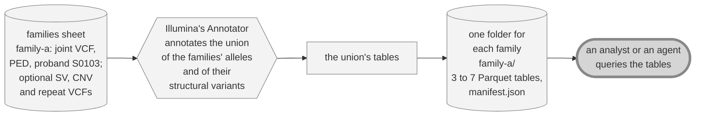
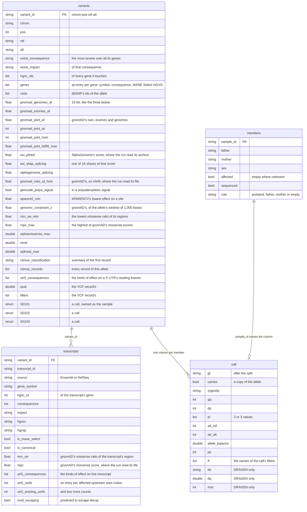
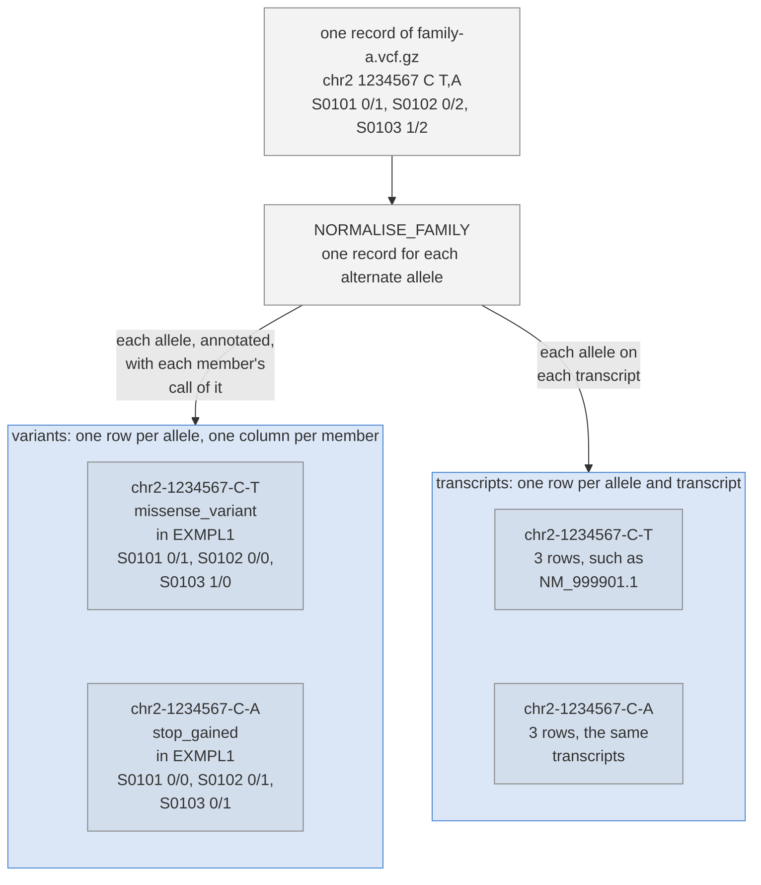
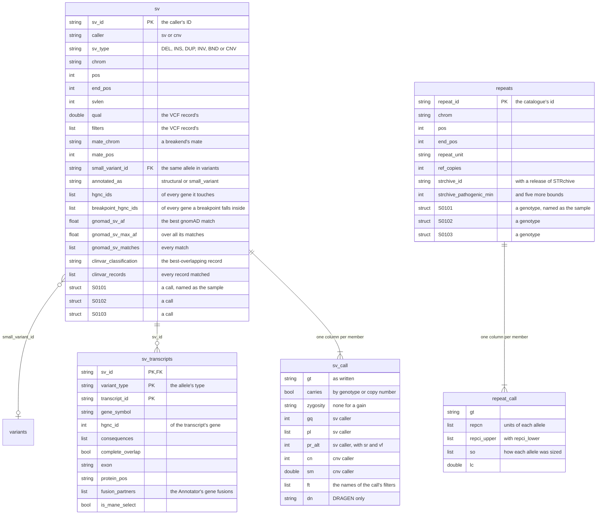

# Reading the family tables

The family tables are two Parquet tables and a manifest that hold one family's annotated variants with each member's
calls, with up to three more tables for its structural variants, copy number segments and tandem repeats. One of those,
`sv`, holds the structural variants and the copy-number variants together: the records of two callers, told apart by its
`caller` column. Every family also has `roh`, the runs of homozygosity of its members, and a family with a child whose
parents are both sequenced has `upd`, the regions in which that child shows the alleles of one parent alone. This page
is for an analyst who queries them, and for someone who writes an agent that does: it follows one record of a joint VCF
into the rows it becomes, shows how to ask the usual rare-disease questions with DuckDB from Python, and ends with the
folder's files and its manifest. It lists no columns: `DESCRIBE` shows them, and
[`tables.md`](../src/case_annotation/tables.md), which every family's folder holds, has what a table does not show.



The marked step is where the tables are read: an analyst or an agent queries the folder of the family it analyses, which
the steps before it wrote. [Annotation](annotation.md#family-tables) explains how `family_tables.nf` makes the tables.
The [glossary](glossary.md) defines each word used here.

Every id and value in the examples is invented. That covers the family `family-a`, the samples `S0101` to `S0103`, the
gene `EXMPL1` and its identifiers, which no gene model contains, the HGNC ids `99901` and `99902`, the rsID
`rs9999990001`, the deletion with its two record ids and the repeat `EXRPT1`.

## Background

> [!NOTE]
>
> Skip this section if you have read a joint-called VCF with an annotation in its INFO column, and know what a row group
> of a Parquet file is.

### A joint VCF and its annotation

A variant caller compares a family's reads with the reference genome and writes the differences into one VCF file for
the whole family, the joint VCF. Three words about it recur on this page. An allele is one alternate sequence at a
position; a position where one member has a `T` and another an `A` in place of the reference's `C` has two. A call is
what the caller concluded for one member at one position: the genotype, such as `0/1` for one copy of the first
alternate allele, with the read counts and qualities behind it. A transcript is one of the RNA molecules that a gene is
copied into, and one variant can change each transcript of a gene differently.

An annotation adds what is known about each allele: its consequence on each transcript, its frequency in
[gnomAD](glossary.md#clinvar-and-gnomad), prediction scores and its ClinVar records. Two gene models name the
transcripts, Ensembl and RefSeq, and for most genes they agree on one default transcript, which is called MANE Select. A
gene has a symbol, such as `EXMPL1`, which can change over the years, and many genes also have an HGNC id, a number that
the HUGO Gene Nomenclature Committee gives a gene for good. An HGVS name is the standard way to write a variant on the
genome, on a transcript or on a protein, such as `c.401C>T` and `p.Ser134Leu`.

A joint-called VCF has one line per site. The site's fields come first, then an INFO column into which an annotator
packs its results as strings, then one column per sample with that sample's call as colon-separated values. An
annotation such as Ensembl VEP's `CSQ` holds one entry per allele and transcript, separated by commas, each a run of
fields separated by `|`. A site with two alternate alleles keeps both on one line, so every per-allele value (an allele
depth, a population frequency, a `CSQ` entry) has to be matched to its allele by position or by name. Answering a
question of a VCF means parsing those strings in the right order, and a tool such as `bcftools` does it one line at a
time.

### Parquet and DuckDB

Parquet is a file format that stores a table column by column, with typed values, so a reader fetches only the columns a
query names. A file is cut into row groups, here of 100,000 rows, and each row group records the smallest and the
largest value of every column. A reader that looks for one position skips every row group whose range of positions
excludes it. A Bloom filter is a small index beside a column of a row group that says when a value is certainly absent
from it, so a lookup by an id or a gene skips row groups in the same way. The file ends in a footer that lists the
columns and the row groups with their ranges, which a reader loads before anything else.

DuckDB is a database engine that runs inside a Python process and queries Parquet files with SQL where they lie.

## From a VCF to two tables

The family tables unpack the information of an annotated VCF into two tables with one kind of row each.

| Table         | One row per                       | Holds                                                                                                                                                                                                                                                                                                  |
| ------------- | --------------------------------- | ------------------------------------------------------------------------------------------------------------------------------------------------------------------------------------------------------------------------------------------------------------------------------------------------------ |
| `variants`    | allele                            | its frequencies, scores and ClinVar records, its most severe consequence, its genes, each with what the allele does to it, and then the VCF's sample columns: one column per sequenced member, named as the VCF names the sample, holding that member's call of the allele as a struct of typed fields |
| `transcripts` | allele and transcript it overlaps | that transcript's consequence and HGVS names, and what two plugins of VEP say of the allele on it                                                                                                                                                                                                      |

A multi-allelic site becomes one row per allele before anything else happens, and the
[variant id](glossary.md#variant-id) `<chrom>-<pos>-<ref>-<alt>` names the allele in both tables, so it is the key that
joins them. A question about a genotype and an annotation together, such as which rare alleles the proband carries,
reads one row of `variants` and needs no join ([Why the tables have this shape](#why-the-tables-have-this-shape)).



The diagram shows the key that joins the tables and a selection of their columns. The
[contract](../contract/tables.json) has every column.

### The pedigree and the roles

The tables hold no pedigree: no row or column says who is whose parent, or who is affected. That comes from the family's
PED file, which `family_tables.nf` copies into the family's `manifest.json` as `members`, shown above as a table of its
own.

Each member also has a role: `proband` for the member that the run's sheet names as the family's proband, `father` and
`mother` for that member's sequenced parents, and none for anyone else. The sheet is the list of families that whoever
runs the pipeline gives `family_tables.nf`. The tables' proband is the one the sheet names; nothing derives it from the
pedigree ([the input contract](annotation.md#the-input-contract)).

A proband is optional. A family whose sheet names none has the same tables with the same columns, one for every
sequenced member, and its manifest gives each member's `affected` and `sequenced` and no role. Of the queries below,
only the trio queries need the roles. The lookups before them use none, and
[Rare variants in every affected member](#rare-variants-in-every-affected-member) and the queries after it read the
manifest's `affected` and `sequenced` instead.

A query reads the roles from the manifest to find the proband's column, as the setup below does.

> [!NOTE]
>
> A sample name, such as `S0103`, is the name that the family's VCF gives one member's sample. It is the member's column
> in `variants` and the member's `sample_id` in the manifest.

## A worked example

The figure follows one record of the joint VCF of the family `family-a` into the two tables. `S0101` is the father,
`S0102` the mother and `S0103` the proband. The rest of the section goes through the same record value by value.



### The record in the VCF

The invented trio `family-a` has an unaffected father `S0101`, an unaffected mother `S0102` and their affected daughter
`S0103`. Its PED file reads:

```text
family-a	S0101	0	0	1	1
family-a	S0102	0	0	2	1
family-a	S0103	S0101	S0102	2	2
```

At one position in the invented gene `EXMPL1` the father carries a `T`, the mother an `A`, and their daughter one of
each. The joint caller writes that as a single record with two alternate alleles. Annotated with VEP, and cut down to
the lines that matter, the VCF reads:

```text
##INFO=<ID=gnomADg_AF,Number=A,Type=Float,Description="Allele frequency in gnomAD v4.1 genomes">
##INFO=<ID=CSQ,Number=.,Type=String,Description="Consequence annotations from Ensembl VEP. Format: Allele|Consequence|IMPACT|SYMBOL|Gene|Feature|MANE_SELECT|HGVSc|HGVSp">
##FORMAT=<ID=GT,Number=1,Type=String,Description="Genotype">
##FORMAT=<ID=AD,Number=R,Type=Integer,Description="Allelic depths for the ref and alt alleles in the order listed">
##FORMAT=<ID=DP,Number=1,Type=Integer,Description="Approximate read depth">
##FORMAT=<ID=GQ,Number=1,Type=Integer,Description="Genotype Quality">
##FORMAT=<ID=PL,Number=G,Type=Integer,Description="Phred-scaled likelihoods for genotypes">
##FORMAT=<ID=FT,Number=1,Type=String,Description="Sample filter">
##FORMAT=<ID=DN,Number=1,Type=String,Description="Possible values are Inherited, DeNovo or LowDQ">
#CHROM	POS	ID	REF	ALT	QUAL	FILTER	INFO	FORMAT	S0101	S0102	S0103
chr2	1234567	.	C	T,A	612.3	PASS	gnomADg_AF=1.3e-05,.;CSQ=T|missense_variant|MODERATE|EXMPL1|ENSG00000999901|ENST00000999901.1|NM_999901.1|ENST00000999901.1:c.401C>T|ENSP00000999901.1:p.Ser134Leu,T|missense_variant|MODERATE|EXMPL1|ENSG00000999901|ENST00000999902.1||ENST00000999902.1:c.302C>T|ENSP00000999902.1:p.Ser101Leu,A|stop_gained|HIGH|EXMPL1|ENSG00000999901|ENST00000999901.1|NM_999901.1|ENST00000999901.1:c.401C>A|ENSP00000999901.1:p.Ser134Ter,A|stop_gained|HIGH|EXMPL1|ENSG00000999901|ENST00000999902.1||ENST00000999902.1:c.302C>A|ENSP00000999902.1:p.Ser101Ter	GT:AD:DP:GQ:PL:FT:DN	0/1:18,16,0:34:48:412,0,520,430,540,990:PASS:.	0/2:20,0,17:37:50:390,420,980,0,450,505:PASS:.	1/2:1,15,14:30:45:820,450,470,440,0,480:PASS:Inherited
```

The `CSQ` value, split at its commas, holds four entries, one for each allele on each of the gene's two Ensembl
transcripts:

```text
T|missense_variant|MODERATE|EXMPL1|ENSG00000999901|ENST00000999901.1|NM_999901.1|ENST00000999901.1:c.401C>T|ENSP00000999901.1:p.Ser134Leu
T|missense_variant|MODERATE|EXMPL1|ENSG00000999901|ENST00000999902.1||ENST00000999902.1:c.302C>T|ENSP00000999902.1:p.Ser101Leu
A|stop_gained|HIGH|EXMPL1|ENSG00000999901|ENST00000999901.1|NM_999901.1|ENST00000999901.1:c.401C>A|ENSP00000999901.1:p.Ser134Ter
A|stop_gained|HIGH|EXMPL1|ENSG00000999901|ENST00000999902.1||ENST00000999902.1:c.302C>A|ENSP00000999902.1:p.Ser101Ter
```

Each sample's values are ordered by allele. `AD` lists the reads of `C`, `T` and `A`. `PL` lists the likelihoods of the
six genotypes the two alleles allow, in the VCF's order `0/0`, `0/1`, `1/1`, `0/2`, `1/2`, `2/2`, so the proband's `0`
in fifth place is her called `1/2`. `gnomADg_AF` has one value per alternate allele, and the `A` is absent from gnomAD.

### The split

`NORMALISE_FAMILY`, the first step of `family_tables.nf` to change the VCF, splits the record with
`bcftools norm -m -any` into one record per alternate allele. Each sample's call is rewritten against that allele alone,
so the proband's `1/2` becomes `1/0` in the `T` record and `0/1` in the `A` record, and the mother's `0/2` becomes `0/0`
in the `T` record. `AD` keeps the reference and that allele, and `PL` the three genotypes made of them.

The tables are built from the split records, with the annotation taken from Illumina's Annotator rather than from `CSQ`,
which the workflow does not read.

> [!WARNING]
>
> Splitting a VCF that carries `CSQ` would leave all four entries on both records, since `CSQ` is not a per-allele
> field. A filter on the split VCF that forgets to match the `Allele` field can then credit the stop gain to the `T`
> allele.

### The rows of `variants`

The record becomes two rows of `variants`. The table shows the columns that describe the allele, with one column per
allele; the members' columns of the same two rows follow [further down](#the-members-columns-of-the-two-rows).

| column                      | `T` allele                  | `A` allele                  |
| --------------------------- | --------------------------- | --------------------------- |
| `variant_id`                | `chr2-1234567-C-T`          | `chr2-1234567-C-A`          |
| `variant_type`              | `SNV`                       | `SNV`                       |
| `hgvsg`                     | `NC_000002.12:g.1234567C>T` | `NC_000002.12:g.1234567C>A` |
| `worst_consequence`         | `missense_variant`          | `stop_gained`               |
| `worst_impact`              | `moderate`                  | `high`                      |
| `hgnc_ids`                  | `[99901]`                   | `[99901]`                   |
| `genes`                     | one entry, of `EXMPL1`      | one entry, of `EXMPL1`      |
| `rsids`                     | `['rs9999990001']`          | empty                       |
| `gnomad_genomes_af`         | 0.000013                    | empty                       |
| `gnomad_joint_af`           | 0.0000095                   | empty                       |
| `gnomad_joint_ac`           | 14                          | empty                       |
| `alphamissense_max` (class) | 0.91 (`likely_pathogenic`)  | empty                       |
| `revel`                     | 0.81                        | empty                       |
| `clinvar_classification`    | empty                       | empty                       |
| `qual`, `filters`           | 612.3, `['PASS']`           | 612.3, `['PASS']`           |

Several values in these rows need a word.

- `qual` and `filters` belong to the VCF record, so the two alleles share them.
- AlphaMissense and REVEL score missense changes only, so the stop gain has neither.
- `rsids` is a list, because dbSNP gives some alleles several ids, and the `A` allele, which dbSNP does not hold, has no
  list rather than an empty one.
- `hgnc_ids` is a list too, because an allele can lie in several genes: it holds the HGNC id of each gene that one of
  the allele's transcripts belongs to, here the id of `EXMPL1` alone.
- `worst_consequence` and `worst_impact` are the allele's own: the most severe consequence among the transcripts of all
  its genes, and the impact of the transcript that has it. A query filters on them. They name no gene, because an allele
  can lie in several.
- `genes` has an entry for each gene of the allele, here one for `EXMPL1`. What is of one gene stands in its entry: the
  gene's identifiers, its own most severe consequence with the transcript that has it, and its MANE Select transcript
  with the HGVS names on it.
- The joint columns hold gnomAD's own values over its exomes and genomes together, which the workflow reads from a
  public archive rather than from the VCF ([gnomAD's joint values](annotation.md#gnomads-joint-values)). gnomAD does not
  hold the `A` allele, so its joint columns are empty too; an allele that gnomAD holds with a count of 0 would read 0
  instead.
- The four frequency columns (`gnomad_genomes_af`, `gnomad_exomes_af`, `gnomad_joint_af` and `gnomad_joint_faf95_max`)
  are 32-bit floats. DuckDB shows the `T` allele's joint frequency as 9.5e-06, and Python reads it as
  9.499999578110874e-06, the 64-bit number equal to the stored one.

The one entry of each allele's `genes` reads:

| field of the entry                          | `T` allele                         | `A` allele                         |
| ------------------------------------------- | ---------------------------------- | ---------------------------------- |
| `gene_symbol`, `ensembl_gene_id`, `hgnc_id` | `EXMPL1`, `ENSG00000999901`, 99901 | `EXMPL1`, `ENSG00000999901`, 99901 |
| `worst_consequence`, `worst_impact`         | `missense_variant`, `moderate`     | `stop_gained`, `high`              |
| `worst_transcript_id`                       | `NM_999901.1`                      | `NM_999901.1`                      |
| `mane_select_transcript_id`                 | `NM_999901.1`                      | `NM_999901.1`                      |
| `mane_select_consequence`                   | `missense_variant`                 | `stop_gained`                      |
| `mane_select_hgvsc`                         | `NM_999901.1:c.401C>T`             | `NM_999901.1:c.401C>A`             |
| `mane_select_hgvsp`                         | `NP_999901.1:p.(Ser134Leu)`        | `NP_999901.1:p.(Ser134Ter)`        |

### The rows of `transcripts`

`transcripts` has a row for each allele on each transcript, from Ensembl and RefSeq both. Four of the six rows:

| `variant_id`       | `transcript_id`     | `source` | `is_mane_select` | `worst_consequence` | `impact`   | `hgvsc`                      | `hgvsp`                           |
| ------------------ | ------------------- | -------- | ---------------- | ------------------- | ---------- | ---------------------------- | --------------------------------- |
| `chr2-1234567-C-T` | `NM_999901.1`       | RefSeq   | true             | `missense_variant`  | `moderate` | `NM_999901.1:c.401C>T`       | `NP_999901.1:p.(Ser134Leu)`       |
| `chr2-1234567-C-T` | `ENST00000999902.1` | Ensembl  | false            | `missense_variant`  | `moderate` | `ENST00000999902.1:c.302C>T` | `ENSP00000999902.1:p.(Ser101Leu)` |
| `chr2-1234567-C-A` | `NM_999901.1`       | RefSeq   | true             | `stop_gained`       | `high`     | `NM_999901.1:c.401C>A`       | `NP_999901.1:p.(Ser134Ter)`       |
| `chr2-1234567-C-A` | `ENST00000999902.1` | Ensembl  | false            | `stop_gained`       | `high`     | `ENST00000999902.1:c.302C>A` | `ENSP00000999902.1:p.(Ser101Ter)` |

The two rows not shown are those of `ENST00000999901.1`, the Ensembl copy of the MANE Select transcript, which Illumina
flags as MANE Select only on the RefSeq copy. Every row also names its transcript's gene, as `gene_symbol` `EXMPL1` and
`hgnc_id` 99901.

### The members' columns of the two rows

The two rows of `variants` end in a column for each member, in the VCF's order. Each cell is a struct holding the
member's call of that row's allele; the table shows its `gt`, `zygosity`, `gq`, `pl` and allele depths, and the
proband's `dn`. The struct also says whether the member carries the allele, as `carries`, which is true wherever the
table shows `het`:

| `variant_id`       | `S0101`                                           | `S0102`                                           | `S0103`                                                  |
| ------------------ | ------------------------------------------------- | ------------------------------------------------- | -------------------------------------------------------- |
| `chr2-1234567-C-T` | `0/1`, `het`, 48, `[412, 0, 520]`, 18 and 16      | `0/0`, `hom_ref`, 50, `[390, 420, 980]`, 20 and 0 | `1/0`, `het`, 45, `[820, 450, 470]`, 1 and 15, Inherited |
| `chr2-1234567-C-A` | `0/0`, `hom_ref`, 48, `[412, 430, 990]`, 18 and 0 | `0/1`, `het`, 50, `[390, 0, 505]`, 20 and 17      | `0/1`, `het`, 45, `[820, 440, 480]`, 1 and 14, Inherited |

Read into Python, the proband's cell in the row of the `T` allele is a dictionary with every field of the call:

```python
{
    'gt': '1/0',
    'carries': True,
    'zygosity': 'het',
    'gq': 45,
    'dp': 30,
    'pl': [820, 450, 470],
    'ad_ref': 1,
    'ad_alt': 15,
    'allele_balance': 0.9375,
    'ps': None,
    'ft': ['PASS'],
    'dn': 'Inherited',
    'dq': None,
    'msc': None,
}
```

Some things in these rows follow from the split.

- Each row holds every member's call of its allele, so the mother's `0/0` for the `T` allele sits beside her daughter's
  call of it, as it would in a split VCF.
- `dp` and `gq` are the original record's and so are the same in both rows for a member.
- The mother's likelihoods for the `T` allele have no 0, because the genotype she was called with (`0/2`) is not among
  the three they keep.
- The proband's allele balance is 0.94 for one allele and 0.93 for the other, although she carries one copy of each,
  because it compares an allele's reads with the reference's alone, and she has almost no reference reads.

The proband is a compound heterozygote in `EXMPL1`, with one allele from each parent, and the compound heterozygote
query below finds her through these two rows.

### The members in the manifest

The manifest's `members` for this family read:

```json
[
  {"sample_id": "S0101", "father": null, "mother": null, "sex": "male", "affected": false, "sequenced": true, "role": "father"},
  {"sample_id": "S0102", "father": null, "mother": null, "sex": "female", "affected": false, "sequenced": true, "role": "mother"},
  {"sample_id": "S0103", "father": "S0101", "mother": "S0102", "sex": "female", "affected": true, "sequenced": true, "role": "proband"}
]
```

## Upstream reading frames and nonsense-mediated decay

The Annotator says of a variant in a 5′ UTR that it is a `5_prime_UTR_variant`, and of a variant that ends a reading
frame that it is a `stop_gained` or a `frameshift_variant`. Two plugins of Ensembl VEP say more about both, and the
workflow runs them unchanged
([Upstream reading frames and nonsense-mediated decay](annotation.md#upstream-reading-frames-and-nonsense-mediated-decay)).
Their values are six columns of `transcripts`, on the rows of Ensembl's transcripts and of RefSeq's alike, and one
column of `variants` to search by. Every allele, transcript and value in this section is invented.

### What a variant does to the reading frames of a 5′ UTR

A transcript's 5′ UTR is the stretch before the start codon of its protein. An `ATG` in that stretch is an upstream
start codon, and the reading frame that begins there is an [upstream reading frame](glossary.md#upstream-reading-frame).
The plugin UTRannotator, of Zhang, Wakeling, Ware and Whiffin, sorts such a frame into three types by where it ends.

| Type              | The frame                                                                                                 |
| ----------------- | --------------------------------------------------------------------------------------------------------- |
| `uORF`            | ends at a stop codon inside the 5′ UTR                                                                    |
| `OutOfFrame_oORF` | has no stop codon in the UTR and runs into the coding sequence, out of frame with it                      |
| `InFrame_oORF`    | has no stop codon in the UTR and runs into the coding sequence in frame, as a longer start of the protein |

It reports five kinds of effect that an allele can have on such frames.

| Kind           | The allele                                                     |
| -------------- | -------------------------------------------------------------- |
| `uAUG_gained`  | creates a start codon in the 5′ UTR                            |
| `uAUG_lost`    | removes a start codon that the UTR has                         |
| `uSTOP_gained` | creates a stop codon inside an existing reading frame          |
| `uSTOP_lost`   | removes the stop codon of an existing reading frame            |
| `uFrameShift`  | shifts an existing reading frame by an insertion or a deletion |

The columns hold what the plugin writes, under names in snake case.

| Column                                         | Type           | Holds                                                                                                          | Null where                                              |
| ---------------------------------------------- | -------------- | -------------------------------------------------------------------------------------------------------------- | ------------------------------------------------------- |
| `variants.utr5_consequences`                   | list of string | the kinds that the allele has on any of its transcripts in `transcripts`, each once, sorted                    | no transcript of the allele has a kind                  |
| `transcripts.utr5_consequences`                | list of string | the kinds that the allele has on this transcript, each once, sorted                                            | the plugin reports no kind, or did not evaluate the row |
| `transcripts.utr5_uorfs`                       | list of struct | one entry for each record of the plugin: one for each upstream start codon that is affected, for each kind     | as `utr5_consequences`                                  |
| `transcripts.utr5_existing_uorfs`              | int32          | "the number of existing uORFs with a stop codon within the 5 prime UTR", for the transcript without the allele | the plugin did not evaluate the row                     |
| `transcripts.utr5_existing_oorfs_out_of_frame` | int32          | the number of existing reading frames of the UTR that overlap the coding sequence out of frame                 | the plugin did not evaluate the row                     |
| `transcripts.utr5_existing_oorfs_in_frame`     | int32          | the number of existing reading frames of the UTR that overlap the coding sequence in frame                     | the plugin did not evaluate the row                     |

The plugin evaluates a row whose allele lies in the transcript's 5′ UTR, and writes its three counts for every such row.
A count, also a 0, therefore says that the plugin looked. A row with counts and without `utr5_consequences` is one where
it found no effect, and a row without counts is one that it did not evaluate.

Several kinds can apply to one allele and transcript, and each has its entries in `utr5_uorfs`. An insertion can create
a start codon and shift the frames of two existing uORFs. `utr5_consequences` is then `uAUG_gained` and `uFrameShift`,
and `utr5_uorfs` has three entries, shown here with the fields that hold a value:

| `consequence` | `type` | `ref_type` | `alt_type`        | `kozak_context` | `kozak_strength` | `distance_to_cds` | `ref_start_distance_to_cds` | `evidence` |
| ------------- | ------ | ---------- | ----------------- | --------------- | ---------------- | ----------------- | --------------------------- | ---------- |
| `uAUG_gained` | `uORF` |            |                   | `ACAATGC`       | `Moderate`       | 56                |                             |            |
| `uFrameShift` |        | `uORF`     | `OutOfFrame_oORF` | `GTTATGT`       | `Moderate`       |                   | 150                         | true       |
| `uFrameShift` |        | `uORF`     | `uORF`            |                 |                  |                   | 84                          | false      |

The entries are ordered by kind, and within a kind from the 5′ end of the UTR.

An entry has `consequence` and the fields of its kind, and every other field is null. The descriptions follow the
plugin's
[README](https://github.com/ImperialCardioGenetics/UTRannotator/blob/3d9d466e356752aa69d61b62da493edddf374363/README.md).

| Field                                | Type   | In an entry of                | Holds                                                                                                                                                                |
| ------------------------------------ | ------ | ----------------------------- | -------------------------------------------------------------------------------------------------------------------------------------------------------------------- |
| `consequence`                        | string | every kind                    | the kind                                                                                                                                                             |
| `type`                               | string | `uAUG_gained`, `uAUG_lost`    | the type of the reading frame that is created or lost                                                                                                                |
| `ref_type`                           | string | `uSTOP_gained`, `uFrameShift` | the type of the affected reading frame with the reference allele                                                                                                     |
| `alt_type`                           | string | `uFrameShift`                 | its type with the alternate allele                                                                                                                                   |
| `kozak_context`                      | string | every kind                    | the Kozak context of the frame's start codon: three bases, `ATG` and one base                                                                                        |
| `kozak_strength`                     | string | every kind                    | `Weak`, `Moderate` or `Strong`, from that context                                                                                                                    |
| `cap_distance_to_start`              | int32  | `uAUG_gained`, `uAUG_lost`    | the number of bases from the start of the 5′ UTR to the start codon                                                                                                  |
| `distance_to_cds`                    | int32  | `uAUG_gained`, `uAUG_lost`    | the number of bases from the start codon to the coding sequence                                                                                                      |
| `distance_to_stop`                   | int32  | `uAUG_gained`, `uAUG_lost`    | the number of bases from the start codon to its stop codon, looked for in the UTR and the coding sequence after it; null where there is none                         |
| `ref_start_distance_to_cds`          | int32  | `uSTOP_gained`, `uFrameShift` | the number of bases from the start codon of the affected frame to the coding sequence                                                                                |
| `new_stop_distance_to_cds`           | int32  | `uSTOP_gained`                | the number of bases from the gained stop codon to the coding sequence                                                                                                |
| `alt_stop`                           | bool   | `uSTOP_lost`                  | whether the UTR has another stop codon downstream in the frame                                                                                                       |
| `alt_stop_distance_to_cds`           | int32  | `uSTOP_lost`                  | the number of bases from that stop codon to the coding sequence; null where there is none                                                                            |
| `frame_with_cds`                     | string | `uSTOP_lost`                  | `inFrame` or `outOfFrame`: the frame of the uORF against the coding sequence                                                                                         |
| `ref_type_length`, `alt_type_length` | int32  | `uFrameShift`                 | the length of the reading frame with the reference and with the alternate allele; null where it has no stop codon                                                    |
| `evidence`                           | bool   | every kind but `uAUG_gained`  | whether the start codon of the affected frame is in the plugin's list of upstream reading frames that ribosome profiling has seen translated, curated from sorfs.org |

Distances and lengths are counted along the spliced transcript. A start codon is in frame with the coding sequence where
its distance to it is a multiple of three, so `distance_to_cds % 3 = 0` gives the frame of any gained or lost start,
also of one whose frame ends inside the UTR. The Kozak strength is `Strong` where the base three before the `ATG` is `A`
or `G` and the base after it is `G`, `Moderate` where one of the two holds and `Weak` otherwise.

> [!WARNING]
>
> The plugin writes the in-frame type as `inFrame_oORF`, with a small `i`, in a `uAUG_gained` entry, and as
> `InFrame_oORF` in every other entry. The tables keep both spellings as the plugin writes them, so a condition
> `u.type = 'InFrame_oORF'` finds no gained start, without an error. Compare `lower(u.type)`, or ask for both.

The plugin leaves these things out, and the tables add none of them.

- It reads `ATG` as the only start codon.
- It gives the Kozak context and strength of the upstream start codon, and nothing for the start codon of the protein
  itself.
- A `uSTOP_lost` entry has no type and no distance of its start codon, so it has fewer fields than the other kinds.
  `frame_with_cds` and `alt_stop` say what becomes of the frame: with `alt_stop` false it runs into the coding sequence.
- A gained start has no `evidence`, since the frame did not exist.
- A start codon within three bases of either end of the UTR has no `kozak_context` and no `kozak_strength`.
- It tests an insertion or a deletion for a shifted frame and for a gained or lost start, and not for a gained stop.
- Its authors tested it on alleles of one to five bases.
- It evaluates a variant inside the exons of the 5′ UTR. A variant upstream of the transcript or in an intron of the UTR
  has no value.

VEP reads its own files of the gene models, of the releases that the Annotator's catalog was built with. A row of
`transcripts` in a 5′ UTR can still be without values, where VEP's file lacks the transcript at that version or places
the variant differently at the edge of the UTR. The manifest counts these rows (`vep_plugins.matching`).

### Escape from nonsense-mediated decay

A variant that ends a reading frame early usually leaves no protein, because the cell destroys the transcript
([nonsense-mediated decay](glossary.md#nonsense-mediated-decay)). VEP's plugin `NMD` predicts where a transcript escapes
that, from the place of the variant alone. By the plugin's documentation it counts a variant as escaping in four cases:
it lies in the last exon; it lies in the last 50 bases of the second-last exon; it lies in the first 100 coding bases;
or the transcript has no intron.

`transcripts.nmd_escaping` holds the prediction for the allele on the transcript.

| `nmd_escaping` | The row                                                                                                                                                     |
| -------------- | ----------------------------------------------------------------------------------------------------------------------------------------------------------- |
| true           | the plugin flags the variant as escaping                                                                                                                    |
| false          | the plugin evaluated the variant and did not flag it: VEP calls it a stop-gained, frameshift, splice-donor or splice-acceptor variant with coding positions |
| null           | the plugin did not evaluate the row, as for a missense variant or a transcript that VEP's file lacks                                                        |

The value is a rule about positions and no measurement. A false says that none of the four cases holds, and the plugin
says nothing about a row that is null, so `NOT nmd_escaping` leaves the null rows out.

## Structural variants, copy number and repeats

The two tables above hold a family's small variants, which are what a joint VCF holds. The
[larger variants](glossary.md#larger-variants) come from other callers, in VCFs of their own, and a family whose VCFs
were given to `family_tables.nf` has up to three more tables for them. `sv` holds the structural variants and the
copy-number variants, the records of two callers, told apart by the `caller` column. `sv_transcripts` holds the
transcripts that those records hit, and `repeats` the tandem repeats. The manifest's `tables` lists the tables a folder
holds, so a reader looks there before it queries one of these.

| Table            | One row per                                                   | Holds                                                                                                                                                                                                                                                                                                                                                                        |
| ---------------- | ------------------------------------------------------------- | ---------------------------------------------------------------------------------------------------------------------------------------------------------------------------------------------------------------------------------------------------------------------------------------------------------------------------------------------------------------------------- |
| `sv`             | record of a structural-variant caller or a copy-number caller | where the record lies, its type and length, a breakend's mate, its QUAL and FILTER, the row of `variants` that is the same allele, where there is one, and what Illumina's Annotator says of the record: its genes, how common a variant like it is, and ClinVar's records; then one column per sequenced member, as in `variants`, holding that member's call of the record |
| `sv_transcripts` | record, allele and transcript that the Annotator lists for it | the transcript and its gene, and how the variant hits the transcript                                                                                                                                                                                                                                                                                                         |
| `repeats`        | tandem repeat that a repeat genotyper sized                   | the repeat's place and unit, STRchive's size ranges of the repeat in a run that was given a release of STRchive, and then one column per sequenced member holding the size of each of that member's alleles                                                                                                                                                                  |

A row's place and the members' calls come from the callers' VCFs. Illumina's Annotator annotates the records of `sv` in
a run of their own, as it annotates the alleles of `variants`, and `sv_transcripts` is to `sv` what `transcripts` is to
`variants`. The Annotator does not read `repeats`. A run that was given a release of STRchive adds the size ranges of
each repeat that STRchive lists ([A repeat in STRchive's pathogenic range](#a-repeat-in-strchives-pathogenic-range)).

Two kinds of caller fill `sv`. A structural-variant caller finds junctions in the reads and writes one record per
[structural variant](glossary.md#structural-variant): a deletion, an insertion, a duplication, an inversion, or a
breakend, which is one side of a junction between two distant places. A copy-number caller reads the depth and writes
one record per [copy number segment](glossary.md#copy-number-segment), a stretch over which a member has fewer or more
copies than expected. `caller` says which a row came from (`sv` or `cnv`).

A copy-number row is a segment whose copy number differs from the expected one in some member; the caller's segments at
the expected copy number are left out. A member carries such a row by its copy number, and a gain is carried with no
zygosity ([Who carries a record](#who-carries-a-record)). The two callers work apart, so one event can have a row from
each ([One deletion in both callers' records](#one-deletion-in-both-callers-records)). In one whole-genome trio `sv` has
about 64,000 rows of the structural-variant caller and about 1,400 of the copy-number caller.

`sv_id` is the caller's own ID of the record and the key of the table, as the variant id is the key of `variants`, and
it joins `sv_transcripts` to `sv`.



The diagram shows a selection of the columns, and the [contract](../contract/tables.json) has all of them.

### One deletion in both callers' records

Suppose the proband of `family-a` has a deletion of about 12 kb in `EXMPL1` on one chromosome copy, which neither parent
has. Both callers report it, each with its own boundaries, so `sv` has two rows for it. The ids are invented, like the
deletion:

| `sv_id`                        | `caller` | `sv_type` | `pos`   | `end_pos` | `S0101`                  | `S0102`                  | `S0103`                |
| ------------------------------ | -------- | --------- | ------- | --------- | ------------------------ | ------------------------ | ---------------------- |
| `EX:DEL:101`                   | `sv`     | `DEL`     | 1250112 | 1261870   | `0/0`, `hom_ref`         | `0/0`, `hom_ref`         | `0/1`, `het`, carries  |
| `EX:LOSS:chr2:1250000-1262000` | `cnv`    | `DEL`     | 1250000 | 1262000   | `./.`, `cn` 2, `hom_ref` | `./.`, `cn` 2, `hom_ref` | `0/1`, `cn` 1, carries |

The first five columns are among those that describe the record. The last three are the members' columns of the same two
rows, shown by their `gt`, `cn`, `zygosity` and `carries`. The two rows are not linked to each other; a reader that
wants one event for the deletion compares their positions.

### Who carries a record

A member's column of `sv` is a struct, as in `variants`, and the fields that mean the same thing in both tables have the
same names: `gt`, `carries`, `zygosity`, `gq`, `pl`, `ft`, `dn` and `dq`. The other fields are these callers' own, such
as the copy number `cn`.

The copy-number caller writes each parent's genotype above as `./.`, although it did call them, at 2 copies. DRAGEN
writes a member at the expected copy number that way, and a member with more copies as `./1` whatever their number. A
genotype of that caller therefore says neither that a parent is unaffected nor how many copies a member has. `carries`
and `zygosity` answer the same question for both callers.

For a row of the structural-variant caller the genotype decides, as in `variants`. `carries` is true where the genotype
holds a copy of the allele, also beside a missing one, false where every allele is called and none is the allele, and
empty for any other genotype, such as the `./.` of a member without a call. `zygosity` is classified in the same way:
`0/1` is `het`, `1/1` is `hom_alt` and `0/0` is `hom_ref`. A genotype with a missing allele has none, also `./1`, which
carries the allele on one copy or on both. A haploid call, as DRAGEN makes on a male's X and Y outside the
[pseudoautosomal regions](glossary.md#pseudoautosomal-regions), is `hom_alt` for `1` and `hom_ref` for `0`.

For a row of the copy-number caller the copy number decides, read against the copies expected. Those are the alleles in
the member's genotype: two, or one where the caller calls the member haploid.

| `cn` against the copies expected | `carries` | `zygosity` | DRAGEN's `gt`, diploid | Haploid |
| -------------------------------- | --------- | ---------- | ---------------------- | ------- |
| the same                         | false     | `hom_ref`  | `./.`                  | `0`     |
| fewer, and more than 0           | true      | `het`      | `0/1`                  |         |
| 0                                | true      | `hom_alt`  | `1/1`                  | `1`     |
| more                             | true      | empty      | `./1`                  | `1`     |
| no copy number, as a female's Y  | empty     | empty      |                        | `.`     |

`zygosity` is empty wherever a call does not determine it, in `sv` as in `variants`. A member with a gain carries the
segment and has no zygosity, because its copy number does not say how the copies are split between the two chromosome
copies: 4 copies can be two on each or three on one. A genotype of the structural-variant caller with a missing allele
beside the allele, `./1`, has none for the same reason. A query for the members who have a record therefore reads
`carries`, and a condition such as `zygosity IN ('het', 'hom_alt')` finds structural variants and losses and no gain. A
male with no copy of a segment of his X is `hom_alt`, like his haploid call of a small variant there.

A member without a call of a record has neither value: the structural-variant caller wrote no genotype for the member,
or the copy-number caller no copy number. `carries` is false only for a member who was called and does not have the
record, and that member's `zygosity` is `hom_ref`.

> [!IMPORTANT]
>
> A copy-number genotype has to agree with its copy number: an alternate allele exactly where the copy number is not the
> expected one, `<DEL>` below it and `<DUP>` above, and as many `<DEL>` alleles as copies are lost. A record that breaks
> this fails the run, so `gt` and `zygosity` never disagree in a table.

### What the annotation says of a record

A caller's record says where a variant lies and who carries it. Illumina's Annotator adds what an analyst filters on:
the genes and transcripts the variant hits, how common a variant like it is, and what ClinVar holds on one. The
transcripts are the rows of `sv_transcripts`, and the rest are columns of `sv`, between `small_variant_id` and the
members' columns. [Annotation](annotation.md#annotating-the-structural-variants) explains the run that makes these
columns, and this section how to read them.

`hgnc_ids` names the record's genes as it names an allele's in `variants`: it holds the HGNC id of each gene that one of
the record's transcripts belongs to. The deletion in `EXMPL1` has `[99901]`, and a deletion of 2 Mb has the id of every
gene in it. A record that touches no transcript has no list, and neither has one that lies only in genes without an HGNC
id ([A gene without an HGNC id](#a-gene-without-an-hgnc-id)). `breakpoint_hgnc_ids` holds those of the record's genes
that one of its breakpoints falls inside ([A breakpoint inside a gene](#a-breakpoint-inside-a-gene)).

A small variant is found in a database by its position and alleles. A structural variant rarely has an exact
counterpart, because two callers seldom place the same deletion at the same two bases. The Annotator therefore reports
the entries of a database that are like the record, and how alike depends on the record:

| Record                                                           | The entries it is matched to                                                                                                                                          |
| ---------------------------------------------------------------- | --------------------------------------------------------------------------------------------------------------------------------------------------------------------- |
| a deletion, a duplication, an inversion or a copy number segment | those at a reciprocal overlap of 0.5 or more, and none of the other direction, such as a gain for a loss; in the output seen so far they are of the record's own kind |
| an insertion                                                     | gnomAD's and 1000 Genomes' within about 500 bases of `pos`, whatever their length; none of ClinVar                                                                    |
| a breakend                                                       | none so far                                                                                                                                                           |

The [reciprocal overlap](glossary.md#reciprocal-overlap) of two intervals is the bases they share, over the longer of
the two: 1 for the same interval, and 0.5 where a deletion of 6 kb lies inside one of 12 kb.

A record can match several entries, so a frequency column needs a rule. Take the proband's deletion of
[One deletion in both callers' records](#one-deletion-in-both-callers-records), and suppose gnomAD holds two deletions
there, with invented ids and values:

| gnomAD entry  | Reciprocal overlap with `EX:DEL:101` | Allele frequency |
| ------------- | ------------------------------------ | ---------------- |
| `EX-gnomad-1` | 0.97                                 | 0.0002           |
| `EX-gnomad-2` | 0.61                                 | 0.031            |

The row of `EX:DEL:101` then reads `gnomad_sv_id` `EX-gnomad-1`, `gnomad_sv_af` 0.0002 and `gnomad_sv_overlap` 0.97,
which are the best match: the entry that overlaps the record most. `gnomad_sv_max_af` is 0.031, the highest frequency
among all its matches, and `gnomad_sv_matches` lists both entries with their intervals. The best match is the estimate
for this deletion. The maximum is what a filter for common variants should read, since a common deletion that covers
half of the record still explains reads there. For an insertion or a breakend the best match is the nearest entry, and
`gnomad_sv_distance` gives the bases between it and `pos` where `gnomad_sv_overlap` is empty.

The other columns of the annotation follow from the same matching:

- `onekg_sv_` and `gnomad_cnv_` hold the best match among the 1000 Genomes structural variants and among gnomAD's
  copy-number variants, without a list.
- `clinvar_records` holds every ClinVar record matched, the best-overlapping first, and the `clinvar_` columns summarise
  that first one, with its overlap in `clinvar_overlap`. A record there is of another variant that overlaps this one: a
  pathogenic deletion of 100 kb at an overlap of 0.5 says little about a deletion of 50 kb inside it.
- `annotated_as` is `small_variant` for a record written as a sequence whose two alleles are each at most 50 bases,
  about one record in five. The Annotator treats such a record as a small variant: it has no match by overlap, and
  instead gnomAD's values of the allele itself in `gnomad_genomes_` and `gnomad_exomes_` and ClinVar's records of the
  allele itself, as a row of `variants` has. Where the record names a row of `variants`, that row has the scores too.
- A segment that one member loses and another gains (`sv_type` `CNV`) has two alleles. Its lists hold the matches of
  both, each with its `variant_type`, and its `hgnc_ids` and `breakpoint_hgnc_ids` the genes of both. Its best match and
  `gnomad_sv_max_af` are empty, because either would be that of one allele. So are its `onekg_sv_` and `gnomad_cnv_`
  columns, which are best matches without a list: the table does not say what those two sources hold on such a segment.
- `annotated_pos` and `annotated_end_pos` give the interval the Annotator annotated. It equals `pos` and `end_pos`
  except where the Annotator trimmed or left-aligned an allele written as a sequence.

### How a record hits a transcript

`sv_transcripts` has one row for each transcript that the Annotator lists for a record: every transcript the variant
overlaps, of Ensembl and of RefSeq. A deletion of 12 kb inside one gene has a row for each transcript of that gene, and
a deletion of 2 Mb a row for each transcript of every gene in it. A row names its transcript and gene in the columns
that `transcripts` has for them, `hgnc_id` among them. Four fields say how the variant hits the transcript of a row.
Read them from the top, and take the first that holds:

| The variant                 | The row shows                                                                                                                                                               |
| --------------------------- | --------------------------------------------------------------------------------------------------------------------------------------------------------------------------- |
| covers the whole transcript | `complete_overlap` is true, and the row has no exon, intron or position. A deletion written as a sequence never has the flag: it has the term `transcript_ablation` instead |
| reaches coding sequence     | `protein_pos`, the amino acids concerned out of the protein's, such as `34-117/666`                                                                                         |
| reaches an exon             | `exon`, the exons concerned out of the transcript's, such as `2-3/9`, and `cdna_pos`                                                                                        |
| lies within introns         | `intron` alone, such as `2/8`                                                                                                                                               |
| lies beside the transcript  | none of these, and the term `upstream_gene_variant` or `downstream_gene_variant`. Only a record written as a sequence has such rows                                         |

`consequences` holds the Annotator's terms for the transcript, from most to least severe, and they need care. The
Annotator gives `feature_truncation` to every transcript that a deletion touches and `feature_elongation` to every one
that an insertion or a duplication touches, also when the variant lies wholly in an intron. A term therefore does not
say that the variant damages the transcript, and the fields above do. That is also why the table has no `impact` and no
`worst_consequence`: Illumina's impact is `high` for about six rows in ten, and the severity order puts an intronic
`feature_truncation` above a missense variant.

The table leaves two more things out. The coding position is not stable: two runs of the Annotator over the same records
give it for different rows, while `protein_pos` is the same in both. The transcript's HGVS names spell out the inserted
or deleted sequence. The table does keep the partners of a gene fusion, in `fusion_partners`
([A breakpoint inside a gene](#a-breakpoint-inside-a-gene)). Most records with a fusion are breakends, and the partner
of a breakend's transcript is a gene at the mate's place, which is in none of the breakend's own rows.

`is_mane_select` is true on RefSeq transcripts only, as in `transcripts`, so a query for the MANE Select transcript of a
gene reads a row with NCBI's `gene_id`; the row's `gene_symbol` and `hgnc_id` are the ones that the gene's Ensembl
transcripts have too. `variant_type` is the Annotator's type of the allele, such as `deletion` or `copy_number_loss`,
and it tells the two alleles of a `CNV` segment apart: such a record has rows of both types.

### A breakpoint inside a gene

A breakpoint is a place where a record ends or joins another place: each end of a deletion, a duplication, an inversion
or a copy number segment, the place of an insertion, and the position of a breakend. A gene with a breakpoint inside it
is cut there. Two reading rules tell such a gene from one that the record covers whole, and both follow from how the
Annotator lists transcripts:

1. For a record with an extent, a transcript that lies wholly inside the interval has `complete_overlap` true and no
   exon, intron or position. A transcript that an end of the interval falls into has `complete_overlap` false, and
   `intron`, `exon` or both for the part of it that the record covers. A transcript wholly inside an inversion has the
   single term `structural_variant`.
1. A breakend is annotated as the one base at its position, so `annotated_pos` and `annotated_end_pos` both equal `pos`.
   Each of its rows is therefore of a transcript that holds the breakpoint, with the `intron` or the `exon` it lies in.
   An insertion is annotated at one place in the same way.

The flag alone does not cover a record written as a sequence. A deletion written as a sequence that takes a whole
transcript has the term `transcript_ablation` without the flag, and `transcript_amplification` is the same term for a
gain. Such a record also has rows of transcripts that it lies beside. So a breakpoint of the record falls inside the
transcript of a row where all of this holds:

```sql
NOT complete_overlap
AND NOT list_has_any(consequences, ['transcript_ablation', 'transcript_amplification',
                                    'upstream_gene_variant', 'downstream_gene_variant'])
```

`breakpoint_hgnc_ids` in `sv` applies that condition for the reader. It holds the HGNC id of each gene with such a row,
sorted and each once, and a record without such a gene has no list, not an empty one. A gene is listed by any one of its
transcripts, also where the record covers a shorter transcript of the gene whole. What the list says depends on the
record:

| Record                                             | `breakpoint_hgnc_ids` holds the genes                                                                                         |
| -------------------------------------------------- | ----------------------------------------------------------------------------------------------------------------------------- |
| a deletion, a duplication or a copy number segment | that the record covers only in part: one end of its interval lies inside the gene, or both ends                               |
| an inversion                                       | that an end of the inverted interval lies inside. A gene wholly inside the inversion is turned around whole and is not listed |
| an insertion                                       | that hold the place of the insertion                                                                                          |
| a breakend                                         | that hold its position. The genes at the other side of the junction are on the row of the mate, whose id is in `mate_id`      |
| a record annotated as a small variant              | that the allele lies in, without the genes it lies beside                                                                     |

For a breakend and for an insertion written as `<INS>` the list equals `hgnc_ids` in the output seen so far, because
every row of such a record is of a transcript that holds its position. The list says where the ends of a record lie and
not what the record does to the gene: a deletion within one intron lists its gene as a deletion of the first exons does,
and `exon` and `protein_pos` of the gene's rows say what the record covers. The ends are as certain as the record's own
(`imprecise`, `cipos` and `ciend`), and the copy-number caller places a segment's ends by the depth. A `CNV` segment of
two alleles lists the genes of either. A gene without an HGNC id is not in the list, and the condition above finds it by
`gene_symbol` in `sv_transcripts`.

`fusion_partners` in `sv_transcripts` holds the gene fusions that the Annotator reports for the transcript of a row. The
Annotator looks for them on a deletion, a tandem duplication, an inversion and a breakend. It reports one where the
record joins the row's transcript to a transcript of another gene, of the same source and in the same orientation, and
the row then has the term `unidirectional_gene_fusion`. The column has one entry for each partner transcript, copied as
the Annotator gives it, and a row without a fusion has no list:

| Field of an entry                         | Holds                                                                                                                                       |
| ----------------------------------------- | ------------------------------------------------------------------------------------------------------------------------------------------- |
| `transcript_id`, `gene_symbol`, `hgnc_id` | the partner transcript and its gene, in the fields that a row has for its own                                                               |
| `exon` or `intron`                        | the partner's exon or intron that holds the junction, out of the transcript's, such as `4/17`                                               |
| `in_frame`                                | true where the Annotator predicts that the joined transcript keeps the reading frame, and false where it does not say so                    |
| `imprecise`                               | true where the Annotator marks the fusion as imprecise, which Illumina's pages do not define                                                |
| `directionality`                          | the Annotator's word for the orientation of the two transcripts: `unidirectional`, since the workflow does not set the option for any other |
| `hgvsr`                                   | the Annotator's HGVS name of the joined RNA, with both transcripts in it                                                                    |

An entry is the Annotator's prediction from the record's coordinates, so it does not show that a cell makes the joined
transcript. A gene with many transcripts gives many entries, so a query groups them by gene. The partner's own row is in
the same table: under the same record where the record has an extent, and under the mate's record for a breakend.

Suppose `family-a` has two more invented records. The inversion `EX:INV:7` on chromosome 2 starts in intron 2 of
`EXMPL1` and holds the gene `EXMPL2` whole. The breakend `EX:BND:3:0` on chromosome 2 lies in intron 5 of `EXMPL3`, and
its mate `EX:BND:3:1` on chromosome 10 in intron 1 of `EXMPL4`. With one invented transcript for each gene,
`sv_transcripts` has four rows for them:

| `sv_id`      | `gene_symbol` | `complete_overlap` | `intron` | `consequences`                                 | `fusion_partners`             |
| ------------ | ------------- | ------------------ | -------- | ---------------------------------------------- | ----------------------------- |
| `EX:INV:7`   | `EXMPL1`      | false              | `2/8`    | `[intron_variant]`                             |                               |
| `EX:INV:7`   | `EXMPL2`      | true               |          | `[structural_variant]`                         |                               |
| `EX:BND:3:0` | `EXMPL3`      | false              | `5/11`   | `[unidirectional_gene_fusion, intron_variant]` | one entry, `EXMPL4` in `1/6`  |
| `EX:BND:3:1` | `EXMPL4`      | false              | `1/6`    | `[unidirectional_gene_fusion, intron_variant]` | one entry, `EXMPL3` in `5/11` |

In `sv` the inversion has the `hgnc_ids` `[99901, 99902]` and the `breakpoint_hgnc_ids` `[99901]`, and each breakend has
its one gene in both lists. The first query finds the records with a breakpoint inside a gene, on the connection of
[Setup](#setup):

```python
cutting_a_gene = con.sql(
    """
    SELECT sv_id, sv_type, chrom, pos, end_pos, mate_chrom, mate_pos, hgnc_ids
    FROM sv
    WHERE list_contains(breakpoint_hgnc_ids, $hgnc_id)
    ORDER BY sv_id
    """,
    params={'hgnc_id': 99901},
).to_arrow_table()
```

It returns the inversion, with both of its genes in `hgnc_ids`. For 99902, the id of `EXMPL2`, it returns nothing, while
`list_contains(hgnc_ids, 99902)` finds the inversion. The second query lists the gene fusions of every record, one row
for each pair of genes:

```python
gene_fusions = con.sql(
    """
    SELECT t.sv_id, t.gene_symbol, t.intron, p.gene_symbol AS partner_gene, p.hgnc_id AS partner_hgnc_id,
           p.intron AS partner_intron, count(*) AS transcript_pairs, bool_or(p.in_frame) AS in_frame
    FROM sv_transcripts t
    CROSS JOIN unnest(t.fusion_partners) AS u(p)
    GROUP BY ALL
    ORDER BY t.sv_id
    """
).to_arrow_table()
```

It returns two rows: `EX:BND:3:0` with `EXMPL3` and the partner `EXMPL4`, and `EX:BND:3:1` with the two the other way
round, each with one pair of transcripts and `in_frame` false.

## Runs of homozygosity and uniparental disomy

Two more tables come from the family's own VCF and from no annotation. `roh` has one row for each run of homozygosity of
a sequenced member, and every family has it. `upd` has one row for each region in which a child shows the alleles of one
parent alone, and a family has it where a sample of its VCF is the child, by the PED file, of two other samples. Each
table comes from a published tool that runs as it is: `bcftools roh` writes the runs, and
[`upd`](https://github.com/bjhall/upd) the regions
([Annotation](annotation.md#runs-of-homozygosity-and-uniparental-disomy) has the commands). The tables hold the tools'
own fields, and nothing in them is classified by the pipeline.

| Table | One row per                                                   | Holds                                                                                                                                                                                                                   |
| ----- | ------------------------------------------------------------- | ----------------------------------------------------------------------------------------------------------------------------------------------------------------------------------------------------------------------- |
| `roh` | run of homozygosity of one member                             | the member's sample name as `member`, the run's first and last position, its `length` in bases, the number of sites in it as `markers`, and `quality`, the average phred score of those sites                           |
| `upd` | region of one child that shows the alleles of one parent only | the child's sample name as `member`, the first and the last site that show one parent's alleles alone, the outer bounds, the parent as `origin` (`maternal` or `paternal`), and three counts of the sites in the region |

In both tables `pos` and `end_pos` are positions as a VCF counts them, from 1, and both belong to the run or the region:
`pos` is its first site and `end_pos` its last, so `length` in `roh` is `end_pos - pos + 1`. A row of `variants` lies
inside where its `pos` is between the two, and a deletion of `sv`, whose bases run from `pos + 1` to `end_pos`, overlaps
where `sv.pos < end_pos` and `sv.end_pos >= pos`. In `upd`, `outer_pos` is the position of the last site before the
region that shows both parents' alleles, and `outer_end_pos` the position before the next such site, so the region may
reach as far as from `outer_pos + 1` to `outer_end_pos`. `informative_sites` counts the sites that show one parent's
alleles alone, `snps` all the sites that the tool read from `pos` to `outer_end_pos`, and `opposite_sites` the sites
among them that point to the other parent. Where a region begins at the first site that the tool read on a chromosome,
the tool gives an `outer_pos` from the chromosome before, or 0 on the first one, so an `outer_pos` above `pos` is no
bound.

The manifest's `roh_upd` says what ran, and which members the tables are of: `roh_members` are the sequenced members,
and `upd_children` the children that `upd` assessed, each with its mother and father. A family has `upd` where it has a
child with both parents sequenced, and the table can be without a row for two reasons, which only the manifest tells
apart:

- a child in `upd_children` was assessed and has no region;
- a child in `upd_not_assessed` could not be assessed, because the family's VCF has no site that `upd` keeps, as a call
  set of a few regions can be. `upd` was not run for it, and its entry gives `no informative site` as the `reason`.

A family without the table has no child with both parents sequenced, and both lists are empty. `roh` is in every folder.
It has no row where the family's VCF has no site that `bcftools roh` reads, and `sites`, the number of sites that the
tools were given, is then low or 0.

The rows of the two tables do not show the following.

- Both tools read the autosomes alone, so neither table has a row on chrX, chrY or chrM. A male's calls on X are
  haploid, which `upd` does not read as genotypes, and written as diploid calls they make a son's whole X a region of
  maternal disomy.
- Both tools read the family's PASS sites with one alternate allele of one base and a frequency in gnomAD's joint
  release above 0. `upd` keeps the sites with a frequency of at least 0.05 and a GQ of at least 30 in every sample of
  the family's VCF, and reports a region of more than 3 informative sites in a row that spans at least 1,000 bases.
- `upd` reports small regions in every trio. On one whole genome of an ordinary trio it reported 84, of 3.1 Mb together:
  80 were shorter than 100 kb and the longest was 1.4 Mb, and several lay on a deletion that the child carries. No
  threshold is applied to the table, so a reader weighs a region by its size and its `informative_sites`. In the same
  trial a disomy of a whole chromosome had over 20,000 informative sites, and one of 5 Mb over 1,000.
- A long run of `roh` with few `markers` spans a gap in the sequence, as at a centromere: the trial's longest such run
  was 18 Mb with 188 sites, where a run of that length over ordinary sequence has tens of thousands.

`upd` also gives each region a type, heterodisomy or isodisomy, and counts of the child's heterozygous and homozygous
sites. The tables leave both out. The tool counts those sites up to the next site that shows both parents' alleles,
which lies beyond the region, so for a region that covers part of a chromosome the counts include sites outside it. In
the trial it typed a deletion of one parent's copy and, on a second caller's calls, an isodisomy as heterodisomy. The
tool's own documentation says to read the type from the runs of homozygosity instead, which the two tables allow
([Isodisomy, heterodisomy or a deletion](#isodisomy-heterodisomy-or-a-deletion)):

- a region that runs of the same child in `roh` cover from end to end is an isodisomy or a deletion of the other
  parent's copy, and `sv` says which, where the family has it: a deletion that the child carries over the region;
- a region that such runs cover in small parts or not at all is a heterodisomy, in which the child has both of one
  parent's copies.

## Querying the tables from Python

DuckDB reads Parquet in place, without loading it into a database first, and answers lookups by region or variant id in
hundredths of a second, and by gene in under a tenth, because each table is sorted by position and has Bloom filters on
its lookup columns. An agent that writes and runs Python uses DuckDB's Python library rather than its command-line tool,
so that a result stays in the program for the next step, such as a join with what another tool returned.

The examples hand results over as Arrow, the columnar format that DuckDB exchanges with Python at least cost. They use
these calls:

| Call                              | What it does                                                                                                                                    |
| --------------------------------- | ----------------------------------------------------------------------------------------------------------------------------------------------- |
| `con.sql(sql, params=parameters)` | runs a query and returns a relation; it binds the values named `$name` in the SQL from a dictionary rather than formatting them into the string |
| a relation's `.to_arrow_table()`  | returns a `pyarrow.Table`                                                                                                                       |
| a relation's `.to_arrow_reader()` | streams record batches for a result too large to hold at once; while such a reader is open, DuckDB 2 refuses any other query on the connection  |
| `con.execute(sql, parameters)`    | the DB-API call, which suits a statement that returns no rows, such as the setup's `CREATE VIEW`                                                |

A relation runs its query again each time it is read, so each example reads its relation once and keeps the table.

DuckDB also queries an Arrow table held in a Python variable directly by the variable's name, without copying it, so one
query's result can be the next query's input. A step that needs pandas or Polars can convert a table with `.to_pandas()`
or `polars.from_arrow()`.

> [!WARNING]
>
> In DuckDB 2 the result of `con.execute` still has `.to_arrow_table()` and `.to_arrow_reader()`, but both copy the rows
> and warn, and the reader does not stream. The older names `fetch_arrow_table()`, `fetch_record_batch()` and `arrow()`
> are gone from it.

The thresholds are parameters too, and the values given here are common starting points rather than recommendations: the
queries a reader runs, and their thresholds, are the reader's own, such as those of an agent's skill.

The four frequency columns are 32-bit floats, and DuckDB widens a column's value to 64 bits to compare it with a Python
float, such as one in `params`. The widened value is close to the decimal number and rarely equal to it: 0.01 and 0.0001
are stored slightly below the decimal number, 0.05 and 0.001 slightly above. A frequency stored exactly on a threshold
can therefore fall on either side of it. That is the usual behaviour of floating-point numbers, and no other frequency
is affected. The frequencies of `sv` are 32-bit floats as well and compare with a threshold in the same way.

### Setup

The setup has two parts. The first opens a connection, makes one view for each table that the manifest lists, and reads
the members from the manifest. It runs for any family, and the queries without roles need nothing else.

```python
import json
import pathlib

import duckdb
import pyarrow

folder = pathlib.Path('family-a')  # the family's folder: its Parquet files and manifest.json
manifest = json.loads((folder / 'manifest.json').read_text())
con = duckdb.connect()
con.execute('SET parquet_metadata_cache = true')
tables = [t['table'] for t in manifest['tables']]
for table in tables:
    con.execute(f"CREATE VIEW {table} AS SELECT * FROM read_parquet('{folder / table}.parquet')")
members = manifest['members']
member_columns = ', '.join(f'"{m["sample_id"]}"' for m in members if m['sequenced'])
```

Every family has the views `variants`, `transcripts` and `roh`. A family with the tables of its larger variants also has
`sv` and `sv_transcripts`, `repeats`, or all three, and a family with a child whose parents are both sequenced has
`upd`. A query on a table that the family lacks fails instead of returning nothing.

`SET parquet_metadata_cache = true` keeps each file's footer in memory once it has been read. Without it DuckDB reads
the footer again for every query, which adds about 0.01 s to a lookup in `variants` and 0.04 s to one in `transcripts`
on a whole genome.

`member_columns` lists the column of every sequenced member, for the SQL of the queries below. Each sample name is in
double quotes, which makes it an identifier; a sample name can hold only letters, digits, `.`, `_` and `-`, so it cannot
break out of the quotes.

The second part is for a family with a proband whose parents were both sequenced, which the trio queries below assume.
It reads the roles from the manifest and makes a view, `trio`, of `variants`, and the views `trio_sv` and `trio_repeats`
of `sv` and `repeats` where the family has those tables.

```python
role = {m['role']: m['sample_id'] for m in members if m['role']}
proband_sex = next(m['sex'] for m in members if m['role'] == 'proband')
for view, table in (('trio', 'variants'), ('trio_sv', 'sv'), ('trio_repeats', 'repeats')):
    if table in tables:
        con.execute(
            f"""
            CREATE VIEW {view} AS
            SELECT * EXCLUDE ({member_columns}),
                   "{role['proband']}" AS proband, "{role['father']}" AS father, "{role['mother']}" AS mother
            FROM {table}
            """
        )
```

`role` maps each role to its member's sample name, `{'father': 'S0101', 'mother': 'S0102', 'proband': 'S0103'}` in the
worked example, where `proband_sex` is `'female'`. `trio` holds the allele's columns of `variants` and the three
members' columns under the names of their roles, so that the SQL reads `proband.gt` whatever the samples are called. It
leaves the members' columns out under their sample names: in a family with a sample that is itself named `proband`, the
name then still means the proband that the manifest gives. A query on the view reads only the columns it names. One
statement makes all three views because every table that holds the members names their columns in the same way
([Shared column names](#shared-column-names)).

> [!WARNING]
>
> In a family without a sequenced father, `role` has no `father`, and creating the view fails with a `KeyError` rather
> than returning an empty result. In a family whose sheet names no proband, `role` is empty and the line that reads
> `proband_sex` already fails, with a `StopIteration`. Such a family runs the first part alone, and then the queries
> that use no roles.

### Variants in a region

Every allele between two positions, with its consequence and frequency:

```python
in_region = con.sql(
    """
    SELECT variant_id, worst_consequence, worst_impact, gnomad_joint_af
    FROM variants
    WHERE chrom = $chrom AND pos BETWEEN $start AND $end
    ORDER BY pos
    """,
    params={'chrom': 'chr2', 'start': 1_200_000, 'end': 1_300_000},
).to_arrow_table()
```

On an indexed VCF the same lookup is `bcftools view -H -r chr2:1200000-1300000 family.vcf.gz`, which returns whole
records with the annotation still packed into INFO.

### An allele's genes

A column of `variants` beside `genes` describes the allele as a whole. What is of one gene, such as its symbol or the
HGVS names on its MANE Select transcript, is in the allele's entry of `genes` for that gene, and the entries run from
the most to the least severe consequence. It stands in the entry because an allele can lie in several genes: a column of
the allele's own could name only one of them, and a search that groups by such a column misses the allele under its
other genes. A listing with one line for each allele reads the first entry, which is the gene of the allele's
`worst_consequence`:

```python
region = {'chrom': 'chr2', 'start': 1_200_000, 'end': 1_300_000}
one_line_each = con.sql(
    """
    SELECT variant_id, worst_consequence,
           genes[1].gene_symbol AS gene_symbol,
           genes[1].mane_select_hgvsc AS mane_select_hgvsc,
           genes[1].mane_select_hgvsp AS mane_select_hgvsp
    FROM variants
    WHERE chrom = $chrom AND pos BETWEEN $start AND $end
    ORDER BY pos
    """,
    params=region,
).to_arrow_table()
```

In DuckDB a list is indexed from 1. An allele without a transcript has no `genes`, and the three values are then empty,
as the two HGVS names are for a gene without a MANE Select transcript. The line of an allele in two genes shows the
first of them. `list_transform` puts every gene of an allele into one value, and `unnest` gives a row for each gene:

```python
every_gene = con.sql(
    """
    SELECT variant_id, worst_consequence, list_transform(genes, lambda g: g.gene_symbol) AS gene_symbols
    FROM variants
    WHERE chrom = $chrom AND pos BETWEEN $start AND $end
    ORDER BY pos
    """,
    params=region,
).to_arrow_table()
a_row_per_gene = con.sql(
    """
    SELECT variant_id, gene.gene_symbol, gene.worst_consequence, gene.worst_impact,
           gene.mane_select_hgvsc, gene.mane_select_hgvsp
    FROM (SELECT variant_id, pos, unnest(genes) AS gene
          FROM variants
          WHERE chrom = $chrom AND pos BETWEEN $start AND $end)
    ORDER BY pos
    """,
    params=region,
).to_arrow_table()
```

An entry's `worst_transcript_id` names the transcript that its `worst_consequence` and `worst_impact` are of. With the
variant id it is the key of that transcript's row of `transcripts`, which has what the entry leaves out, such as the
biotype, the exon and the position in the protein:

```python
with_transcript = con.sql(
    """
    SELECT g.variant_id, g.gene.gene_symbol, t.transcript_id, t.exon, t.protein_pos, t.hgvsc, t.hgvsp
    FROM (SELECT variant_id, unnest(genes) AS gene
          FROM variants
          WHERE chrom = $chrom AND pos BETWEEN $start AND $end) g
    JOIN transcripts t
      ON t.variant_id = g.variant_id AND t.transcript_id = g.gene.worst_transcript_id
    WHERE t.chrom = $chrom AND t.pos BETWEEN $start AND $end
    """,
    params=region,
).to_arrow_table()
```

The query gives the region to `transcripts` as well, so that the statistics of `chrom` and `pos` pick out its row groups
too. Left to the join alone, DuckDB narrows the scan of `transcripts` to the alleles' row groups only for a few alleles
([A gene without an HGNC id](#a-gene-without-an-hgnc-id)). In the worked example each query returns the two alleles with
`EXMPL1`, and the last one the row of `NM_999901.1` for each.

A search by a property of a transcript, such as its biotype, starts in `transcripts`, because an entry of `genes` holds
none. It takes two steps: the alleles of the transcripts with the biotype, and then those alleles' rows of `variants`.

```python
on_lncrna = con.sql(
    """
    SELECT DISTINCT variant_id
    FROM transcripts
    WHERE biotype = $biotype AND chrom = $chrom AND pos BETWEEN $start AND $end
    """,
    params={'biotype': 'lncRNA', **region},
).to_arrow_table()
alleles_on_lncrna = con.sql(
    """
    SELECT v.variant_id, v.worst_consequence, v.gnomad_joint_af
    FROM variants v
    SEMI JOIN on_lncrna USING (variant_id)
    WHERE v.chrom = $chrom AND v.pos BETWEEN $start AND $end
    ORDER BY v.pos
    """,
    params=region,
).to_arrow_table()
```

`biotype` holds the Annotator's own words, such as `lncRNA`, and `mRNA` where Ensembl VEP writes `protein_coding`, so a
condition on VEP's word matches no row and raises no error. `SELECT DISTINCT biotype FROM transcripts` lists the words
of a table. Both steps name the region, so that each table's statistics of `chrom` and `pos` pick out its row groups. In
the worked example the search returns nothing, because the transcripts of `EXMPL1` are all `mRNA`.

A condition on a field of an entry cannot skip a row group, like one on `hgnc_ids`. A query that lists a field of
`genes` makes DuckDB 2.0 decode every field of the entries, wherever in the table a row passes the conditions that it
applies while it scans: those on one column each that `AND` joins. A handful of alleles then costs little, and the
lookup by rsID takes as long with the gene symbol as without. A few thousand alleles spread over the genome cost most of
the read of the column, and conditions on several columns that `OR` joins cost all of it, which is most of the time of
such a search ([Where the time goes](#where-the-time-goes)). A query that narrows the alleles by their own columns
first, as the second query of [Recessive: compound heterozygous candidates](#recessive-compound-heterozygous-candidates)
does, also has fewer entries to turn into rows with `unnest(genes)`. Write a search for a field of an entry over the
whole table as `len(list_filter(genes, lambda g: g.worst_consequence = $consequence)) > 0` or as
`list_contains(list_transform(genes, lambda g: g.worst_consequence), $consequence)`, and not as
`$consequence = ANY(list_transform(genes, lambda g: g.worst_consequence))`, for the reason that the warning of
[Variants in a gene](#variants-in-a-gene) gives for `hgnc_ids`.

### Variants in a gene

`hgnc_ids` lists every gene that one of the allele's transcripts belongs to, by its HGNC id, so one condition finds a
gene's alleles, also those that lie in another gene as well:

```python
in_gene = con.sql(
    """
    SELECT variant_id, pos, worst_consequence, gnomad_joint_af
    FROM variants
    WHERE list_contains(hgnc_ids, $hgnc_id)
    ORDER BY pos
    """,
    params={'hgnc_id': 99901},
).to_arrow_table()
```

DuckDB 2.0 uses neither a row group's statistics nor its Bloom filter for a condition on a list, so the query reads the
whole column. The column is small, under 1 MB for a whole genome, and the lookup takes about 0.09 s
([How fast](#how-fast)).

> [!WARNING]
>
> Write the condition as `list_contains(hgnc_ids, $hgnc_id)` and not as `$hgnc_id = ANY(hgnc_ids)`. With `ANY`, the same
> lookup took 0.7 s and 1.7 GB of memory, and the lookup by rsID below took 3.8 s and 3 GB, past the memory limit of 2
> GB.

With VEP's `CSQ` the closest is
`bcftools +split-vep -d -i 'SYMBOL="EXMPL1"' -f '%CHROM %POS %REF %Allele %Consequence\n' family.vcf.gz`, which reads
every record of the file, since a VCF index knows positions and not genes.

### A gene without an HGNC id

Many genes have no HGNC id. Of the 78,000 or so gene symbols in a whole-genome trio's `transcripts`, about 42,500 have
one. Of the trio's alleles, 60% have a list in `hgnc_ids`, 24% have no transcript, and the other 16% lie only in genes
without an id. Nearly every protein-coding gene with a symbol of its own does (19,447 of 19,471), and none of the 35,000
genes whose symbol is the id that Ensembl or NCBI gave them, an `ENSG` or a `LOC` name. A gene without an HGNC id is
found by its symbol, or by its gene id, in `transcripts`, which has a row for every gene an allele touches. The lookup
takes two steps:

1. the gene's alleles from `transcripts`, each with its chromosome and position;
1. those alleles' rows of `variants`.

The second step gives the scan of `variants` the gene's chromosome and the span of its alleles, so that the statistics
of `chrom` and `pos` pick out the row groups that hold the gene, and a semi join with the first step's table keeps the
gene's alleles among those of the span. The second step runs once for each chromosome on which the symbol has alleles,
which is one for nearly every gene.

```python
gene_alleles = con.sql(
    'SELECT DISTINCT variant_id, chrom, pos FROM transcripts WHERE gene_symbol = $gene',
    params={'gene': 'EXMPL1'},
).to_arrow_table()
spans = con.sql('SELECT chrom, min(pos), max(pos) FROM gene_alleles GROUP BY chrom').fetchall()
in_gene_by_symbol = pyarrow.concat_tables(
    con.sql(
        """
        SELECT v.variant_id, v.pos, v.worst_consequence, v.gnomad_joint_af
        FROM variants v
        SEMI JOIN gene_alleles USING (variant_id)
        WHERE v.chrom = $chrom AND v.pos BETWEEN $start AND $end
        ORDER BY v.pos
        """,
        params={'chrom': chrom, 'start': start, 'end': end},
    ).to_arrow_table()
    for chrom, start, end in spans
)
```

> [!WARNING]
>
> A symbol in which the family has no allele gives no span, and `concat_tables` then raises an `ArrowInvalid` rather
> than returning an empty table.

The two steps take about 0.02 s on a whole genome, less than the scan of `hgnc_ids`, because the Bloom filter of
`gene_symbol` picks out the row groups of `transcripts` that hold the gene. With `hgnc_id = $hgnc_id` in the first step
they find a gene by its HGNC id as fast.

Without the span, the ids alone narrow the scan less well. Joined to the table of ids, DuckDB filters the scan of
`variants` by the ids: with at most 50 ids, DuckDB 2.0.0 passes the ids themselves and the scan reads the few row groups
that hold them, but with more ids its filter is coarser, and the scan read 4 of the 90 row groups for a gene on
chromosome X, 15 for one on chromosome 2 and 39 for one on chromosome 13 or 17.

In a single join of `transcripts` and `variants`, DuckDB 2.0.0 chooses the table that it builds its hash table on from
its estimate of the rows that the condition leaves, and the estimate differs with the column of the condition. With the
condition on `gene_symbol` it built on `variants` and read that table whole. With the same gene's `hgnc_id` it built on
the gene's rows of `transcripts` and filtered the scan of `variants` by their ids. A lookup that should not depend on
that choice takes the two steps above, which give the scan of `variants` the span whatever the plan is.

### A variant's transcripts

The HGVS names of one allele on each transcript, MANE Select first, read row by row:

```python
transcripts_of_variant = con.sql(
    """
    SELECT transcript_id, source, is_mane_select, worst_consequence, hgvsc, hgvsp
    FROM transcripts
    WHERE variant_id = $variant_id
    ORDER BY is_mane_select DESC, source
    """,
    params={'variant_id': 'chr2-1234567-C-T'},
).to_arrow_table()
for row in transcripts_of_variant.to_pylist():
    print(row['transcript_id'], row['hgvsc'], row['hgvsp'])
```

The VCF equivalent, `bcftools +split-vep -d -r chr2:1234567 -f '%Allele %Feature %HGVSc %HGVSp\n' family.vcf.gz`, prints
the entries of every allele at the position, and the reader keeps those whose `Allele` is `T`.

### Splice sites, promoters, regulatory features and conservation

`spliceai_max` says that an allele may change the splicing of a gene, and `transcripts` says how. For the gene of each
row it has SpliceAI's four scores, `spliceai_acceptor_gain`, `spliceai_acceptor_loss`, `spliceai_donor_gain` and
`spliceai_donor_loss`, and beside each the distance from the allele to the splice site that the score is of, in a column
of the same name with `_distance`:

```python
splicing_of_variant = con.sql(
    """
    SELECT transcript_id, gene_symbol, COLUMNS('^spliceai_')
    FROM transcripts
    WHERE variant_id = $variant_id AND spliceai_max IS NOT NULL
    ORDER BY transcript_id
    """,
    params={'variant_id': 'chr2-1234567-C-T'},
).to_arrow_table()
```

`COLUMNS('^spliceai_')` stands for every column whose name starts that way: `spliceai_max`, which is the highest of the
four scores, and the four with their distances.

An allele deep in an intron can change splicing too, for example at the branch point before an acceptor site, and a
search for such alleles asks how far each lies from the nearest exon. `intron_offset_start` and `intron_offset_end` in
`transcripts` hold that distance as numbers. They are the intron offsets that the row's `hgvsc` writes for its first and
for its last position: `c.123+5G>A` has 5 in both columns, and the deletion `c.124-30_124-25del` has -30 and -25. An
offset counts from the exon's edge in the transcript's direction, whatever the strand of the gene. It is positive after
the end of an exon, on the donor side of the intron, and negative before the start of an exon, so negative before an
acceptor site. This query returns the rows of one gene whose allele has an end 18 to 44 bases before an exon of the
row's transcript, which is the window where most known branch points lie:

```python
in_branch_point_window = con.sql(
    """
    SELECT variant_id, transcript_id, hgvsc, intron_offset_start, intron_offset_end
    FROM transcripts
    WHERE hgnc_id = $hgnc_id
      AND (intron_offset_start BETWEEN -44 AND -18 OR intron_offset_end BETWEEN -44 AND -18)
    ORDER BY pos, transcript_id
    """,
    params={'hgnc_id': 99901},
).to_arrow_table()
```

PromoterAI scores what an allele does to the expression of a gene from the promoter of one transcript, from -1 to 1. A
score below 0 predicts less expression and a score above 0 more, and Illumina treats a score between -0.05 and 0.05 as
no effect. `promoterai_score` in `transcripts` is the score for the row's transcript, and `promoterai_tss_distance` the
distance of the allele from the start of that transcript (its TSS). `variants` has the lowest and the highest score
among an allele's PromoterAI entries, `promoterai_min` and `promoterai_max`, and the regulatory features that the allele
overlaps, `regulatory_features`. This query finds the alleles of a region that have a promoter effect in either
direction or lie in a feature of one type:

```python
promoter_candidates = con.sql(
    """
    SELECT variant_id, promoterai_min, promoterai_max,
           list_transform(regulatory_features, lambda f: f.type) AS regulatory_types
    FROM variants
    WHERE chrom = $chrom AND pos BETWEEN $start AND $end
      AND (promoterai_min <= -$min_effect
           OR promoterai_max >= $min_effect
           OR len(list_filter(regulatory_features, lambda f: f.type = $type)) > 0)
    ORDER BY pos
    """,
    params={'chrom': 'chr2', 'start': 1_200_000, 'end': 1_300_000, 'min_effect': 0.1, 'type': 'promoter'},
).to_arrow_table()
```

A query on these columns has to allow for the following.

- A search for a promoter effect reads both `promoterai_min` and `promoterai_max`, as above, because a threshold on
  `promoterai_max` alone misses every allele whose scores are all below 0. Both columns hold the same value for an
  allele with one PromoterAI entry, and both are null for an allele without an entry.
- A SpliceAI score is null where SpliceAI gives the gene no score of that kind, which is the case for a score below the
  threshold of Illumina's release, and a distance is null with its score.
- A RefSeq row has the SpliceAI scores of the Ensembl gene with its symbol, because a SpliceAI entry is matched to a
  transcript by the id of the transcript's Ensembl gene.
- Both intron offsets are null in a row without `hgvsc`, and in a row whose allele lies in an exon of the transcript,
  where `hgvsc` writes no offset. A range with one end in an exon, such as `c.120_123+5del`, has one offset and one
  null. A comparison drops a null, so the condition on the window needs no `IS NOT NULL`.
- The offsets belong to the row's transcript. One allele can lie 25 bases before an exon of one transcript and inside an
  exon of another, so a query that should count each allele once selects one row per allele, such as the row of the MANE
  Select transcript.
- HGVS counts an offset from the nearer of the intron's two exons, so the sign turns from plus to minus in the middle of
  the intron. In an intron shorter than 88 bases, some of the 44 bases before the acceptor site therefore have a
  positive offset, and the condition on the window does not return an allele there.
- The condition on the window returns an allele with an end in the window. A deletion that starts before the window and
  ends after it has neither end in it, and the two offsets alone do not say whether both ends lie in the same intron.
  The `hgvsc` of the row has both positions in full.
- The offsets place an insertion or a deletion where `hgvsc` places it. HGVS's rule for a repeated sequence is the last
  possible place in the transcript's direction, and `pos` holds the first place on the genome, so the offsets of such an
  allele can differ from a count of bases from `pos` by the length of the repeat.
- Illumina gives the transcript of a PromoterAI entry by its Ensembl id, so both PromoterAI columns are null on the
  RefSeq rows of `transcripts`. `is_mane_select` is true on RefSeq rows only, so a condition on it together with one on
  `promoterai_score` matches no row.
- `regulatory_features` has an entry for each feature, sorted by `id`, with the feature's `id` and its `type` in the
  Annotator's words, such as `promoter` or `enhancer`. An allele that overlaps no feature has no list rather than an
  empty one. The column is a list of structs like `genes`, so a condition on a field of an entry is written with
  `list_filter` or `list_transform` and cannot skip a row group ([An allele's genes](#an-alleles-genes)).
- `phylop_primate` in `variants` is the Annotator's phyloP score over primates, a conservation score beside `phylop`.

Illumina states neither how the two distances are counted nor which alleles have a phyloP score. The tables hold every
distance as the Annotator writes it, and the following was measured on the Annotator's output for one whole genome with
catalog `202610`.

- A SpliceAI distance is counted from the allele's `pos`. A positive distance points to a higher genomic coordinate on
  both strands, whatever the direction of the transcript.
- For an SNV at the intron offset `c.N+k` or `c.N-k` whose loss score is of that intron's own splice site, the distance
  is k-1 bases long, so it leads from the allele to the base at the intron's edge.
- A SpliceAI distance can be long. Of the distances of SNVs, 2% are more than 500 bases, and the longest about 32,000.
  Of those of insertions and deletions, nine in ten are more than 500 bases, almost all towards higher coordinates and
  spread evenly up to 32,765. The SpliceAI score of an insertion or a deletion therefore mostly refers to a place far
  from the allele, and a query can discount such a score by its distance.
- `promoterai_tss_distance` is negative for an allele upstream of the transcript's start, in the transcript's direction,
  and runs from -500 to 500.
- `phylop_primate` and `phylop` have a value for SNVs only, and are null for every insertion and deletion.

### gnomAD by group, missense scores and ClinVar at the position

`gnomad_genomes_af`, `gnomad_genomes_ac`, `gnomad_genomes_an` and `gnomad_genomes_hom` are gnomAD's values over all its
genomes: the allele's frequency, its count, the number of alleles called and the count of homozygotes.
`gnomad_genomes_groups` has the same four values for each of gnomAD's ancestry groups and for each sex, as the Annotator
gives them, and `gnomad_exomes_groups` has them for the exomes. Each is a struct with one field per group: `afr`, `ami`
(in the genomes only), `amr`, `asj`, `eas`, `fin`, `mid`, `nfe`, `sas` and `remaining`, then `female` and `male`. A
group is a struct too, with the fields `af`, `ac`, `an` and `hom`. A query reads a value by its path, such as
`gnomad_genomes_groups.male.ac`, and DuckDB then reads that one value from the file and not the whole struct. This query
returns how many copies of each allele of a region of chrX gnomAD counted in its male samples, and among how many
alleles called:

```python
male_counts = con.sql(
    """
    SELECT variant_id, gnomad_genomes_groups.male.ac AS genomes_male_ac,
           gnomad_genomes_groups.male.an AS genomes_male_an,
           gnomad_exomes_groups.male.ac AS exomes_male_ac,
           gnomad_exomes_groups.male.an AS exomes_male_an
    FROM variants
    WHERE chrom = 'chrX' AND pos BETWEEN $start AND $end
    ORDER BY pos
    """,
    params={'start': 1_200_000, 'end': 1_300_000},
).to_arrow_table()
```

The Annotator gives no value over several groups, such as the highest frequency in any of them, and the tables compute
none from its groups. The one such value in the tables is gnomAD's own, `gnomad_joint_faf95_max`, the highest filtering
allele frequency of its joint release. A query on the groups chooses them and takes the highest with `greatest`, which
skips a group without a value. This one returns the alleles that are common in one of five groups, also where they are
rare over all samples:

```python
common_in_a_group = con.sql(
    """
    SELECT variant_id, gnomad_genomes_af,
           greatest(g.afr.af, g.amr.af, g.eas.af, g.nfe.af, g.sas.af) AS highest_group_af
    FROM (SELECT *, gnomad_genomes_groups AS g FROM variants)
    WHERE greatest(g.afr.af, g.amr.af, g.eas.af, g.nfe.af, g.sas.af) >= $min_af
    """,
    params={'min_af': 0.01},
).to_arrow_table()
```

A frequency in a small group rests on few alleles, and the group's `an` says on how many.

`clinvar_records` holds ClinVar's records of the allele itself. ClinVar's records of other alleles at the same position
are in `clinvar_other_alleles`: a pathogenic change at a position is evidence about another change there that ClinVar
calls of uncertain significance or has no record of. Each entry has the fields of an entry of `clinvar_records` and
after them `ref_allele` and `alt_allele`, the two alleles that the record is of. This query lists the classified records
at the positions of the family's alleles, each beside ClinVar's classification of the family's own allele:

```python
classified_at_the_position = con.sql(
    """
    SELECT v.variant_id, v.clinvar_classification, r.accession, r.ref_allele, r.alt_allele, r.variant_type,
           r.classification, r.stars
    FROM variants v
    CROSS JOIN unnest(v.clinvar_other_alleles) AS u(r)
    WHERE regexp_matches(r.classification, $pattern) AND r.stars >= $min_stars
    ORDER BY v.pos
    """,
    params={'pattern': '^(Likely )?[Pp]athogenic', 'min_stars': 2},
).to_arrow_table()
```

A query on these columns has to allow for the following.

- A group that the Annotator's entry leaves out has no struct, so each of its four values reads as null, and an allele
  without a gnomAD entry has no `gnomad_genomes_groups` at all. A comparison on a group's value drops such a row, as a
  comparison on a null frequency does.
- gnomAD's exomes have no `ami` group, so `gnomad_exomes_groups` has no such field and a query that reads it fails.
- `hom` is the Annotator's `Hc`, which Illumina describes as the count of homozygous individuals. The Annotator gives no
  count of hemizygotes under a name of its own. On chrX outside the pseudoautosomal regions that count is `male.ac`, and
  `male.hom` is 0 there, as measured below.
- `gnomad_genomes_coverage` and `gnomad_exomes_coverage` hold the `coverage` of the allele's gnomAD entry, which
  Illumina describes as the average coverage. An allele without an entry has no coverage either. The column therefore
  says how deeply gnomAD sequenced the site of an allele that it holds, and cannot tell an allele that gnomAD did not
  see from a site that gnomAD did not cover.
- `in_low_complexity_region` is true for an allele in one of gnomAD's low-complexity regions and false for every other
  allele that the Annotator annotated. The Annotator writes the flag only where it is true, so the column is false in
  every row where the Annotator ran without those regions. A family's manifest lists the source as `gnomAD_LCR` in
  `annotation.data_sources` where the Annotator had it.
- `primateai3d_percentile` and `primateai3d_class` in `transcripts` are of the PrimateAI-3D entry that gives the row its
  `primateai3d_score`, and `primateai3d_max_percentile` and `primateai3d_max_class` in `variants` are of the entry that
  gives `primateai3d_max`. Illumina gives the percentile from 0 to 1 and the class as `pathogenic` or `benign`. An entry
  can hold a score without them, and both are then null beside the score.
- `alphamissense_is_isoform` in `transcripts` is true where the row's AlphaMissense score comes from AlphaMissense's
  file of isoform predictions and false where it comes from its main file. It is null in a row without a score.
- `amino_acid_conservation` in `transcripts` is the list of amino-acid conservation scores that the Annotator writes on
  the row's transcript, in its order. Illumina computes a score from UCSC's alignment of 100 vertebrates and describes
  it as the share that is conserved with respect to the human amino acid, from 0.01 to 1. It has scores for few
  transcripts, so a row without a list says nothing about conservation.
- `clinvar_last_updated` and `clinvar_pubmed_ids` are of the record that the other summary columns are of, the first of
  `clinvar_records`. The date is the one on which ClinVar last updated the record. The ids are those that the record's
  germline classification and its submissions cite, each once, as strings sorted as text, and a record that cites
  nothing has no list.
- The Annotator marks a ClinVar record as the allele's own where the record's alternate allele matches the allele's, and
  `clinvar_other_alleles` holds every other record that it lists on the allele, the best reviewed first. An allele
  without one has no list. An allele can have such records and none of its own, and `clinvar_classification` is then
  null.
- `ref_allele` and `alt_allele` are spelt as the Annotator spells them. Illumina trims the alleles of a ClinVar record,
  and its example of an insertion has `-` as the reference allele. They do not compare with `ref` and `alt` of
  `variants`, which keep the base before an insertion or a deletion.
- `clinvar_other_alleles` is a list of structs like `clinvar_records`, so a condition on a field of an entry is written
  with `list_filter` or with `unnest`, as above.
- `clinvar_last_updated`, `clinvar_pubmed_ids` and `clinvar_other_alleles` are `clinvar_` columns, so a run without
  ClinVar leaves them out with the others.

The following was measured on the Annotator's output for one whole genome with catalog `202610`. Illumina states none of
it except the rule for the flags.

- On chrX outside the pseudoautosomal regions, `male.hom` is 0 for every one of 242,291 common alleles with a `male.ac`
  above 0. The Annotator therefore does not count a hemizygous male as a homozygote there, and `male.ac` is the number
  of hemizygous males.
- Every group can be missing from an entry as a whole, while the all-sample values never are. `male` is missing from
  some entries of the genomes, and `mid` from many entries of the exomes.
- Every gnomAD entry has `coverage` beside the allele's all-sample values, so no entry gives the coverage of a site
  whose allele gnomAD lacks.
- The Annotator writes each of the three flags as true or leaves it out, and never writes false:
  `inLowComplexityRegion`, `isIsoform` of an AlphaMissense entry and `isAlleleSpecific` of a ClinVar record. Illumina's
  page says the same of every boolean key.
- The PrimateAI-3D entries with a score and neither a percentile nor a class are those of insertions and deletions.
- An amino-acid conservation list has one score for nearly all transcripts that have one, two for a few, and at most
  five.

### A gained upstream start codon that overlaps the coding sequence

The alleles that create a start codon in a 5′ UTR whose reading frame runs into the coding sequence out of frame, with
the strength of the new start codon's Kozak context. `utr5_consequences` narrows the rows before the entries of
`utr5_uorfs` are read, and each entry is then held to its own kind:

```python
gained_out_of_frame = con.sql(
    """
    SELECT t.variant_id, t.transcript_id, u.kozak_strength, u.distance_to_cds, u.distance_to_stop
    FROM (SELECT variant_id, transcript_id, unnest(utr5_uorfs) AS u
          FROM transcripts
          WHERE list_contains(utr5_consequences, 'uAUG_gained')) t
    WHERE u.consequence = 'uAUG_gained' AND u.type = 'OutOfFrame_oORF'
    ORDER BY t.variant_id, t.transcript_id
    """
).to_arrow_table()
```

A search over the whole family starts in `variants`, which has the kinds of each allele beside its frequencies and the
members' calls, and reads `transcripts` for the alleles that it keeps:

```python
utr5_candidates = con.sql(
    """
    SELECT variant_id, utr5_consequences
    FROM variants
    WHERE list_has_any(utr5_consequences, $kinds) AND coalesce(gnomad_joint_af, 0) < $max_af
    ORDER BY pos
    """,
    params={'kinds': ['uAUG_gained', 'uSTOP_lost'], 'max_af': 0.001},
).to_arrow_table()
```

The frame of a gained start codon against the coding sequence is its distance modulo three, whatever its type, and a row
with a null `utr5_consequences` is told apart by the counts:

```python
gained_frames = con.sql(
    """
    SELECT t.variant_id, u.type, u.distance_to_cds % 3 = 0 AS in_frame, u.kozak_strength
    FROM (SELECT variant_id, unnest(utr5_uorfs) AS u
          FROM transcripts
          WHERE is_mane_select AND list_contains(utr5_consequences, 'uAUG_gained')) t
    WHERE u.consequence = 'uAUG_gained'
    ORDER BY t.variant_id
    """
).to_arrow_table()
evaluated = con.sql(
    """
    SELECT utr5_existing_uorfs IS NOT NULL AS evaluated, utr5_consequences IS NOT NULL AS has_effect, count(*) AS n
    FROM transcripts
    WHERE list_contains(consequences, '5_prime_UTR_variant')
    GROUP BY ALL
    ORDER BY ALL
    """
).to_arrow_table()
```

On an invented table the first query returned the one allele whose new frame overlaps the coding sequence out of frame,
on both transcripts that hold it, and not the same allele's row on a transcript with a shorter UTR, where the frame ends
before the coding sequence. The third query gave one row for each gained start codon of the MANE Select transcript, with
`in_frame` true for the entry of type `inFrame_oORF` alone.

### Variants that end a reading frame, by their escape from decay

```python
ended = con.sql(
    """
    SELECT variant_id, transcript_id, worst_consequence, nmd_escaping
    FROM transcripts
    WHERE worst_consequence IN ('stop_gained', 'frameshift_variant') AND is_mane_select
    ORDER BY pos
    """
).to_arrow_table()
```

`WHERE nmd_escaping` keeps the variants that the plugin flags, and `WHERE nmd_escaping = false` those that it evaluated
and did not flag. `WHERE NOT nmd_escaping` returns the same rows as the second, since a comparison with a null row is
null.

### A variant by its rsID

`rsids` holds an allele's dbSNP ids as a list, and `list_contains` finds an id wherever it stands in the list, also
beside others:

```python
by_rsid = con.sql(
    """
    SELECT variant_id, genes[1].gene_symbol AS gene_symbol, worst_consequence, rsids
    FROM variants
    WHERE list_contains(rsids, $rsid)
    """,
    params={'rsid': 'rs9999990001'},
).to_arrow_table()
```

As for `hgnc_ids`, the query reads the whole column, which is larger here and takes about a quarter of a second
([How fast](#how-fast)). A family whose run did not name dbSNP has no `rsids` column, and the query fails: the manifest
lists the column under `omitted_columns`.

### Rare damaging variants in the proband

The proband's alleles that are rare in gnomAD's joint release and either have a high-impact consequence or a damaging
score. The genotype and the annotation are columns of the same row, so the query reads `trio` alone. An allele absent
from gnomAD has no frequency, which `coalesce` reads as 0. The joint columns do not say whether gnomAD filtered an
allele; `gnomad_genomes_failed_filter` and `gnomad_exomes_failed_filter` do, for each set.

`worst_consequence` and `worst_impact` are the columns to filter on. They are the allele's own: the most severe
consequence among the transcripts of all the allele's genes, and the impact of the transcript that has it. They say what
the allele does at its worst and not to which gene, and `genes` has the consequence and the impact in each gene. An
allele whose every consequence has the impact `modifier`, such as one in an exon of a non-coding RNA gene, passes no
threshold on the impact, in this column or in an entry of `genes`. A query for such alleles names their consequence
instead, such as `non_coding_transcript_exon_variant`.

```python
rare_damaging = con.sql(
    """
    SELECT variant_id, list_transform(genes, lambda g: g.gene_symbol) AS gene_symbols,
           worst_consequence, proband.gt AS proband_gt,
           gnomad_joint_af, gnomad_joint_ac,
           alphamissense_max, revel, spliceai_max
    FROM trio
    WHERE proband.carries
      AND coalesce(gnomad_joint_af, 0) < $max_af
      AND (worst_impact = 'high'
           OR alphamissense_max_class = 'likely_pathogenic'
           OR revel >= $min_revel
           OR spliceai_max >= $min_spliceai)
    """,
    params={'max_af': 0.001, 'min_revel': 0.75, 'min_spliceai': 0.2},
).to_arrow_table()
```

The result can go straight into the next query. Here it is narrowed to the alleles in a gene that another tool returned
by symbol, such as a lookup of genes linked to the proband's phenotype, by naming both Arrow tables in the SQL.
`gene_symbols` holds every gene of an allele, so an allele in two genes is kept where either is among them:

```python
phenotype_genes = pyarrow.table({'gene_symbol': ['EXMPL1', 'EXMPL2']})  # for example, from a phenotype lookup
in_phenotype_genes = con.sql(
    """
    SELECT * FROM rare_damaging
    WHERE list_has_any(gene_symbols, (SELECT list(gene_symbol) FROM phenotype_genes))
    """
).to_arrow_table()
```

On a VCF the first query takes two steps, one for the sample and one for the annotation, roughly
`bcftools view -s S0103 -i 'GT="alt"' family.vcf.gz | bcftools +split-vep -s worst -i 'IMPACT="HIGH" || REVEL>=0.75' ...`,
with the field names depending on how the VCF was annotated.

### Rare variants in a panel of genes

A panel is a list of genes, given here as a table of HGNC ids. The query takes the rare alleles that the proband
carries, turns each one's `hgnc_ids` into a row per gene with `unnest`, and keeps the rows whose gene is in the panel.
An allele in two genes of the panel gives two rows.

```python
panel = pyarrow.table({'hgnc_id': [99901, 99902]})  # for example, the genes of a disease panel
in_panel = con.sql(
    """
    SELECT variant_id, hgnc_id, worst_consequence, gnomad_joint_af, proband_gt
    FROM (SELECT variant_id, unnest(hgnc_ids) AS hgnc_id, worst_consequence, gnomad_joint_af,
                 proband.gt AS proband_gt
          FROM trio
          WHERE proband.carries
            AND coalesce(gnomad_joint_af, 0) < $max_af)
    SEMI JOIN panel USING (hgnc_id)
    """,
    params={'max_af': 0.001},
).to_arrow_table()
```

In the worked example this returns both alleles, each with the HGNC id 99901. For a panel of 300 genes on a whole genome
it takes about 0.33 s. The same question takes 0.42 s through `transcripts`, and about 0.7 s when every allele's list is
tested against the panel with `list_has_any`.

### AlphaGenome's scores

A run that was given archives of AlphaGenome's scores has up to 19 more columns in `variants`, all 32-bit floats
([AlphaGenome's scores](annotation.md#alphagenomes-scores)). AlphaGenome is Google DeepMind's model of DNA sequence, and
its Variant Impact (AVI) score rates every single-base change, inside a gene or far from one. The other scores of
`variants` rate one kind of change each, as AlphaMissense and REVEL rate missense changes.

| Column                  | Holds                                                                                                                                                            |
| ----------------------- | ---------------------------------------------------------------------------------------------------------------------------------------------------------------- |
| `avi_phred`             | the rank of the allele's AVI score among all single-base changes, on the PHRED scale: 20 is the top 1%, and a higher value a smaller top share                   |
| `avi_raw`               | the AVI score itself, which is below 0 for more than half of the changes                                                                                         |
| `avi_shap_`, 16 columns | the share of `avi_raw` that each input of the score contributes (its SHAP value), which can be below 0; the 16 add up to `avi_raw` plus a constant of about 0.05 |
| `alphagenome_splicing`  | AlphaGenome's splicing score of the change, from 0 up. It has no published threshold and is not on SpliceAI's scale of 0 to 1: values above 4 occur              |

The 16 contributions are named after the inputs as DeepMind's table lists them: `avi_shap_splicing`, `avi_shap_atac`,
`avi_shap_contact_maps`, `avi_shap_dnase`, `avi_shap_chip_tf`, `avi_shap_chip_histone`, `avi_shap_cage`,
`avi_shap_procap`, `avi_shap_rna_seq`, `avi_shap_polyadenylation`, `avi_shap_alphamissense`, `avi_shap_cactus_241way`,
`avi_shap_protein_termination`, `avi_shap_start_lost`, `avi_shap_stop_lost` and `avi_shap_phastcons_470way`.

A query has to allow for four things.

- The scores are of single-base changes on chr1 to chr22, chrX and chrY. Every insertion, every deletion and every
  allele on chrM has a null in all 19 columns, which a comparison drops: `avi_phred >= 20` never returns an indel.
- The splicing scores cover stretches of the genome. A null in `alphagenome_splicing` on a single-base change says that
  the change lies outside them, and not that it leaves splicing alone.
- A run that was not given an archive has none of its columns, and a query that reads one fails. The manifest lists the
  missing columns in `omitted_columns`, and has a null under the archive's key ([The manifest](#the-manifest)).
- The 16 contributions are to be read together. Several inputs respond to the same change, so the input with the largest
  share does not name the mechanism: a change in a polyadenylation signal can have its largest shares under
  `avi_shap_rna_seq` or the two conservation inputs and little under `avi_shap_polyadenylation`.

DeepMind offers the breakdown and the splicing scores for non-commercial use only, so a folder whose `variants` has the
`avi_shap_` columns or `alphagenome_splicing` is under DeepMind's terms: its manifest holds the notice that the terms
ask for as `terms`, under `alphagenome_avi_breakdown` and `alphagenome_splicing`
([The terms of AlphaGenome's files](annotation.md#the-terms-of-alphagenomes-files)). The scores are predictions, and
DeepMind's terms say of all of them that they are not validated for clinical use.

The first query is for the proband's rare single-base changes that AlphaGenome ranks in the top 1%, the highest first.
It needs the run to have had the archive `alphagenome_avi`.

```python
high_avi = con.sql(
    """
    SELECT variant_id, worst_consequence, proband.gt AS proband_gt, gnomad_joint_af, avi_phred, avi_raw
    FROM trio
    WHERE proband.carries
      AND coalesce(gnomad_joint_af, 0) < $max_af
      AND avi_phred >= $min_phred
    ORDER BY avi_phred DESC
    """,
    params={'max_af': 0.001, 'min_phred': 20},
).to_arrow_table()
```

The second query reads one allele's contributions as rows, the largest first, with the allele's raw score beside them.
`UNPIVOT` turns the 16 columns into 16 rows, and returns none for an allele without a breakdown. It needs the archive
`alphagenome_avi_breakdown` as well.

```python
contributions = con.sql(
    """
    SELECT replace(input, 'avi_shap_', '') AS input, contribution, avi_raw
    FROM (SELECT avi_raw, COLUMNS('avi_shap_.*') FROM variants WHERE variant_id = $variant_id)
        UNPIVOT (contribution FOR input IN (COLUMNS('avi_shap_.*')))
    ORDER BY contribution DESC
    """,
    params={'variant_id': 'chr2-1234567-C-T'},
).to_arrow_table()
```

### Mitochondrial frequencies and polyadenylation

A run that was given the public files for them has up to 19 more columns in `variants`, from four files that the
workflow joins to the alleles ([Joined files](annotation.md#joined-files)). The counts are 32-bit integers and the
frequencies and scores 32-bit floats.

gnomAD's sites of the mitochondrial genome give the 13 `gnomad_mito_` columns, which hold a value only for an allele on
chrM that gnomAD's file lists. gnomAD counts a sample as homoplasmic for an allele at a heteroplasmy level of 0.95 or
more, which is the share of the sample's mitochondrial DNA that has the allele, and as heteroplasmic at a level from
0.10 up to 0.95.

| Column                                                                   | Holds                                                                                                                                                                            | gnomAD's field                            |
| ------------------------------------------------------------------------ | -------------------------------------------------------------------------------------------------------------------------------------------------------------------------------- | ----------------------------------------- |
| `gnomad_mito_ac_hom`, `gnomad_mito_ac_het`                               | the number of samples that are homoplasmic and that are heteroplasmic for the allele                                                                                             | `AC_hom`, `AC_het`                        |
| `gnomad_mito_af_hom`, `gnomad_mito_af_het`                               | those counts as a share of `gnomad_mito_an`                                                                                                                                      | `AF_hom`, `AF_het`                        |
| `gnomad_mito_an`                                                         | the number of samples with a call at the site                                                                                                                                    | `AN`                                      |
| `gnomad_mito_max_heteroplasmy`                                           | the highest heteroplasmy level of the allele in any sample                                                                                                                       | `max_hl`                                  |
| `gnomad_mito_hapmax_af_hom`, `gnomad_mito_hapmax_af_het`                 | the highest homoplasmic and the highest heteroplasmic frequency among gnomAD's 29 haplogroups                                                                                    | the highest of `hap_AF_hom`, `hap_AF_het` |
| `gnomad_mito_hapmax_hom_haplogroup`, `gnomad_mito_hapmax_het_haplogroup` | the haplogroup that has that frequency; null where the frequency is 0 or several haplogroups share it                                                                            | `hapmax_AF_hom`, `hapmax_AF_het`          |
| `gnomad_mito_faf_hapmax_hom`                                             | the highest filtering allele frequency of the homoplasmic calls among the haplogroups, which allows for a haplogroup's size                                                      | `faf_hapmax_hom`                          |
| `gnomad_mito_filters`                                                    | the record's FILTER values as a list: `['PASS']`, or the names of gnomAD's filters `artifact_prone_site`, `indel_stack` and `npg` (no sample passed the filters with the allele) | FILTER                                    |
| `gnomad_mito_hap_defining`                                               | whether the allele defines a haplogroup in PhyloTree                                                                                                                             | `hap_defining_variant`                    |

MitoTIP is a predictor of how likely a change in a mitochondrial tRNA gene is to be pathogenic. Its table of scores
holds every single-base change of the 1,504 bases of those genes, and gives two columns:

| Column             | Holds                                                                                                                                                                                                                                                                 |
| ------------------ | --------------------------------------------------------------------------------------------------------------------------------------------------------------------------------------------------------------------------------------------------------------------- |
| `mitotip_score`    | MitoTIP's score of the change, between -5.9 and 21.8 in its file of April 2020. A higher score is a change that MitoTIP takes as more likely to be pathogenic                                                                                                         |
| `mitotip_quartile` | the quartile of the score among all the changes that MitoTIP scores, as text. `Q1` holds the highest scores, above 16.25, which MitoTIP words as likely pathogenic; then come `Q2` (possibly pathogenic), `Q3` (possibly benign) and `Q4`, below 8.44 (likely benign) |

GENCODE's polyadenylation features give `gencode_polya_signal`, a flag that is true where the allele changes a base of a
polyadenylation signal: the short motif, nearly always six bases, before the place where a transcript is cut and gets
its poly(A) tail. An insertion counts where it lies between two bases of a signal, and not at either end of one.

APARENT2 is a model that predicts from the sequence how much a polyadenylation site is used. Its table of single-base
changes gives three columns:

| Column               | Holds                                                                                                                                                                                       |
| -------------------- | ------------------------------------------------------------------------------------------------------------------------------------------------------------------------------------------- |
| `aparent2_min`       | the lowest `delta_logodds_narrow` among the allele's rows: the predicted change in the natural-log odds of cleavage within 50 bases after a site's signal. A value below 0 weakens the site |
| `aparent2_max`       | the highest such change among the allele's rows                                                                                                                                             |
| `aparent2_ref_usage` | the `ref_usage` of the site of the lowest row, between 0 and 1: the site's share of use without the change, which is the value that the table's changes of usage start from                 |

An allele has a row for each site near it, so the two columns differ where it lies near two sites, or near sites of
genes on both strands.

A query has to allow for these things.

- A run that was not given a file has none of its columns, and a query that reads one fails. The manifest lists the
  missing columns in `omitted_columns` and the files that the run read in `joined_files`
  ([The manifest](#the-manifest)).
- A null in a `gnomad_mito_` column says that gnomAD's file does not list the allele, which holds for every allele off
  chrM. gnomAD also lists alleles that it never counted: such a row has frequencies of 0 and `npg` among its filters. A
  comparison drops the null, so a search for rare alleles on chrM reads `coalesce(gnomad_mito_af_hom, 0)`.
- `gnomad_mito_hapmax_af_hom` can be 1 because of one sample: a haplogroup with a single sample that carries the allele
  has a frequency of 1. `gnomad_mito_faf_hapmax_hom` is the value that allows for the number of samples.
- The two `mitotip_` columns come from MitoTIP's own table and not from gnomAD's file, so a change in a tRNA gene that
  gnomAD does not list has a score. They are null for an allele outside the tRNA genes and for every insertion and
  deletion: MitoTIP also scores the deletion of each base, and the tables do not hold those scores
  ([Joined files](annotation.md#joined-files)). The wording of a quartile is the predictor's and no classification of
  the variant.
- `gencode_polya_signal` is false for an allele in a signal that GENCODE has not annotated, and GENCODE annotates the
  signals by hand.
- The three `aparent2_` columns are null for every insertion and deletion, also one that removes a whole signal, and for
  a single-base change that is not near a site of the table. A search for a weakened site reads `aparent2_min`: a
  threshold on `aparent2_max` alone misses every allele whose rows are all below 0.

The first query is for the proband's alleles on chrM that are rare in gnomAD and define no haplogroup, with gnomAD's
values and MitoTIP's score beside the call. `proband.allele_balance` is the share of the proband's reads at the site
that show the allele. The query needs the run to have had the files `gnomad_mito` and `mitotip`.

```python
rare_mito = con.sql(
    """
    SELECT variant_id, proband.gt AS proband_gt, proband.allele_balance AS proband_balance,
           gnomad_mito_af_hom, gnomad_mito_af_het, gnomad_mito_max_heteroplasmy, gnomad_mito_filters,
           mitotip_score, mitotip_quartile
    FROM trio
    WHERE chrom = 'chrM'
      AND proband.carries
      AND coalesce(gnomad_mito_af_hom, 0) < $max_af_hom
      AND NOT coalesce(gnomad_mito_hap_defining, false)
    ORDER BY pos
    """,
    params={'max_af_hom': 0.00002},
).to_arrow_table()
```

The second query is for the proband's rare alleles that change a base of a polyadenylation signal, or that APARENT2
predicts to change the odds of a site's use about 2.7-fold or more in either direction, which is 1 on the scale of the
natural logarithm. It needs the files `gencode_polya` and `aparent2`.

```python
polyadenylation = con.sql(
    """
    SELECT variant_id, worst_consequence, proband.gt AS proband_gt, gnomad_joint_af,
           gencode_polya_signal, aparent2_min, aparent2_max, aparent2_ref_usage
    FROM trio
    WHERE proband.carries
      AND coalesce(gnomad_joint_af, 0) < $max_af
      AND (gencode_polya_signal
           OR aparent2_min <= -$min_effect
           OR aparent2_max >= $min_effect)
    ORDER BY aparent2_min NULLS LAST, variant_id
    """,
    params={'max_af': 0.001, 'min_effect': 1.0},
).to_arrow_table()
```

Both queries were run on a toy table of eight invented alleles. The first returned two of its four alleles on chrM: one
with a homoplasmic frequency of 0, and one that gnomAD's file does not list, which has MitoTIP's score all the same, in
`Q1`. It left out a common allele and one that defines a haplogroup. The second returned three of the other four: a
change in a signal with an effect of -3.5, a change outside every signal that raises a site's odds by 1.4, and last a
deletion in a signal, which has no score.

### Constraint and missense scores from gnomAD

A run that was given gnomAD's three files for them has three more columns in `variants` and five in `transcripts`
([Joined files](annotation.md#joined-files)). Two of the files measure constraint: the number of variants that gnomAD's
samples have in a stretch of sequence, against the number that a model of mutation expects there. A stretch with fewer
variants than expected is one that selection keeps free of them. The third file scores single missense changes.

| Table         | Column                 | Holds                                                                                                                                                                                                                                                              | Null where                                                                                                          |
| ------------- | ---------------------- | ------------------------------------------------------------------------------------------------------------------------------------------------------------------------------------------------------------------------------------------------------------------ | ------------------------------------------------------------------------------------------------------------------- |
| `variants`    | `genomic_constraint_z` | the z score of the window of 1,000 bases that holds `pos`, from gnomAD v3.1.2, as a 32-bit float. A higher score is a window with fewer variants than expected                                                                                                     | the window did not pass gnomAD's quality control, or the allele is on chrX, chrY or chrM, which the file leaves out |
| `variants`    | `mcr_oe_min`           | the lowest `mcr_oe` among the regions that hold `pos`, whatever their transcript, as a 32-bit float                                                                                                                                                                | no region holds the position                                                                                        |
| `variants`    | `mpc_max`              | the highest `mpc` of the allele among its transcripts, as a 32-bit float                                                                                                                                                                                           | gnomAD's file has no row of the allele                                                                              |
| `transcripts` | `mcr_oe`               | the ratio of observed to expected missense variants in the region of the row's transcript that holds `pos`, from gnomAD v4.1.1, as a 32-bit float. A ratio below 1 is a region with fewer missense variants than expected, and 0 one in which gnomAD observed none | gnomAD's file has no region of the row's transcript at the position                                                 |
| `transcripts` | `mcr_regions`          | the number of regions that gnomAD divides the coding sequence of the transcript into, as a 32-bit integer. With 1 the region is the whole coding sequence, and `mcr_oe` is the ratio of the transcript                                                             | `mcr_oe` is null                                                                                                    |
| `transcripts` | `mcr_oe_p`             | the p-value of a chi-squared test of the region's observed number against its expected one, as a 64-bit float. It is small where the ratio differs from 1 in either direction                                                                                      | `mcr_oe` is null                                                                                                    |
| `transcripts` | `mcr_high_coverage`    | whether gnomAD's exomes cover the region well: the share of them with a call, taken as the median over the region, is at least 90%                                                                                                                                 | `mcr_oe` is null                                                                                                    |
| `transcripts` | `mpc`                  | gnomAD's MPC score, v4.1.1, of the allele as a missense change of the row's transcript, as a 32-bit float: from 0 to about 5, and the value 6. A higher score is a more deleterious change                                                                         | gnomAD's file has no row of the allele and the transcript                                                           |

A window of the genomic constraint covers whatever lies in it, coding or not. gnomAD gives 2.18 and 4.0 as the scores
that the top 10% and the top 1% of the non-coding windows reach. The windows that hold coding sequence score higher, so
the two values are thresholds for an allele outside coding sequence.

`mcr_oe` describes the region and not the allele. A region is a stretch of the transcript's coding sequence and spans
the introns between its coding bases, so an intronic or a synonymous allele in it has the same ratio as a missense
change, and a query filters on the consequence itself. The authors of the measure give a ratio of at most 0.59 as
supporting and a ratio of at most 0.36 as moderate evidence for a missense change under the ACMG criterion PP2, and set
no condition on the coverage for that. gnomAD's browser greys out a region whose p-value is above 0.001 or whose
coverage is low.

The authors of MPC use 2 and 2.5 as the edges of its bins. The score was fitted with ClinVar's classifications of May
2025 ([Dated sources](annotation.md#dated-sources)).

A query has to allow for these things.

- A run that was not given a file has none of its columns, and a query that reads one fails. The manifest lists the
  missing columns of `variants` in `omitted_columns` and those of `transcripts` in `transcripts_omitted_columns`
  ([The manifest](#the-manifest)).
- The five columns of `transcripts` hold a value on Ensembl rows only. gnomAD's files have one transcript for a gene,
  under its Ensembl id: the MANE Select transcript, or the canonical one for a gene without a MANE Select transcript. A
  RefSeq row has another id and no value, and `is_mane_select` is true on RefSeq rows only, so a filter on it leaves no
  row with a value. A query filters on `variants.mcr_oe_min` or `variants.mpc_max`, which need no transcript, or picks
  the transcript in `transcripts` with `source = 'Ensembl' AND is_canonical`. gnomAD chose its transcripts from MANE
  Select 0.95 and GENCODE 39, and a run's annotation can be of other releases, so the canonical transcript of a gene can
  be another than gnomAD's. A query that must not miss a value leaves the flag out, because every row with a value is of
  gnomAD's transcript for the gene.
- A comparison drops a null, and a null is no ratio of 0. `mcr_oe_min <= 0.36` leaves out an allele in a transcript
  without a region, and `coalesce(mcr_oe_min, 0)` would rank it as the most constrained of all. The file of regions
  leaves out the transcripts in which the authors caution that the ratios are less accurate, so a transcript without a
  region has no measure, which says nothing about its constraint.
- `mcr_oe_min` and `mpc_max` are taken over the transcripts of gnomAD's files. Where the run's annotation does not list
  such a transcript for the allele, no row of `transcripts` holds the value that `variants` has.
- gnomAD's file of MPC scores has no row for some missense changes, so a missense allele can have a null `mpc_max`.
- An insertion or a deletion has the window and the regions of its `pos`, the base that the VCF writes before the
  changed ones. It has an `mpc` only where gnomAD's file has a row of its REF and ALT, and the rows of the file that
  were read are all single-base changes.

The first query is for the proband's rare missense alleles in a region with moderate evidence of constraint. It reads
`variants` alone and needs the run to have had the files `mcr` and `mpc`.

```python
constrained_missense = con.sql(
    """
    SELECT variant_id, proband.gt AS proband_gt, gnomad_joint_af, mcr_oe_min, mpc_max, alphamissense_max
    FROM trio
    WHERE proband.carries
      AND coalesce(gnomad_joint_af, 0) < $max_af
      AND worst_consequence = 'missense_variant'
      AND mcr_oe_min <= $max_oe
    ORDER BY mcr_oe_min, variant_id
    """,
    params={'max_af': 0.001, 'max_oe': 0.36},
).to_arrow_table()
```

The second query reads the values on the transcript: the proband's rare alleles that are a missense change of a gene's
canonical Ensembl transcript, in a region with supporting evidence of constraint or with an MPC score of 2 or more, with
the region's other columns. It needs the files `mcr` and `mpc`.

```python
missense_by_transcript = con.sql(
    """
    SELECT t.variant_id, t.transcript_id, t.gene_symbol, t.hgvsp,
           t.mcr_oe, t.mcr_regions, t.mcr_oe_p, t.mcr_high_coverage, t.mpc
    FROM transcripts t JOIN trio v USING (variant_id)
    WHERE v.proband.carries
      AND coalesce(v.gnomad_joint_af, 0) < $max_af
      AND t.source = 'Ensembl' AND t.is_canonical
      AND list_contains(t.consequences, 'missense_variant')
      AND (t.mcr_oe <= $max_oe OR t.mpc >= $min_mpc)
    ORDER BY t.mpc DESC NULLS LAST, t.variant_id
    """,
    params={'max_af': 0.001, 'max_oe': 0.59, 'min_mpc': 2.0},
).to_arrow_table()
```

Both queries were run on toy tables of six invented alleles, each with an Ensembl and a RefSeq row in `transcripts`. The
first returned one allele, with a ratio of 0.2. It left out a missense allele with a ratio of 0.5, a common one, an
intronic allele in a region with a ratio of 0.15, a missense allele in a transcript without a region and one with a
ratio of 0.9. The second returned three Ensembl rows: that allele, the one without a region, which has an MPC score of
2.6, and the one with a ratio of 0.5. With `t.is_mane_select` in place of the two conditions on the transcript it
returned no row.

### A de novo search

The tables hold no de novo calls (see [De novo variants](annotation.md#de-novo-variants)), so a reader has to search for
them. This search is permissive in the way seqr's de novo search is: the proband is heterozygous, both parents are
called homozygous reference with enough depth and at most one read of the allele, the proband's call has a GQ of at
least 20 and an allele balance of at least 0.2, the allele is very rare, and it touches a protein or a splice site. It
returns the three calls whole, each as a struct with every field.

A member's `carries` has three values: true where the genotype holds a copy of the allele, false where every allele of
the genotype is called and none is the allele, and empty (null) where the genotype is missing or has a missing allele
and no copy of the allele, as in `./.` and `0/.`. `zygosity` is `hom_ref` exactly where `carries` is false, so the
conditions on the parents below say that each parent was called and lacks the allele, and
`NOT father.carries AND NOT mother.carries` says the same. Neither form matches a parent without a call. A search for
the alleles that a parent is not shown to carry, uncalled sites included, asks for `father.carries IS NOT TRUE`.

```python
de_novo = con.sql(
    """
    SELECT variant_id, genes[1].gene_symbol AS gene_symbol, worst_consequence, proband, father, mother
    FROM trio
    WHERE proband.zygosity = 'het'
      AND father.zygosity = 'hom_ref' AND mother.zygosity = 'hom_ref'
      AND proband.gq >= $min_gq
      AND proband.allele_balance >= $min_ab
      AND father.dp >= $min_parent_dp AND mother.dp >= $min_parent_dp
      AND coalesce(father.ad_alt, 0) <= $max_parent_ad_alt
      AND coalesce(mother.ad_alt, 0) <= $max_parent_ad_alt
      AND coalesce(gnomad_joint_af, 0) < $max_af
      AND (worst_impact IN ('high', 'moderate') OR spliceai_max >= $min_spliceai)
    """,
    params={
        'min_gq': 20,
        'min_ab': 0.2,
        'min_parent_dp': 10,
        'max_parent_ad_alt': 1,
        'max_af': 0.0001,
        'min_spliceai': 0.2,
    },
).to_arrow_table()
```

A GQ floor tuned on GATK's calls cuts into true de novo calls in DRAGEN's, because DRAGEN's GQ includes a prior of about
35 on the Phred scale against a heterozygous call of an allele that the population does not support, which is what a de
novo allele is ([De novo variants](annotation.md#de-novo-variants) says where the number was read). The likelihoods in
`pl` come from the reads before that prior. In DuckDB a list is indexed from 1, so `pl[1]` is the likelihood of `0/0`
and `pl[2]` that of `0/1`. The same search can therefore ask the reads directly: the proband's `0/0` is unlikely
(`proband.pl[1]`), and so is each parent's `0/1` (`father.pl[2]`, `mother.pl[2]`).

```python
de_novo_by_pl = con.sql(
    """
    SELECT variant_id, genes[1].gene_symbol AS gene_symbol, worst_consequence,
           proband, father.pl AS father_pl, mother.pl AS mother_pl
    FROM trio
    WHERE proband.zygosity = 'het'
      AND father.zygosity = 'hom_ref' AND mother.zygosity = 'hom_ref'
      AND proband.pl[1] >= $min_pl
      AND father.pl[2] >= $min_pl AND mother.pl[2] >= $min_pl
      AND proband.allele_balance >= $min_ab
      AND coalesce(gnomad_joint_af, 0) < $max_af
      AND (worst_impact IN ('high', 'moderate') OR spliceai_max >= $min_spliceai)
    """,
    params={'min_pl': 20, 'min_ab': 0.2, 'max_af': 0.0001, 'min_spliceai': 0.2},
).to_arrow_table()
```

> [!WARNING]
>
> PL has a caveat of its own: with DRAGEN's [personalisation](glossary.md#personalisation) on, the evidence for an
> allele on the sample's imputed haplotypes moves from PL into the prior, so the PL values of a known and a novel allele
> are not comparable.

Where the VCF comes from DRAGEN's pedigree calling, the proband's `dn` holds DRAGEN's own verdict for a further look.

On a split VCF with the samples in the order father, mother, proband, the first search is roughly
`bcftools view -i 'GT[2]="het" && GT[0]="RR" && GT[1]="RR" && GQ[2]>=20 && FMT/AD[2:1]/(FMT/AD[2:0]+FMT/AD[2:1])>=0.2' split.vcf.gz`,
followed by the annotation filters as above.

### Recessive: homozygous in the proband, heterozygous in both parents

```python
homozygous = con.sql(
    """
    SELECT variant_id, genes[1].gene_symbol AS gene_symbol, worst_consequence,
           proband.gt AS proband_gt, father.gt AS father_gt, mother.gt AS mother_gt,
           gnomad_joint_af, gnomad_joint_hom
    FROM trio
    WHERE proband.zygosity = 'hom_alt'
      AND father.zygosity = 'het' AND mother.zygosity = 'het'
      AND coalesce(gnomad_joint_af, 0) < $max_af
      AND worst_impact IN ('high', 'moderate')
    """,
    params={'max_af': 0.01},
).to_arrow_table()
```

`gnomad_joint_hom`, the number of homozygous people in gnomAD's joint release, rules out an allele that healthy people
carry on both copies. The VCF filter for the genotypes is `bcftools view -i 'GT[2]="AA" && GT[0]="het" && GT[1]="het"'`.

### Recessive: compound heterozygous candidates

Two rare alleles in one gene, each heterozygous in the proband, one inherited from the father and one from the mother.
The search goes through `transcripts`, so that it counts an allele in every gene it touches, with or without an HGNC id,
and keeps the genes with at least one allele from each side. An allele that both parents carry, or neither, has no side
and is left out; a phased call (`ps`) could place some of those. So has an allele for which a parent's genotype has a
missing allele, such as `./1`, which has no zygosity.

```python
compound_het = con.sql(
    """
    WITH candidates AS (
        SELECT DISTINCT t.gene_symbol, v.variant_id,
               CASE WHEN v.father.zygosity = 'het' AND v.mother.zygosity = 'hom_ref' THEN 'father'
                    WHEN v.mother.zygosity = 'het' AND v.father.zygosity = 'hom_ref' THEN 'mother'
               END AS from_parent
        FROM trio v
        JOIN transcripts t USING (variant_id)
        WHERE v.proband.zygosity = 'het'
          AND coalesce(v.gnomad_joint_af, 0) < $max_af
          AND (t.impact IN ('high', 'moderate') OR v.spliceai_max >= $min_spliceai)
    )
    SELECT gene_symbol,
           list(variant_id) FILTER (WHERE from_parent = 'father') AS from_father,
           list(variant_id) FILTER (WHERE from_parent = 'mother') AS from_mother
    FROM candidates
    WHERE from_parent IS NOT NULL
    GROUP BY gene_symbol
    HAVING count(*) FILTER (WHERE from_parent = 'father') > 0
       AND count(*) FILTER (WHERE from_parent = 'mother') > 0
    """,
    params={'max_af': 0.01, 'min_spliceai': 0.2},
).to_arrow_table()
```

In the worked example this returns `EXMPL1` with `chr2-1234567-C-T` from the father and `chr2-1234567-C-A` from the
mother. A whole genome takes a little over a second here, most of it in the join with `transcripts`. A VCF has no
one-line equivalent, because the pairing is by gene across records: it takes a script over `bcftools query` output, or a
tool built for it.

`genes` gives the same attribution without the join. The query filters on the allele's own columns first, turns the
entries of the alleles that are left into rows with `unnest`, and counts each allele under each of its genes:

```python
compound_het_by_genes = con.sql(
    """
    WITH candidates AS (
        SELECT gene.gene_symbol AS gene_symbol, variant_id, from_parent
        FROM (SELECT variant_id, spliceai_max, unnest(genes) AS gene,
                     CASE WHEN father.zygosity = 'het' AND mother.zygosity = 'hom_ref' THEN 'father'
                          WHEN mother.zygosity = 'het' AND father.zygosity = 'hom_ref' THEN 'mother'
                     END AS from_parent
              FROM trio
              WHERE proband.zygosity = 'het'
                AND coalesce(gnomad_joint_af, 0) < $max_af)
        WHERE gene.worst_impact IN ('high', 'moderate') OR spliceai_max >= $min_spliceai
    )
    SELECT gene_symbol,
           list(variant_id) FILTER (WHERE from_parent = 'father') AS from_father,
           list(variant_id) FILTER (WHERE from_parent = 'mother') AS from_mother
    FROM candidates
    WHERE from_parent IS NOT NULL
    GROUP BY gene_symbol
    HAVING count(*) FILTER (WHERE from_parent = 'father') > 0
       AND count(*) FILTER (WHERE from_parent = 'mother') > 0
    """,
    params={'max_af': 0.01, 'min_spliceai': 0.2},
).to_arrow_table()
```

A gene symbol stands in at most one entry of an allele, so the query needs no `DISTINCT`. It reads the impact of each
gene's most severe consequence, where the query through `transcripts` reads the impact of every transcript. A whole
genome takes it 1.2 s, most of it in the read of `genes`.

### X-linked in a male proband

DRAGEN calls a male's X outside the [pseudoautosomal regions](glossary.md#pseudoautosomal-regions) as haploid, so a
carried allele there has the call `1` and two likelihoods. The query looks for rare alleles that a male proband carries
on his single X and that his unaffected father does not carry. The mother's call is returned to tell an inherited allele
from a de novo one.

```python
if proband_sex == 'male':
    x_linked = con.sql(
        """
        SELECT variant_id, genes[1].gene_symbol AS gene_symbol, worst_consequence,
               proband.gt AS proband_gt, proband.pl AS proband_pl,
               mother.gt AS mother_gt, father.gt AS father_gt, gnomad_joint_af
        FROM trio
        WHERE chrom = 'chrX'
          AND proband.gt = '1'
          AND father.zygosity = 'hom_ref'
          AND coalesce(gnomad_joint_af, 0) < $max_af
          AND worst_impact IN ('high', 'moderate')
        """,
        params={'max_af': 0.001},
    ).to_arrow_table()
```

The proband of the worked example is a girl, so the condition skips the query for her family. A female proband's own
calls on chrX are diploid, but her father's calls outside the pseudoautosomal regions are haploid, and a haploid `1` has
the zygosity `hom_alt`, never `het`. The queries above that read only the proband's call, or that ask for a `hom_ref`
father, therefore work there as on an autosome; in the search by likelihoods, the father's `pl[2]` is then the
likelihood of a haploid `1`. The two recessive queries do not: the homozygous query asks for a `het` father, and the
compound heterozygous query counts an allele as the father's only where he is `het`, so neither returns an allele that
the father carries on his X.

In a pseudoautosomal region a male is called diploid, and his alleles there show as `het` or `hom_alt` like any
autosome's. The VCF filter for the genotypes is `bcftools view -r chrX -i 'GT[2]="A" && GT[0]="R"'`, where `A` and `R`
match a haploid call of the allele and of the reference.

gnomAD's count of an allele in its male samples is `gnomad_genomes_groups.male.ac` for the genomes and
`gnomad_exomes_groups.male.ac` for the exomes. On chrX outside the pseudoautosomal regions it is the number of
hemizygous males, and `male.hom` is 0 there
([gnomAD by group, missense scores and ClinVar at the position](#gnomad-by-group-missense-scores-and-clinvar-at-the-position)).

### Rare variants in every affected member

This query uses no proband and no roles, so it also serves a family whose sheet names no proband. It reads from the
manifest who is affected and who was sequenced, and returns the rare alleles that every affected sequenced member
carries and that every unaffected sequenced member is called homozygous reference for. It is the pattern of a cause that
the affected members share.

```python
affected = [m['sample_id'] for m in members if m['sequenced'] and m['affected']]
unaffected = [m['sample_id'] for m in members if m['sequenced'] and m['affected'] is False]
if affected:
    conditions = [f'"{sample}".carries' for sample in affected]
    conditions += [f""""{sample}".zygosity = 'hom_ref'""" for sample in unaffected]
    in_every_affected_member = con.sql(
        f"""
        SELECT variant_id, genes[1].gene_symbol AS gene_symbol, worst_consequence, gnomad_joint_af
        FROM variants
        WHERE {' AND '.join(conditions)}
          AND coalesce(gnomad_joint_af, 0) < $max_af
        """,
        params={'max_af': 0.001},
    ).to_arrow_table()
```

In the worked example this returns nothing: the daughter is the only affected member, and an unaffected parent carries
each of her two alleles. Where the affected members may have different causes, the same query runs once for each of
them, with that member alone in `affected` and the other affected members in neither list. The query asks an unaffected
member for `zygosity = 'hom_ref'`, which a member without a call does not have, so an allele for which an unaffected
member has no call is left out.

A member whose phenotype the PED file gives as unknown has `"affected": null` in the manifest and belongs in neither
list, so the query asks nothing of that member's call. The condition `m['affected'] is False` keeps such a member out of
`unaffected`, where `not m['affected']` would put the member in. The query runs only for a family with an affected
sequenced member (`if affected`). Without one it would ask only that the unaffected members lack the allele, and return
the alleles that members of unknown phenotype carry.

### ClinVar pathogenic variants in anyone in the family

Every allele that any ClinVar record calls pathogenic or likely pathogenic, with the members who carry it. The query
reads `clinvar_records` rather than the summary columns, so that a pathogenic record shows even where a record with more
stars says otherwise. A classification is a string such as `Pathogenic/Likely pathogenic` or `Likely pathogenic`, and
the pattern does not match `Conflicting classifications of pathogenicity`.

A question about any member, rather than about named roles, turns the member columns into rows, which `UNPIVOT` does.
`variants` holds the allele's columns beside the members', so the query names the members' columns with the setup's
`member_columns`, which has the column of every member whose `sequenced` is true in the manifest, so the query works for
a family of any size. Each row of `member_calls` holds one member's call of one allele, with the member's sample name in
`sample_id` and the struct in `call`.

The query picks the alleles first and then reads `variants` a second time for the calls of those alleles alone.
Unpivoting in the same read as the ClinVar filter looks shorter and takes 1.4 times as long (see [How fast](#how-fast)).

```python
clinvar_pathogenic = con.sql(
    f"""
    WITH pathogenic AS (
        SELECT variant_id, genes[1].gene_symbol AS gene_symbol, clinvar_classification, clinvar_stars
        FROM variants
        WHERE len(list_filter(clinvar_records,
                              lambda r: regexp_matches(r.classification, $pattern))) > 0
    ),
    member_calls AS (
        UNPIVOT (SELECT variant_id, {member_columns} FROM variants SEMI JOIN pathogenic USING (variant_id))
        ON {member_columns} INTO NAME sample_id VALUE call
    )
    SELECT p.variant_id, p.gene_symbol, p.clinvar_classification, p.clinvar_stars,
           list(m.sample_id || ' ' || m.call.gt ORDER BY m.sample_id) AS carriers
    FROM pathogenic p
    JOIN member_calls m USING (variant_id)
    WHERE m.call.carries
    GROUP BY ALL
    """,
    params={'pattern': '^(Likely )?[Pp]athogenic'},
).to_arrow_table()
```

With ClinVar's own VCF annotated into INFO, the VCF version is
`bcftools query -i 'INFO/CLNSIG~"athogenic" && GT="alt"' -f '%CHROM-%POS-%REF-%ALT[ %SAMPLE=%GT]\n'`, which also matches
ClinVar's conflicting classifications unless the pattern excludes them.

### A count for each member

`COLUMNS(...)` applies one expression to each column of a list of names and keeps a result column per member, named as
the sample. This counts each member's heterozygous calls of rare alleles, a quick check that no member's calls look
unlike the others'. The list holds the members' names as strings, in single quotes. The parentheses around
`COLUMNS(...)` are needed before a field name, and the cast turns DuckDB's 128-bit count into an integer that Python
reads as an `int`.

```python
member_names = ', '.join(f"'{m['sample_id']}'" for m in members if m['sequenced'])
rare_het_per_member = con.sql(
    f"""
    SELECT count_if((COLUMNS([{member_names}])).zygosity = 'het'
                    AND coalesce(gnomad_joint_af, 0) < $max_af)::BIGINT
    FROM variants
    """,
    params={'max_af': 0.001},
).to_arrow_table()
```

In the worked example the result has one row, with 1 for `S0101`, 1 for `S0102` and 2 for `S0103`.

### A deletion in a region that neither parent carries

The last seven queries read the tables of the larger variants, which a family has only where it brought their VCFs: `sv`
and `repeats` through the setup's views `trio_sv` and `trio_repeats`, and `sv_transcripts` under its own name. This one
returns the proband's deletions that overlap a region, where both parents were called and carry none. The members' calls
are columns of the record's own row, as in `variants`, so it needs no join. The bases a deletion removes run from
`pos + 1` to `end_pos`, so it overlaps the region where `pos < $end` and `end_pos >= $start`.

```python
deletions_in_region = con.sql(
    """
    SELECT sv_id, caller, pos, end_pos, filters, imprecise,
           proband, father.gt AS father_gt, mother.gt AS mother_gt
    FROM trio_sv
    WHERE chrom = $chrom AND pos < $end AND end_pos >= $start
      AND sv_type = 'DEL'
      AND proband.carries
      AND father.zygosity = 'hom_ref' AND mother.zygosity = 'hom_ref'
    ORDER BY pos
    """,
    params={'chrom': 'chr2', 'start': 1_200_000, 'end': 1_300_000},
).to_arrow_table()
```

In the example of [One deletion in both callers' records](#one-deletion-in-both-callers-records) this returns both rows,
with the proband's call of each as a struct: her `gq`, `pl` and read counts in the `sv` row, and her `cn`, `sm` and `qs`
in the `cnv` row. `father.carries IS NOT TRUE` in place of the `hom_ref` condition also admits a parent without a call.
The breakpoints of an `imprecise` record are uncertain by the bounds in `cipos` and `ciend`. A segment that one member
loses and another gains has the type `CNV` and is not returned here. With
`(sv_type = 'DEL' OR (sv_type = 'CNV' AND proband.zygosity IN ('het', 'hom_alt')))` in place of `sv_type = 'DEL'`, the
query also finds the proband's losses among those, since only a loss has a zygosity. On the VCFs the same question takes
one command per caller, such as
`bcftools view -r chr2:1200000-1300000 -i 'SVTYPE="DEL" && GT[2]="alt" && GT[0]="RR" && GT[1]="RR"' family.sv.vcf.gz`,
and the copy-number VCF needs a filter on `FMT/CN` instead, because its parents' genotypes are missing.

### A deletion of both copies

A deletion that leaves the proband no copy: homozygous in the structural-variant caller's genotype, or a copy number of
0\. Both read `hom_alt`, and so does a deletion on a male's single X, which the callers write as the haploid genotype
`1`.

```python
no_copy_left = con.sql(
    """
    SELECT sv_id, caller, chrom, pos, end_pos,
           proband.gt AS proband_gt, proband.cn AS proband_cn,
           father.zygosity AS father_zygosity, mother.zygosity AS mother_zygosity
    FROM trio_sv
    WHERE sv_type IN ('DEL', 'CNV')
      AND proband.zygosity = 'hom_alt'
      AND end_pos - pos >= $min_length
      AND list_contains(filters, 'PASS')
    """,
    params={'min_length': 1_000},
).to_arrow_table()
```

The parents' zygosities tell a deletion inherited from two carriers (`het` and `het`) from one that a parent's calls do
not explain. The whole-genome trio of [How fast](#how-fast) has about 540 such rows. About two in three of them match a
deletion that gnomAD holds at a frequency of 1% or more, and adding `AND coalesce(gnomad_sv_max_af, 0) < 0.01` sets
those aside.

### The genes a structural variant hits

Every gene that one record hits, with the most that any of its transcripts shows, in the order of
[How a record hits a transcript](#how-a-record-hits-a-transcript).

```python
genes_hit = con.sql(
    """
    SELECT gene_symbol, hgnc_id, variant_type,
           CASE WHEN bool_or(complete_overlap OR list_contains(consequences, 'transcript_ablation'))
                    THEN 'whole transcript'
                WHEN bool_or(protein_pos IS NOT NULL) THEN 'coding sequence'
                WHEN bool_or(exon IS NOT NULL) THEN 'exon'
                WHEN bool_or(intron IS NOT NULL) THEN 'intron'
                ELSE 'beside' END AS reaches,
           count(*) AS transcripts,
           any_value(exon) FILTER (WHERE is_mane_select) AS mane_select_exon
    FROM sv_transcripts
    WHERE sv_id = $sv_id
    GROUP BY gene_symbol, hgnc_id, variant_type
    ORDER BY gene_symbol, variant_type
    """,
    params={'sv_id': 'EX:DEL:101'},
).to_arrow_table()
```

For the deletion of 12 kb in `EXMPL1` this returns one row, `EXMPL1` and 99901 with `deletion` and `coding sequence` if
the deletion takes coding exons, and the exons of the MANE Select transcript that it takes. Ensembl's and RefSeq's
transcripts of a gene share its symbol and its HGNC id and so fall into one row. A `CNV` segment returns two rows for
each gene, one for the loss and one for the gain.

### A rare deletion of coding sequence that neither parent carries

The proband's deletions and copy-number losses that reach the coding sequence of a MANE Select transcript, match no
common variant of gnomAD, and are absent from both parents' calls.

```python
rare_coding_deletions = con.sql(
    """
    SELECT s.sv_id, s.caller, s.chrom, s.pos, s.end_pos, t.gene_symbol, t.hgnc_id, t.transcript_id, t.exon,
           t.protein_pos, s.gnomad_sv_max_af, s.proband.zygosity AS proband_zygosity
    FROM trio_sv s
    JOIN sv_transcripts t USING (sv_id)
    WHERE t.variant_type IN ('deletion', 'copy_number_loss')
      AND t.is_mane_select
      AND (t.complete_overlap OR t.protein_pos IS NOT NULL
           OR list_contains(t.consequences, 'transcript_ablation'))
      AND coalesce(s.gnomad_sv_max_af, greatest(s.gnomad_genomes_af, s.gnomad_exomes_af), 0) < $max_af
      AND s.proband.carries
      AND (s.sv_type <> 'CNV' OR s.proband.zygosity IN ('het', 'hom_alt'))
      AND s.father.zygosity = 'hom_ref' AND s.mother.zygosity = 'hom_ref'
    ORDER BY s.chrom, s.pos
    """,
    params={'max_af': 0.01},
).to_arrow_table()
```

In the worked example this returns the two rows of the deletion in `EXMPL1`, one for each caller's record, if neither
matches a common gnomAD entry. A record without a match has no frequency, which `coalesce` reads as 0, so the query
keeps it. The conditions on the proband and on the frequency read as follows:

- A `CNV` segment has transcript rows for its loss and for its gain, and the proband may carry the gain. Only a loss has
  a zygosity ([Who carries a record](#who-carries-a-record)), so the condition on `sv_type` keeps such a segment where
  the proband loses copies.
- A deletion of at most 50 bases is annotated as a small variant and has no `gnomad_sv_max_af`. Its frequency is the
  allele's own, in `gnomad_genomes_af` and `gnomad_exomes_af`, and the query takes the higher of the two.
- The frequency is that of entries like the record, and the record itself may be rarer. Tightening the query to the best
  match (`gnomad_sv_af`) keeps a rare deletion that lies in a common larger one.
- gnomAD filtered some of its entries, which `failed_filter` in `gnomad_sv_matches` says of each, and `gnomad_sv_max_af`
  counts them too.
- A `CNV` segment has no `gnomad_sv_max_af`. Its loss's frequency is
  `list_max(list_transform(list_filter(s.gnomad_sv_matches, lambda m: m.variant_type IN ('deletion', 'copy_number_loss')), lambda m: m.af))`.

### ClinVar records that overlap a record

Every ClinVar record classified pathogenic or likely pathogenic that overlaps a record the proband carries. The query
reads `clinvar_records`, as the one for small variants does, and returns each record's overlap, since a record is of
another variant.

```python
clinvar_overlapping = con.sql(
    """
    SELECT s.sv_id, s.sv_type, s.chrom, s.pos, s.end_pos, r.accession, r.classification, r.stars,
           r.variant_type, r.pos AS record_pos, r.end_pos AS record_end_pos, r.reciprocal_overlap,
           s.proband.zygosity AS proband_zygosity
    FROM trio_sv s
    CROSS JOIN unnest(s.clinvar_records) AS u(r)
    WHERE s.proband.carries
      AND regexp_matches(r.classification, $pattern)
    ORDER BY r.reciprocal_overlap DESC NULLS LAST
    """,
    params={'pattern': '^(Likely )?[Pp]athogenic'},
).to_arrow_table()
```

A record at an overlap near 1 is nearly this variant, and one near 0.5 is a variant twice or half its size. A record of
a small variant's own allele has no overlap and comes last. In a folder whose run did not name ClinVar, `sv` has no
`clinvar_` column and the query fails, as a query on `variants` does.

### Recessive: a small variant and a deletion in one gene

A gene in which the proband has a rare small variant from one parent and a rare deletion from the other. Neither
[compound heterozygous search](#recessive-compound-heterozygous-candidates) finds such a pair alone, because one half is
a row of `variants` and the other a row of `sv`. Both tables name a row's genes in `hgnc_ids`, so the query puts the two
kinds of hit into one list by HGNC id and pairs a hit of each kind from different parents.

```python
small_variant_and_deletion = con.sql(
    """
    WITH hits AS (
        SELECT unnest(hgnc_ids) AS hgnc_id, 'variants' AS source, variant_id AS id,
               CASE WHEN father.zygosity = 'het' AND mother.zygosity = 'hom_ref' THEN 'father'
                    WHEN mother.zygosity = 'het' AND father.zygosity = 'hom_ref' THEN 'mother'
               END AS from_parent
        FROM trio
        WHERE proband.zygosity = 'het'
          AND coalesce(gnomad_joint_af, 0) < $max_af
          AND (worst_impact IN ('high', 'moderate') OR spliceai_max >= $min_spliceai)
        UNION ALL
        SELECT unnest(hgnc_ids), 'sv', sv_id,
               CASE WHEN father.zygosity = 'het' AND mother.zygosity = 'hom_ref' THEN 'father'
                    WHEN mother.zygosity = 'het' AND father.zygosity = 'hom_ref' THEN 'mother'
               END
        FROM trio_sv
        WHERE proband.zygosity = 'het'
          AND sv_type IN ('DEL', 'CNV')
          AND small_variant_id IS NULL
          AND coalesce(gnomad_sv_max_af, greatest(gnomad_genomes_af, gnomad_exomes_af), 0) < $max_af
    )
    SELECT hgnc_id, small.id AS variant_id, small.from_parent AS variant_from,
           larger.id AS sv_id, larger.from_parent AS deletion_from
    FROM hits small
    JOIN hits larger USING (hgnc_id)
    WHERE small.source = 'variants' AND larger.source = 'sv'
      AND small.from_parent <> larger.from_parent
    ORDER BY hgnc_id, variant_id, sv_id
    """,
    params={'max_af': 0.01, 'min_spliceai': 0.2},
).to_arrow_table()
```

In the worked example this returns nothing: the proband's deletion in `EXMPL1` is in neither parent, so it has no side.
Had her mother carried it, the query would return gene 99901 with `chr2-1234567-C-T` from the father and the deletion
from the mother, once for each caller's record of it that matches no common gnomAD entry. The two halves name the
parents' zygosities alike, which is why one `CASE` serves both. The conditions of the second half read as follows:

- `proband.zygosity = 'het'` keeps a deletion on one copy, also in a `CNV` segment, where only a loss has a zygosity.
- `small_variant_id IS NULL` leaves out a deletion that is also a row of `variants`, which the first half judges by its
  own columns.
- A record's `hgnc_ids` hold every gene it touches, also one in which it lies within an intron. Joining `sv_transcripts`
  on `sv_id` and `hgnc_id`, with the conditions of the query before the last, keeps the deletions of coding sequence.

A gene without an HGNC id is in neither list, so this search misses it; `transcripts` and `sv_transcripts` both have its
`gene_symbol`. The whole-genome trio of [How fast](#how-fast) returns about 480 pairs in about 230 genes, and about 30
pairs in 14 genes once the deletion has to reach coding sequence.

### A repeat above a size

The proband's genotype of one repeat where its longer allele has at least a given number of units. The repeat and the
size are both parameters here. The size from which a repeat causes disease differs from repeat to repeat, and the
[next query](#a-repeat-in-strchives-pathogenic-range) reads it from the table where the run was given a release of
STRchive.

```python
expanded = con.sql(
    """
    SELECT repeat_id, repeat_unit, ref_copies,
           proband.repcn AS proband_repcn, proband.repci_upper AS proband_upper, proband.so AS proband_so,
           father.repcn AS father_repcn, mother.repcn AS mother_repcn
    FROM trio_repeats
    WHERE repeat_id = $repeat
      AND list_max(proband.repcn) >= $min_units
    """,
    params={'repeat': 'EXRPT1', 'min_units': 40},
).to_arrow_table()
```

`repcn` lists the units of each allele, two for a diploid genotype and one for a haploid one, and `list_max` takes the
longer. An allele longer than the reads is sized from reads that lie within the repeat (`INREPEAT` in `so`), and its
size is then an estimate with a wide interval, so `list_max(proband.repci_upper) >= $min_units` is the more cautious
test. A member without a call has no list, and the row is not returned. Leaving out the first condition applies one size
to every repeat of the catalogue, which rarely makes sense.

### A repeat in STRchive's pathogenic range

A run that was given a release of STRchive has fourteen more columns in `repeats`
([STRchive's ranges of the repeats](annotation.md#strchives-ranges-of-the-repeats)). STRchive curates the tandem repeats
that are linked to a disease, and a row has its values where the row's repeat is one of STRchive's loci
([Matching a repeat to its STRchive locus](annotation.md#matching-a-repeat-to-its-strchive-locus)). Thirteen of the
columns hold one field of STRchive's file as the file gives it, under the field's name with `strchive_` before it, and
`strchive_units_offset` compares the row's interval with its locus's.

| Column                                                   | Holds                                                                                                                                                                                                                                                                                                                            | STRchive's field                       |
| -------------------------------------------------------- | -------------------------------------------------------------------------------------------------------------------------------------------------------------------------------------------------------------------------------------------------------------------------------------------------------------------------------- | -------------------------------------- |
| `strchive_id`                                            | STRchive's id of the locus, which joins an abbreviation of the disease and the gene                                                                                                                                                                                                                                              | `id`                                   |
| `strchive_gene`                                          | the gene's symbol as STRchive writes it                                                                                                                                                                                                                                                                                          | `gene`                                 |
| `strchive_evidence`                                      | STRchive's level of evidence for the link between the locus and the disease, one of the eight below; null where STRchive gives none, which holds for every locus of a release before v2.18.0                                                                                                                                     | `evidence`                             |
| `strchive_inheritance`                                   | the modes of inheritance of the disease as a list of STRchive's abbreviations, such as `AD` for autosomal dominant                                                                                                                                                                                                               | `inheritance`                          |
| `strchive_start_hg38`, `strchive_stop_hg38`              | the stretch of GRCh38 that STRchive takes as the repeat, as 32-bit integers in the form of the row's `pos` and `end_pos`: the repeat's bases are those after the first number up to the second                                                                                                                                   | `start_hg38`, `stop_hg38`              |
| `strchive_units_offset`                                  | the length of STRchive's interval less the length of the row's own, `end_pos - pos`, in repeat units, as a 32-bit float: the number of units by which a member's size is below the count of the same allele over STRchive's interval. It is 0 where the two intervals have one length, and below 0 where the row's is the longer | none: the two intervals compared       |
| `strchive_pathogenic_motif_reference_orientation`        | the motifs whose repeat causes the disease, as a list, on the reference's strand                                                                                                                                                                                                                                                 | the same name                          |
| `strchive_benign_min`, `strchive_benign_max`             | the smallest and the largest number of repeat units of an allele in the benign range, as 32-bit integers. A member's size is compared with them after `strchive_units_offset` is added to it                                                                                                                                     | `benign_min`, `benign_max`             |
| `strchive_intermediate_min`, `strchive_intermediate_max` | the same for the intermediate range, which lies between a benign size and a pathogenic one, with the same addition                                                                                                                                                                                                               | `intermediate_min`, `intermediate_max` |
| `strchive_pathogenic_min`, `strchive_pathogenic_max`     | the same for the pathogenic range, with the same addition                                                                                                                                                                                                                                                                        | `pathogenic_min`, `pathogenic_max`     |

A bound and a member's size are both numbers of repeat units. STRchive gives a bound as a number of units, and `repcn`
in a member's column is the number of units of the row's `repeat_unit` in each of the member's alleles. A row has
STRchive's values only where its unit is as long as the motif that STRchive counts, so nothing has to be converted to
bases.

The two numbers count the same stretch only where the genotyper's catalogue and STRchive draw the ends of the repeat
alike. A catalogue often sizes a shorter stretch than STRchive's interval, and a member's size is then lower than the
count over that interval by `strchive_units_offset`. For one polyalanine repeat a public catalogue sizes 6 units of the
reference where STRchive counts 10, at a locus whose benign and pathogenic sizes are two units apart: the offset is
about 4, and a size of 8 from that catalogue is 12 by STRchive's count. A size is therefore compared with a range after
the offset is added to it. An offset whose absolute value is below one unit says that the two count the same stretch for
practical purposes, and the size then compares as it stands.

> [!WARNING]
>
> The sum of a size and a large offset is a second reading of the size and does not replace the first. The offset
> compares the lengths of the two intervals. It is the exact difference of the two counts only where one interval lies
> within the other. Where the two are shifted against each other, an offset near 0 does not show that they count the
> same stretch, and the condition below finds such rows. And STRchive's ranges need not count its whole interval: at one
> locus of STRchive v2.28.0 the reference has 20 units by a public catalogue and about 50 in STRchive's interval, and
> the largest benign size is 39, so the size as the genotyper gives it is there the one that compares. For a row with an
> offset of one unit or more, read how STRchive's entry of `strchive_id` counts the repeat.

Two intervals are shifted against each other where neither lies within the other:

```sql
(pos < strchive_start_hg38 AND end_pos < strchive_stop_hg38)
OR (pos > strchive_start_hg38 AND end_pos > strchive_stop_hg38)
```

STRchive's site lists its levels of evidence with these descriptions. The releases up to v2.28.0 use all of them but
`No Known Relationship`.

| `strchive_evidence`     | STRchive's description                                                             |
| ----------------------- | ---------------------------------------------------------------------------------- |
| `Definitive`            | "There is definitive evidence for this locus-disease relationship"                 |
| `Strong`                | "There is strong evidence for this locus-disease relationship"                     |
| `Moderate`              | "There is moderate evidence for this locus-disease relationship"                   |
| `Limited`               | "There is limited evidence for this locus-disease relationship"                    |
| `Disputed`              | "Evidence disputes this locus-disease relationship"                                |
| `Refuted`               | "Evidence refutes this locus-disease relationship"                                 |
| `No Known Relationship` | "No known evidence for this locus-disease relationship"                            |
| `Provisional`           | "This locus-disease relationship has been proposed but has not yet been evaluated" |

This toy table is the `repeats` of the worked example's family, with three invented repeats and two invented loci of
STRchive. The catalogue and STRchive draw `EXRPT1` alike. STRchive's locus of `EXRPT3` is four units longer than the
stretch that the catalogue sizes, and STRchive lists no locus for `EXRPT2`, whose columns are null.

| `repeat_id` | `pos`, `end_pos` | `strchive_id` | `strchive_evidence` | STRchive's interval | `strchive_units_offset` | pathogenic | `S0101.repcn` | `S0102.repcn` | `S0103.repcn` |
| ----------- | ---------------- | ------------- | ------------------- | ------------------- | ----------------------- | ---------- | ------------- | ------------- | ------------- |
| `EXRPT1`    | 1230000, 1230057 | `EXD_EXMPL1`  | `Definitive`        | 1230000, 1230057    | 0.0                     | 36 to 250  | `[17, 19]`    | `[19, 30]`    | `[17, 52]`    |
| `EXRPT3`    | 1300000, 1300018 | `EXD3_EXMPL3` | `Limited`           | 1300000, 1300030    | 4.0                     | 12 to 18   | `[6, 9]`      | `[6, 6]`      | `[6, 9]`      |
| `EXRPT2`    | 5000000, 5000060 | null          | null                | null                | null                    | null       | `[20]`        | `[20, 29]`    | `[20, 29]`    |

No column says that a member's allele is pathogenic. The query compares each member's longer allele with the two ends of
the pathogenic range, as the genotyper sized it and with the offset added, and returns the member where either number is
in the range. It adds an offset above 0 for the lower end and one below 0 for the upper end. It reads no role, so it
serves any family, and `UNPIVOT` turns the members' columns into one row for each repeat and member.

```python
in_pathogenic_range = con.sql(
    f"""
    SELECT repeat_id, strchive_id, strchive_gene, strchive_evidence, strchive_inheritance, member,
           list_max(genotype.repcn) AS longer, strchive_units_offset,
           list_max(genotype.repcn) + strchive_units_offset AS longer_with_offset,
           strchive_pathogenic_min, strchive_pathogenic_max
    FROM (UNPIVOT repeats ON {member_columns} INTO NAME member VALUE genotype)
    WHERE list_max(genotype.repcn) + greatest(strchive_units_offset, 0) >= strchive_pathogenic_min
      AND list_max(genotype.repcn) + least(strchive_units_offset, 0) <= strchive_pathogenic_max
    ORDER BY repeat_id, member
    """
).to_arrow_table()
```

On the toy table it returns three rows. The first is `EXRPT1` of the locus `EXD_EXMPL1` in `EXMPL1`, with the evidence
`Definitive`, inherited as `['AD']`, for the member `S0103`, whose longer allele has 52 units, within the range from 36
to 250, at an offset of 0. The other two are `EXRPT3` for `S0101` and `S0103`. Their longer allele has 9 units of the
stretch that the catalogue sizes, below the pathogenic minimum of 12, and 13 with the offset of 4, within the range: a
comparison of the size as it stands returns neither. The evidence of that locus is `Limited`, and the offset says that
STRchive's entry has to be read before the 13 is taken as its count. Her mother's longer allele of `EXRPT1`, 30 units,
is in the intermediate range of that locus, 27 to 35, which the same query finds with the two `strchive_intermediate_`
columns. `EXRPT2` is not returned for anyone, because a comparison with a null is never true.

A query has to allow for these things.

- A run that was not given a release of STRchive has none of the fourteen columns, and a query that reads one fails. The
  manifest lists them in `repeats_omitted_columns` and has a null under `strchive` ([The manifest](#the-manifest)).
- A null in the columns says that STRchive's release lists no locus for the row's repeat. It does not say that the
  repeat is harmless at every size.
- A row that the query returns through a large offset alone can be a normal allele, where STRchive's ranges count less
  than its interval. A row that it returns at an offset below one unit does not depend on the offset.
- STRchive also lists loci whose link to a disease has limited evidence, is disputed or is refuted: 24 of the 82 loci of
  v2.28.0 have a level below `Moderate`. The condition `strchive_evidence NOT IN ('Disputed', 'Refuted')` leaves the
  last two out. It also drops every row whose level is null, which is every row with a release before v2.18.0.
- A range has two ends, and the query tests both. A repeat can cause disease by losing units: one locus of STRchive
  v2.28.0 is pathogenic at 3 units and benign at 4, and a test of the pathogenic minimum alone returns its benign
  allele.
- Any bound can be null. Of the 82 loci of v2.28.0, 12 have no benign range, 48 no intermediate range and 4 no
  pathogenic one. The ranges of a locus need not meet either: a size can lie between two of them, or at an end that two
  of them share.
- The pathogenic range counts units of a pathogenic motif. At some loci the disease comes from a repeat of another motif
  than the reference has, and a catalogue can size the reference's motif there. Such a row has STRchive's values, and
  its sizes say nothing about the pathogenic motif. The condition after this list tests whether a row sizes a pathogenic
  motif.
- An allele longer than the reads has an estimated size ([A repeat above a size](#a-repeat-above-a-size)). A test on
  `list_max(genotype.repci_upper)` in place of the size is the cautious one for an expansion.
- STRchive asks that its ranges be verified and marks its site "Research use only." A row in the pathogenic range is a
  reason to read STRchive's entry of `strchive_id`.
- STRchive is a dated source. The manifest's `strchive` gives the release that the columns come from and its date
  ([The manifest](#the-manifest)).

A row sizes a pathogenic motif where its `repeat_unit` is a rotation of one of the motifs in the list. This condition
tests that for a unit and motifs without IUPAC codes:

```sql
len(list_filter(strchive_pathogenic_motif_reference_orientation,
                lambda motif: len(motif) = len(repeat_unit) AND contains(repeat_unit || repeat_unit, motif))) > 0
```

### Variants inside a region of uniparental disomy or a long run of homozygosity

`roh` and `upd` hold a handful of rows for a member, so a question about the variants inside them is a join of
`variants` against those rows, and no column of `variants` says that an allele lies in one. This returns the alleles
that a child carries inside its regions of `upd`, each with the region:

```python
child = manifest['roh_upd']['upd_children'][0]['child']
in_regions = con.sql(
    f"""
    SELECT v.variant_id, v."{child}".zygosity, v.worst_consequence, u.origin,
           u.pos AS region_pos, u.end_pos AS region_end_pos, u.informative_sites
    FROM upd u
    JOIN variants v ON v.chrom = u.chrom AND v.pos BETWEEN u.pos AND u.end_pos
    WHERE u.member = $child AND v."{child}".carries
      AND u.end_pos - u.pos + 1 >= $min_length
    ORDER BY u.chrom, u.pos, v.pos
    """,
    params={'child': child, 'min_length': 1_000_000},
).to_arrow_table()
```

The first line fails with an `IndexError` in a family without an assessed child. The same join against `roh` returns the
alleles inside a member's long runs, where an allele that both copies share is homozygous:

```python
in_runs = con.sql(
    f"""
    SELECT v.variant_id, v."{child}".zygosity, v.worst_consequence, r.pos AS run_pos, r.end_pos AS run_end_pos
    FROM roh r
    JOIN variants v ON v.chrom = r.chrom AND v.pos BETWEEN r.pos AND r.end_pos
    WHERE r.member = $member AND r.length >= $min_length AND r.markers >= $min_markers
      AND v."{child}".zygosity = 'hom_alt'
    ORDER BY r.chrom, r.pos, v.pos
    """,
    params={'member': child, 'min_length': 1_000_000, 'min_markers': 1_000},
).to_arrow_table()
```

`min_length` and `min_markers` are the reader's own choice and not values that the tables apply: the floor on `markers`
leaves out the runs across a centromere
([Runs of homozygosity and uniparental disomy](#runs-of-homozygosity-and-uniparental-disomy)). Both joins put the
segment's few rows first and read `variants` by chromosome and position, which its row groups are sorted by.

### Isodisomy, heterodisomy or a deletion

This gives each region of `upd` the share of its positions that a run of the same member in `roh` covers:

```python
region_types = con.sql(
    """
    SELECT u.member, u.chrom, u.pos, u.end_pos, u.origin, u.informative_sites,
           coalesce(sum(least(u.end_pos, r.end_pos) - greatest(u.pos, r.pos) + 1)
                        FILTER (WHERE r.pos IS NOT NULL), 0)
               / (u.end_pos - u.pos + 1) AS homozygous_fraction
    FROM upd u
    LEFT JOIN roh r
      ON r.member = u.member AND r.chrom = u.chrom AND r.pos <= u.end_pos AND r.end_pos >= u.pos
    GROUP BY u.member, u.chrom, u.pos, u.end_pos, u.origin, u.informative_sites
    ORDER BY u.end_pos - u.pos DESC
    """
).to_arrow_table()
```

A region with a fraction near 1 is an isodisomy or a deletion of the other parent's copy, and one with a low fraction a
heterodisomy. The fraction of a heterodisomy is above 0 in a real genome, which has short runs everywhere: in the trial
the runs of the child covered 0.14 of a heterodisomy of a whole chromosome, and all of each isodisomy and of a deleted
copy. A fraction well in between is a region that is homozygous in part, as a disomy is that changes from two different
copies to two identical ones along the chromosome. On an invented trio with a region of each kind, which the pipeline's
tests run the two tools on, the query returns 1 for the region that the child has one of the mother's alleles twice in,
and 0 for the region in which the child has both of her alleles. The `FILTER` matters: DuckDB's `least` and `greatest`
skip a null, so without it a region without a run would get 1.

Whether a region with a fraction near 1 is a deletion is a question to `sv`, in a family that has it: a deletion that
the child carries, of about the region's size, with `pos < u.end_pos` and `end_pos >= u.pos`
([A deletion in a region that neither parent carries](#a-deletion-in-a-region-that-neither-parent-carries) has the form
of that query).

## How fast

The times below come from one family, a whole-genome trio with about 9 million alleles, on an Apple M4 Max laptop:
DuckDB 2.0.0 on one thread with a memory limit of 2 GB, after the setup above, the files in the operating system's
cache, and the best of three runs; bcftools ran on the same laptop with one thread. They are approximate. An agent's
sandbox runs on a slower x86 core, where every time is longer.

The last column ran the queries on this page as they stand. The page gives no query for the first four rows; the first
three filter on `gnomad_genomes_af`, as their wording says, so that they stay comparable with the JSON scripts. The
second reads the gene from the first entry of `genes`.

| Question                                                                           | VCF or Annotator JSON                    | Family tables |
| ---------------------------------------------------------------------------------- | ---------------------------------------- | ------------- |
| The proband carries the allele, with a gnomAD genomes AF below 0.01 or none: count | 351 s (JSON, Python's `json` module)     | 0.10 s        |
| The same, returned as Arrow with the gene, worst consequence and AF                |                                          | 1.2 s         |
| The proband's DRAGEN `DN` is `DeNovo`, and the allele is as rare                   | 157 s (JSON, with a substring pre-check) | 0.07 s        |
| Proband heterozygous, both parents homozygous reference, FILTER `PASS`             | 15.5 s (bcftools on the split VCF)       | 0.31 s        |
| Rare damaging variants in the proband                                              |                                          | 1.2 s         |
| Rare variants in a panel of 300 genes                                              |                                          | 0.33 s        |
| A de novo search, by GQ                                                            |                                          | 1.8 s         |
| A de novo search, by PL                                                            |                                          | 1.6 s         |
| Recessive: homozygous in the proband                                               |                                          | 0.89 s        |
| Recessive: compound heterozygous candidates                                        |                                          | 1.1 s         |
| Recessive: compound heterozygous candidates, through `genes`                       |                                          | 1.2 s         |
| X-linked in a male proband                                                         |                                          | 0.05 s        |
| Rare variants in every affected member                                             |                                          | 1.1 s         |
| ClinVar pathogenic variants in anyone in the family                                |                                          | 1.8 s         |
| A count for each member                                                            |                                          | 0.21 s        |
| A deletion in a region that neither parent carries, over a whole chromosome        |                                          | 0.003 s       |
| A deletion of both copies                                                          |                                          | 0.005 s       |
| The genes a structural variant hits                                                |                                          | 0.002 s       |
| A rare deletion of coding sequence that neither parent carries                     |                                          | 0.04 s        |
| ClinVar records that overlap a record                                              |                                          | 0.01 s        |
| Recessive: a small variant and a deletion in one gene                              |                                          | 0.36 s        |
| A repeat above a size                                                              |                                          | 0.001 s       |
| What the proband carries in a 1 Mb region, in `variants` and `sv`                  |                                          | 0.01 s        |

The seven rows before the last read the tables of the larger variants, which are small: this trio's `sv` has about
65,000 rows, its `sv_transcripts` about 670,000 and its `repeats` 77. The sixth of them reads `variants` too. The last
row is the query of [Shared column names](#shared-column-names).

Each query of this page peaked at 0.12 to 0.27 GB of process memory, and those that read the tables of the larger
variants alone at the lower end of that. Unpivoting the members' columns in the same read as the ClinVar filter, rather
than in a second read of the matching rows, took 2.6 s.

### Against the VCF and the JSON

Decompressing a file alone takes 3 s for the joint VCF (about 0.9 GB) and 151 s for the Annotator's JSON (about 6 GB).
The JSON times come from one CPU of a Linux container, a slower core than the laptop's.

The three do not count the same things. The JSON scripts count positions, where the tables count alleles after the
split, and read a multi-allelic site in their own way, so the counts differ by a few percent: about 760,000 positions
against about 720,000 alleles for the first question, and about 3,300 of each for the third. For the trio filter,
bcftools finds about 400 records fewer than the tables' 45,000 or so alleles: those where the father is called haploid
on X or Y, since `GT="RR"` does not match a haploid `0`.

### Lookups

| Lookup                                                | Time    | What the scan reads                                                                                                                                                                     |
| ----------------------------------------------------- | ------- | --------------------------------------------------------------------------------------------------------------------------------------------------------------------------------------- |
| a 1 Mb region                                         | 0.005 s | a few of the 90 row groups of `variants`, which the statistics of `pos` pick out                                                                                                        |
| an allele by variant id, with every column            | 0.02 s  | a few row groups, which the statistics of `variant_id` and the Bloom filter pick out                                                                                                    |
| an allele's transcripts                               | 0.01 s  | a few of the 1,000 or so row groups of `transcripts`, picked out in the same way                                                                                                        |
| an allele by rsID                                     | 0.25 s  | the column in every row group, since a search inside the lists of `rsids` cannot skip one ([A variant by its rsID](#a-variant-by-its-rsid))                                             |
| a gene by `hgnc_ids`                                  | 0.09 s  | the column in every row group, for the same reason; it is far smaller than `rsids` ([Variants in a gene](#variants-in-a-gene))                                                          |
| a gene through `transcripts` at one locus, both steps | 0.02 s  | mostly `transcripts`, for the gene's alleles; the scan of `variants` then reads the row groups that the gene's span picks out ([A gene without an HGNC id](#a-gene-without-an-hgnc-id)) |

These times include no read of a footer, which the setup's `parquet_metadata_cache` keeps in memory. The footer of
`variants` describes 102 columns in each of 90 row groups for this trio, and is 1.3 MB; the one of `transcripts` is 3.9
MB.

### Where the time goes

Most of the gain over the VCF and the JSON comes from reading typed values instead of parsing text, and from reading
only the columns a query names: the trio filter reads 5 of the 102 columns of `variants`, about 8% of its bytes, and
skips no row group, since every row group holds heterozygous and homozygous calls. Skipping row groups is what makes a
lookup by region or variant id take hundredths of a second.

A search over the genome that lists a gene pays for the read of `genes`. The search for rare damaging variants takes
0.32 s without its `gene_symbols` and 1.2 s with them, and the de novo search by GQ 1.4 s without the gene symbol and
1.8 s with it ([An allele's genes](#an-alleles-genes) says when a query reads the column).

## Why the tables have this shape

The members' calls are columns of `variants`, and the transcripts are a table of their own. Both choices were measured
against their alternatives on the whole-genome trio above, with the queries of this page written for each layout and
their results checked to be equal.

### The members' calls in `variants`

A rare-disease question nearly always asks about a genotype and an annotation together: rare and damaging in the
proband, or absent from both parents and changing a protein. With the calls in a table of their own, each such question
joins two tables of 9 million rows on the variant id. With the calls in `variants`, it reads columns of one row.

| Measure                                                | Calls in a table of their own | Calls in `variants`                              |
| ------------------------------------------------------ | ----------------------------- | ------------------------------------------------ |
| Rare damaging variants in the proband                  | 0.67 s                        | 0.39 s                                           |
| A count for each member                                | 1.03 s                        | 0.24 s                                           |
| every question that needs a genotype and an annotation |                               | from 21% less time to 11 times faster            |
| the highest peak memory of a query                     | 1.4 GB                        | 0.25 GB                                          |
| the folder                                             |                               | 71 MB smaller                                    |
| a lookup in one table                                  |                               | 5 to 8 ms more, which the metadata cache removes |

The lookups cost more because the footer of `variants` grows with the members' columns, and DuckDB reads it for every
query unless the setup's `parquet_metadata_cache` is on. The times of this table were taken without the cache, and in
both layouts with the gene symbol in a column of the allele's own, so they differ from those above.

The members' columns are at the top level of the table, one struct per member. Under one struct that holds them all, the
same queries took 2 to 5 times as long.

`variants` holds one row per allele with a column for each member, so one row holds all three calls of a trio. The other
layout, one row per allele and member, was measured as well. A trio query on it joins the table to itself twice.

| Question                                                               | One row per allele and member | `variants` |
| ---------------------------------------------------------------------- | ----------------------------- | ---------- |
| Proband heterozygous, both parents homozygous reference, FILTER `PASS` | 2.7 s                         | 0.31 s     |
| A de novo search, by GQ                                                | 3.5 s                         | 1.3 s      |
| A de novo search, by PL                                                | 5.2 s                         | 0.94 s     |
| Recessive: homozygous in the proband                                   | 5.2 s                         | 0.38 s     |
| Recessive: compound heterozygous candidates                            | 17 s                          | 1.1 s      |
| X-linked in a male proband                                             | 1.2 s                         | 0.02 s     |
| ClinVar pathogenic variants in anyone in the family                    | 0.59 s                        | 0.91 s     |

A column for each member answers trio questions faster because one row holds all three calls; a question about any
member, which turns the member columns back into rows, is the exception. The trio queries on the other layout also
peaked at 1.7 to 4.6 GB of process memory, which DuckDB's limit does not wholly bound. That layout was measured with
DuckDB 1.5.6 and on tables without gnomAD's joint columns, and both layouts with the gene symbol in a column of the
allele's own, so the comparison is approximate and the times of `variants` are below those of [How fast](#how-fast) for
a search that lists a gene.

### `transcripts` as a table of its own

An allele has eleven transcripts on average, so the rows of `transcripts` cannot sit beside the rows of `variants` one
for one. Three alternatives were measured and rejected: two ways of holding both in one table, and one of joining the
two tables as a query runs.

| Alternative                                                                                                                | What it cost                                                                                                                                                                                                                                                                                                                                                                                                                                                                                                                                                                                                                                                                                                                                                                        |
| -------------------------------------------------------------------------------------------------------------------------- | ----------------------------------------------------------------------------------------------------------------------------------------------------------------------------------------------------------------------------------------------------------------------------------------------------------------------------------------------------------------------------------------------------------------------------------------------------------------------------------------------------------------------------------------------------------------------------------------------------------------------------------------------------------------------------------------------------------------------------------------------------------------------------------- |
| each allele's transcripts inside its row of `variants`, as a list of structs                                               | DuckDB 2.0 decodes every field of every transcript to read one of them. A condition on one field of a transcript, over many alleles, took about 17 s against 1.1 s on the flat table, and three natural ways of writing such a query spilled 12 GB to disk and failed                                                                                                                                                                                                                                                                                                                                                                                                                                                                                                               |
| one row per allele and transcript, with the allele's columns repeated in each                                              | The table was 46% larger than the two tables together, 1.8 GB against 1.2 GB. A count of alleles took 10 times as long with `DISTINCT` in a subquery, and 170 times as long as `count(DISTINCT variant_id)`, which read the file 17 times to stay within the memory limit. A query that forgets to count each allele once returns 10 times as many rows as alleles, and four times as many genes with two rare damaging alleles, without an error                                                                                                                                                                                                                                                                                                                                   |
| `variants` with the allele's own columns alone, without `genes`, and a view that joins it to `transcripts` as a query runs | DuckDB 2.0.0 passes the keys of a join into the scan of `transcripts` only for at most 50 alleles ([A gene without an HGNC id](#a-gene-without-an-hgnc-id)). A listing of a few thousand alleles with their gene and HGVS names read every row group of `transcripts` and took three times as long as the same listing from `genes`, 3.8 s against 1.2 s. A count of alleles through the view, which needs no transcript, read `transcripts` all the same and took ten times as long as on `variants`. A query through the view returns a row for each transcript of each allele, for that count 10 times as many rows as alleles, without an error. A view that gathers each allele's transcripts into a list instead ran out of memory. The two files together were 40 MB smaller |

The figures of the last two rows were taken with DuckDB 2.0.0 on one thread with a memory limit of 1 GB. The table of
the second row repeated every column of `variants`, the members' calls among them, and had the gene symbol in a column
of the allele's own.

`hgnc_ids` gives `variants` the part of `transcripts` that most questions need, the genes of an allele, in a column of
under 1 MB. `genes` holds a summary for each of those genes. It is a list of structs as well, with an entry for each
gene instead of each transcript, and DuckDB 2.0 reads it in the same way: every field of the entries to read one of
them.

`sv_transcripts` is a table of its own beside `sv` for the same reason: a record has ten transcripts on average, and
some have hundreds. `sv` has `hgnc_ids` as well.

### Shared column names

Columns that mean the same thing have the same name and type in every table of a family.

| What                                     | Columns                                                                                                                                                                                                                                                                                                                                          |
| ---------------------------------------- | ------------------------------------------------------------------------------------------------------------------------------------------------------------------------------------------------------------------------------------------------------------------------------------------------------------------------------------------------ |
| the position                             | `chrom` and `pos`, and `end_pos` in a table whose rows have an end                                                                                                                                                                                                                                                                               |
| the allele                               | `variant_id`; `sv` names the row of `variants` that a record is the same allele as in `small_variant_id`                                                                                                                                                                                                                                         |
| what the VCF record says                 | `ref`, `alt`, `qual` and `filters`, the record's FILTER values                                                                                                                                                                                                                                                                                   |
| a gene                                   | `gene_symbol` and its HGNC id `hgnc_id`, in `transcripts`, in `sv_transcripts` and in an entry of `genes`, and `hgnc_ids` where a row has several genes; `gene_id`, the id that the transcript's own gene model gives the gene, in `transcripts` and in `sv_transcripts`                                                                         |
| a transcript                             | `transcript_id`, `source`, `biotype`, `consequences`, `protein_id`, `is_mane_select`, `is_canonical`, `exon`, `intron`, `cdna_pos` and `protein_pos`, in `transcripts` and `sv_transcripts`                                                                                                                                                      |
| what a source holds on the allele itself | gnomAD's values in the `gnomad_genomes_` and `gnomad_exomes_` columns, and ClinVar's records in the `clinvar_` columns, in `variants` and for a record of `sv` that is annotated as a small variant; `variants` alone has gnomAD's coverage and groups, the last update and the PubMed ids of a ClinVar record, and the records of other alleles |
| the members' calls                       | one struct column per sequenced member, named as the sample, after the columns that say what a row is of                                                                                                                                                                                                                                         |
| the fields of a call                     | `gt`, `gq`, `pl`, `ft`, `dn` and `dq`, and in a table whose rows are variants `carries` and `zygosity`                                                                                                                                                                                                                                           |

`variants` and `sv` are the tables whose rows are variants. In both, `carries` says whether the member carries the row's
variant and `zygosity` on how many copies, where the call determines that. A genotype with a missing allele beside the
allele has no zygosity, in `variants` and in a row of the structural-variant caller, and neither has a member who gains
copies of a segment of `sv` ([Who carries a record](#who-carries-a-record)). A field that only one kind of variant has
keeps its own name, such as `ad_alt` in `variants` and `cn` in `sv`. A row of `repeats` is a repeat of the catalogue,
which has a row whatever a member's alleles are, so its structs hold `gt` and the sizes of the alleles and neither
`carries` nor `zygosity`. Its `gt` is also the one that does not compare between members, because each member's repeat
VCF numbers its own alleles; the sizes in `repcn` do.

A structural record of `sv` has the `clinvar_` columns too, for the ClinVar records that overlap it
([What the annotation says of a record](#what-the-annotation-says-of-a-record)). Each entry of its `clinvar_records` has
the fields of an entry in `variants` under the same names, and after them the record's interval and its overlaps.

The rule also binds any table that joins the folder, so that a question across kinds is a short `UNION ALL` over the
same column names. This query lists what the proband carries in a region, small variants and larger ones together,
through the setup's views `trio` and `trio_sv`:

```python
carried_in_region = con.sql(
    """
    SELECT 'variants' AS source, variant_id AS id, pos, variant_type AS type, filters,
           proband.gt AS proband_gt, proband.zygosity AS proband_zygosity
    FROM trio
    WHERE chrom = $chrom AND pos BETWEEN $start AND $end
      AND proband.carries
    UNION ALL
    SELECT 'sv', sv_id, pos, sv_type, filters, proband.gt, proband.zygosity
    FROM trio_sv
    WHERE chrom = $chrom AND pos < $end AND end_pos >= $start
      AND proband.carries
      AND small_variant_id IS NULL
    ORDER BY pos
    """,
    params={'chrom': 'chr2', 'start': 1_200_000, 'end': 1_300_000},
).to_arrow_table()
```

In the worked example it returns the proband's two alleles at `chr2:1234567` from `variants` and the two records of her
deletion from `sv`. `small_variant_id IS NULL` leaves out a structural variant that is also a row of `variants`, which
the first half already returns. The two halves test the region differently because a record of `sv` has an end: a
deletion that starts before the region can reach into it.

A question by gene crosses the kinds in the same way, because `variants` and `sv` both name a row's genes in `hgnc_ids`:
[Recessive: a small variant and a deletion in one gene](#recessive-a-small-variant-and-a-deletion-in-one-gene) looks for
a small variant on one copy of a gene and a deletion on the other.

## The folder: files and manifest

This section defines what a family's folder holds beside the rows of its tables. The page has no list of the columns: a
table's own schema has them, which `DESCRIBE` shows, and [the contract](../contract/tables.json) has every table's
columns with their types as JSON. What a table does not show, and what a query gets wrong without an error, is in the
notes on the tables, [`tables.md`](../src/case_annotation/tables.md). A run copies that file into every family's folder,
so a reader of a folder has the notes on the tables it reads.

[Annotation](annotation.md#family-tables) explains how `family_tables.nf` writes the folder, and
[the contract](../contract/README.md) has the manifest's JSON Schema.

### The folder and its files

A family's folder holds `variants.parquet`, `transcripts.parquet`, `roh.parquet`, `manifest.json` and `tables.md`, the
notes on the tables. A family whose VCFs of larger variants were given to the workflow also has `sv.parquet` and
`sv_transcripts.parquet`, `repeats.parquet`, or all three, and a family with a child whose parents are both sequenced
has `upd.parquet`. The manifest's `tables` lists the tables that are there. `family_tables.nf` publishes the folder as
`annotations/<family>/tables-<version>-illumina-<catalog>/`, such as
`annotations/family-a/tables-0.5.0-illumina-202610/` ([What a run publishes](annotation.md#what-a-run-publishes)).

The tables' version, `0.5.0` here, changes when a column of a table is renamed, retyped or removed, or when its meaning
changes. A table, a column or a manifest key that is added leaves it as it is, because a reader of the Parquet tables by
column name, or of the manifest as plain JSON, finds what it knew as before: `variants` and `transcripts` are the same
in a folder with and without the others. A reader that checks the manifest against a fixed set of keys has to allow for
a key that is added under the same version.

The tables share these properties:

| Property           | Value                                                                                                                                                                                                                                                                                                                                                                                                                                                                                                                                                                                                                                                                                                                                                                    |
| ------------------ | ------------------------------------------------------------------------------------------------------------------------------------------------------------------------------------------------------------------------------------------------------------------------------------------------------------------------------------------------------------------------------------------------------------------------------------------------------------------------------------------------------------------------------------------------------------------------------------------------------------------------------------------------------------------------------------------------------------------------------------------------------------------------ |
| order of the rows  | sorted by chromosome (1 to 22, X, Y, M) and position; `sv` and `repeats` then by `end_pos` and their key, `sv_transcripts` then by `end_pos`, `sv_id`, `variant_type` and `transcript_id`, and `roh` and `upd` then by `end_pos` and `member`                                                                                                                                                                                                                                                                                                                                                                                                                                                                                                                            |
| compression        | zstd, in row groups of 100,000 rows                                                                                                                                                                                                                                                                                                                                                                                                                                                                                                                                                                                                                                                                                                                                      |
| Bloom filters      | on the columns a lookup uses: in `variants` the variant id and the values of `hgnc_ids`; in `transcripts` the variant id, the transcript id, the gene symbol and id and the HGNC id; `sv_id` in `sv` and in `sv_transcripts`, which also has them on its transcript id, its gene symbol and id and its HGNC id; and `repeat_id` in `repeats`; `roh` and `upd` have none. DuckDB 2.0 does not use the one of `hgnc_ids` ([Variants in a gene](#variants-in-a-gene)), and a reader that tests a list's values against a filter can                                                                                                                                                                                                                                         |
| key-value metadata | the tables' version (`schema_version`), the table's name, the family, and the annotation's provenance (`annotation`, `gnomad_joint`, the three `alphagenome_` keys and `joined_files`, as in the manifest, and `vep_plugins`, as the manifest's `vep_plugins.run`); `sv` and `sv_transcripts` carry the provenance of the annotation of the structural variants instead (`annotation`, which is the manifest's `sv_annotation`), and `repeats` the release of STRchive that its ranges come from (`strchive`, as in the manifest, and a JSON null in a run without one)                                                                                                                                                                                                  |
| variant id         | `<chrom>-<pos>-<ref>-<alt>` with the VCF's contig name, such as `chr2-1234567-C-T`                                                                                                                                                                                                                                                                                                                                                                                                                                                                                                                                                                                                                                                                                       |
| shared columns     | a column that means the same thing has the same name and type in every table ([Shared column names](#shared-column-names))                                                                                                                                                                                                                                                                                                                                                                                                                                                                                                                                                                                                                                               |
| a missing value    | a null. That holds for the list columns `rsids`, `hgnc_ids`, `breakpoint_hgnc_ids`, `genes`, `regulatory_features`, `clinvar_records`, `clinvar_other_alleles`, `clinvar_conditions`, `clinvar_pubmed_ids`, `amino_acid_conservation`, `utr5_consequences`, `utr5_uorfs`, `gnomad_sv_matches`, `fusion_partners`, `pl` and `ft` too, and for `cipos`, `ciend`, the lists of a repeat's genotype and the two lists that STRchive gives for a repeat: an allele without an rsID has no `rsids`, not an empty list. `filters` differs: in every table it holds the VCF record's FILTER values, and an empty list for a record whose FILTER is `.`. `gnomad_mito_filters` holds those of gnomAD's record in the same way, and is null for an allele that gnomAD's file lacks |

The tables hold no gene-level knowledge beyond a gene's identifiers and, in a run that joined gnomAD's regions of
missense constraint, the constraint of a transcript's regions. What OMIM, ClinGen and other gene–disease sources say
about a gene is knowledge that the reader brings. `repeats` is the exception for one kind of knowledge: in a run that
was given a release of STRchive it holds, for a repeat that STRchive lists, the gene, the mode of inheritance, the sizes
that STRchive links to a disease and STRchive's level of evidence for that link.

### The manifest

`manifest.json` describes the folder: its tables, the family and what annotated the alleles and the structural variants.
Every manifest holds every key below, also the manifest of a family without the optional tables.

| Key                           | Holds                                                                                                                                                                                                                                                                                                                                                                                                                                                                                                                                                                                                                                                                                                                                                                                                                                                              |
| ----------------------------- | ------------------------------------------------------------------------------------------------------------------------------------------------------------------------------------------------------------------------------------------------------------------------------------------------------------------------------------------------------------------------------------------------------------------------------------------------------------------------------------------------------------------------------------------------------------------------------------------------------------------------------------------------------------------------------------------------------------------------------------------------------------------------------------------------------------------------------------------------------------------ |
| `schema_version`              | the tables' version, such as `0.5.0`                                                                                                                                                                                                                                                                                                                                                                                                                                                                                                                                                                                                                                                                                                                                                                                                                               |
| `pipeline_version`            | the release of the pipeline that wrote the folder, such as `0.3.0`: the version of the workflow and of the tools image at once, because the workflow gives its own version to the step that writes the folder, which refuses to write with tools of another. It is the same in every run of one release                                                                                                                                                                                                                                                                                                                                                                                                                                                                                                                                                            |
| `family`                      | the family's id                                                                                                                                                                                                                                                                                                                                                                                                                                                                                                                                                                                                                                                                                                                                                                                                                                                    |
| `members`                     | the pedigree: each member with its `sample_id`, `father`, `mother`, `sex`, `affected` (empty where the PED file gives the phenotype as unknown), `sequenced` (whether `variants` has its column, and `sv` and `repeats` where the family has them) and `role`                                                                                                                                                                                                                                                                                                                                                                                                                                                                                                                                                                                                      |
| `notes`                       | the notes on the tables in the folder: the `path`, which is `tables.md`, with the file's size in `bytes` and its `sha256`, as an entry of `tables` gives a table's                                                                                                                                                                                                                                                                                                                                                                                                                                                                                                                                                                                                                                                                                                 |
| `tables`                      | each table the folder holds, with its rows, size and SHA-256: `variants` and `transcripts`, then `sv`, `sv_transcripts` and `repeats` where the family has them, then `roh`, and `upd` where the family has it                                                                                                                                                                                                                                                                                                                                                                                                                                                                                                                                                                                                                                                     |
| `sv_callers`                  | the callers whose records `sv` holds: `sv`, `cnv` or both, and an empty list in a family without the table. A named caller with no row of `sv` reported nothing                                                                                                                                                                                                                                                                                                                                                                                                                                                                                                                                                                                                                                                                                                    |
| `alleles`                     | the number of alleles, which is the number of rows of `variants`                                                                                                                                                                                                                                                                                                                                                                                                                                                                                                                                                                                                                                                                                                                                                                                                   |
| `annotation`                  | what annotated the alleles: the Annotator, the catalog, the sources named and the versions they pinned, the data sources the JSON header records, and the bundle's sources the run left out, each with its reason: `dated`, `not_applicable`, `current` or `unplaced`                                                                                                                                                                                                                                                                                                                                                                                                                                                                                                                                                                                              |
| `gnomad_joint`                | the archive of gnomAD's joint values: its file name, its size and SHA-256 as the run read it, echtvar's version, and each field the archive's embedded configuration declares, with gnomAD's name for it, the archive's alias, its type, its multiplier and the value that stands for a missing one                                                                                                                                                                                                                                                                                                                                                                                                                                                                                                                                                                |
| `alphagenome_avi`             | the archive of AlphaGenome's AVI scores, which `avi_phred` and `avi_raw` come from, in the form of `gnomad_joint`; null in a run that was not given it                                                                                                                                                                                                                                                                                                                                                                                                                                                                                                                                                                                                                                                                                                             |
| `alphagenome_avi_breakdown`   | the archive of the breakdown of the AVI score, which the `avi_shap_` columns come from, in the same form, with the notice that DeepMind's terms ask for as `terms`; null in a run that was not given it                                                                                                                                                                                                                                                                                                                                                                                                                                                                                                                                                                                                                                                            |
| `alphagenome_splicing`        | the archive of AlphaGenome's splicing scores, which `alphagenome_splicing` comes from, in the form of `alphagenome_avi_breakdown`; null in a run that was not given it                                                                                                                                                                                                                                                                                                                                                                                                                                                                                                                                                                                                                                                                                             |
| `joined_files`                | the public files that the run joined to the alleles ([Joined files](annotation.md#joined-files)): an entry for each, with the name of its param as `source`, its `file` name, and its size in `bytes` and its `sha256` as the run read it, in the order of their columns; an empty list in a run that was given none                                                                                                                                                                                                                                                                                                                                                                                                                                                                                                                                               |
| `vep_plugins`                 | what the `utr5_` columns and `nmd_escaping` come from. `run` is the record of the union's VEP run: VEP's version, UTRannotator's commit, the name, size and SHA-256 of the plugin's file of translated reading frames, of `NMD.pm` and of each gene model file as the run read it, the public file that each was prepared from, VEP's options, the number of the union's alleles that VEP read, and for each gene model file the rows it gave and the rows left out because their id is no transcript id. `matching` has an entry for `Ensembl` and one for `RefSeq`, of this family's tables: `rows_without_transcript`, the plugins' rows on a transcript that the allele has no row of in `transcripts`, and `utr5_transcripts_without_values`, the rows of `transcripts` with `5_prime_UTR_variant` that have no value of UTRannotator's                       |
| `omitted_columns`             | the columns of `variants` that the run left out because it did not name their source: those of its dated sources, then those of the archives of AlphaGenome's scores that it was not given, then those of the joined files that it was not given                                                                                                                                                                                                                                                                                                                                                                                                                                                                                                                                                                                                                   |
| `transcripts_omitted_columns` | the columns of `transcripts` that the run left out because it was not given the joined file that they come from                                                                                                                                                                                                                                                                                                                                                                                                                                                                                                                                                                                                                                                                                                                                                    |
| `sv_annotation`               | what annotated the structural variants and copy number segments, in the form of `annotation`: the second Annotator run, which has the catalog and the sources of the first; null in a family without `sv`                                                                                                                                                                                                                                                                                                                                                                                                                                                                                                                                                                                                                                                          |
| `sv_omitted_columns`          | the columns of `sv` that the run left out because it did not name their dated source; an empty list in a family without `sv`                                                                                                                                                                                                                                                                                                                                                                                                                                                                                                                                                                                                                                                                                                                                       |
| `strchive`                    | the release of STRchive that the `strchive_` columns of `repeats` come from ([STRchive's ranges of the repeats](annotation.md#strchives-ranges-of-the-repeats)): its `file` name, its size in `bytes` and its `sha256` as the run read it, the `release` and its `release_date` as the run stated them, since the file holds neither, and the rows of `repeats` with a locus of STRchive as `matched_repeats` and those without one as `unmatched_repeats`; null in a run that was given no release, and in a family without `repeats`                                                                                                                                                                                                                                                                                                                             |
| `roh_upd`                     | what found the rows of `roh` and `upd` ([Runs of homozygosity and uniparental disomy](annotation.md#runs-of-homozygosity-and-uniparental-disomy)): the versions of bcftools and of upd, the commit of upd's repository that upd was installed from, the commands that prepared the VCF both tools read and the two tools' own commands, the archive that gave each site its frequency, in the form of `gnomad_joint` with the one field that was read, the number of `sites` in the prepared VCF, the members that `roh` is of as `roh_members`, the children that upd assessed as `upd_children`, each with its mother and father, and as `upd_not_assessed` the children with both parents sequenced that upd was not run for, each with its mother, its father and the `reason`, which is `no informative site`; both lists are empty in a family without `upd` |
| `repeats_omitted_columns`     | the columns of `repeats` that the run left out because it was given no release of STRchive; an empty list in a family without `repeats`                                                                                                                                                                                                                                                                                                                                                                                                                                                                                                                                                                                                                                                                                                                            |

The reasons, under `annotation.omitted`, follow the groups of sources in [Dated sources](annotation.md#dated-sources):
`dated` for a dated source, `not_applicable` for one that does not apply to germline small variants, `current` for a
current source the run did not name, and `unplaced` for a source that nobody has placed yet, which counts as dated. A
run names the dated sources it includes, and a source it left out is listed here with its reason. The versions that the
named sources pinned are under `annotation.source_versions`, and a consumer that needs the tables as of a date compares
them with that date. STRchive is a dated source that is no part of a bundle, so it is not among them: its release and
the date of that release are under `strchive`.

A member's `role` is `proband` for the member the run's sheet names as the family's proband
([the input contract](annotation.md#the-input-contract)), and `father` and `mother` for that member's parents in the PED
file. A parent has its role only where sequenced, so that every role names a column of `variants`, and nobody else has a
role. In a family whose sheet names no proband, no member has one. The roles are never derived from who is affected:
with two affected siblings the sheet decides which is the proband, and with an empty field neither is. A member whose
phenotype the PED file gives as unknown (`0` or `-9`) has `"affected": null`, which says neither affected nor
unaffected.

### Column encodings

Most columns are written with a dictionary. A column whose values rarely repeat within a row group is written without
one, because the dictionary would hold nearly every value once and add an index per row:

- `pos` in every table, as the differences between neighbouring positions (Parquet's `DELTA_BINARY_PACKED` encoding),
  which are small because a table is sorted by position within a chromosome. In `variants` a position takes 1.3 bytes
  this way, against 5.2 with a dictionary and 3.2 as a plain value.
- As plain values: `variant_id` in `variants`, `hgvsg`, `rsids`, the `mane_select_hgvsc` of the entries of `genes`, the
  `hgvsc` of `transcripts`, and gnomAD's frequencies and its allele and homozygote counts.
- In `sv`, `sv_transcripts` and `repeats`: `end_pos` as differences too, since it rises nearly as `pos` does, which
  takes under half of what its dictionary takes; and as plain values the `sv_id`, `ref`, `alt` and `small_variant_id` of
  `sv`.
- In the annotation's columns of `sv`: as differences the annotated interval and the intervals of the gnomAD matches,
  which rise as `pos` does; and as plain values the ids, frequencies, allele counts and overlaps of the best gnomAD
  match and of the matches, and the frequency, allele count and homozygote count of the allele's own gnomAD genomes
  values. With the encodings of the record's columns they make `sv` about 15% smaller.

Every other column keeps its dictionary, among them the fields of the members' calls and the HGNC ids, whose values
repeat from row to row. So does every column of `roh` and `upd`, which hold a few thousand rows at most.

These columns keep their row-group statistics, page indexes and Bloom filters, so a lookup skips row groups as before.

Two smaller alternatives were measured and left out for their cost in query time.

| Alternative                                                                                               | Would save | Cost                                                                              |
| --------------------------------------------------------------------------------------------------------- | ---------- | --------------------------------------------------------------------------------- |
| each variant id of `variants` as what follows the start it shares with the id before (`DELTA_BYTE_ARRAY`) | 6 MB       | DuckDB took a quarter longer over a join of 9 million rows on ids stored that way |
| plain variant ids in `transcripts`, where an id repeats over an allele's rows and keeps its dictionary    | 15 MB      | a join of the whole table on them takes DuckDB twice as long                      |

A whole-genome trio has about 9 million alleles, and its tables have these sizes:

| Table            | Rows              | Size   | Size without the encodings above |
| ---------------- | ----------------- | ------ | -------------------------------- |
| `variants`       | about 9 million   | 680 MB | 815 MB                           |
| `transcripts`    | about 100 million | 565 MB | 645 MB                           |
| `sv`             | about 65,000      | 7.4 MB | 8.7 MB                           |
| `sv_transcripts` | about 670,000     | 6.2 MB | 6.4 MB                           |
| `repeats`        | 77                | 20 KB  | 20 KB                            |

The members' columns of a trio take about 215 MB of `variants`, `genes` about 39 MB, `hgnc_ids` under 1 MB, and the
`hgnc_id` of `transcripts` 2.5 MB.

The rows of `sv` are that trio's records from DRAGEN 4.6.2: about 64,000 of the structural-variant caller and about
1,400 copy number segments away from the reference's copy number. About 51,000 of the records are written as a sequence,
and about 10,000 of those are an allele of `variants`. The Annotator treats about a fifth of the records as small
variants, and about four in ten have a match among gnomAD's structural variants. The members' columns take about 2 MB of
the table and the annotation's a little more. `sv` and `repeats` each fit in one row group, and `sv_transcripts` has
seven.
