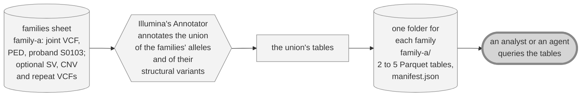
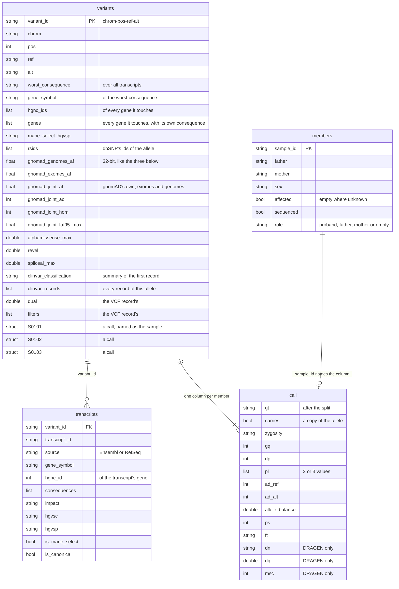
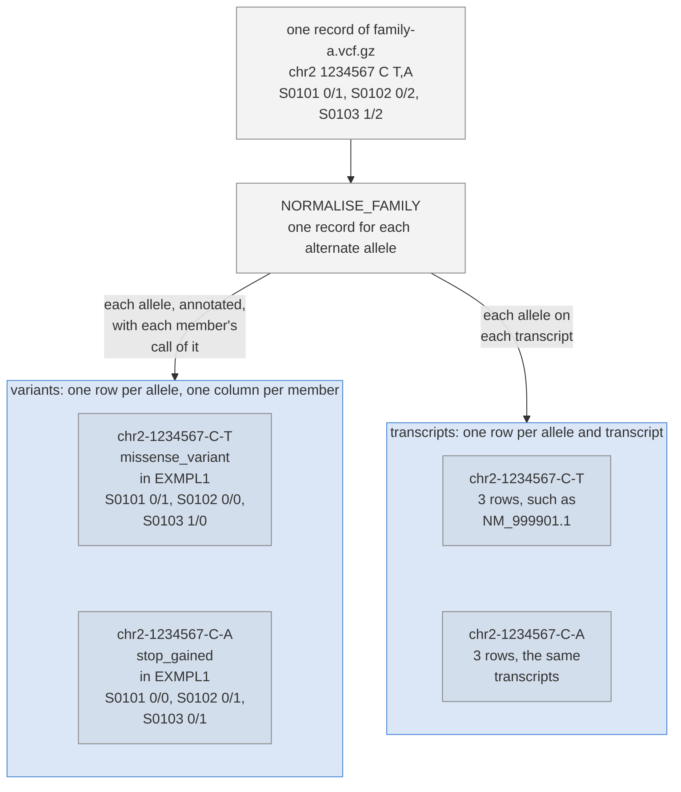
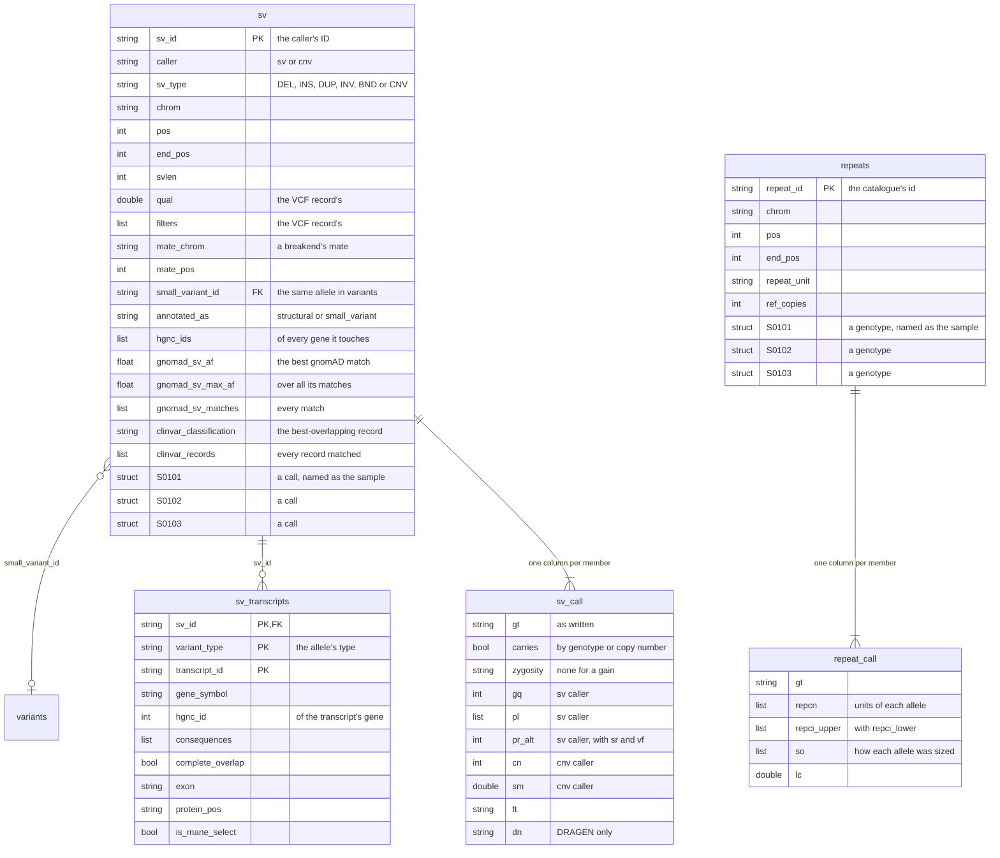

# Reading the family tables

The family tables are two Parquet tables and a manifest that hold one family's annotated variants with each member's
calls, with up to three more tables for its structural variants, copy number segments and tandem repeats. One of those,
`sv`, holds the structural variants and the copy-number variants together: the records of two callers, told apart by its
`caller` column. This page is for an analyst who queries them, and for someone who writes an agent that does: it follows
one record of a joint VCF into the rows it becomes, shows how to ask the usual rare-disease questions with DuckDB from
Python, and ends with a reference of every file, column and manifest field.



The marked step is where the tables are read: an analyst or an agent queries the folder of the family it analyses, which
the steps before it wrote. [Annotation](annotation.md#family-tables) explains how `family_tables.nf` makes the tables.
The [glossary](glossary.md) defines each word used here.

Every id and value in the examples is invented. That covers the family `family-a`, the samples `S0101` to `S0103`, the
gene `EXMPL1` and its identifiers, which no gene model contains, the HGNC ids `99901` and `99902`, the rsID
`rs9999990001`, the deletion with its two record ids and the repeat `EXRPT1`.

## Background

> [!NOTE]
>
> Skip this section if you have read a joint-called VCF with an annotation in its INFO column, and know what a row group
> of a Parquet file is.

### A joint VCF and its annotation

A variant caller compares a family's reads with the reference genome and writes the differences into one VCF file for
the whole family, the joint VCF. Three words about it recur on this page. An allele is one alternate sequence at a
position; a position where one member has a `T` and another an `A` in place of the reference's `C` has two. A call is
what the caller concluded for one member at one position: the genotype, such as `0/1` for one copy of the first
alternate allele, with the read counts and qualities behind it. A transcript is one of the RNA molecules that a gene is
copied into, and one variant can change each transcript of a gene differently.

An annotation adds what is known about each allele: its consequence on each transcript, its frequency in
[gnomAD](glossary.md#clinvar-and-gnomad), prediction scores and its ClinVar records. Two gene models name the
transcripts, Ensembl and RefSeq, and for most genes they agree on one default transcript, which is called MANE Select. A
gene has a symbol, such as `EXMPL1`, which can change over the years, and many genes also have an HGNC id, a number that
the HUGO Gene Nomenclature Committee gives a gene for good. An HGVS name is the standard way to write a variant on the
genome, on a transcript or on a protein, such as `c.401C>T` and `p.Ser134Leu`.

A joint-called VCF has one line per site. The site's fields come first, then an INFO column into which an annotator
packs its results as strings, then one column per sample with that sample's call as colon-separated values. An
annotation such as Ensembl VEP's `CSQ` holds one entry per allele and transcript, separated by commas, each a run of
fields separated by `|`. A site with two alternate alleles keeps both on one line, so every per-allele value (an allele
depth, a population frequency, a `CSQ` entry) has to be matched to its allele by position or by name. Answering a
question of a VCF means parsing those strings in the right order, and a tool such as `bcftools` does it one line at a
time.

### Parquet and DuckDB

Parquet is a file format that stores a table column by column, with typed values, so a reader fetches only the columns a
query names. A file is cut into row groups, here of 100,000 rows, and each row group records the smallest and the
largest value of every column. A reader that looks for one position skips every row group whose range of positions
excludes it. A Bloom filter is a small index beside a column of a row group that says when a value is certainly absent
from it, so a lookup by an id or a gene skips row groups in the same way. The file ends in a footer that lists the
columns and the row groups with their ranges, which a reader loads before anything else.

DuckDB is a database engine that runs inside a Python process and queries Parquet files with SQL where they lie.

## From a VCF to two tables

The family tables unpack the information of an annotated VCF into two tables with one kind of row each.

| Table         | One row per                       | Holds                                                                                                                                                                                                                                                                |
| ------------- | --------------------------------- | -------------------------------------------------------------------------------------------------------------------------------------------------------------------------------------------------------------------------------------------------------------------- |
| `variants`    | allele                            | its frequencies, scores, ClinVar records and the summary of its most severe consequence, and then the VCF's sample columns: one column per sequenced member, named as the VCF names the sample, holding that member's call of the allele as a struct of typed fields |
| `transcripts` | allele and transcript it overlaps | that transcript's consequence and HGVS names                                                                                                                                                                                                                         |

A multi-allelic site becomes one row per allele before anything else happens, and the
[variant id](glossary.md#variant-id) `<chrom>-<pos>-<ref>-<alt>` names the allele in both tables, so it is the key that
joins them. A question about a genotype and an annotation together, such as which rare alleles the proband carries,
reads one row of `variants` and needs no join ([Why the tables have this shape](#why-the-tables-have-this-shape)).



The diagram shows the key that joins the tables and a selection of their columns. The
[reference](#reference-files-columns-and-manifest) at the end of the page has every column.

### The pedigree and the roles

The tables hold no pedigree: no row or column says who is whose parent, or who is affected. That comes from the family's
PED file, which `family_tables.nf` copies into the family's `manifest.json` as `members`, shown above as a table of its
own.

Each member also has a role: `proband` for the member that the run's sheet names as the family's proband, `father` and
`mother` for that member's sequenced parents, and none for anyone else. The sheet is the list of families that whoever
runs the pipeline gives `family_tables.nf`. The tables' proband is the one the sheet names; nothing derives it from the
pedigree ([the input contract](annotation.md#the-input-contract)).

A proband is optional. A family whose sheet names none has the same tables with the same columns, one for every
sequenced member, and its manifest gives each member's `affected` and `sequenced` and no role. Of the queries below,
only the trio queries need the roles. The lookups before them use none, and
[Rare variants in every affected member](#rare-variants-in-every-affected-member) and the queries after it read the
manifest's `affected` and `sequenced` instead.

A query reads the roles from the manifest to find the proband's column, as the setup below does.

> [!NOTE]
>
> A sample name, such as `S0103`, is the name that the family's VCF gives one member's sample. It is the member's column
> in `variants` and the member's `sample_id` in the manifest.

## A worked example

The figure follows one record of the joint VCF of the family `family-a` into the two tables. `S0101` is the father,
`S0102` the mother and `S0103` the proband. The rest of the section goes through the same record value by value.



### The record in the VCF

The invented trio `family-a` has an unaffected father `S0101`, an unaffected mother `S0102` and their affected daughter
`S0103`. Its PED file reads:

```text
family-a	S0101	0	0	1	1
family-a	S0102	0	0	2	1
family-a	S0103	S0101	S0102	2	2
```

At one position in the invented gene `EXMPL1` the father carries a `T`, the mother an `A`, and their daughter one of
each. The joint caller writes that as a single record with two alternate alleles. Annotated with VEP, and cut down to
the lines that matter, the VCF reads:

```text
##INFO=<ID=gnomADg_AF,Number=A,Type=Float,Description="Allele frequency in gnomAD v4.1 genomes">
##INFO=<ID=CSQ,Number=.,Type=String,Description="Consequence annotations from Ensembl VEP. Format: Allele|Consequence|IMPACT|SYMBOL|Gene|Feature|MANE_SELECT|HGVSc|HGVSp">
##FORMAT=<ID=GT,Number=1,Type=String,Description="Genotype">
##FORMAT=<ID=AD,Number=R,Type=Integer,Description="Allelic depths for the ref and alt alleles in the order listed">
##FORMAT=<ID=DP,Number=1,Type=Integer,Description="Approximate read depth">
##FORMAT=<ID=GQ,Number=1,Type=Integer,Description="Genotype Quality">
##FORMAT=<ID=PL,Number=G,Type=Integer,Description="Phred-scaled likelihoods for genotypes">
##FORMAT=<ID=FT,Number=1,Type=String,Description="Sample filter">
##FORMAT=<ID=DN,Number=1,Type=String,Description="Possible values are Inherited, DeNovo or LowDQ">
#CHROM	POS	ID	REF	ALT	QUAL	FILTER	INFO	FORMAT	S0101	S0102	S0103
chr2	1234567	.	C	T,A	612.3	PASS	gnomADg_AF=1.3e-05,.;CSQ=T|missense_variant|MODERATE|EXMPL1|ENSG00000999901|ENST00000999901.1|NM_999901.1|ENST00000999901.1:c.401C>T|ENSP00000999901.1:p.Ser134Leu,T|missense_variant|MODERATE|EXMPL1|ENSG00000999901|ENST00000999902.1||ENST00000999902.1:c.302C>T|ENSP00000999902.1:p.Ser101Leu,A|stop_gained|HIGH|EXMPL1|ENSG00000999901|ENST00000999901.1|NM_999901.1|ENST00000999901.1:c.401C>A|ENSP00000999901.1:p.Ser134Ter,A|stop_gained|HIGH|EXMPL1|ENSG00000999901|ENST00000999902.1||ENST00000999902.1:c.302C>A|ENSP00000999902.1:p.Ser101Ter	GT:AD:DP:GQ:PL:FT:DN	0/1:18,16,0:34:48:412,0,520,430,540,990:PASS:.	0/2:20,0,17:37:50:390,420,980,0,450,505:PASS:.	1/2:1,15,14:30:45:820,450,470,440,0,480:PASS:Inherited
```

The `CSQ` value, split at its commas, holds four entries, one for each allele on each of the gene's two Ensembl
transcripts:

```text
T|missense_variant|MODERATE|EXMPL1|ENSG00000999901|ENST00000999901.1|NM_999901.1|ENST00000999901.1:c.401C>T|ENSP00000999901.1:p.Ser134Leu
T|missense_variant|MODERATE|EXMPL1|ENSG00000999901|ENST00000999902.1||ENST00000999902.1:c.302C>T|ENSP00000999902.1:p.Ser101Leu
A|stop_gained|HIGH|EXMPL1|ENSG00000999901|ENST00000999901.1|NM_999901.1|ENST00000999901.1:c.401C>A|ENSP00000999901.1:p.Ser134Ter
A|stop_gained|HIGH|EXMPL1|ENSG00000999901|ENST00000999902.1||ENST00000999902.1:c.302C>A|ENSP00000999902.1:p.Ser101Ter
```

Each sample's values are ordered by allele. `AD` lists the reads of `C`, `T` and `A`. `PL` lists the likelihoods of the
six genotypes the two alleles allow, in the VCF's order `0/0`, `0/1`, `1/1`, `0/2`, `1/2`, `2/2`, so the proband's `0`
in fifth place is her called `1/2`. `gnomADg_AF` has one value per alternate allele, and the `A` is absent from gnomAD.

### The split

`NORMALISE_FAMILY`, the first step of `family_tables.nf` to change the VCF, splits the record with
`bcftools norm -m -any` into one record per alternate allele. Each sample's call is rewritten against that allele alone,
so the proband's `1/2` becomes `1/0` in the `T` record and `0/1` in the `A` record, and the mother's `0/2` becomes `0/0`
in the `T` record. `AD` keeps the reference and that allele, and `PL` the three genotypes made of them.

The tables are built from the split records, with the annotation taken from Illumina's Annotator rather than from `CSQ`,
which the workflow does not read.

> [!WARNING]
>
> Splitting a VCF that carries `CSQ` would leave all four entries on both records, since `CSQ` is not a per-allele
> field. A filter on the split VCF that forgets to match the `Allele` field can then credit the stop gain to the `T`
> allele.

### The rows of `variants`

The record becomes two rows of `variants`. The table shows the columns that describe the allele, with one column per
allele; the members' columns of the same two rows follow [further down](#the-members-columns-of-the-two-rows).

| column                      | `T` allele                  | `A` allele                  |
| --------------------------- | --------------------------- | --------------------------- |
| `variant_id`                | `chr2-1234567-C-T`          | `chr2-1234567-C-A`          |
| `variant_type`              | `SNV`                       | `SNV`                       |
| `hgvsg`                     | `NC_000002.12:g.1234567C>T` | `NC_000002.12:g.1234567C>A` |
| `worst_consequence`         | `missense_variant`          | `stop_gained`               |
| `worst_impact`              | `moderate`                  | `high`                      |
| `worst_transcript_id`       | `NM_999901.1`               | `NM_999901.1`               |
| `gene_symbol`, `gene_id`    | `EXMPL1`, `ENSG00000999901` | `EXMPL1`, `ENSG00000999901` |
| `hgnc_ids`                  | `[99901]`                   | `[99901]`                   |
| `genes`                     | one entry, of `EXMPL1`      | one entry, of `EXMPL1`      |
| `mane_select_hgvsp`         | `NP_999901.1:p.(Ser134Leu)` | `NP_999901.1:p.(Ser134Ter)` |
| `rsids`                     | `['rs9999990001']`          | empty                       |
| `gnomad_genomes_af`         | 0.000013                    | empty                       |
| `gnomad_joint_af`           | 0.0000095                   | empty                       |
| `gnomad_joint_ac`           | 14                          | empty                       |
| `alphamissense_max` (class) | 0.91 (`likely_pathogenic`)  | empty                       |
| `revel`                     | 0.81                        | empty                       |
| `clinvar_classification`    | empty                       | empty                       |
| `qual`, `filters`           | 612.3, `['PASS']`           | 612.3, `['PASS']`           |

Several values in these rows need a word.

- `qual` and `filters` belong to the VCF record, so the two alleles share them.
- AlphaMissense and REVEL score missense changes only, so the stop gain has neither.
- `rsids` is a list, because dbSNP gives some alleles several ids, and the `A` allele, which dbSNP does not hold, has no
  list rather than an empty one.
- `hgnc_ids` is a list too, because an allele can lie in several genes: it holds the HGNC id of each gene that one of
  the allele's transcripts belongs to, here the id of `EXMPL1` alone.
- `worst_consequence`, `worst_impact`, `gene_symbol` and `gene_id` are those of one transcript: the one with the most
  severe consequence among the transcripts of all the allele's genes. For an allele in two overlapping genes they
  describe one of the two. `genes` has an entry for each gene, with that gene's own most severe consequence and its
  impact, here one entry for `EXMPL1`.
- The joint columns hold gnomAD's own values over its exomes and genomes together, which the workflow reads from a
  public archive rather than from the VCF ([gnomAD's joint columns](#gnomads-joint-columns)). gnomAD does not hold the
  `A` allele, so its joint columns are empty too; an allele that gnomAD holds with a count of 0 would read 0 instead.
- The four frequency columns (`gnomad_genomes_af`, `gnomad_exomes_af`, `gnomad_joint_af` and `gnomad_joint_faf95_max`)
  are 32-bit floats. DuckDB shows the `T` allele's joint frequency as 9.5e-06, and Python reads it as
  9.499999578110874e-06, the 64-bit number equal to the stored one.

### The rows of `transcripts`

`transcripts` has a row for each allele on each transcript, from Ensembl and RefSeq both. Four of the six rows:

| `variant_id`       | `transcript_id`     | `source` | `is_mane_select` | `worst_consequence` | `impact`   | `hgvsc`                      | `hgvsp`                           |
| ------------------ | ------------------- | -------- | ---------------- | ------------------- | ---------- | ---------------------------- | --------------------------------- |
| `chr2-1234567-C-T` | `NM_999901.1`       | RefSeq   | true             | `missense_variant`  | `moderate` | `NM_999901.1:c.401C>T`       | `NP_999901.1:p.(Ser134Leu)`       |
| `chr2-1234567-C-T` | `ENST00000999902.1` | Ensembl  | false            | `missense_variant`  | `moderate` | `ENST00000999902.1:c.302C>T` | `ENSP00000999902.1:p.(Ser101Leu)` |
| `chr2-1234567-C-A` | `NM_999901.1`       | RefSeq   | true             | `stop_gained`       | `high`     | `NM_999901.1:c.401C>A`       | `NP_999901.1:p.(Ser134Ter)`       |
| `chr2-1234567-C-A` | `ENST00000999902.1` | Ensembl  | false            | `stop_gained`       | `high`     | `ENST00000999902.1:c.302C>A` | `ENSP00000999902.1:p.(Ser101Ter)` |

The two rows not shown are those of `ENST00000999901.1`, the Ensembl copy of the MANE Select transcript, which Illumina
flags as MANE Select only on the RefSeq copy. Every row also names its transcript's gene, as `gene_symbol` `EXMPL1` and
`hgnc_id` 99901.

### The members' columns of the two rows

The two rows of `variants` end in a column for each member, in the VCF's order. Each cell is a struct holding the
member's call of that row's allele; the table shows its `gt`, `zygosity`, `gq`, `pl` and allele depths, and the
proband's `dn`. The struct also says whether the member carries the allele, as `carries`, which is true wherever the
table shows `het`:

| `variant_id`       | `S0101`                                           | `S0102`                                           | `S0103`                                                  |
| ------------------ | ------------------------------------------------- | ------------------------------------------------- | -------------------------------------------------------- |
| `chr2-1234567-C-T` | `0/1`, `het`, 48, `[412, 0, 520]`, 18 and 16      | `0/0`, `hom_ref`, 50, `[390, 420, 980]`, 20 and 0 | `1/0`, `het`, 45, `[820, 450, 470]`, 1 and 15, Inherited |
| `chr2-1234567-C-A` | `0/0`, `hom_ref`, 48, `[412, 430, 990]`, 18 and 0 | `0/1`, `het`, 50, `[390, 0, 505]`, 20 and 17      | `0/1`, `het`, 45, `[820, 440, 480]`, 1 and 14, Inherited |

Read into Python, the proband's cell in the row of the `T` allele is a dictionary with every field of the call:

```python
{
    'gt': '1/0',
    'carries': True,
    'zygosity': 'het',
    'gq': 45,
    'dp': 30,
    'pl': [820, 450, 470],
    'ad_ref': 1,
    'ad_alt': 15,
    'allele_balance': 0.9375,
    'ps': None,
    'ft': 'PASS',
    'dn': 'Inherited',
    'dq': None,
    'msc': None,
}
```

Some things in these rows follow from the split.

- Each row holds every member's call of its allele, so the mother's `0/0` for the `T` allele sits beside her daughter's
  call of it, as it would in a split VCF.
- `dp` and `gq` are the original record's and so are the same in both rows for a member.
- The mother's likelihoods for the `T` allele have no 0, because the genotype she was called with (`0/2`) is not among
  the three they keep.
- The proband's allele balance is 0.94 for one allele and 0.93 for the other, although she carries one copy of each,
  because it compares an allele's reads with the reference's alone, and she has almost no reference reads.

The proband is a compound heterozygote in `EXMPL1`, with one allele from each parent, and the compound heterozygote
query below finds her through these two rows.

### The members in the manifest

The manifest's `members` for this family read:

```json
[
  {"sample_id": "S0101", "father": null, "mother": null, "sex": "male", "affected": false, "sequenced": true, "role": "father"},
  {"sample_id": "S0102", "father": null, "mother": null, "sex": "female", "affected": false, "sequenced": true, "role": "mother"},
  {"sample_id": "S0103", "father": "S0101", "mother": "S0102", "sex": "female", "affected": true, "sequenced": true, "role": "proband"}
]
```

## Structural variants, copy number and repeats

The two tables above hold a family's small variants, which are what a joint VCF holds. The
[larger variants](glossary.md#larger-variants) come from other callers, in VCFs of their own, and a family whose VCFs
were given to `family_tables.nf` has up to three more tables for them. `sv` holds the structural variants and the
copy-number variants, the records of two callers, told apart by the `caller` column. `sv_transcripts` holds the
transcripts that those records hit, and `repeats` the tandem repeats. The manifest's `tables` lists the tables a folder
holds, so a reader looks there before it queries one of these.

| Table            | One row per                                                   | Holds                                                                                                                                                                                                                                                                                                                                                                        |
| ---------------- | ------------------------------------------------------------- | ---------------------------------------------------------------------------------------------------------------------------------------------------------------------------------------------------------------------------------------------------------------------------------------------------------------------------------------------------------------------------- |
| `sv`             | record of a structural-variant caller or a copy-number caller | where the record lies, its type and length, a breakend's mate, its QUAL and FILTER, the row of `variants` that is the same allele, where there is one, and what Illumina's Annotator says of the record: its genes, how common a variant like it is, and ClinVar's records; then one column per sequenced member, as in `variants`, holding that member's call of the record |
| `sv_transcripts` | record, allele and transcript that the Annotator lists for it | the transcript and its gene, and how the variant hits the transcript                                                                                                                                                                                                                                                                                                         |
| `repeats`        | tandem repeat that a repeat genotyper sized                   | the repeat's place and unit, and then one column per sequenced member holding the size of each of that member's alleles                                                                                                                                                                                                                                                      |

A row's place and the members' calls come from the callers' VCFs. Illumina's Annotator annotates the records of `sv` in
a run of their own, as it annotates the alleles of `variants`, and `sv_transcripts` is to `sv` what `transcripts` is to
`variants`. Nothing annotates `repeats` ([Shared column names](#shared-column-names) says what is still to come).

Two kinds of caller fill `sv`. A structural-variant caller finds junctions in the reads and writes one record per
[structural variant](glossary.md#structural-variant): a deletion, an insertion, a duplication, an inversion, or a
breakend, which is one side of a junction between two distant places. A copy-number caller reads the depth and writes
one record per [copy number segment](glossary.md#copy-number-segment), a stretch over which a member has fewer or more
copies than expected. `caller` says which a row came from (`sv` or `cnv`).

A copy-number row is a segment whose copy number differs from the expected one in some member; the caller's segments at
the expected copy number are left out. A member carries such a row by its copy number, and a gain is carried with no
zygosity ([Who carries a record](#who-carries-a-record)). The two callers work apart, so one event can have a row from
each ([One deletion in both callers' records](#one-deletion-in-both-callers-records)). In one whole-genome trio `sv` has
about 64,000 rows of the structural-variant caller and about 1,400 of the copy-number caller.

`sv_id` is the caller's own ID of the record and the key of the table, as the variant id is the key of `variants`, and
it joins `sv_transcripts` to `sv`.



The diagram shows a selection of the columns, and the [reference](#the-sv-table) has all of them.

### One deletion in both callers' records

Suppose the proband of `family-a` has a deletion of about 12 kb in `EXMPL1` on one chromosome copy, which neither parent
has. Both callers report it, each with its own boundaries, so `sv` has two rows for it. The ids are invented, like the
deletion:

| `sv_id`                        | `caller` | `sv_type` | `pos`   | `end_pos` | `S0101`                  | `S0102`                  | `S0103`                |
| ------------------------------ | -------- | --------- | ------- | --------- | ------------------------ | ------------------------ | ---------------------- |
| `EX:DEL:101`                   | `sv`     | `DEL`     | 1250112 | 1261870   | `0/0`, `hom_ref`         | `0/0`, `hom_ref`         | `0/1`, `het`, carries  |
| `EX:LOSS:chr2:1250000-1262000` | `cnv`    | `DEL`     | 1250000 | 1262000   | `./.`, `cn` 2, `hom_ref` | `./.`, `cn` 2, `hom_ref` | `0/1`, `cn` 1, carries |

The first five columns are among those that describe the record. The last three are the members' columns of the same two
rows, shown by their `gt`, `cn`, `zygosity` and `carries`. The two rows are not linked to each other; a reader that
wants one event for the deletion compares their positions.

### Who carries a record

A member's column of `sv` is a struct, as in `variants`, and the fields that mean the same thing in both tables have the
same names: `gt`, `carries`, `zygosity`, `gq`, `pl`, `ft`, `dn` and `dq`. The other fields are these callers' own, such
as the copy number `cn` ([The members' columns of `sv`](#the-members-columns-of-sv)).

The copy-number caller writes each parent's genotype above as `./.`, although it did call them, at 2 copies. DRAGEN
writes a member at the expected copy number that way, and a member with more copies as `./1` whatever their number. A
genotype of that caller therefore says neither that a parent is unaffected nor how many copies a member has. `carries`
and `zygosity` answer the same question for both callers.

For a row of the structural-variant caller the genotype decides, as in `variants`. `carries` is true where the genotype
holds a copy of the allele, also beside a missing one, false where every allele is called and none is the allele, and
empty for any other genotype, such as the `./.` of a member without a call. `zygosity` is classified in the same way:
`0/1` is `het`, `1/1` is `hom_alt`, `0/0` is `hom_ref`, and a genotype that leaves `carries` empty has none. A haploid
call, as DRAGEN makes on a male's X and Y outside the [pseudoautosomal regions](glossary.md#pseudoautosomal-regions), is
`hom_alt` for `1` and `hom_ref` for `0`.

For a row of the copy-number caller the copy number decides, read against the copies expected. Those are the alleles in
the member's genotype: two, or one where the caller calls the member haploid.

| `cn` against the copies expected | `carries` | `zygosity` | DRAGEN's `gt`, diploid | Haploid |
| -------------------------------- | --------- | ---------- | ---------------------- | ------- |
| the same                         | false     | `hom_ref`  | `./.`                  | `0`     |
| fewer, and more than 0           | true      | `het`      | `0/1`                  |         |
| 0                                | true      | `hom_alt`  | `1/1`                  | `1`     |
| more                             | true      | empty      | `./1`                  | `1`     |
| no copy number, as a female's Y  | empty     | empty      |                        | `.`     |

A gain is the one case in which `carries` and `zygosity` differ from what they say in `variants`, where a member who
carries an allele is always `het` or `hom_alt`. A member with a gain carries the segment and has no zygosity, because
its copy number does not say how the copies are split between the two chromosome copies: 4 copies can be two on each or
three on one. A query for the members who have a record therefore reads `carries`, and a condition such as
`zygosity IN ('het', 'hom_alt')` finds structural variants and losses and no gain. A male with no copy of a segment of
his X is `hom_alt`, like his haploid call of a small variant there.

A member without a call of a record has neither value: the structural-variant caller wrote no genotype for the member,
or the copy-number caller no copy number. `carries` is false only for a member who was called and does not have the
record, and that member's `zygosity` is `hom_ref`.

> [!IMPORTANT]
>
> A copy-number genotype has to agree with its copy number: an alternate allele exactly where the copy number is not the
> expected one, `<DEL>` below it and `<DUP>` above, and as many `<DEL>` alleles as copies are lost. A record that breaks
> this fails the run, so `gt` and `zygosity` never disagree in a table.

### What the annotation says of a record

A caller's record says where a variant lies and who carries it. Illumina's Annotator adds what an analyst filters on:
the genes and transcripts the variant hits, how common a variant like it is, and what ClinVar holds on one. The
transcripts are the rows of `sv_transcripts`, and the rest are columns of `sv`, between `small_variant_id` and the
members' columns. [Annotation](annotation.md#annotating-the-structural-variants) explains the run that makes these
columns, and this section how to read them.

`hgnc_ids` names the record's genes as it names an allele's in `variants`: it holds the HGNC id of each gene that one of
the record's transcripts belongs to. The deletion in `EXMPL1` has `[99901]`, and a deletion of 2 Mb has the id of every
gene in it. A record that touches no transcript has no list, and neither has one that lies only in genes without an HGNC
id ([A gene without an HGNC id](#a-gene-without-an-hgnc-id)).

A small variant is found in a database by its position and alleles. A structural variant rarely has an exact
counterpart, because two callers seldom place the same deletion at the same two bases. The Annotator therefore reports
the entries of a database that are like the record, and how alike depends on the record:

| Record                                                           | The entries it is matched to                                                                                                                                          |
| ---------------------------------------------------------------- | --------------------------------------------------------------------------------------------------------------------------------------------------------------------- |
| a deletion, a duplication, an inversion or a copy number segment | those at a reciprocal overlap of 0.5 or more, and none of the other direction, such as a gain for a loss; in the output seen so far they are of the record's own kind |
| an insertion                                                     | gnomAD's and 1000 Genomes' within about 500 bases of `pos`, whatever their length; none of ClinVar                                                                    |
| a breakend                                                       | none so far                                                                                                                                                           |

The [reciprocal overlap](glossary.md#reciprocal-overlap) of two intervals is the bases they share, over the longer of
the two: 1 for the same interval, and 0.5 where a deletion of 6 kb lies inside one of 12 kb.

A record can match several entries, so a frequency column needs a rule. Take the proband's deletion of
[One deletion in both callers' records](#one-deletion-in-both-callers-records), and suppose gnomAD holds two deletions
there, with invented ids and values:

| gnomAD entry  | Reciprocal overlap with `EX:DEL:101` | Allele frequency |
| ------------- | ------------------------------------ | ---------------- |
| `EX-gnomad-1` | 0.97                                 | 0.0002           |
| `EX-gnomad-2` | 0.61                                 | 0.031            |

The row of `EX:DEL:101` then reads `gnomad_sv_id` `EX-gnomad-1`, `gnomad_sv_af` 0.0002 and `gnomad_sv_overlap` 0.97,
which are the best match: the entry that overlaps the record most. `gnomad_sv_max_af` is 0.031, the highest frequency
among all its matches, and `gnomad_sv_matches` lists both entries with their intervals. The best match is the estimate
for this deletion. The maximum is what a filter for common variants should read, since a common deletion that covers
half of the record still explains reads there. For an insertion or a breakend the best match is the nearest entry, and
`gnomad_sv_distance` gives the bases between it and `pos` where `gnomad_sv_overlap` is empty.

The other columns of the annotation follow from the same matching:

- `onekg_sv_` and `gnomad_cnv_` hold the best match among the 1000 Genomes structural variants and among gnomAD's
  copy-number variants, without a list.
- `clinvar_records` holds every ClinVar record matched, the best-overlapping first, and the `clinvar_` columns summarise
  that first one, with its overlap in `clinvar_overlap`. A record there is of another variant that overlaps this one: a
  pathogenic deletion of 100 kb at an overlap of 0.5 says little about a deletion of 50 kb inside it.
- `annotated_as` is `small_variant` for a record written as a sequence whose two alleles are each at most 50 bases,
  about one record in five. The Annotator treats such a record as a small variant: it has no match by overlap, and
  instead gnomAD's values of the allele itself in `gnomad_genomes_` and `gnomad_exomes_` and ClinVar's records of the
  allele itself, as a row of `variants` has. Where the record names a row of `variants`, that row has the scores too.
- A segment that one member loses and another gains (`sv_type` `CNV`) has two alleles. Its lists hold the matches of
  both, each with its `variant_type`, and its `hgnc_ids` the genes of both. Its best match and `gnomad_sv_max_af` are
  empty, because either would be that of one allele. So are its `onekg_sv_` and `gnomad_cnv_` columns, which are best
  matches without a list: the table does not say what those two sources hold on such a segment.
- `annotated_pos` and `annotated_end_pos` give the interval the Annotator annotated. It equals `pos` and `end_pos`
  except where the Annotator trimmed or left-aligned an allele written as a sequence.

### How a record hits a transcript

`sv_transcripts` has one row for each transcript that the Annotator lists for a record: every transcript the variant
overlaps, of Ensembl and of RefSeq. A deletion of 12 kb inside one gene has a row for each transcript of that gene, and
a deletion of 2 Mb a row for each transcript of every gene in it. A row names its transcript and gene in the columns
that `transcripts` has for them, `hgnc_id` among them. Four fields say how the variant hits the transcript of a row.
Read them from the top, and take the first that holds:

| The variant                 | The row shows                                                                                                                                                               |
| --------------------------- | --------------------------------------------------------------------------------------------------------------------------------------------------------------------------- |
| covers the whole transcript | `complete_overlap` is true, and the row has no exon, intron or position. A deletion written as a sequence never has the flag: it has the term `transcript_ablation` instead |
| reaches coding sequence     | `protein_pos`, the amino acids concerned out of the protein's, such as `34-117/666`                                                                                         |
| reaches an exon             | `exon`, the exons concerned out of the transcript's, such as `2-3/9`, and `cdna_pos`                                                                                        |
| lies within introns         | `intron` alone, such as `2/8`                                                                                                                                               |
| lies beside the transcript  | none of these, and the term `upstream_gene_variant` or `downstream_gene_variant`. Only a record written as a sequence has such rows                                         |

`consequences` holds the Annotator's terms for the transcript, from most to least severe, and they need care. The
Annotator gives `feature_truncation` to every transcript that a deletion touches and `feature_elongation` to every one
that an insertion or a duplication touches, also when the variant lies wholly in an intron. A term therefore does not
say that the variant damages the transcript, and the fields above do. That is also why the table has no `impact` and no
`worst_consequence`: Illumina's impact is `high` for about six rows in ten, and the severity order puts an intronic
`feature_truncation` above a missense variant.

The table leaves three more things out. The coding position is not stable: two runs of the Annotator over the same
records give it for different rows, while `protein_pos` is the same in both. The HGVS names spell out the inserted or
deleted sequence. The partners of a gene fusion are mostly neighbouring genes that a deletion joins, and the term
`unidirectional_gene_fusion` stays in `consequences` for a reader who wants to look at such a record.

`is_mane_select` is true on RefSeq transcripts only, as in `transcripts`, so a query for the MANE Select transcript of a
gene reads a row with NCBI's `gene_id`; the row's `gene_symbol` and `hgnc_id` are the ones that the gene's Ensembl
transcripts have too. `variant_type` is the Annotator's type of the allele, such as `deletion` or `copy_number_loss`,
and it tells the two alleles of a `CNV` segment apart: such a record has rows of both types.

## Querying the tables from Python

DuckDB reads Parquet in place, without loading it into a database first, and answers lookups by region or variant id in
hundredths of a second, and by gene in under a tenth, because each table is sorted by position and has Bloom filters on
its lookup columns. An agent that writes and runs Python uses DuckDB's Python library rather than its command-line tool,
so that a result stays in the program for the next step, such as a join with what another tool returned.

The examples hand results over as Arrow, the columnar format that DuckDB exchanges with Python at least cost. They use
these calls:

| Call                              | What it does                                                                                                                                    |
| --------------------------------- | ----------------------------------------------------------------------------------------------------------------------------------------------- |
| `con.sql(sql, params=parameters)` | runs a query and returns a relation; it binds the values named `$name` in the SQL from a dictionary rather than formatting them into the string |
| a relation's `.to_arrow_table()`  | returns a `pyarrow.Table`                                                                                                                       |
| a relation's `.to_arrow_reader()` | streams record batches for a result too large to hold at once; while such a reader is open, DuckDB 2 refuses any other query on the connection  |
| `con.execute(sql, parameters)`    | the DB-API call, which suits a statement that returns no rows, such as the setup's `CREATE VIEW`                                                |

A relation runs its query again each time it is read, so each example reads its relation once and keeps the table.

DuckDB also queries an Arrow table held in a Python variable directly by the variable's name, without copying it, so one
query's result can be the next query's input. A step that needs pandas or Polars can convert a table with `.to_pandas()`
or `polars.from_arrow()`.

> [!WARNING]
>
> In DuckDB 2 the result of `con.execute` still has `.to_arrow_table()` and `.to_arrow_reader()`, but both copy the rows
> and warn, and the reader does not stream. The older names `fetch_arrow_table()`, `fetch_record_batch()` and `arrow()`
> are gone from it.

The thresholds are parameters too, and the values given here are common starting points rather than recommendations: the
queries a reader runs, and their thresholds, are the reader's own, such as those of an agent's skill.

The four frequency columns are 32-bit floats, and DuckDB widens a column's value to 64 bits to compare it with a Python
float, such as one in `params`. The widened value is close to the decimal number and rarely equal to it: 0.01 and 0.0001
are stored slightly below the decimal number, 0.05 and 0.001 slightly above. A frequency stored exactly on a threshold
can therefore fall on either side of it. That is the usual behaviour of floating-point numbers, and no other frequency
is affected. The frequencies of `sv` are 32-bit floats as well and compare with a threshold in the same way.

### Setup

The setup has two parts. The first opens a connection, makes one view for each table that the manifest lists, and reads
the members from the manifest. It runs for any family, and the queries without roles need nothing else.

```python
import json
import pathlib

import duckdb
import pyarrow

folder = pathlib.Path('family-a')  # the family's folder: its Parquet files and manifest.json
manifest = json.loads((folder / 'manifest.json').read_text())
con = duckdb.connect()
con.execute('SET parquet_metadata_cache = true')
tables = [t['table'] for t in manifest['tables']]
for table in tables:
    con.execute(f"CREATE VIEW {table} AS SELECT * FROM read_parquet('{folder / table}.parquet')")
members = manifest['members']
member_columns = ', '.join(f'"{m["sample_id"]}"' for m in members if m['sequenced'])
```

Every family has the views `variants` and `transcripts`. A family with the tables of its larger variants also has `sv`
and `sv_transcripts`, `repeats`, or all three, and a query on a table that the family lacks fails instead of returning
nothing.

`SET parquet_metadata_cache = true` keeps each file's footer in memory once it has been read. Without it DuckDB reads
the footer again for every query, which adds about 0.01 s to a lookup in `variants` and 0.04 s to one in `transcripts`
on a whole genome.

`member_columns` lists the column of every sequenced member, for the SQL of the queries below. Each sample name is in
double quotes, which makes it an identifier; a sample name can hold only letters, digits, `.`, `_` and `-`, so it cannot
break out of the quotes.

The second part is for a family with a proband whose parents were both sequenced, which the trio queries below assume.
It reads the roles from the manifest and makes a view, `trio`, of `variants`, and the views `trio_sv` and `trio_repeats`
of `sv` and `repeats` where the family has those tables.

```python
role = {m['role']: m['sample_id'] for m in members if m['role']}
proband_sex = next(m['sex'] for m in members if m['role'] == 'proband')
for view, table in (('trio', 'variants'), ('trio_sv', 'sv'), ('trio_repeats', 'repeats')):
    if table in tables:
        con.execute(
            f"""
            CREATE VIEW {view} AS
            SELECT * EXCLUDE ({member_columns}),
                   "{role['proband']}" AS proband, "{role['father']}" AS father, "{role['mother']}" AS mother
            FROM {table}
            """
        )
```

`role` maps each role to its member's sample name, `{'father': 'S0101', 'mother': 'S0102', 'proband': 'S0103'}` in the
worked example, where `proband_sex` is `'female'`. `trio` holds the allele's columns of `variants` and the three
members' columns under the names of their roles, so that the SQL reads `proband.gt` whatever the samples are called. It
leaves the members' columns out under their sample names: in a family with a sample that is itself named `proband`, the
name then still means the proband that the manifest gives. A query on the view reads only the columns it names. One
statement makes all three views because every table that holds the members names their columns in the same way
([Shared column names](#shared-column-names)).

> [!WARNING]
>
> In a family without a sequenced father, `role` has no `father`, and creating the view fails with a `KeyError` rather
> than returning an empty result. In a family whose sheet names no proband, `role` is empty and the line that reads
> `proband_sex` already fails, with a `StopIteration`. Such a family runs the first part alone, and then the queries
> that use no roles.

### Variants in a region

Every allele between two positions, with its gene, consequence and frequency:

```python
in_region = con.sql(
    """
    SELECT variant_id, gene_symbol, worst_consequence, gnomad_joint_af
    FROM variants
    WHERE chrom = $chrom AND pos BETWEEN $start AND $end
    ORDER BY pos
    """,
    params={'chrom': 'chr2', 'start': 1_200_000, 'end': 1_300_000},
).to_arrow_table()
```

On an indexed VCF the same lookup is `bcftools view -H -r chr2:1200000-1300000 family.vcf.gz`, which returns whole
records with the annotation still packed into INFO.

### Variants in a gene

`variants.gene_symbol` names only the gene of the allele's most severe consequence, so an allele in two overlapping
genes shows under one of them there. `hgnc_ids` lists every gene that one of the allele's transcripts belongs to, by its
HGNC id, so one condition finds a gene's alleles:

```python
in_gene = con.sql(
    """
    SELECT variant_id, pos, worst_consequence, gnomad_joint_af
    FROM variants
    WHERE list_contains(hgnc_ids, $hgnc_id)
    ORDER BY pos
    """,
    params={'hgnc_id': 99901},
).to_arrow_table()
```

DuckDB 2.0 uses neither a row group's statistics nor its Bloom filter for a condition on a list, so the query reads the
whole column. The column is small, under 1 MB for a whole genome, and the lookup takes about 0.09 s
([How fast](#how-fast)).

> [!WARNING]
>
> Write the condition as `list_contains(hgnc_ids, $hgnc_id)` and not as `$hgnc_id = ANY(hgnc_ids)`. With `ANY`, the same
> lookup took 0.7 s and 1.7 GB of memory, and the lookup by rsID below took 3.8 s and 3 GB, past the memory limit of 2
> GB.

With VEP's `CSQ` the closest is
`bcftools +split-vep -d -i 'SYMBOL="EXMPL1"' -f '%CHROM %POS %REF %Allele %Consequence\n' family.vcf.gz`, which reads
every record of the file, since a VCF index knows positions and not genes.

### A gene without an HGNC id

Many genes have no HGNC id. Of the 78,000 or so gene symbols in a whole-genome trio's `transcripts`, about 42,500 have
one. Nearly every protein-coding gene with a symbol of its own does (19,447 of 19,471), and none of the 35,000 genes
whose symbol is the id that Ensembl or NCBI gave them, an `ENSG` or a `LOC` name. A gene without an HGNC id is found by
its symbol, or by its gene id, in `transcripts`, which has a row for every gene an allele touches. The lookup takes two
steps:

1. the gene's alleles from `transcripts`, each with its chromosome and position;
1. those alleles' rows of `variants`.

The second step gives the scan of `variants` the gene's chromosome and the span of its alleles, so that the statistics
of `chrom` and `pos` pick out the row groups that hold the gene, and a semi join with the first step's table keeps the
gene's alleles among those of the span. The second step runs once for each chromosome on which the symbol has alleles,
which is one for nearly every gene.

```python
gene_alleles = con.sql(
    'SELECT DISTINCT variant_id, chrom, pos FROM transcripts WHERE gene_symbol = $gene',
    params={'gene': 'EXMPL1'},
).to_arrow_table()
spans = con.sql('SELECT chrom, min(pos), max(pos) FROM gene_alleles GROUP BY chrom').fetchall()
in_gene_by_symbol = pyarrow.concat_tables(
    con.sql(
        """
        SELECT v.variant_id, v.pos, v.worst_consequence, v.gnomad_joint_af
        FROM variants v
        SEMI JOIN gene_alleles USING (variant_id)
        WHERE v.chrom = $chrom AND v.pos BETWEEN $start AND $end
        ORDER BY v.pos
        """,
        params={'chrom': chrom, 'start': start, 'end': end},
    ).to_arrow_table()
    for chrom, start, end in spans
)
```

> [!WARNING]
>
> A symbol in which the family has no allele gives no span, and `concat_tables` then raises an `ArrowInvalid` rather
> than returning an empty table.

The two steps take about 0.02 s on a whole genome, less than the scan of `hgnc_ids`, because the Bloom filter of
`gene_symbol` picks out the row groups of `transcripts` that hold the gene. With `hgnc_id = $hgnc_id` in the first step
they find a gene by its HGNC id as fast.

Without the span, the ids alone narrow the scan less well. Joined to the table of ids, DuckDB filters the scan of
`variants` by the ids: with at most 50 ids, DuckDB 2.0.0 passes the ids themselves and the scan reads the few row groups
that hold them, but with more ids its filter is coarser, and the scan read 4 of the 90 row groups for a gene on
chromosome X, 15 for one on chromosome 2 and 39 for one on chromosome 13 or 17. In a single join of `transcripts` and
`variants`, DuckDB builds its hash table on `variants`, which it then reads whole.

### A variant's transcripts

The HGVS names of one allele on each transcript, MANE Select first, read row by row:

```python
transcripts_of_variant = con.sql(
    """
    SELECT transcript_id, source, is_mane_select, worst_consequence, hgvsc, hgvsp
    FROM transcripts
    WHERE variant_id = $variant_id
    ORDER BY is_mane_select DESC, source
    """,
    params={'variant_id': 'chr2-1234567-C-T'},
).to_arrow_table()
for row in transcripts_of_variant.to_pylist():
    print(row['transcript_id'], row['hgvsc'], row['hgvsp'])
```

The VCF equivalent, `bcftools +split-vep -d -r chr2:1234567 -f '%Allele %Feature %HGVSc %HGVSp\n' family.vcf.gz`, prints
the entries of every allele at the position, and the reader keeps those whose `Allele` is `T`.

### A variant by its rsID

`rsids` holds an allele's dbSNP ids as a list, and `list_contains` finds an id wherever it stands in the list, also
beside others:

```python
by_rsid = con.sql(
    """
    SELECT variant_id, gene_symbol, worst_consequence, rsids
    FROM variants
    WHERE list_contains(rsids, $rsid)
    """,
    params={'rsid': 'rs9999990001'},
).to_arrow_table()
```

As for `hgnc_ids`, the query reads the whole column, which is larger here and takes about a quarter of a second
([How fast](#how-fast)). A family whose run did not name dbSNP has no `rsids` column, and the query fails
([the `variants` table](#the-variants-table)).

### Rare damaging variants in the proband

The proband's alleles that are rare in gnomAD's joint release and either have a high-impact consequence or a damaging
score. The genotype and the annotation are columns of the same row, so the query reads `trio` alone. An allele absent
from gnomAD has no frequency, which `coalesce` reads as 0. The joint columns do not say whether gnomAD filtered an
allele; `gnomad_genomes_failed_filter` and `gnomad_exomes_failed_filter` do, for each set.

`worst_impact` is the impact of one transcript, the one that `worst_consequence` and `gene_symbol` are of: the
transcript with the most severe consequence among those of all the allele's genes. For an allele in two overlapping
genes it is the impact in one of them, and `genes` has the impact in each ([the `variants` table](#the-variants-table)).
An allele whose every consequence has the impact `modifier`, such as one in an exon of a non-coding RNA gene, passes no
threshold on the impact, in this column or in an entry of `genes`. A query for such alleles names their consequence
instead, such as `non_coding_transcript_exon_variant`.

```python
rare_damaging = con.sql(
    """
    SELECT variant_id, gene_symbol, worst_consequence, proband.gt AS proband_gt,
           gnomad_joint_af, gnomad_joint_ac,
           alphamissense_max, revel, spliceai_max
    FROM trio
    WHERE proband.carries
      AND coalesce(gnomad_joint_af, 0) < $max_af
      AND (worst_impact = 'high'
           OR alphamissense_max_class = 'likely_pathogenic'
           OR revel >= $min_revel
           OR spliceai_max >= $min_spliceai)
    """,
    params={'max_af': 0.001, 'min_revel': 0.75, 'min_spliceai': 0.2},
).to_arrow_table()
```

The result can go straight into the next query. Here it is narrowed to the genes that another tool returned by symbol,
such as a lookup of genes linked to the proband's phenotype, by naming both Arrow tables in the SQL:

```python
phenotype_genes = pyarrow.table({'gene_symbol': ['EXMPL1', 'EXMPL2']})  # for example, from a phenotype lookup
in_phenotype_genes = con.sql('SELECT * FROM rare_damaging JOIN phenotype_genes USING (gene_symbol)').to_arrow_table()
```

On a VCF the first query takes two steps, one for the sample and one for the annotation, roughly
`bcftools view -s S0103 -i 'GT="alt"' family.vcf.gz | bcftools +split-vep -s worst -i 'IMPACT="HIGH" || REVEL>=0.75' ...`,
with the field names depending on how the VCF was annotated.

### Rare variants in a panel of genes

A panel is a list of genes, given here as a table of HGNC ids. The query takes the rare alleles that the proband
carries, turns each one's `hgnc_ids` into a row per gene with `unnest`, and keeps the rows whose gene is in the panel.
An allele in two genes of the panel gives two rows.

```python
panel = pyarrow.table({'hgnc_id': [99901, 99902]})  # for example, the genes of a disease panel
in_panel = con.sql(
    """
    SELECT variant_id, hgnc_id, worst_consequence, gnomad_joint_af, proband_gt
    FROM (SELECT variant_id, unnest(hgnc_ids) AS hgnc_id, worst_consequence, gnomad_joint_af,
                 proband.gt AS proband_gt
          FROM trio
          WHERE proband.carries
            AND coalesce(gnomad_joint_af, 0) < $max_af)
    SEMI JOIN panel USING (hgnc_id)
    """,
    params={'max_af': 0.001},
).to_arrow_table()
```

In the worked example this returns both alleles, each with the HGNC id 99901. For a panel of 300 genes on a whole genome
it takes about 0.33 s. The same question takes 0.42 s through `transcripts`, and about 0.7 s when every allele's list is
tested against the panel with `list_has_any`.

### A de novo search

The tables hold no de novo calls (see [De novo variants](annotation.md#de-novo-variants)), so a reader has to search for
them. This search is permissive in the way seqr's de novo search is: the proband is heterozygous, both parents are
called homozygous reference with enough depth and at most one read of the allele, the proband's call has a GQ of at
least 20 and an allele balance of at least 0.2, the allele is very rare, and it touches a protein or a splice site. It
returns the three calls whole, each as a struct with every field.

A member's `carries` has three values: true where the genotype holds a copy of the allele, false where every allele of
the genotype is called and none is the allele, and empty (null) where the genotype is missing or has a missing allele
and no copy of the allele, as in `./.` and `0/.`. `zygosity` is `hom_ref` exactly where `carries` is false, so the
conditions on the parents below say that each parent was called and lacks the allele, and
`NOT father.carries AND NOT mother.carries` says the same. Neither form matches a parent without a call. A search for
the alleles that a parent is not shown to carry, uncalled sites included, asks for `father.carries IS NOT TRUE`.

```python
de_novo = con.sql(
    """
    SELECT variant_id, gene_symbol, worst_consequence, proband, father, mother
    FROM trio
    WHERE proband.zygosity = 'het'
      AND father.zygosity = 'hom_ref' AND mother.zygosity = 'hom_ref'
      AND proband.gq >= $min_gq
      AND proband.allele_balance >= $min_ab
      AND father.dp >= $min_parent_dp AND mother.dp >= $min_parent_dp
      AND coalesce(father.ad_alt, 0) <= $max_parent_ad_alt
      AND coalesce(mother.ad_alt, 0) <= $max_parent_ad_alt
      AND coalesce(gnomad_joint_af, 0) < $max_af
      AND (worst_impact IN ('high', 'moderate') OR spliceai_max >= $min_spliceai)
    """,
    params={
        'min_gq': 20,
        'min_ab': 0.2,
        'min_parent_dp': 10,
        'max_parent_ad_alt': 1,
        'max_af': 0.0001,
        'min_spliceai': 0.2,
    },
).to_arrow_table()
```

A GQ floor tuned on GATK's calls cuts into true de novo calls in DRAGEN's, because DRAGEN's GQ includes a prior of about
35 on the Phred scale against a heterozygous call of an allele that the population does not support, which is what a de
novo allele is ([De novo variants](annotation.md#de-novo-variants) says where the number was read). The likelihoods in
`pl` come from the reads before that prior. In DuckDB a list is indexed from 1, so `pl[1]` is the likelihood of `0/0`
and `pl[2]` that of `0/1`. The same search can therefore ask the reads directly: the proband's `0/0` is unlikely
(`proband.pl[1]`), and so is each parent's `0/1` (`father.pl[2]`, `mother.pl[2]`).

```python
de_novo_by_pl = con.sql(
    """
    SELECT variant_id, gene_symbol, worst_consequence, proband, father.pl AS father_pl, mother.pl AS mother_pl
    FROM trio
    WHERE proband.zygosity = 'het'
      AND father.zygosity = 'hom_ref' AND mother.zygosity = 'hom_ref'
      AND proband.pl[1] >= $min_pl
      AND father.pl[2] >= $min_pl AND mother.pl[2] >= $min_pl
      AND proband.allele_balance >= $min_ab
      AND coalesce(gnomad_joint_af, 0) < $max_af
      AND (worst_impact IN ('high', 'moderate') OR spliceai_max >= $min_spliceai)
    """,
    params={'min_pl': 20, 'min_ab': 0.2, 'max_af': 0.0001, 'min_spliceai': 0.2},
).to_arrow_table()
```

> [!WARNING]
>
> PL has a caveat of its own: with DRAGEN's [personalisation](glossary.md#personalisation) on, the evidence for an
> allele on the sample's imputed haplotypes moves from PL into the prior, so the PL values of a known and a novel allele
> are not comparable.

Where the VCF comes from DRAGEN's pedigree calling, the proband's `dn` holds DRAGEN's own verdict for a further look.

On a split VCF with the samples in the order father, mother, proband, the first search is roughly
`bcftools view -i 'GT[2]="het" && GT[0]="RR" && GT[1]="RR" && GQ[2]>=20 && FMT/AD[2:1]/(FMT/AD[2:0]+FMT/AD[2:1])>=0.2' split.vcf.gz`,
followed by the annotation filters as above.

### Recessive: homozygous in the proband, heterozygous in both parents

```python
homozygous = con.sql(
    """
    SELECT variant_id, gene_symbol, worst_consequence,
           proband.gt AS proband_gt, father.gt AS father_gt, mother.gt AS mother_gt,
           gnomad_joint_af, gnomad_joint_hom
    FROM trio
    WHERE proband.zygosity = 'hom_alt'
      AND father.zygosity = 'het' AND mother.zygosity = 'het'
      AND coalesce(gnomad_joint_af, 0) < $max_af
      AND worst_impact IN ('high', 'moderate')
    """,
    params={'max_af': 0.01},
).to_arrow_table()
```

`gnomad_joint_hom`, the number of homozygous people in gnomAD's joint release, rules out an allele that healthy people
carry on both copies. The VCF filter for the genotypes is `bcftools view -i 'GT[2]="AA" && GT[0]="het" && GT[1]="het"'`.

### Recessive: compound heterozygous candidates

Two rare alleles in one gene, each heterozygous in the proband, one inherited from the father and one from the mother.
The search goes through `transcripts`, so that it counts an allele in every gene it touches, with or without an HGNC id,
and keeps the genes with at least one allele from each side. An allele that both parents carry, or neither, has no side
and is left out; a phased call (`ps`) could place some of those.

```python
compound_het = con.sql(
    """
    WITH candidates AS (
        SELECT DISTINCT t.gene_symbol, v.variant_id,
               CASE WHEN v.father.zygosity = 'het' AND v.mother.zygosity = 'hom_ref' THEN 'father'
                    WHEN v.mother.zygosity = 'het' AND v.father.zygosity = 'hom_ref' THEN 'mother'
               END AS from_parent
        FROM trio v
        JOIN transcripts t USING (variant_id)
        WHERE v.proband.zygosity = 'het'
          AND coalesce(v.gnomad_joint_af, 0) < $max_af
          AND (t.impact IN ('high', 'moderate') OR v.spliceai_max >= $min_spliceai)
    )
    SELECT gene_symbol,
           list(variant_id) FILTER (WHERE from_parent = 'father') AS from_father,
           list(variant_id) FILTER (WHERE from_parent = 'mother') AS from_mother
    FROM candidates
    WHERE from_parent IS NOT NULL
    GROUP BY gene_symbol
    HAVING count(*) FILTER (WHERE from_parent = 'father') > 0
       AND count(*) FILTER (WHERE from_parent = 'mother') > 0
    """,
    params={'max_af': 0.01, 'min_spliceai': 0.2},
).to_arrow_table()
```

In the worked example this returns `EXMPL1` with `chr2-1234567-C-T` from the father and `chr2-1234567-C-A` from the
mother. A whole genome takes a little over a second here, most of it in the join with `transcripts`. A VCF has no
one-line equivalent, because the pairing is by gene across records: it takes a script over `bcftools query` output, or a
tool built for it.

`genes` gives the same attribution without the join. The query filters on the allele's own columns first, turns the
entries of the alleles that are left into rows with `unnest`, and counts each allele under each of its genes:

```python
compound_het_by_genes = con.sql(
    """
    WITH candidates AS (
        SELECT gene.gene_symbol AS gene_symbol, variant_id, from_parent
        FROM (SELECT variant_id, spliceai_max, unnest(genes) AS gene,
                     CASE WHEN father.zygosity = 'het' AND mother.zygosity = 'hom_ref' THEN 'father'
                          WHEN mother.zygosity = 'het' AND father.zygosity = 'hom_ref' THEN 'mother'
                     END AS from_parent
              FROM trio
              WHERE proband.zygosity = 'het'
                AND coalesce(gnomad_joint_af, 0) < $max_af)
        WHERE gene.worst_impact IN ('high', 'moderate') OR spliceai_max >= $min_spliceai
    )
    SELECT gene_symbol,
           list(variant_id) FILTER (WHERE from_parent = 'father') AS from_father,
           list(variant_id) FILTER (WHERE from_parent = 'mother') AS from_mother
    FROM candidates
    WHERE from_parent IS NOT NULL
    GROUP BY gene_symbol
    HAVING count(*) FILTER (WHERE from_parent = 'father') > 0
       AND count(*) FILTER (WHERE from_parent = 'mother') > 0
    """,
    params={'max_af': 0.01, 'min_spliceai': 0.2},
).to_arrow_table()
```

A gene symbol stands in at most one entry of an allele, so the query needs no `DISTINCT`. It reads the impact of each
gene's most severe consequence, where the query through `transcripts` reads the impact of every transcript. A search
that groups by the allele's own `gene_symbol` instead counts an allele in two genes under one of them, and misses a pair
in the other.

### X-linked in a male proband

DRAGEN calls a male's X outside the [pseudoautosomal regions](glossary.md#pseudoautosomal-regions) as haploid, so a
carried allele there has the call `1` and two likelihoods. The query looks for rare alleles that a male proband carries
on his single X and that his unaffected father does not carry. The mother's call is returned to tell an inherited allele
from a de novo one.

```python
if proband_sex == 'male':
    x_linked = con.sql(
        """
        SELECT variant_id, gene_symbol, worst_consequence,
               proband.gt AS proband_gt, proband.pl AS proband_pl,
               mother.gt AS mother_gt, father.gt AS father_gt, gnomad_joint_af
        FROM trio
        WHERE chrom = 'chrX'
          AND proband.gt = '1'
          AND father.zygosity = 'hom_ref'
          AND coalesce(gnomad_joint_af, 0) < $max_af
          AND worst_impact IN ('high', 'moderate')
        """,
        params={'max_af': 0.001},
    ).to_arrow_table()
```

The proband of the worked example is a girl, so the condition skips the query for her family. A female proband's own
calls on chrX are diploid, but her father's calls outside the pseudoautosomal regions are haploid, and a haploid `1` has
the zygosity `hom_alt`, never `het`. The queries above that read only the proband's call, or that ask for a `hom_ref`
father, therefore work there as on an autosome; in the search by likelihoods, the father's `pl[2]` is then the
likelihood of a haploid `1`. The two recessive queries do not: the homozygous query asks for a `het` father, and the
compound heterozygous query counts an allele as the father's only where he is `het`, so neither returns an allele that
the father carries on his X.

In a pseudoautosomal region a male is called diploid, and his alleles there show as `het` or `hom_alt` like any
autosome's. The VCF filter for the genotypes is `bcftools view -r chrX -i 'GT[2]="A" && GT[0]="R"'`, where `A` and `R`
match a haploid call of the allele and of the reference.

### Rare variants in every affected member

This query uses no proband and no roles, so it also serves a family whose sheet names no proband. It reads from the
manifest who is affected and who was sequenced, and returns the rare alleles that every affected sequenced member
carries and that every unaffected sequenced member is called homozygous reference for. It is the pattern of a cause that
the affected members share.

```python
affected = [m['sample_id'] for m in members if m['sequenced'] and m['affected']]
unaffected = [m['sample_id'] for m in members if m['sequenced'] and m['affected'] is False]
if affected:
    conditions = [f'"{sample}".carries' for sample in affected]
    conditions += [f""""{sample}".zygosity = 'hom_ref'""" for sample in unaffected]
    in_every_affected_member = con.sql(
        f"""
        SELECT variant_id, gene_symbol, worst_consequence, gnomad_joint_af
        FROM variants
        WHERE {' AND '.join(conditions)}
          AND coalesce(gnomad_joint_af, 0) < $max_af
        """,
        params={'max_af': 0.001},
    ).to_arrow_table()
```

In the worked example this returns nothing: the daughter is the only affected member, and an unaffected parent carries
each of her two alleles. Where the affected members may have different causes, the same query runs once for each of
them, with that member alone in `affected` and the other affected members in neither list. The query asks an unaffected
member for `zygosity = 'hom_ref'`, which a member without a call does not have, so an allele for which an unaffected
member has no call is left out.

A member whose phenotype the PED file gives as unknown has `"affected": null` in the manifest and belongs in neither
list, so the query asks nothing of that member's call. The condition `m['affected'] is False` keeps such a member out of
`unaffected`, where `not m['affected']` would put the member in. The query runs only for a family with an affected
sequenced member (`if affected`). Without one it would ask only that the unaffected members lack the allele, and return
the alleles that members of unknown phenotype carry.

### ClinVar pathogenic variants in anyone in the family

Every allele that any ClinVar record calls pathogenic or likely pathogenic, with the members who carry it. The query
reads `clinvar_records` rather than the summary columns, so that a pathogenic record shows even where a record with more
stars says otherwise. A classification is a string such as `Pathogenic/Likely pathogenic` or `Likely pathogenic`, and
the pattern does not match `Conflicting classifications of pathogenicity`.

A question about any member, rather than about named roles, turns the member columns into rows, which `UNPIVOT` does.
`variants` holds the allele's columns beside the members', so the query names the members' columns with the setup's
`member_columns`, which has the column of every member whose `sequenced` is true in the manifest, so the query works for
a family of any size. Each row of `member_calls` holds one member's call of one allele, with the member's sample name in
`sample_id` and the struct in `call`.

The query picks the alleles first and then reads `variants` a second time for the calls of those alleles alone.
Unpivoting in the same read as the ClinVar filter looks shorter and takes 1.9 times as long (see [How fast](#how-fast)).

```python
clinvar_pathogenic = con.sql(
    f"""
    WITH pathogenic AS (
        SELECT variant_id, gene_symbol, clinvar_classification, clinvar_stars
        FROM variants
        WHERE len(list_filter(clinvar_records,
                              lambda r: regexp_matches(r.classification, $pattern))) > 0
    ),
    member_calls AS (
        UNPIVOT (SELECT variant_id, {member_columns} FROM variants SEMI JOIN pathogenic USING (variant_id))
        ON {member_columns} INTO NAME sample_id VALUE call
    )
    SELECT p.variant_id, p.gene_symbol, p.clinvar_classification, p.clinvar_stars,
           list(m.sample_id || ' ' || m.call.gt ORDER BY m.sample_id) AS carriers
    FROM pathogenic p
    JOIN member_calls m USING (variant_id)
    WHERE m.call.carries
    GROUP BY ALL
    """,
    params={'pattern': '^(Likely )?[Pp]athogenic'},
).to_arrow_table()
```

With ClinVar's own VCF annotated into INFO, the VCF version is
`bcftools query -i 'INFO/CLNSIG~"athogenic" && GT="alt"' -f '%CHROM-%POS-%REF-%ALT[ %SAMPLE=%GT]\n'`, which also matches
ClinVar's conflicting classifications unless the pattern excludes them.

### A count for each member

`COLUMNS(...)` applies one expression to each column of a list of names and keeps a result column per member, named as
the sample. This counts each member's heterozygous calls of rare alleles, a quick check that no member's calls look
unlike the others'. The list holds the members' names as strings, in single quotes. The parentheses around
`COLUMNS(...)` are needed before a field name, and the cast turns DuckDB's 128-bit count into an integer that Python
reads as an `int`.

```python
member_names = ', '.join(f"'{m['sample_id']}'" for m in members if m['sequenced'])
rare_het_per_member = con.sql(
    f"""
    SELECT count_if((COLUMNS([{member_names}])).zygosity = 'het'
                    AND coalesce(gnomad_joint_af, 0) < $max_af)::BIGINT
    FROM variants
    """,
    params={'max_af': 0.001},
).to_arrow_table()
```

In the worked example the result has one row, with 1 for `S0101`, 1 for `S0102` and 2 for `S0103`.

### A deletion in a region that neither parent carries

The last seven queries read the tables of the larger variants, which a family has only where it brought their VCFs: `sv`
and `repeats` through the setup's views `trio_sv` and `trio_repeats`, and `sv_transcripts` under its own name. This one
returns the proband's deletions that overlap a region, where both parents were called and carry none. The members' calls
are columns of the record's own row, as in `variants`, so it needs no join. The bases a deletion removes run from
`pos + 1` to `end_pos`, so it overlaps the region where `pos < $end` and `end_pos >= $start`.

```python
deletions_in_region = con.sql(
    """
    SELECT sv_id, caller, pos, end_pos, filters, imprecise,
           proband, father.gt AS father_gt, mother.gt AS mother_gt
    FROM trio_sv
    WHERE chrom = $chrom AND pos < $end AND end_pos >= $start
      AND sv_type = 'DEL'
      AND proband.carries
      AND father.zygosity = 'hom_ref' AND mother.zygosity = 'hom_ref'
    ORDER BY pos
    """,
    params={'chrom': 'chr2', 'start': 1_200_000, 'end': 1_300_000},
).to_arrow_table()
```

In the example of [One deletion in both callers' records](#one-deletion-in-both-callers-records) this returns both rows,
with the proband's call of each as a struct: her `gq`, `pl` and read counts in the `sv` row, and her `cn`, `sm` and `qs`
in the `cnv` row. `father.carries IS NOT TRUE` in place of the `hom_ref` condition also admits a parent without a call.
The breakpoints of an `imprecise` record are uncertain by the bounds in `cipos` and `ciend`. A segment that one member
loses and another gains has the type `CNV` and is not returned here. With
`(sv_type = 'DEL' OR (sv_type = 'CNV' AND proband.zygosity IN ('het', 'hom_alt')))` in place of `sv_type = 'DEL'`, the
query also finds the proband's losses among those, since only a loss has a zygosity. On the VCFs the same question takes
one command per caller, such as
`bcftools view -r chr2:1200000-1300000 -i 'SVTYPE="DEL" && GT[2]="alt" && GT[0]="RR" && GT[1]="RR"' family.sv.vcf.gz`,
and the copy-number VCF needs a filter on `FMT/CN` instead, because its parents' genotypes are missing.

### A deletion of both copies

A deletion that leaves the proband no copy: homozygous in the structural-variant caller's genotype, or a copy number of
0\. Both read `hom_alt`, and so does a deletion on a male's single X, which the callers write as the haploid genotype
`1`.

```python
no_copy_left = con.sql(
    """
    SELECT sv_id, caller, chrom, pos, end_pos,
           proband.gt AS proband_gt, proband.cn AS proband_cn,
           father.zygosity AS father_zygosity, mother.zygosity AS mother_zygosity
    FROM trio_sv
    WHERE sv_type IN ('DEL', 'CNV')
      AND proband.zygosity = 'hom_alt'
      AND end_pos - pos >= $min_length
      AND list_contains(filters, 'PASS')
    """,
    params={'min_length': 1_000},
).to_arrow_table()
```

The parents' zygosities tell a deletion inherited from two carriers (`het` and `het`) from one that a parent's calls do
not explain. The whole-genome trio of [How fast](#how-fast) has about 540 such rows. About two in three of them match a
deletion that gnomAD holds at a frequency of 1% or more, and adding `AND coalesce(gnomad_sv_max_af, 0) < 0.01` sets
those aside.

### The genes a structural variant hits

Every gene that one record hits, with the most that any of its transcripts shows, in the order of
[How a record hits a transcript](#how-a-record-hits-a-transcript).

```python
genes_hit = con.sql(
    """
    SELECT gene_symbol, hgnc_id, variant_type,
           CASE WHEN bool_or(complete_overlap OR list_contains(consequences, 'transcript_ablation'))
                    THEN 'whole transcript'
                WHEN bool_or(protein_pos IS NOT NULL) THEN 'coding sequence'
                WHEN bool_or(exon IS NOT NULL) THEN 'exon'
                WHEN bool_or(intron IS NOT NULL) THEN 'intron'
                ELSE 'beside' END AS reaches,
           count(*) AS transcripts,
           any_value(exon) FILTER (WHERE is_mane_select) AS mane_select_exon
    FROM sv_transcripts
    WHERE sv_id = $sv_id
    GROUP BY gene_symbol, hgnc_id, variant_type
    ORDER BY gene_symbol, variant_type
    """,
    params={'sv_id': 'EX:DEL:101'},
).to_arrow_table()
```

For the deletion of 12 kb in `EXMPL1` this returns one row, `EXMPL1` and 99901 with `deletion` and `coding sequence` if
the deletion takes coding exons, and the exons of the MANE Select transcript that it takes. Ensembl's and RefSeq's
transcripts of a gene share its symbol and its HGNC id and so fall into one row. A `CNV` segment returns two rows for
each gene, one for the loss and one for the gain.

### A rare deletion of coding sequence that neither parent carries

The proband's deletions and copy-number losses that reach the coding sequence of a MANE Select transcript, match no
common variant of gnomAD, and are absent from both parents' calls.

```python
rare_coding_deletions = con.sql(
    """
    SELECT s.sv_id, s.caller, s.chrom, s.pos, s.end_pos, t.gene_symbol, t.hgnc_id, t.transcript_id, t.exon,
           t.protein_pos, s.gnomad_sv_max_af, s.proband.zygosity AS proband_zygosity
    FROM trio_sv s
    JOIN sv_transcripts t USING (sv_id)
    WHERE t.variant_type IN ('deletion', 'copy_number_loss')
      AND t.is_mane_select
      AND (t.complete_overlap OR t.protein_pos IS NOT NULL
           OR list_contains(t.consequences, 'transcript_ablation'))
      AND coalesce(s.gnomad_sv_max_af, greatest(s.gnomad_genomes_af, s.gnomad_exomes_af), 0) < $max_af
      AND s.proband.carries
      AND (s.sv_type <> 'CNV' OR s.proband.zygosity IN ('het', 'hom_alt'))
      AND s.father.zygosity = 'hom_ref' AND s.mother.zygosity = 'hom_ref'
    ORDER BY s.chrom, s.pos
    """,
    params={'max_af': 0.01},
).to_arrow_table()
```

In the worked example this returns the two rows of the deletion in `EXMPL1`, one for each caller's record, if neither
matches a common gnomAD entry. A record without a match has no frequency, which `coalesce` reads as 0, so the query
keeps it. The conditions on the proband and on the frequency read as follows:

- A `CNV` segment has transcript rows for its loss and for its gain, and the proband may carry the gain. Only a loss has
  a zygosity ([Who carries a record](#who-carries-a-record)), so the condition on `sv_type` keeps such a segment where
  the proband loses copies.
- A deletion of at most 50 bases is annotated as a small variant and has no `gnomad_sv_max_af`. Its frequency is the
  allele's own, in `gnomad_genomes_af` and `gnomad_exomes_af`, and the query takes the higher of the two.
- The frequency is that of entries like the record, and the record itself may be rarer. Tightening the query to the best
  match (`gnomad_sv_af`) keeps a rare deletion that lies in a common larger one.
- gnomAD filtered some of its entries, which `failed_filter` in `gnomad_sv_matches` says of each, and `gnomad_sv_max_af`
  counts them too.
- A `CNV` segment has no `gnomad_sv_max_af`. Its loss's frequency is
  `list_max(list_transform(list_filter(s.gnomad_sv_matches, lambda m: m.variant_type IN ('deletion', 'copy_number_loss')), lambda m: m.af))`.

### ClinVar records that overlap a record

Every ClinVar record classified pathogenic or likely pathogenic that overlaps a record the proband carries. The query
reads `clinvar_records`, as the one for small variants does, and returns each record's overlap, since a record is of
another variant.

```python
clinvar_overlapping = con.sql(
    """
    SELECT s.sv_id, s.sv_type, s.chrom, s.pos, s.end_pos, r.accession, r.classification, r.stars,
           r.variant_type, r.pos AS record_pos, r.end_pos AS record_end_pos, r.reciprocal_overlap,
           s.proband.zygosity AS proband_zygosity
    FROM trio_sv s
    CROSS JOIN unnest(s.clinvar_records) AS u(r)
    WHERE s.proband.carries
      AND regexp_matches(r.classification, $pattern)
    ORDER BY r.reciprocal_overlap DESC NULLS LAST
    """,
    params={'pattern': '^(Likely )?[Pp]athogenic'},
).to_arrow_table()
```

A record at an overlap near 1 is nearly this variant, and one near 0.5 is a variant twice or half its size. A record of
a small variant's own allele has no overlap and comes last. In a folder whose run did not name ClinVar, `sv` has no
`clinvar_` column and the query fails, as a query on `variants` does.

### Recessive: a small variant and a deletion in one gene

A gene in which the proband has a rare small variant from one parent and a rare deletion from the other. Neither
[compound heterozygous search](#recessive-compound-heterozygous-candidates) finds such a pair alone, because one half is
a row of `variants` and the other a row of `sv`. Both tables name a row's genes in `hgnc_ids`, so the query puts the two
kinds of hit into one list by HGNC id and pairs a hit of each kind from different parents.

```python
small_variant_and_deletion = con.sql(
    """
    WITH hits AS (
        SELECT unnest(hgnc_ids) AS hgnc_id, 'variants' AS source, variant_id AS id,
               CASE WHEN father.zygosity = 'het' AND mother.zygosity = 'hom_ref' THEN 'father'
                    WHEN mother.zygosity = 'het' AND father.zygosity = 'hom_ref' THEN 'mother'
               END AS from_parent
        FROM trio
        WHERE proband.zygosity = 'het'
          AND coalesce(gnomad_joint_af, 0) < $max_af
          AND (worst_impact IN ('high', 'moderate') OR spliceai_max >= $min_spliceai)
        UNION ALL
        SELECT unnest(hgnc_ids), 'sv', sv_id,
               CASE WHEN father.zygosity = 'het' AND mother.zygosity = 'hom_ref' THEN 'father'
                    WHEN mother.zygosity = 'het' AND father.zygosity = 'hom_ref' THEN 'mother'
               END
        FROM trio_sv
        WHERE proband.zygosity = 'het'
          AND sv_type IN ('DEL', 'CNV')
          AND small_variant_id IS NULL
          AND coalesce(gnomad_sv_max_af, greatest(gnomad_genomes_af, gnomad_exomes_af), 0) < $max_af
    )
    SELECT hgnc_id, small.id AS variant_id, small.from_parent AS variant_from,
           larger.id AS sv_id, larger.from_parent AS deletion_from
    FROM hits small
    JOIN hits larger USING (hgnc_id)
    WHERE small.source = 'variants' AND larger.source = 'sv'
      AND small.from_parent <> larger.from_parent
    ORDER BY hgnc_id, variant_id, sv_id
    """,
    params={'max_af': 0.01, 'min_spliceai': 0.2},
).to_arrow_table()
```

In the worked example this returns nothing: the proband's deletion in `EXMPL1` is in neither parent, so it has no side.
Had her mother carried it, the query would return gene 99901 with `chr2-1234567-C-T` from the father and the deletion
from the mother, once for each caller's record of it that matches no common gnomAD entry. The two halves name the
parents' zygosities alike, which is why one `CASE` serves both. The conditions of the second half read as follows:

- `proband.zygosity = 'het'` keeps a deletion on one copy, also in a `CNV` segment, where only a loss has a zygosity.
- `small_variant_id IS NULL` leaves out a deletion that is also a row of `variants`, which the first half judges by its
  own columns.
- A record's `hgnc_ids` hold every gene it touches, also one in which it lies within an intron. Joining `sv_transcripts`
  on `sv_id` and `hgnc_id`, with the conditions of the query before the last, keeps the deletions of coding sequence.

A gene without an HGNC id is in neither list, so this search misses it; `transcripts` and `sv_transcripts` both have its
`gene_symbol`. The whole-genome trio of [How fast](#how-fast) returns about 480 pairs in about 230 genes, and about 30
pairs in 14 genes once the deletion has to reach coding sequence.

### A repeat above a size

The proband's genotype of one repeat where its longer allele has at least a given number of units. The repeat and the
size are both parameters: the tables hold no normal or disease range, which differs from repeat to repeat.

```python
expanded = con.sql(
    """
    SELECT repeat_id, repeat_unit, ref_copies,
           proband.repcn AS proband_repcn, proband.repci_upper AS proband_upper, proband.so AS proband_so,
           father.repcn AS father_repcn, mother.repcn AS mother_repcn
    FROM trio_repeats
    WHERE repeat_id = $repeat
      AND list_max(proband.repcn) >= $min_units
    """,
    params={'repeat': 'EXRPT1', 'min_units': 40},
).to_arrow_table()
```

`repcn` lists the units of each allele, two for a diploid genotype and one for a haploid one, and `list_max` takes the
longer. An allele longer than the reads is sized from reads that lie within the repeat (`INREPEAT` in `so`), and its
size is then an estimate with a wide interval, so `list_max(proband.repci_upper) >= $min_units` is the more cautious
test. A member without a call has no list, and the row is not returned. Leaving out the first condition applies one size
to every repeat of the catalogue, which rarely makes sense.

## How fast

The times below come from one family, a whole-genome trio with about 9 million alleles, on an Apple M4 Max laptop:
DuckDB 2.0.0 on one thread with a memory limit of 2 GB, after the setup above, the files in the operating system's
cache, and the best of three runs; bcftools ran on the same laptop with one thread. They are approximate. An agent's
sandbox runs on a slower x86 core, where every time is longer.

The last column ran the queries on this page as they stand. The page gives no query for the first four rows; the first
three filter on `gnomad_genomes_af`, as their wording says, so that they stay comparable with the JSON scripts.

| Question                                                                           | VCF or Annotator JSON                    | Family tables |
| ---------------------------------------------------------------------------------- | ---------------------------------------- | ------------- |
| The proband carries the allele, with a gnomAD genomes AF below 0.01 or none: count | 351 s (JSON, Python's `json` module)     | 0.10 s        |
| The same, returned as Arrow with the gene, worst consequence and AF                |                                          | 0.27 s        |
| The proband's DRAGEN `DN` is `DeNovo`, and the allele is as rare                   | 157 s (JSON, with a substring pre-check) | 0.07 s        |
| Proband heterozygous, both parents homozygous reference, FILTER `PASS`             | 15.5 s (bcftools on the split VCF)       | 0.31 s        |
| Rare damaging variants in the proband                                              |                                          | 0.35 s        |
| Rare variants in a panel of 300 genes                                              |                                          | 0.33 s        |
| A de novo search, by GQ                                                            |                                          | 1.3 s         |
| A de novo search, by PL                                                            |                                          | 0.94 s        |
| Recessive: homozygous in the proband                                               |                                          | 0.38 s        |
| Recessive: compound heterozygous candidates                                        |                                          | 1.1 s         |
| X-linked in a male proband                                                         |                                          | 0.02 s        |
| Rare variants in every affected member                                             |                                          | 0.32 s        |
| ClinVar pathogenic variants in anyone in the family                                |                                          | 0.91 s        |
| A count for each member                                                            |                                          | 0.21 s        |
| A deletion in a region that neither parent carries, over a whole chromosome        |                                          | 0.003 s       |
| A deletion of both copies                                                          |                                          | 0.005 s       |
| The genes a structural variant hits                                                |                                          | 0.002 s       |
| A rare deletion of coding sequence that neither parent carries                     |                                          | 0.04 s        |
| ClinVar records that overlap a record                                              |                                          | 0.01 s        |
| Recessive: a small variant and a deletion in one gene                              |                                          | 0.36 s        |
| A repeat above a size                                                              |                                          | 0.001 s       |
| What the proband carries in a 1 Mb region, in `variants` and `sv`                  |                                          | 0.01 s        |

The seven rows before the last read the tables of the larger variants, which are small: this trio's `sv` has about
65,000 rows, its `sv_transcripts` about 670,000 and its `repeats` 77. The sixth of them reads `variants` too. The last
row is the query of [Shared column names](#shared-column-names).

Each query of this page peaked at 0.12 to 0.25 GB of process memory, and those that read the tables of the larger
variants alone at the lower end of that. Unpivoting the members' columns in the same read as the ClinVar filter, rather
than in a second read of the matching rows, took 1.7 s.

### Against the VCF and the JSON

Decompressing a file alone takes 3 s for the joint VCF (about 0.9 GB) and 151 s for the Annotator's JSON (about 6 GB).
The JSON times come from one CPU of a Linux container, a slower core than the laptop's.

The three do not count the same things. The JSON scripts count positions, where the tables count alleles after the
split, and read a multi-allelic site in their own way, so the counts differ by a few percent: about 760,000 positions
against about 720,000 alleles for the first question, and about 3,300 of each for the third. For the trio filter,
bcftools finds about 400 records fewer than the tables' 45,000 or so alleles: those where the father is called haploid
on X or Y, since `GT="RR"` does not match a haploid `0`.

### Lookups

| Lookup                                                | Time    | What the scan reads                                                                                                                                                                     |
| ----------------------------------------------------- | ------- | --------------------------------------------------------------------------------------------------------------------------------------------------------------------------------------- |
| a 1 Mb region                                         | 0.005 s | a few of the 90 row groups of `variants`, which the statistics of `pos` pick out                                                                                                        |
| an allele by variant id, with every column            | 0.02 s  | a few row groups, which the statistics of `variant_id` and the Bloom filter pick out                                                                                                    |
| an allele's transcripts                               | 0.01 s  | a few of the 1,000 or so row groups of `transcripts`, picked out in the same way                                                                                                        |
| an allele by rsID                                     | 0.25 s  | the column in every row group, since a search inside the lists of `rsids` cannot skip one ([A variant by its rsID](#a-variant-by-its-rsid))                                             |
| a gene by `hgnc_ids`                                  | 0.09 s  | the column in every row group, for the same reason; it is far smaller than `rsids` ([Variants in a gene](#variants-in-a-gene))                                                          |
| a gene through `transcripts` at one locus, both steps | 0.02 s  | mostly `transcripts`, for the gene's alleles; the scan of `variants` then reads the row groups that the gene's span picks out ([A gene without an HGNC id](#a-gene-without-an-hgnc-id)) |

These times include no read of a footer, which the setup's `parquet_metadata_cache` keeps in memory. The footer of
`variants` describes 99 columns in each of 90 row groups for this trio, and is 1.2 MB; the one of `transcripts` is 3.9
MB.

### Where the time goes

Most of the gain over the VCF and the JSON comes from reading typed values instead of parsing text, and from reading
only the columns a query names: the trio filter reads 5 of the 99 columns of `variants`, about 8% of its bytes, and
skips no row group, since every row group holds heterozygous and homozygous calls. Skipping row groups is what makes a
lookup by region or variant id take hundredths of a second.

## Why the tables have this shape

The members' calls are columns of `variants`, and the transcripts are a table of their own. Both choices were measured
against their alternatives on the whole-genome trio above, with the queries of this page written for each layout and
their results checked to be equal.

### The members' calls in `variants`

A rare-disease question nearly always asks about a genotype and an annotation together: rare and damaging in the
proband, or absent from both parents and changing a protein. With the calls in a table of their own, each such question
joins two tables of 9 million rows on the variant id. With the calls in `variants`, it reads columns of one row.

| Measure                                                | Calls in a table of their own | Calls in `variants`                              |
| ------------------------------------------------------ | ----------------------------- | ------------------------------------------------ |
| Rare damaging variants in the proband                  | 0.67 s                        | 0.39 s                                           |
| A count for each member                                | 1.03 s                        | 0.24 s                                           |
| every question that needs a genotype and an annotation |                               | from 21% less time to 11 times faster            |
| the highest peak memory of a query                     | 1.4 GB                        | 0.25 GB                                          |
| the folder                                             |                               | 71 MB smaller                                    |
| a lookup in one table                                  |                               | 5 to 8 ms more, which the metadata cache removes |

The lookups cost more because the footer of `variants` grows with the members' columns, and DuckDB reads it for every
query unless the setup's `parquet_metadata_cache` is on. The times of this table were taken without the cache, so they
differ a little from those above.

The members' columns are at the top level of the table, one struct per member. Under one struct that holds them all, the
same queries took 2 to 5 times as long.

`variants` holds one row per allele with a column for each member, so one row holds all three calls of a trio. The other
layout, one row per allele and member, was measured as well. A trio query on it joins the table to itself twice.

| Question                                                               | One row per allele and member | `variants` |
| ---------------------------------------------------------------------- | ----------------------------- | ---------- |
| Proband heterozygous, both parents homozygous reference, FILTER `PASS` | 2.7 s                         | 0.31 s     |
| A de novo search, by GQ                                                | 3.5 s                         | 1.3 s      |
| A de novo search, by PL                                                | 5.2 s                         | 0.94 s     |
| Recessive: homozygous in the proband                                   | 5.2 s                         | 0.38 s     |
| Recessive: compound heterozygous candidates                            | 17 s                          | 1.1 s      |
| X-linked in a male proband                                             | 1.2 s                         | 0.02 s     |
| ClinVar pathogenic variants in anyone in the family                    | 0.59 s                        | 0.91 s     |

A column for each member answers trio questions faster because one row holds all three calls; a question about any
member, which turns the member columns back into rows, is the exception. The trio queries on the other layout also
peaked at 1.7 to 4.6 GB of process memory, which DuckDB's limit does not wholly bound. That layout was measured with
DuckDB 1.5.6 and on tables without gnomAD's joint columns, so the comparison is approximate.

### `transcripts` as a table of its own

An allele has eleven transcripts on average, so the rows of `transcripts` cannot sit beside the rows of `variants` one
for one. Two ways of holding both in one table were measured and rejected.

| Alternative                                                                   | What it cost                                                                                                                                                                                                                                                          |
| ----------------------------------------------------------------------------- | --------------------------------------------------------------------------------------------------------------------------------------------------------------------------------------------------------------------------------------------------------------------- |
| each allele's transcripts inside its row of `variants`, as a list of structs  | DuckDB 2.0 decodes every field of every transcript to read one of them. A condition on one field of a transcript, over many alleles, took about 17 s against 1.1 s on the flat table, and three natural ways of writing such a query spilled 12 GB to disk and failed |
| one row per allele and transcript, with the allele's columns repeated in each | The table was 32% larger and questions about alleles took 4 to 7 times as long. A query that forgets to count each allele once returns counts 10 to 27 times too high, without an error                                                                               |

`hgnc_ids` gives `variants` the part of `transcripts` that most questions need, the genes of an allele, in a column of
under 1 MB. `genes` holds a summary for each of those genes. It is a list of structs as well, with an entry for each
gene instead of each transcript, and DuckDB 2.0 reads it in the same way: every field of the entries to read one of
them.

`sv_transcripts` is a table of its own beside `sv` for the same reason: a record has ten transcripts on average, and
some have hundreds. `sv` has `hgnc_ids` as well.

### Shared column names

Columns that mean the same thing have the same name and type in every table of a family.

| What                                     | Columns                                                                                                                                                                                             |
| ---------------------------------------- | --------------------------------------------------------------------------------------------------------------------------------------------------------------------------------------------------- |
| the position                             | `chrom` and `pos`, and `end_pos` in a table whose rows have an end                                                                                                                                  |
| the allele                               | `variant_id`; `sv` names the row of `variants` that a record is the same allele as in `small_variant_id`                                                                                            |
| what the VCF record says                 | `ref`, `alt`, `qual` and `filters`, the record's FILTER values                                                                                                                                      |
| a gene                                   | `gene_symbol`, `gene_id` and its HGNC id (`hgnc_id`, or `hgnc_ids` where a row has several genes)                                                                                                   |
| a transcript                             | `transcript_id`, `source`, `biotype`, `consequences`, `protein_id`, `is_mane_select`, `is_canonical`, `exon`, `intron`, `cdna_pos` and `protein_pos`, in `transcripts` and `sv_transcripts`         |
| what a source holds on the allele itself | gnomAD's values in the `gnomad_genomes_` and `gnomad_exomes_` columns, and ClinVar's records in the `clinvar_` columns, in `variants` and for a record of `sv` that is annotated as a small variant |
| the members' calls                       | one struct column per sequenced member, named as the sample, after the columns that say what a row is of                                                                                            |
| the fields of a call                     | `gt`, `gq`, `pl`, `ft`, `dn` and `dq`, and in a table whose rows are variants `carries` and `zygosity`                                                                                              |

`variants` and `sv` are the tables whose rows are variants. In both, `carries` says whether the member carries the row's
variant and `zygosity` on how many copies, with one difference: a member who gains copies of a segment of `sv` carries
it and has no zygosity ([Who carries a record](#who-carries-a-record)). A field that only one kind of variant has keeps
its own name, such as `ad_alt` in `variants` and `cn` in `sv`. A row of `repeats` is a repeat of the catalogue, which
has a row whatever a member's alleles are, so its structs hold `gt` and the sizes of the alleles and neither `carries`
nor `zygosity`. Its `gt` is also the one that does not compare between members, because each member's repeat VCF numbers
its own alleles; the sizes in `repcn` do.

A structural record of `sv` has the `clinvar_` columns too, for the ClinVar records that overlap it
([What the annotation says of a record](#what-the-annotation-says-of-a-record)). Each entry of its `clinvar_records` has
the fields of an entry in `variants` under the same names, and after them the record's interval and its overlaps.

The rule also binds any table that joins the folder, so that a question across kinds is a short `UNION ALL` over the
same column names. This query lists what the proband carries in a region, small variants and larger ones together,
through the setup's views `trio` and `trio_sv`:

```python
carried_in_region = con.sql(
    """
    SELECT 'variants' AS source, variant_id AS id, pos, variant_type AS type, filters,
           proband.gt AS proband_gt, proband.zygosity AS proband_zygosity
    FROM trio
    WHERE chrom = $chrom AND pos BETWEEN $start AND $end
      AND proband.carries
    UNION ALL
    SELECT 'sv', sv_id, pos, sv_type, filters, proband.gt, proband.zygosity
    FROM trio_sv
    WHERE chrom = $chrom AND pos < $end AND end_pos >= $start
      AND proband.carries
      AND small_variant_id IS NULL
    ORDER BY pos
    """,
    params={'chrom': 'chr2', 'start': 1_200_000, 'end': 1_300_000},
).to_arrow_table()
```

In the worked example it returns the proband's two alleles at `chr2:1234567` from `variants` and the two records of her
deletion from `sv`. `small_variant_id IS NULL` leaves out a structural variant that is also a row of `variants`, which
the first half already returns. The two halves test the region differently because a record of `sv` has an end: a
deletion that starts before the region can reach into it.

A question by gene crosses the kinds in the same way, because `variants` and `sv` both name a row's genes in `hgnc_ids`:
[Recessive: a small variant and a deletion in one gene](#recessive-a-small-variant-and-a-deletion-in-one-gene) looks for
a small variant on one copy of a gene and a deletion on the other.

> [!CAUTION]
>
> Not built: the sizes from which a repeat of `repeats` counts as pathogenic. The table holds what the repeat genotyper
> wrote, and nothing annotates it.

## Reference: files, columns and manifest

This section defines what a family's folder holds. [Annotation](annotation.md#family-tables) explains how
`family_tables.nf` writes it. [The contract](../contract/README.md) has the manifest's JSON Schema and each table's
columns with their types as JSON, for a program that reads a folder.

### The folder and its files

A family's folder holds `variants.parquet`, `transcripts.parquet` and `manifest.json`. A family whose VCFs of larger
variants were given to the workflow also has `sv.parquet` and `sv_transcripts.parquet`, `repeats.parquet`, or all three,
and the manifest's `tables` lists the tables that are there. `family_tables.nf` publishes the folder as
`annotations/<family>/tables-<version>-illumina-<catalog>/`, such as
`annotations/family-a/tables-0.5.0-illumina-202610/` ([What a run publishes](annotation.md#what-a-run-publishes)).

The tables' version, `0.5.0` here, changes when a column of a table is renamed, retyped or removed, or when its meaning
changes. A table, a column or a manifest key that is added leaves it as it is, because a reader of the Parquet tables by
column name, or of the manifest as plain JSON, finds what it knew as before: `variants` and `transcripts` are the same
in a folder with and without the others. A reader that checks the manifest against a fixed set of keys has to allow for
a key that is added under the same version.

The tables share these properties:

| Property           | Value                                                                                                                                                                                                                                                                                                                                                                                                                                                  |
| ------------------ | ------------------------------------------------------------------------------------------------------------------------------------------------------------------------------------------------------------------------------------------------------------------------------------------------------------------------------------------------------------------------------------------------------------------------------------------------------ |
| order of the rows  | sorted by chromosome (1 to 22, X, Y, M) and position; `sv` and `repeats` then by `end_pos` and their key, and `sv_transcripts` then by `end_pos`, `sv_id`, `variant_type` and `transcript_id`                                                                                                                                                                                                                                                          |
| compression        | zstd, in row groups of 100,000 rows                                                                                                                                                                                                                                                                                                                                                                                                                    |
| Bloom filters      | on the columns a lookup uses: the variant id, the gene symbol and id, the HGNC id, and the transcript id; `sv_id` in `sv` and in `sv_transcripts`, which also has them on its transcript id, its gene symbol and id and its HGNC id; and `repeat_id` in `repeats`. The one of `hgnc_ids` is on the lists' values; DuckDB 2.0 does not use it ([Variants in a gene](#variants-in-a-gene)), and a reader that tests a list's values against a filter can |
| key-value metadata | the tables' version (`schema_version`), the table's name, the family, and the annotation's provenance (`annotation` and `gnomad_joint`, as in the manifest); `sv` and `sv_transcripts` carry the provenance of the annotation of the structural variants instead (`annotation`, which is the manifest's `sv_annotation`), and `repeats` none, since nothing annotated it                                                                               |
| variant id         | `<chrom>-<pos>-<ref>-<alt>` with the VCF's contig name, such as `chr2-1234567-C-T`                                                                                                                                                                                                                                                                                                                                                                     |
| shared columns     | a column that means the same thing has the same name and type in every table ([Shared column names](#shared-column-names))                                                                                                                                                                                                                                                                                                                             |
| a missing value    | a null. That holds for the list columns `rsids`, `hgnc_ids`, `genes`, `clinvar_records`, `clinvar_conditions`, `gnomad_sv_matches` and `pl` too, and for `cipos`, `ciend` and the lists of a repeat's genotype: an allele without an rsID has no `rsids`, not an empty list. `filters` differs: in every table it holds the VCF record's FILTER values, and an empty list for a record whose FILTER is `.`                                             |

The tables hold no gene-level knowledge beyond a gene's identifiers. What OMIM, ClinGen and other gene–disease sources
say about a gene is knowledge that the reader brings.

### The `variants` table

`variants` has one row per allele: the columns that describe the allele, which this section lists, and then one column
per sequenced member ([The members' columns](#the-members-columns)). The first table has the columns that name the
allele and carry the family's own record of it; in the file, `qual` and `filters` are the last columns before the
members'.

| Column                       | Type                            | Holds                                                                                |
| ---------------------------- | ------------------------------- | ------------------------------------------------------------------------------------ |
| `chrom`, `pos`, `ref`, `alt` | string, 32-bit integer, strings | the allele, after the split and the left-alignment                                   |
| `variant_id`                 | string                          | the allele's id in both tables                                                       |
| `variant_type`, `hgvsg`      | strings                         | Illumina's `variant_type`, such as `SNV`, and the allele's genomic HGVS name         |
| `qual`, `filters`            | 64-bit float, list of strings   | the family's own `qual` and `filters`, the QUAL and FILTER of the VCF record         |
| `rsids`                      | list of strings                 | dbSNP's ids of the allele in the order Illumina gives them, when the run named dbSNP |

dbSNP gives some alleles several ids. An allele without one has no value (a null, as in `clinvar_records` for an allele
without a record, and not an empty list).

The consequence columns summarise the allele's rows of `transcripts`. An allele with no transcript nearby has none of
them.

| Column                                                                                           | Type                    | Holds                                                                                                                                                                                                                                        |
| ------------------------------------------------------------------------------------------------ | ----------------------- | -------------------------------------------------------------------------------------------------------------------------------------------------------------------------------------------------------------------------------------------- |
| `worst_consequence`, `worst_impact`, `worst_transcript_id`                                       | strings                 | the most severe consequence over all transcripts, Ensembl's and RefSeq's, by Ensembl's ordering of Sequence Ontology terms; among transcripts with the same consequence, the MANE Select one is chosen, then a canonical one, then Ensembl's |
| `gene_symbol`, `gene_id`                                                                         | strings                 | `gene_symbol` is that transcript's, and `gene_id` its Ensembl gene                                                                                                                                                                           |
| `hgnc_ids`                                                                                       | list of 32-bit integers | the HGNC ids of the genes of all the allele's transcripts, each once, in ascending order; `HGNC:1100` is 1100                                                                                                                                |
| `genes`                                                                                          | list of structs         | one entry for each gene of the allele's transcripts, with that gene's own most severe consequence; the gene of `gene_symbol` comes first                                                                                                     |
| `mane_select_transcript_id`, `mane_select_consequence`, `mane_select_hgvsc`, `mane_select_hgvsp` | strings                 | the MANE Select transcript, which Illumina flags on RefSeq's copy                                                                                                                                                                            |

For a RefSeq transcript, `gene_id` is the Ensembl gene of the allele's Ensembl transcripts with the same symbol, and it
has no value where the symbol names none or more than one (as in the pseudoautosomal regions). An allele in two genes
can have two MANE Select transcripts; the one of the worst consequence's gene is shown, and the transcripts table holds
both.

`worst_consequence`, `worst_impact`, `worst_transcript_id`, `gene_symbol` and `gene_id` are all of one transcript,
chosen among the transcripts of every gene of the allele, so for an allele in two overlapping genes they describe one of
the two. `genes` describes each gene: the same rule chooses one transcript among the gene's own, and the gene's entry
holds what that transcript says.

| Field of an entry                   | Type                                        | Holds                                                                                                                                        |
| ----------------------------------- | ------------------------------------------- | -------------------------------------------------------------------------------------------------------------------------------------------- |
| `gene_symbol`, `gene_id`, `hgnc_id` | strings, and a 32-bit integer for `hgnc_id` | the gene: the chosen transcript's symbol, its Ensembl gene as in the allele's own `gene_id`, and the HGNC id of the symbol, where it has one |
| `biotype`                           | string                                      | the biotype of the chosen transcript                                                                                                         |
| `worst_consequence`, `worst_impact` | strings                                     | the most severe consequence among the gene's transcripts, and the impact of the chosen transcript                                            |
| `mane_select_consequence`           | string                                      | the most severe consequence on the gene's MANE Select transcript, where the allele has such a transcript of the gene                         |

Two transcripts are of one gene where they have the same HGNC id, which Ensembl's and RefSeq's transcripts of a gene
share. A gene without an HGNC id is told by its symbol, and its entry has no `hgnc_id`. A transcript without a symbol is
told by the gene id of its own gene model.

The entries stand in the order of their chosen transcripts under the same rule, so they run from the most to the least
severe consequence. The first entry is the gene of the allele's own columns: its `gene_symbol`, `gene_id`,
`worst_consequence` and `worst_impact` are the allele's. The allele's `mane_select_` columns are of a MANE Select
transcript with the allele's `gene_symbol` where the allele has one, and otherwise of another gene's MANE Select
transcript. `biotype` is that of one transcript, so a protein-coding gene whose most severe consequence lies on a
non-coding transcript shows that transcript's biotype. An allele without a transcript has no `genes`, and every other
allele has at least one entry, also an allele that has no `hgnc_ids` because none of its genes has an id.

A condition on a field of an entry cannot skip a row group, like one on `hgnc_ids`. DuckDB 2.0 reads `genes` for every
row group that a query does not skip, with every field of its entries, also where the query's other conditions leave few
alleles. A query that reads `genes` over the whole genome therefore reads the column whole. One that narrows the alleles
by their own columns first, as the second query of
[Recessive: compound heterozygous candidates](#recessive-compound-heterozygous-candidates) does, has fewer entries to
turn into rows with `unnest(genes)`. Write a search for a field of an entry over the whole table as
`len(list_filter(genes, lambda g: g.biotype = $biotype)) > 0` or as
`list_contains(list_transform(genes, lambda g: g.biotype), $biotype)`, and not as
`$biotype = ANY(list_transform(genes, lambda g: g.biotype))`, for the reason that the warning of
[Variants in a gene](#variants-in-a-gene) gives for `hgnc_ids`.

An HGNC id comes from the genes section of the Annotator's output, which lists the gene of every transcript by its
symbol, with the gene's HGNC id where it has one. A transcript's gene is matched to that list by its symbol, whichever
gene model the transcript is of. An allele none of whose genes has an HGNC id has no `hgnc_ids`, like an allele without
a transcript: in a whole-genome trio 60% of the alleles have a list, 24% have no transcript, and the other 16% lie only
in genes without an id ([A gene without an HGNC id](#a-gene-without-an-hgnc-id)).

The frequency columns come from two places: Illumina's bundle for each of gnomAD's two sets, and gnomAD's own joint
release for the two together.

| Column                                                                             | Type                                            | Holds                                                                                                                                              |
| ---------------------------------------------------------------------------------- | ----------------------------------------------- | -------------------------------------------------------------------------------------------------------------------------------------------------- |
| `gnomad_genomes_{af,ac,an,hom,failed_filter}`                                      | 32-bit float, three 32-bit integers, boolean    | gnomAD v4.1 genomes as Illumina carries them, with the allele number and whether gnomAD filtered the allele                                        |
| `gnomad_exomes_{af,ac,an,hom,failed_filter}`                                       | the same                                        | gnomAD v4.1 exomes, likewise                                                                                                                       |
| `gnomad_joint_af`, `gnomad_joint_ac`, `gnomad_joint_hom`, `gnomad_joint_faf95_max` | 32-bit float, two 32-bit integers, 32-bit float | gnomAD v4.1's own values over exomes and genomes together, which are gnomAD's `AF_joint`, `AC_joint`, `nhomalt_joint` and `fafmax_faf95_max_joint` |

The two frequencies, `gnomad_genomes_af` and `gnomad_exomes_af`, are 32-bit floats, which hold the six decimal places
Illumina gives. Illumina's bundle has no joint values, and the two joint frequencies are 32-bit floats too
([gnomAD's joint columns](#gnomads-joint-columns)).

| Score column                                   | Type                 | Holds                                                                                                                                       |
| ---------------------------------------------- | -------------------- | ------------------------------------------------------------------------------------------------------------------------------------------- |
| `alphamissense_max`, `alphamissense_max_class` | 64-bit float, string | the highest AlphaMissense score of the allele, with its class                                                                               |
| `revel`                                        | 64-bit float         | the REVEL score                                                                                                                             |
| `spliceai_max`                                 | 64-bit float         | the largest of SpliceAI's four delta scores; Illumina's filtered release leaves out low scores, so no value means none passed its threshold |
| `primateai3d_max`, `dann`, `phylop`, `gerp`    | 64-bit floats        | the highest PrimateAI-3D score, and the DANN, phyloP and GERP scores                                                                        |

The ClinVar columns are there when the run named ClinVar. They come from the records of this very allele; Illumina also
lists records of other alleles at the position, which are left out. An allele can have several records, such as one of
the allele alone and one of a haplotype that holds it.

| Column                                                                                                                                     | Type                                                               | Holds                                                                                                                                                           |
| ------------------------------------------------------------------------------------------------------------------------------------------ | ------------------------------------------------------------------ | --------------------------------------------------------------------------------------------------------------------------------------------------------------- |
| `clinvar_records`                                                                                                                          | list of structs                                                    | every record, each with its accession, version, record and variant type, germline classification, review status, gold stars, date last evaluated and conditions |
| `clinvar_accession`, `clinvar_classification`, `clinvar_review_status`, `clinvar_stars`, `clinvar_conditions` and `clinvar_last_evaluated` | strings, an 8-bit integer for the stars, a list for the conditions | a summary of the first record                                                                                                                                   |

A record's fields are named `accession`, `version`, `record_type`, `variant_type`, `classification`, `review_status`,
`stars`, `last_evaluated` and `conditions`. The records are ordered by stars (a record without a germline
classification, or with a review status ClinVar does not list, last), then by the date last evaluated (latest first),
then by accession. Records that disagree show in the list, not in the summary.

> [!WARNING]
>
> The columns of a dated source the run did not name are left out rather than left empty, so that a query on them fails
> instead of reading as "not in ClinVar". The manifest lists them under `omitted_columns`.

### The members' columns

After the allele's columns, `variants` has one column per sequenced member, named exactly as the member's sample in the
VCF and in the VCF's order, like the sample columns of a split VCF. The schema names no roles; the manifest says which
column is the proband's. Each member's column is a struct of that member's own call of the allele, and a query reads a
field as `"<sample>".gt`.

| Field of a call      | Type                                 | Holds                                                                                                                                                                                                                                                                                                                   |
| -------------------- | ------------------------------------ | ----------------------------------------------------------------------------------------------------------------------------------------------------------------------------------------------------------------------------------------------------------------------------------------------------------------------- |
| `gt`                 | string                               | the genotype as written in the VCF after the split (so a `1/2` becomes `1/0` and `0/1`)                                                                                                                                                                                                                                 |
| `carries`            | boolean                              | whether the member carries the allele, by the genotype alone: true where it holds a copy of the allele, also beside a missing one, as in `./1`; false where every allele is called and none is the allele; empty where the genotype is missing or has a missing allele and no copy of the allele, as in `./.` and `0/.` |
| `zygosity`           | string                               | `hom_ref`, `het` or `hom_alt`: `hom_ref` where `carries` is false, `hom_alt` where every allele is the allele, and `het` for any other genotype that holds the allele, `./1` among them; empty where `carries` is empty                                                                                                 |
| `gq`, `dp`           | 32-bit integers                      | the call's GQ and DP                                                                                                                                                                                                                                                                                                    |
| `pl`                 | list of 32-bit integers              | the Phred-scaled genotype likelihoods                                                                                                                                                                                                                                                                                   |
| `ad_ref`, `ad_alt`   | 32-bit integers                      | the reads of the reference and of the allele                                                                                                                                                                                                                                                                            |
| `allele_balance`     | 64-bit float                         | the allele's share of the reads of the reference and the allele, empty unless both depths are known and not both 0                                                                                                                                                                                                      |
| `ps`, `ft`           | 32-bit integer, string               | the call's phase set and its sample filter                                                                                                                                                                                                                                                                              |
| `dn`, `dq` and `msc` | string, 64-bit float, 32-bit integer | DRAGEN's DN, DQ and MSC, which are empty for a VCF from another caller                                                                                                                                                                                                                                                  |

`pl` holds three likelihoods for a diploid call (`0/0`, `0/1`, `1/1`) and two for a haploid one (`0`, `1`), as DRAGEN
calls a male's X and Y outside the pseudoautosomal regions. It is empty where the VCF has none. When
`bcftools norm -m -any` splits a multi-allelic record, it keeps for each allele the likelihoods of the genotypes made of
the reference and that allele, per call and so also for the haploid calls of a record with diploid ones. It does not
normalise them again, so the smallest is not 0 where the member's call was of another allele of the record. A list whose
length does not fit the call's ploidy, or with a value missing among others, fails the run, so a query can rely on the
two lengths.

`carries` says whether the member has the allele at all, and a query for the members who carry an allele reads it alone.
`zygosity` says on how many of the member's copies of the chromosome the allele lies, and a haploid call of the allele
is `hom_alt`. A member who carries the allele is `het` or `hom_alt`. Both fields are read from the genotype alone,
whatever the member's sex and the chromosome, and both are empty where the genotype does not say whether the member has
the allele, as for a member without a call. A query for a member who was called and does not carry the allele asks for
`NOT "<sample>".carries` or for `zygosity = 'hom_ref'`, which match the same calls
([A de novo search](#a-de-novo-search)). The two fields have the same meaning in the members' columns of `sv`, where a
gain of copies is carried with no zygosity ([The members' columns of `sv`](#the-members-columns-of-sv)).

DuckDB matches column names without regard to case, and a member's column stands beside the columns that say what a row
is of in `variants`, in `sv` and in `repeats`. `FAMILY_CHECK` therefore refuses a sample named as one of those columns
of any of the three tables in any case, such as `pos`, `Revel` or `sv_id`, and two samples whose names differ only in
case. The columns of a dated source count as well in a run that leaves them out, and those of `sv` and `repeats` in a
family that brings no VCF for them, so that a name is refused or accepted whatever the run names.

### The `transcripts` table

`transcripts` has one row per allele and transcript, about eleven per allele in a whole genome.

| Column                                                                                                        | Type                                        | Holds                                                                                                                                                       |
| ------------------------------------------------------------------------------------------------------------- | ------------------------------------------- | ----------------------------------------------------------------------------------------------------------------------------------------------------------- |
| `chrom`, `pos`, `variant_id`                                                                                  | string, 32-bit integer, string              | the allele                                                                                                                                                  |
| `transcript_id`, `source`, `biotype`                                                                          | strings                                     | the transcript, its `source` (Ensembl or RefSeq) and its biotype                                                                                            |
| `gene_symbol`, `gene_id`, `hgnc_id`                                                                           | strings, and a 32-bit integer for `hgnc_id` | the transcript's gene: its symbol, Ensembl's gene id for an Ensembl transcript and NCBI's for a RefSeq one, and the HGNC id of the symbol, where it has one |
| `consequences`, `worst_consequence`                                                                           | list of strings, string                     | the transcript's `consequences` and the most severe of them                                                                                                 |
| `impact`, `hgvsc`, `hgvsp`, `protein_id`                                                                      | strings                                     | the impact, the HGVS names on the transcript and its protein, and the protein's id                                                                          |
| `is_mane_select`, `is_canonical`                                                                              | booleans                                    | whether Illumina flags the transcript as MANE Select, and as canonical                                                                                      |
| `exon`, `intron`, `cdna_pos`, `cds_pos`, `protein_pos`, `codons`, `amino_acids`                               | strings                                     | the exon, intron and positions                                                                                                                              |
| `alphamissense_pathogenicity`, `alphamissense_class`, `primateai3d_score`, `spliceai_max`, `promoterai_score` | 64-bit floats, and a string for the class   | the scores Illumina gives per transcript or gene: AlphaMissense, PrimateAI-3D, SpliceAI (through the transcript's Ensembl genes) and PromoterAI             |

Identifiers are matched without their version, since Illumina's score sources and gene models carry different versions.
Where a source gives several entries for one transcript or gene, the highest score is kept, as it is for the
variant-level maxima.

### The `sv` table

`sv` has one row per record of the family's structural-variant caller and of its copy-number caller, on the primary
chromosomes: the columns that describe the record, then those of its annotation, both of which this section lists, and
then one column per sequenced member ([The members' columns of `sv`](#the-members-columns-of-sv)). The copy-number
caller also writes the segments at the reference's copy number, which have no alternate allele; those have no row. A
breakend keeps its own row, and so does its mate.

| Column                              | Type                                  | Holds                                                                                                                                                                                                                                                                                  |
| ----------------------------------- | ------------------------------------- | -------------------------------------------------------------------------------------------------------------------------------------------------------------------------------------------------------------------------------------------------------------------------------------- |
| `chrom`, `pos`                      | string, 32-bit integer                | the record's place as the VCF writes it                                                                                                                                                                                                                                                |
| `end_pos`                           | 32-bit integer                        | the record's end as htslib reads it: INFO `END`, or for a symbolic allele other than an insertion `pos` plus the length in `SVLEN` where that lies further; without either, the last base of REF, which is `pos` for a breakend and for a symbolic insertion                           |
| `sv_id`                             | string                                | the caller's ID of the record, which is the table's key; no two records of the family's callers share one                                                                                                                                                                              |
| `caller`                            | string                                | `sv` for the structural-variant caller, `cnv` for the copy-number caller                                                                                                                                                                                                               |
| `sv_type`                           | string                                | for `sv`, INFO `SVTYPE`: `DEL`, `INS`, `DUP`, `INV` or `BND`; for `cnv`, `DEL` for a loss, `DUP` for a gain, and `CNV` for a segment that one member loses and another gains                                                                                                           |
| `svlen`                             | 32-bit integer                        | INFO `SVLEN` as the caller writes it, negative for a deletion; empty without one, and for a `CNV` segment, which has a length for each allele                                                                                                                                          |
| `ref`, `alt`                        | strings                               | the alleles as written: a sequence, a symbolic allele such as `<DEL>`, a breakend, or `<DEL>,<DUP>`                                                                                                                                                                                    |
| `qual`, `filters`                   | 64-bit float, list of strings         | the record's QUAL and FILTER                                                                                                                                                                                                                                                           |
| `imprecise`, `cipos`, `ciend`       | boolean, two lists of 32-bit integers | INFO `IMPRECISE`, and the two bounds each of `CIPOS` and `CIEND`, by which the breakpoints of an imprecise record are uncertain                                                                                                                                                        |
| `mate_id`, `mate_chrom`, `mate_pos` | string, string, 32-bit integer        | for a breakend: its INFO `MATEID`, and its mate's contig and position, read from its ALT                                                                                                                                                                                               |
| `bnd_extends`, `mate_extends`       | strings                               | for a breakend: `bnd_extends` is `left` where the junction keeps the sequence up to `pos` (ALT `t[p[` or `t]p]`) and `right` where it keeps the sequence from `pos` on (`]p]t` or `[p[t`); `mate_extends` is the side of `mate_pos` that is joined, `right` for `[` and `left` for `]` |
| `event_id`                          | string                                | INFO `EVENT`, which the records of one complex event share                                                                                                                                                                                                                             |
| `small_variant_id`                  | string                                | the `variant_id` of the row of `variants` that is the same allele, where there is one                                                                                                                                                                                                  |

The columns above are the caller's record. The ones below are what Illumina's Annotator says of it, and
[What the annotation says of a record](#what-the-annotation-says-of-a-record) explains them. A match's `pos` and
`end_pos` are read as a record's: the bases concerned run from `pos + 1` to `end_pos`.

| Column                                                                                                                                  | Type                                                                    | Holds                                                                                                                                                                                                                                          |
| --------------------------------------------------------------------------------------------------------------------------------------- | ----------------------------------------------------------------------- | ---------------------------------------------------------------------------------------------------------------------------------------------------------------------------------------------------------------------------------------------- |
| `annotated_as`                                                                                                                          | string                                                                  | `structural`, or `small_variant` for a record written as a sequence whose two alleles are each at most 50 bases, which the Annotator treats as a small variant                                                                                 |
| `annotated_pos`, `annotated_end_pos`                                                                                                    | 32-bit integers                                                         | the interval the Annotator annotated, which differs from `pos` and `end_pos` where it trimmed or left-aligned an allele written as a sequence; empty for a record of two alleles whose intervals differ                                        |
| `hgnc_ids`                                                                                                                              | list of 32-bit integers                                                 | the HGNC ids of the genes of all the record's transcripts, each once, in ascending order; `HGNC:1100` is 1100                                                                                                                                  |
| `gnomad_sv_id`                                                                                                                          | string                                                                  | the best match among gnomAD's structural variants: gnomAD's id of it                                                                                                                                                                           |
| `gnomad_sv_af`, `gnomad_sv_ac`, `gnomad_sv_an`, `gnomad_sv_hom`                                                                         | 32-bit float, three 32-bit integers                                     | that match's allele frequency, allele count, allele number and number of homozygotes                                                                                                                                                           |
| `gnomad_sv_failed_filter`                                                                                                               | boolean                                                                 | whether gnomAD filtered that match                                                                                                                                                                                                             |
| `gnomad_sv_overlap`                                                                                                                     | 32-bit float                                                            | that match's reciprocal overlap with the record; empty for an insertion and a breakend                                                                                                                                                         |
| `gnomad_sv_distance`                                                                                                                    | 32-bit integer                                                          | for an insertion and a breakend, the bases between `pos` and that match; empty for the others                                                                                                                                                  |
| `gnomad_sv_max_af`                                                                                                                      | 32-bit float                                                            | the highest allele frequency among all the record's matches                                                                                                                                                                                    |
| `gnomad_sv_matches`                                                                                                                     | list of structs                                                         | every match, the best first: `id`, `variant_type`, `pos`, `end_pos`, `af`, `ac`, `an`, `hom`, `failed_filter`, `reciprocal_overlap`, and `annotation_overlap`, the bases shared over the entry's length                                        |
| `onekg_sv_id`, `onekg_sv_af`, `onekg_sv_ac`, `onekg_sv_an`, `onekg_sv_overlap`, `onekg_sv_distance`                                     | string, 32-bit float, two 32-bit integers, 32-bit float, 32-bit integer | the best match among the 1000 Genomes structural variants, as for gnomAD                                                                                                                                                                       |
| `gnomad_cnv_id`, `gnomad_cnv_sf`, `gnomad_cnv_failed_filter`, `gnomad_cnv_overlap`                                                      | string, 32-bit float, boolean, 32-bit float                             | the best match among gnomAD's copy-number variants, which come from exomes: its id, its site frequency (the fraction of samples that carry it), whether gnomAD filtered it, and its reciprocal overlap                                         |
| `gnomad_genomes_{af,ac,an,hom,failed_filter}`, `gnomad_exomes_{af,ac,an,hom,failed_filter}`                                             | as in `variants`                                                        | for a record annotated as a small variant, gnomAD's values of the allele itself                                                                                                                                                                |
| `clinvar_accession`, `clinvar_classification`, `clinvar_review_status`, `clinvar_stars`, `clinvar_conditions`, `clinvar_last_evaluated` | as in `variants`                                                        | the first of `clinvar_records`, when the run named ClinVar                                                                                                                                                                                     |
| `clinvar_overlap`                                                                                                                       | 32-bit float                                                            | that record's reciprocal overlap with this one; empty for a record annotated as a small variant, whose ClinVar records are of the allele itself                                                                                                |
| `clinvar_records`                                                                                                                       | list of structs                                                         | every ClinVar record matched: the fields of a record in `variants`, then `pos`, `end_pos`, `reciprocal_overlap` and `annotation_overlap`. The best-overlapping record comes first, then the one with more stars, the later date, the accession |

The best match of a record with an extent is the entry with the highest reciprocal overlap, and that of an insertion or
a breakend the nearest entry. Among equals the more frequent entry comes first, then the one whose id sorts first. A
record without a match has none of a source's columns, and of the columns from `hgnc_ids` on a record of two alleles has
that one and the two lists alone.

An HGNC id comes from the genes section of the Annotator's output, by the rule of `variants`
([The `variants` table](#the-variants-table)). A record none of whose genes has an HGNC id has no `hgnc_ids`, like a
record without a transcript: in a whole-genome trio 56% of the records have a list, 29% have no transcript, and the
other 15% lie only in genes without an id.

The ClinVar columns are left out of a folder whose run did not name ClinVar, as they are in `variants`, and the manifest
lists them under `sv_omitted_columns`.

The table leaves out the Annotator's other sources for structural variants: ClinGen's dosage sensitivity map and
gnomAD's gene scores, ClinGen's legacy records, DECIPHER's common copy-number variants and MITOMAP's structural entries.
[Annotation](annotation.md#annotating-the-structural-variants) gives the reason for each.

For a deletion, a duplication, an inversion and a copy number segment the reference bases concerned run from `pos + 1`
to `end_pos`: `pos` is the base before them, as in a VCF. A record therefore overlaps a region from `start` to `end`
where `pos < end` and `end_pos >= start`. The column is called `end_pos` because `end` is a reserved word in SQL.

A structural variant that the caller wrote as a sequence can be the same allele as a small variant, since DRAGEN's
small-variant caller and its structural-variant caller both report indels of a few tens of bases. Such a record stays in
`sv` and names the row of `variants` in `small_variant_id`. The two are compared after the same split and
left-alignment, so a deletion that the two callers wrote at different places of a repeat is still found, and the record
keeps the position and alleles its caller wrote. Only an allele of the family's own `variants` is named. A symbolic
allele, a breakend and a copy number segment have no sequence to compare and name none.

The table leaves out what else the structural-variant caller reports: the assembled contigs, and the homology and
inserted sequences. The VCF has them.

### The members' columns of `sv`

After the record's columns and the annotation's, `sv` has one column per sequenced member, named and ordered as the
members' columns of `variants` are, and the manifest says which is the proband's. Each member's column is a struct of
that member's call of the record. The fields that a call in `variants` has too come under the same names and types and
in the same order: `gt`, `carries`, `zygosity`, `gq`, `pl`, `ft`, `dn` and `dq`. The fields between them are these
callers' own. A field that the caller's VCF does not define is empty, so a row of the structural-variant caller has no
`cn` and a row of DRAGEN's copy-number caller no `gq` or `pl`.

| Field of a call                                            | Type                         | Holds                                                                                                                                                                                                                                                                                                                                                                   |
| ---------------------------------------------------------- | ---------------------------- | ----------------------------------------------------------------------------------------------------------------------------------------------------------------------------------------------------------------------------------------------------------------------------------------------------------------------------------------------------------------------- |
| `gt`                                                       | string                       | the genotype as written in the VCF                                                                                                                                                                                                                                                                                                                                      |
| `carries`                                                  | boolean                      | whether the member carries the record: for the structural-variant caller as in `variants`, by the genotype; for the copy-number caller true where the copy number is not the expected one and false where it is; empty for a member without a call, whose genotype does not say for the structural-variant caller and who has no copy number for the copy-number caller |
| `zygosity`                                                 | string                       | `hom_ref`, `het` or `hom_alt`: for the structural-variant caller classified as in `variants`, for the copy-number caller by the copy number; empty for a member without a call, and for a gain of copies                                                                                                                                                                |
| `gq`                                                       | 32-bit integer               | the call's GQ, from the structural-variant caller                                                                                                                                                                                                                                                                                                                       |
| `pl`                                                       | list of 32-bit integers      | the Phred-scaled genotype likelihoods, from the structural-variant caller: three for a diploid call and two for a haploid one, as in `variants`                                                                                                                                                                                                                         |
| `pr_ref`, `pr_alt`, `sr_ref`, `sr_alt`, `vf_ref`, `vf_alt` | 32-bit integers              | the structural-variant caller's counts for the reference and for the allele: spanning read pairs (`PR`), split reads (`SR`) and fragments (`VF`)                                                                                                                                                                                                                        |
| `cn`                                                       | 32-bit integer               | the copy number, from the copy-number caller                                                                                                                                                                                                                                                                                                                            |
| `sm`, `bc`                                                 | 64-bit float, 32-bit integer | the copy-number caller's mean copy ratio of the segment (`SM`) and its number of bins (`BC`)                                                                                                                                                                                                                                                                            |
| `pe_start`, `pe_end`                                       | 32-bit integers              | improperly paired reads at the segment's start and at its end (`PE`)                                                                                                                                                                                                                                                                                                    |
| `qs`                                                       | 32-bit integer               | the quality of the copy-number call (`QS`)                                                                                                                                                                                                                                                                                                                              |
| `ft`                                                       | string                       | the call's sample filter                                                                                                                                                                                                                                                                                                                                                |
| `dn`, `dq`                                                 | string, 64-bit float         | DRAGEN's DN and DQ, which are empty for a VCF from another caller                                                                                                                                                                                                                                                                                                       |

[Who carries a record](#who-carries-a-record) defines `carries` and `zygosity` for both callers. They differ from what
they say in `variants` in one case: a member who gains copies carries the segment and has no zygosity. In a `CNV`
segment, `cn` and the allele of `alt` that `gt` names say which way a member differs: in DRAGEN's `<DEL>,<DUP>`, `1` is
the loss and `2` the gain. Only a loss has a zygosity, so `zygosity IN ('het', 'hom_alt')` finds the members who lose
copies there.

### The `sv_transcripts` table

`sv_transcripts` has one row per record of `sv`, allele and transcript that the Annotator lists for it, about ten per
record in a whole genome, and none for a record that touches no transcript. Its key is `sv_id`, `variant_type` and
`transcript_id`. [How a record hits a transcript](#how-a-record-hits-a-transcript) says how to read a row. A column that
`transcripts` has too is named and typed as there, and the columns stand in the same order.

| Column                               | Type                                        | Holds                                                                                                                                                                                                                                |
| ------------------------------------ | ------------------------------------------- | ------------------------------------------------------------------------------------------------------------------------------------------------------------------------------------------------------------------------------------ |
| `chrom`, `pos`, `end_pos`, `sv_id`   | string, two 32-bit integers, string         | the record, as in `sv`                                                                                                                                                                                                               |
| `variant_type`                       | string                                      | the Annotator's type of the allele: `deletion`, `insertion`, `tandem_duplication`, `duplication`, `inversion`, `translocation` for a breakend, `copy_number_loss`, `copy_number_gain`, and `delins` or `MNV` for some small variants |
| `transcript_id`, `source`, `biotype` | strings                                     | the transcript, its `source` (Ensembl or RefSeq) and its biotype                                                                                                                                                                     |
| `gene_symbol`, `gene_id`, `hgnc_id`  | strings, and a 32-bit integer for `hgnc_id` | the transcript's gene: its symbol, Ensembl's gene id for an Ensembl transcript and NCBI's for a RefSeq one, and the HGNC id of the symbol, where it has one                                                                          |
| `consequences`                       | list of strings                             | the Annotator's terms for the transcript, from most to least severe                                                                                                                                                                  |
| `protein_id`                         | string                                      | the id of the transcript's protein, for a transcript that codes for one                                                                                                                                                              |
| `is_mane_select`, `is_canonical`     | booleans                                    | whether Illumina flags the transcript as MANE Select, and as canonical                                                                                                                                                               |
| `complete_overlap`                   | boolean                                     | the Annotator's flag that the variant covers the whole transcript                                                                                                                                                                    |
| `exon`, `intron`                     | strings                                     | the exons and the introns concerned, out of the transcript's                                                                                                                                                                         |
| `cdna_pos`, `protein_pos`            | strings                                     | the bases of the transcript and the amino acids of its protein concerned, each out of their number                                                                                                                                   |

The table has no `worst_consequence`, `impact`, `hgvsc`, `hgvsp` or `cds_pos`, and no scores
([How a record hits a transcript](#how-a-record-hits-a-transcript) gives the reasons).

### The `repeats` table

`repeats` has one row per tandem repeat of the repeat genotyper's catalogue, whether or not anyone's alleles differ from
the reference: the columns that describe the repeat, and then one column per sequenced member. Every member's repeat VCF
has to hold the same repeats, described alike, so that the files are of one catalogue.

| Column         | Type                   | Holds                                                                                                                                |
| -------------- | ---------------------- | ------------------------------------------------------------------------------------------------------------------------------------ |
| `chrom`, `pos` | string, 32-bit integer | the repeat's place as the VCF writes it                                                                                              |
| `end_pos`      | 32-bit integer         | the record's end as htslib reads it: INFO `END`, the last base of the repeat in the reference, and `pos` for a record without one    |
| `repeat_id`    | string                 | the catalogue's id of the repeat, INFO `VARID`, which is the table's key; DRAGEN's files give it again as `REPID`, which is not read |
| `repeat_unit`  | string                 | the repeated unit, INFO `RU`                                                                                                         |
| `ref_copies`   | 32-bit integer         | the reference's number of units, INFO `REF`                                                                                          |

The members' columns are named and ordered as in `variants`. Each is a struct of that member's genotype of the repeat. A
list holds one value per allele in the genotype's order, so two for a diploid genotype and one for a haploid one, and is
empty for a member without a call.

| Field of a genotype          | Type                     | Holds                                                                                                                                                                                |
| ---------------------------- | ------------------------ | ------------------------------------------------------------------------------------------------------------------------------------------------------------------------------------ |
| `gt`                         | string                   | the genotype as written in the member's own VCF. Its allele numbers refer to the alleles of that file, so a `1` of one member and a `1` of another can be alleles of different sizes |
| `repcn`                      | list of 32-bit integers  | the number of repeat units of each allele (`REPCN`)                                                                                                                                  |
| `repci_lower`, `repci_upper` | lists of 32-bit integers | the bounds of each allele's confidence interval (`REPCI`)                                                                                                                            |
| `so`                         | list of strings          | the kind of reads that sized each allele: `SPANNING`, `FLANKING` or `INREPEAT`                                                                                                       |
| `adsp`, `adfl`, `adir`       | lists of 32-bit integers | the spanning, flanking and in-repeat reads consistent with each allele                                                                                                               |
| `lc`                         | 64-bit float             | the locus coverage                                                                                                                                                                   |
| `filters`                    | list of strings          | the FILTER of the member's own record                                                                                                                                                |

The struct has no `carries` and no `zygosity`, because the table holds no threshold. Which size of a repeat is in the
normal range or causes disease is knowledge about the locus, which the reader brings. The repeat genotyper's motif
counts are left out; the VCF has them.

### The manifest

`manifest.json` describes the folder: its tables, the family and what annotated the alleles and the structural variants.
Every manifest holds every key below, also the manifest of a family without the optional tables.

| Key                  | Holds                                                                                                                                                                                                                                                                                               |
| -------------------- | --------------------------------------------------------------------------------------------------------------------------------------------------------------------------------------------------------------------------------------------------------------------------------------------------- |
| `schema_version`     | the tables' version, such as `0.5.0`                                                                                                                                                                                                                                                                |
| `family`             | the family's id                                                                                                                                                                                                                                                                                     |
| `members`            | the pedigree: each member with its `sample_id`, `father`, `mother`, `sex`, `affected` (empty where the PED file gives the phenotype as unknown), `sequenced` (whether `variants` has its column, and `sv` and `repeats` where the family has them) and `role`                                       |
| `tables`             | each table the folder holds, with its rows, size and SHA-256: `variants` and `transcripts`, then `sv`, `sv_transcripts` and `repeats` where the family has them                                                                                                                                     |
| `sv_callers`         | the callers whose records `sv` holds: `sv`, `cnv` or both, and an empty list in a family without the table. A named caller with no row of `sv` reported nothing                                                                                                                                     |
| `alleles`            | the number of alleles, which is the number of rows of `variants`                                                                                                                                                                                                                                    |
| `annotation`         | what annotated the alleles: the Annotator, the catalog, the sources named and the versions they pinned, the data sources the JSON header records, and the bundle's sources the run left out, each with its reason: `dated`, `not_applicable`, `current` or `unplaced`                               |
| `gnomad_joint`       | the archive of gnomAD's joint values: its file name, its size and SHA-256 as the run read it, echtvar's version, and each field the archive's embedded configuration declares, with gnomAD's name for it, the archive's alias, its type, its multiplier and the value that stands for a missing one |
| `omitted_columns`    | the columns of `variants` that the run left out because it did not name their dated source                                                                                                                                                                                                          |
| `sv_annotation`      | what annotated the structural variants and copy number segments, in the form of `annotation`: the second Annotator run, which has the catalog and the sources of the first; null in a family without `sv`                                                                                           |
| `sv_omitted_columns` | the columns of `sv` that the run left out because it did not name their dated source; an empty list in a family without `sv`                                                                                                                                                                        |

The reasons, under `annotation.omitted`, follow the groups of sources in [Dated sources](annotation.md#dated-sources):
`dated` for a dated source, `not_applicable` for one that does not apply to germline small variants, `current` for a
current source the run did not name, and `unplaced` for a source that nobody has placed yet, which counts as dated. A
run names the dated sources it includes, and a source it left out is listed here with its reason. The versions that the
named sources pinned are under `annotation.source_versions`, and a consumer that needs the tables as of a date compares
them with that date.

A member's `role` is `proband` for the member the run's sheet names as the family's proband
([the input contract](annotation.md#the-input-contract)), and `father` and `mother` for that member's parents in the PED
file. A parent has its role only where sequenced, so that every role names a column of `variants`, and nobody else has a
role. In a family whose sheet names no proband, no member has one. The roles are never derived from who is affected:
with two affected siblings the sheet decides which is the proband, and with an empty field neither is. A member whose
phenotype the PED file gives as unknown (`0` or `-9`) has `"affected": null`, which says neither affected nor
unaffected.

### gnomAD's joint columns

The four `gnomad_joint_` columns come from a public echtvar archive of gnomAD v4.1's joint release
([gnomAD's joint values](annotation.md#gnomads-joint-values) says which, and how the workflow reads it). The columns
hold the values as the archive stores them, which a query has to know in these respects:

| What a query sees                                             | Why                                                                                                                                                                                                        |
| ------------------------------------------------------------- | ---------------------------------------------------------------------------------------------------------------------------------------------------------------------------------------------------------- |
| the counts are exact                                          | `gnomad_joint_ac` and `gnomad_joint_hom` are gnomAD's own                                                                                                                                                  |
| a frequency is a multiple of 5e-7                             | that is the step the archive stores a frequency (`gnomad_joint_af`, `gnomad_joint_faf95_max`) in. It comes back as a 32-bit float, which the column holds as echtvar returns it                            |
| a frequency can be slightly below gnomAD's                    | the multiple is the largest that is not above gnomAD's value or, for about 0.9% of values, the one below that, because the archive's encoder multiplies in 32-bit arithmetic                               |
| all four columns are empty                                    | only for an allele that the archive lacks, which it marks with a missing allele count                                                                                                                      |
| all four columns are 0                                        | an allele that gnomAD's joint file lists with an allele count of 0 has 0 in all four                                                                                                                       |
| a filtering allele frequency of 0                             | a filtering allele frequency that gnomAD did not compute reads 0 as well                                                                                                                                   |
| no allele number, hemizygote count, ancestry or filter status | the archive has no allele number, no hemizygote count, no values per ancestry group and no filter status. The per-type columns from Illumina carry each type's allele number and filter flag               |
| a chrM allele's joint columns are empty                       | gnomAD's joint release has no chrM                                                                                                                                                                         |
| an indel that gnomAD holds can read as absent                 | echtvar matches an allele by position, REF and ALT exactly, and the tables' alleles are split and left-aligned, so an indel that gnomAD's VCF writes at another position reads as one gnomAD does not hold |

The joint frequencies and Illumina's `gnomad_genomes_af` and `gnomad_exomes_af` are 32-bit floats.
[Querying the tables from Python](#querying-the-tables-from-python) says what that means for a threshold.

### Column encodings

Most columns are written with a dictionary. A column whose values rarely repeat within a row group is written without
one, because the dictionary would hold nearly every value once and add an index per row:

- `pos` in every table, as the differences between neighbouring positions (Parquet's `DELTA_BINARY_PACKED` encoding),
  which are small because a table is sorted by position within a chromosome. In `variants` a position takes 1.3 bytes
  this way, against 5.2 with a dictionary and 3.2 as a plain value.
- As plain values: `variant_id` in `variants`, `hgvsg`, `rsids`, `mane_select_hgvsc`, the `hgvsc` of `transcripts`, and
  gnomAD's frequencies and its allele and homozygote counts.
- In `sv`, `sv_transcripts` and `repeats`: `end_pos` as differences too, since it rises nearly as `pos` does, which
  takes under half of what its dictionary takes; and as plain values the `sv_id`, `ref`, `alt` and `small_variant_id` of
  `sv`.
- In the annotation's columns of `sv`: as differences the annotated interval and the intervals of the gnomAD matches,
  which rise as `pos` does; and as plain values the ids, frequencies, allele counts and overlaps of the best gnomAD
  match and of the matches, and the frequency, allele count and homozygote count of the allele's own gnomAD genomes
  values. With the encodings of the record's columns they make `sv` about 15% smaller.

Every other column keeps its dictionary, among them the fields of the members' calls and the HGNC ids, whose values
repeat from row to row.

These columns keep their row-group statistics, page indexes and Bloom filters, so a lookup skips row groups as before.

Two smaller alternatives were measured and left out for their cost in query time.

| Alternative                                                                                               | Would save | Cost                                                                              |
| --------------------------------------------------------------------------------------------------------- | ---------- | --------------------------------------------------------------------------------- |
| each variant id of `variants` as what follows the start it shares with the id before (`DELTA_BYTE_ARRAY`) | 6 MB       | DuckDB took a quarter longer over a join of 9 million rows on ids stored that way |
| plain variant ids in `transcripts`, where an id repeats over an allele's rows and keeps its dictionary    | 15 MB      | a join of the whole table on them takes DuckDB twice as long                      |

A whole-genome trio has about 9 million alleles, and its tables have these sizes:

| Table            | Rows              | Size   | Size without the encodings above |
| ---------------- | ----------------- | ------ | -------------------------------- |
| `variants`       | about 9 million   | 670 MB | 800 MB                           |
| `transcripts`    | about 100 million | 565 MB | 645 MB                           |
| `sv`             | about 65,000      | 7.4 MB | 8.7 MB                           |
| `sv_transcripts` | about 670,000     | 6.2 MB | 6.4 MB                           |
| `repeats`        | 77                | 20 KB  | 20 KB                            |

The members' columns of a trio take about 215 MB of `variants`, `hgnc_ids` under 1 MB, and the `hgnc_id` of
`transcripts` 2.5 MB.

The rows of `sv` are that trio's records from DRAGEN 4.6.2: about 64,000 of the structural-variant caller and about
1,400 copy number segments away from the reference's copy number. About 51,000 of the records are written as a sequence,
and about 10,000 of those are an allele of `variants`. The Annotator treats about a fifth of the records as small
variants, and about four in ten have a match among gnomAD's structural variants. The members' columns take about 2 MB of
the table and the annotation's a little more. `sv` and `repeats` each fit in one row group, and `sv_transcripts` has
seven.
